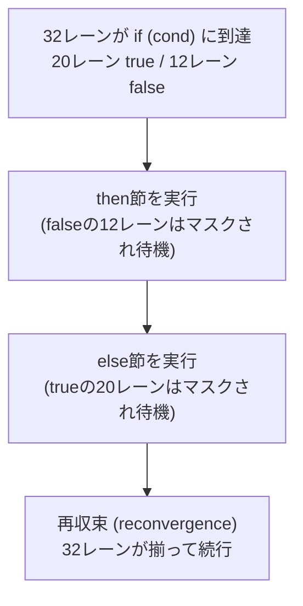

# GPU並列実行モデル — Warp / Wave / SIMT

## 概要

GPUはスレッドをWarp/Wave等の単位にまとめ、同じ命令をactiveなレーン群へ発行して高いスループットを得ます。NVIDIAのWarpは32本、AMDは世代・設定によりWave32/64等を使います。NVIDIAのプログラミングモデルではこれを **SIMT (Single Instruction, Multiple Threads)** と呼びます。制御状態とスケジューリングの詳細はGPU世代ごとに異なります。このページはWikiの中でも最重要級です — 分岐コスト、メモリコアレッシング、Occupancy、Wave命令という**シェーダ性能のほぼ全ての謎**がここで解けます。

## なぜ必要なのか

- 「ifを書くと遅い」「隣のスレッドと連続アドレスを読め」— 経験則の**理由**がすべてこのモデルにある
- SM6.0のWave Intrinsics、VulkanのSubgroup操作は、このハードウェア構造を直接叩く最速の道具
- Mesh Shader、Naniteのようなモダン技術のコードはWave命令だらけ — 読めなければ最先端を追えない

## 歴史・誕生した背景

- 起源は1960-80年代のSIMDマシン (ILLIAC IV, Connection Machine) とベクトル計算機 (Cray)
- 2006: G80で「スカラースレッドの束としてプログラムし、ハードウェアがSIMD実行する」**SIMTモデル**をNVIDIAが確立。CUDAと共に用語Warpが定着 (織機の「縦糸」から)
- AMDはGCN (2012) でWave64、RDNA (2019) でWave32へ — Waveという用語はAMD/HLSL系
- 2016-18: 明示的なWave/Subgroup命令がAPI標準化 (SM6.0, Vulkan 1.1) — それまで暗黙だった実行モデルがプログラマに公開された
- NVIDIA Volta (2017) 以降: Independent Thread Scheduling — threadごとのPC・call stack等を保持し、active thread群をSIMT実行へまとめる。分岐のコストは残り、暗黙のwarp同期を前提にしたコードは見直しが必要

## それ以前の技術

明示的SIMD (SSE/AVX): プログラマが16バイト幅のレジスタを意識して書く。SIMTは「スカラーコードを書けばハードが束ねる」ことで生産性を確保した点が革新でした。

## 解決した課題

スカラープログラミングモデルと、SIMDハードウェアの効率の両立。制御フロー (分岐・ループ) を持つ一般的なコードを、マスク実行により「そのまま」SIMD実行できるようにしました。

## 現在の位置づけ

全GPUの共通実行モデルです。Wave幅の違い (32/64、Intelは8-32可変) があるため、**移植性のあるコードはWave幅を決め打ちしない** (`WaveGetLaneCount()` を使う) のが鉄則です。

## 内部動作

### SIMT実行と分岐ダイバージェンス

NVIDIAのVolta以前はWarpで一つのPCとactive maskを共有していました。Volta以降はthreadごとの制御状態を持つため、「全GPUが常にWarp単位で一つのPCを共有する」とは説明できません。それでも同じ命令をactiveなレーン群へ発行する効率が重要です。以下は `if` の行き先が割れた場合の典型的なマスク実行を示す概念図で、実際の再収束順や時刻の保証ではありません:



- 行き先の異なるレーン群をマスクしながら複数パスを実行すると、演算器の利用効率が下がる。増加率はパス長・最適化・命令/メモリ負荷によるため、一律に2倍ではない
- Warp内で同じ側へ進むuniformな分岐はダイバージェンスによる損失を避けられるが、分岐命令自体のコストまで常に0という意味ではない
- データをソートして同じ処理のスレッドを固める、マテリアルごとにディスパッチを分ける等が定石

### メモリコアレッシング

Warpの32レーンが同時に発行するメモリアクセスは、ハードウェアが**キャッシュライン単位のトランザクションに束ね**ます:

| アクセスパターン | トランザクション数 | 効率 |
|---|---|---|
| レーンiが `data[base + i]` (連続) | 1〜4回 | ◎ 理想 |
| レーンiが `data[base + i * 64]` (ストライド) | 32回 | ✕ 帯域32倍浪費 |
| ランダム | 最大32回 | ✕ |

**AoS→SoA変換**が効く理由がこれです: `struct{float3 pos; float3 vel;}` の配列でposだけ読むと、velがキャッシュラインを汚染します。

### Occupancy とレイテンシ隠蔽

SMは多数のWarpを常駐させ、ストールしたWarpから実行可能なWarpへゼロコストで切り替えます → [GPUアーキテクチャ](/hardware/gpu/architecture.html)

$$\text{Occupancy} = \frac{\text{常駐Warp数}}{\text{最大常駐Warp数}}$$

制限要因: スレッドあたり**レジスタ数**、グループあたり**共有メモリ**、グループサイズ。Occupancyが低い=メモリレイテンシを隠せない=ALUが遊ぶ。ただし**高ければ良いわけでもない** (キャッシュ圧迫)。プロファイラ ([Nsight/PIX](/graphics/optimization/tools.html)) で計測して判断します。

### Wave Intrinsics (SM6.0 / Vulkan Subgroup)

Wave/Subgroup命令は、命令に参加するactiveなレーン間でレジスタ値の集約・交換等を行います。shared memoryを経由しないための仕組みであり、shared/global memoryへの書込みの可視性や別のthread群との実行同期まで保証するものではありません。CUDAなら必要に応じて `__syncwarp(mask)` や同期版intrinsicを使い、HLSL/GLSLでも各APIの参加レーンとmemory barrierの規則を守ります:

| 分類 | HLSL (SM6.0) | GLSL (Subgroup) | 動作 |
|---|---|---|---|
| 問い合わせ | `WaveGetLaneIndex()` | `gl_SubgroupInvocationID` | 自分のレーン番号 |
| 投票 | `WaveActiveAnyTrue(b)` | `subgroupAny(b)` | 誰かがtrueか |
| 集約 | `WaveActiveSum(x)` | `subgroupAdd(x)` | 参加するactiveレーンの合計 |
| スキャン | `WavePrefixSum(x)` | `subgroupExclusiveAdd(x)` | 前方レーンの累積 |
| 放送 | `WaveReadLaneFirst(x)` | `subgroupBroadcastFirst(x)` | 参加する最初のactiveレーンの値を参加レーンへ |
| ビット | `WaveActiveBallot(b)` | `subgroupBallot(b)` | 各レーンの真偽をビットマスクに |

**用途**: Reductionの高速化、アトミックの集約 (Wave内で合計してから1回だけAtomic)、コンパクション (可視リスト詰め)、ソフトウェアラスタライザ — 現代GPUコードの必須語彙です。

## 各環境での扱い

### Unity
HLSLでSM6.0が使えるターゲット (DX12/Vulkan/Metal + `#pragma use_dxc` 系設定) でWave命令が利用可能。プラットフォームごとのWave幅差 (モバイル=32/64混在) に注意。

### Unreal Engine
`COMPUTESHADER` のUSFでWaveOps使用可 (`FDataDrivenShaderPlatformInfo` で対応判定)。NaniteのSWラスタライザはWave命令の教科書的活用例です。

### DirectX 12
SM6.0 Wave Intrinsics。`D3D12_FEATURE_DATA_D3D12_OPTIONS1::WaveLaneCountMin/Max` で幅を取得。SM6.6で `WaveSize` 指定属性も。

### Vulkan
Subgroup操作 (Vulkan 1.1コア)。`VkPhysicalDeviceSubgroupProperties` でサイズと対応ステージを取得。`VK_EXT_subgroup_size_control` で幅の明示制御。

## コード例

Wave命令によるストリームコンパクション (可視オブジェクトの詰め込み):

```hlsl
RWStructuredBuffer<uint> gVisibleIndices : register(u0);
RWStructuredBuffer<uint> gCounter : register(u1);

[numthreads(64, 1, 1)]
void CullCS(uint3 id : SV_DispatchThreadID)
{
    bool visible = (id.x < gCount) && FrustumTest(gObjects[id.x]);

    // Wave内で「自分より前の可視レーン数」= 書き込みオフセット
    uint localOffset = WavePrefixCountBits(visible);
    uint waveTotal   = WaveActiveCountBits(visible);

    // Waveの先頭レーンだけがAtomicでグローバル位置を確保 (Atomic回数 1/32)
    uint waveBase;
    if (WaveIsFirstLane())
        InterlockedAdd(gCounter[0], waveTotal, waveBase);
    waveBase = WaveReadLaneFirst(waveBase);

    if (visible)
        gVisibleIndices[waveBase + localOffset] = id.x;
}
```

ダイバージェンスの良い例・悪い例:

```hlsl
// 悪い: レーンごとにランダムに割れる分岐
if (materials[id.x].type == GLASS) ShadeGlass();   // Warp内で混在
else                               ShadeOpaque();  // → 両方直列実行

// 良い: 事前にマテリアル別にソート/ビニングしてディスパッチを分ける
// (Warp内が同一マテリアル → 分岐が実質無料になる)
```

## 前提知識

- [GPUアーキテクチャ詳解](/hardware/gpu/architecture.html)
- [Compute Shader](/graphics/compute/compute-shader.html)

## 次に読むべきページ

- [Shared Memory と Atomic](/graphics/compute/shared-memory.html)
- [並列アルゴリズム (Reduction/Scan)](/graphics/compute/parallel-algorithms.html)
- [GPU最適化の基礎](/graphics/optimization/basics.html)

## 理解度チェック

1. **「分岐はGPUで遅い」という通説を、正確な表現に直せ。**
   ::: details 解答
   遅いのは「Warp/Wave内でレーンの行き先が割れる分岐」。全レーンが同じ側に進む分岐(uniform分岐、例えば定数バッファの値による分岐)はほぼコストがない。割れた場合は両パスがマスク付きで直列実行され、実効スループットが低下する。
   :::

2. **AoSからSoAへの変換がGPUで効果的な理由をコアレッシングの観点から説明せよ。**
   ::: details 解答
   Warpの隣接レーンは通常、隣接インデックスの要素を処理する。SoAならレーン群のposアクセスがメモリ上で連続し、1〜数回のキャッシュライントランザクションに束ねられる。AoSでは各レーンのposの間にvel等が挟まりストライドアクセスとなり、必要データ以外でキャッシュライン帯域を浪費する。
   :::

3. **Wave集約つきAtomic (コード例) が素朴な全レーンAtomicより速い理由は。**
   ::: details 解答
   同一アドレスへのAtomicは直列化されるため、64レーンが個別に発行すると64回の直列操作になる。Wave内でPrefixCountBits/CountBitsにより合計と各自のオフセットをレジスタ内で計算し、代表レーン1回のAtomicで領域を確保すれば、直列化コストがWave幅分の1になる。
   :::

## 参考資料

- NVIDIA, *CUDA C++ Programming Guide* — SIMT Architecture章 (最良の一次資料)
- Kayvon Fatahalian, *"How a GPU works"* 講義 (CMU/Stanford)
- Microsoft, *HLSL Wave Intrinsics* 仕様 / Khronos, *Subgroup tutorial*
- AMD GPUOpen, *RDNA Performance Guide*
- [NVIDIA CUDA C++ Programming Guide 13.0: SIMT Architecture](https://docs.nvidia.com/cuda/archive/13.0.0/cuda-c-programming-guide/index.html#simt-architecture)
