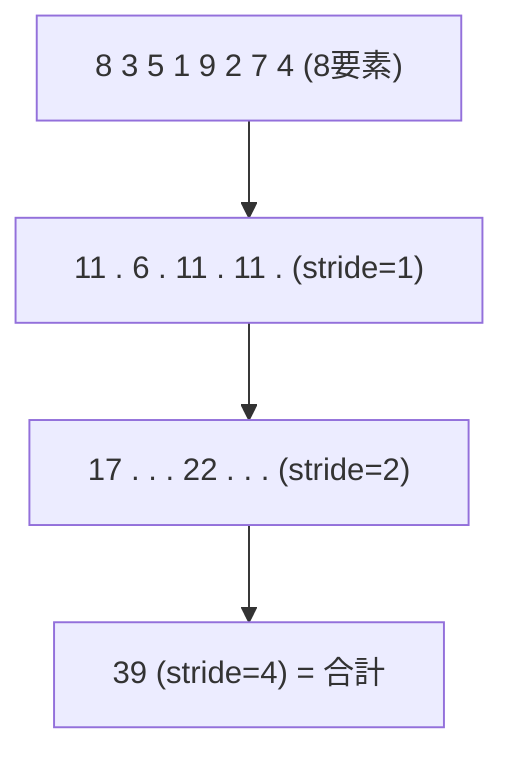

# 並列アルゴリズム — Reduction / Prefix Sum (Scan)

## 概要

逐次なら自明なループ (合計を取る、累積和を作る) は、数千スレッドのGPUでは**専用の並列アルゴリズム**になります。代表が **Reduction** (集約: 合計・最大値など) と **Prefix Sum / Scan** (累積和) です。特にScanは「並列プログラミングの万能部品」であり、コンパクション・ソート・パーティクル管理・GPU Drivenの可視リスト構築など、あらゆる場面の裏で動いています。

## なぜ必要なのか

- `for (i) sum += a[i]` は逐次依存の塊 — 並列化には**構造の変換**が必要
- 「N個から可視なものだけ詰めた配列を作る」(コンパクション) はGPU Drivenレンダリングの心臓部で、その実装はScanそのもの
- 自動露出 (平均輝度)、ヒストグラム、Bloom縮小、SAT、Radixソート — レンダラーの至る所に登場する

## 歴史・誕生した背景

- 理論は古い: Scanの並列アルゴリズムは Blelloch (1990) が体系化。「Prefix Sums and Their Applications」は必読古典
- 回路的起源: 桁上げ先読み加算器 (carry-lookahead adder) は本質的にScan
- 2007: Mark Harris の *"Optimizing Parallel Reduction in CUDA"* がGPU実装の教科書に
- 2010年代: CUB/Thrust (CUDA) がライブラリ化。グラフィックス側でもDX11世代からライトカリング・パーティクルで常用
- 現在: **Wave命令によりWave幅の部分はハードウェア1命令** (`WavePrefixSum`) になり、実装は簡潔化。single-pass scan (decoupled look-back) などの発展形も定着

## それ以前の技術

CPUへの読み戻し (Readback) による集計。GPU→CPU転送は同期ストールを起こすため、フレーム内で完結する処理には使えませんでした。

## 解決した課題

O(N)の逐次依存を **O(log N) 段の並列ステップ**に変換し、GPU内で完結させました。

## 現在の位置づけ

レンダリングエンジニアの基礎教養です。フルスクラッチ実装の機会は減りました (Wave命令+定型パターンで済む) が、構造を理解していないとGPU Drivenパイプラインの設計もデバッグもできません。

## 内部動作

### Reduction (並列集約)

木構造で半分ずつ畳みます — N要素を log₂N ステップで:



実装の要点:
1. 各グループがタイルをSharedに載せ、グループ内で木状に集約
2. グループごとの部分和をバッファへ書き出し
3. 部分和の配列をもう一度Reduction (要素数が1グループに収まるまで再帰)
4. 現代は最内段を `WaveActiveSum` に置き換えてバリア回数を削減

### Prefix Sum / Scan

入力 $[a_0, a_1, a_2, ...]$ に対し:
- **Exclusive scan**: $[0,\; a_0,\; a_0{+}a_1,\; a_0{+}a_1{+}a_2, ...]$ (自分を含まない)
- **Inclusive scan**: $[a_0,\; a_0{+}a_1,\; a_0{+}a_1{+}a_2, ...]$

**なぜ万能か**: 「各要素が可変個の出力を持つとき、自分の書き込み開始位置は『自分より前の全要素の出力数の合計』」— これがExclusive Scanです。

```text
コンパクション (可視要素の詰め込み):
  flags:   [1, 0, 1, 1, 0, 1]   (可視=1)
  exscan:  [0, 1, 1, 2, 3, 3]   (書き込み先インデックス!)
  出力:    要素0→slot0, 要素2→slot1, 要素3→slot2, 要素5→slot3
```

### Blellochの2フェーズ (work-efficient scan)

グループ内Scanの古典実装。**Up-sweep** (Reductionと同じ木で部分和を作る) → **Down-sweep** (根に0を置いて木を降りながら交換・加算) の2段で、加算回数 O(N) を保ちます。

### マルチグループへの拡張

1. 各グループ内でScan
2. グループ合計の配列を (別ディスパッチで) Scan
3. 各グループの要素に「自グループより前の総和」を加算

3ディスパッチ構成が基本形。1パスで済ませる **decoupled look-back** (Merrill & Garland 2016) が高速実装の現在形です。

## 各環境での扱い

### Unity
GPU Resident Drawer・VFX GraphのカリングがこのパターンをC++/Compute内部で使用。ユーザーレベルでは `GraphicsBuffer` + 自作Computeで実装します。

### Unreal Engine
Niagaraのパーティクルコンパクション、Naniteのクラスタカリング、`FGPUSort` (Radixソート実装) など、エンジン内に実装が多数。`WaveOps` 対応プラットフォームでは高速経路が選ばれます。

### DirectX 12
`WavePrefixSum` / `WaveActiveSum` (SM6.0) が最内段の標準部品。DirectX-Graphics-SamplesのnBodyやMiniEngineに実例。

### Vulkan
`subgroupExclusiveAdd` 等。Vulkan-Samplesや各種オープンソースレンダラー (Granite等) に実装例があります。

## コード例

Wave命令を使ったモダンなグループ内Exclusive Scan (HLSL SM6.0):

```hlsl
// 256要素のグループ内exclusive scan (Wave幅非依存)
groupshared uint sWaveSums[8];   // 256/32 = 最大8 Wave

uint GroupExclusiveScan(uint value, uint gi) {
    uint laneScan  = WavePrefixSum(value);            // Wave内scan (1命令)
    uint waveId    = gi / WaveGetLaneCount();
    uint waveTotal = WaveActiveSum(value);

    if (WaveGetLaneIndex() == WaveGetLaneCount() - 1) // 各Waveの合計を記録
        sWaveSums[waveId] = laneScan + value;
    GroupMemoryBarrierWithGroupSync();

    // 先頭WaveがWave合計たちをscan (Wave数 <= Wave幅 前提)
    if (waveId == 0) {
        uint ws = (gi < 8) ? sWaveSums[gi] : 0;
        sWaveSums[gi] = WavePrefixSum(ws);
    }
    GroupMemoryBarrierWithGroupSync();

    return laneScan + sWaveSums[waveId];              // Wave内 + 前Wave分
}

// 利用例: 視錐台カリング済みインスタンスのコンパクション
[numthreads(256, 1, 1)]
void CompactCS(uint3 dtid : SV_DispatchThreadID, uint gi : SV_GroupIndex) {
    bool visible = TestVisible(dtid.x);
    uint offset  = GroupExclusiveScan(visible ? 1u : 0u, gi);
    if (visible)
        gVisible[gGroupBase + offset] = dtid.x;
}
```

Reduction: 平均輝度 (自動露出用) の骨格:

```hlsl
groupshared float sLum[64];

[numthreads(64, 1, 1)]
void LumReduceCS(uint gi : SV_GroupIndex, uint3 gid : SV_GroupID) {
    float lum = ComputeLuminance(LoadTile(gid, gi));  // 各自の担当分
    lum = WaveActiveSum(lum);                          // Wave内は1命令
    if (WaveIsFirstLane()) sLum[gi / WaveGetLaneCount()] = lum;
    GroupMemoryBarrierWithGroupSync();
    if (gi == 0) {
        float total = 0;
        for (uint i = 0; i < 64 / WaveGetLaneCount(); ++i) total += sLum[i];
        gPartialSums[gid.x] = total;                   // 次段のディスパッチへ
    }
}
```

## 前提知識

- [Compute Shader](/graphics/compute/compute-shader.html)
- [GPU並列実行モデル](/graphics/compute/execution-model.html), [Shared Memory と Atomic](/graphics/compute/shared-memory.html)

## 次に読むべきページ

- [GPU Driven Rendering](/graphics/optimization/gpu-driven.html) — Scanの最大の実戦場
- [CUDA と OpenCL](/graphics/compute/cuda-opencl.html)

## 理解度チェック

1. **Exclusive Scanが「並列プログラミングの万能部品」と呼ばれる理由を、メモリ割り当ての観点から説明せよ。**
   ::: details 解答
   並列処理で各スレッドが可変個の出力を持つとき、衝突しない書き込み位置の決定が本質的課題になる。各スレッドの出力数の配列にExclusive Scanをかけると「自分より前の出力総数」=自分の書き込み開始オフセットが全スレッド分一括で求まる。これはコンパクション、ソート、可変長リスト構築など、あらゆる並列出力問題の共通解になっている。
   :::

2. **Reductionで「グループ内はShared/Wave、グループ間は複数ディスパッチ」とする理由は。**
   ::: details 解答
   同期の可能な範囲が異なるため。グループ内はバリアとShared/Wave命令で協調できるが、グループ間には同期手段がない(実行順序も並行性も保証されない)。よってグループ間の集約はディスパッチ境界(すべてのグループの完了が保証される点)を挟んで次段に渡す。
   :::

3. **Atomicカウンタ (`InterlockedAdd`) によるコンパクションとScanベースのコンパクションの違いは何か。**
   ::: details 解答
   Atomic方式は実装が単純だが出力順序が非決定的(実行順依存)で、高競合時に直列化する。Scan方式は元の順序を保存した決定的な出力が得られ、競合もない。順序が必要な場合(描画順、再現性)はScan、順序不問で疎な出力ならWave集約付きAtomicが手軽、と使い分ける。
   :::

## 参考資料

- Guy Blelloch, *"Prefix Sums and Their Applications"* (1990) — 理論の原典
- Mark Harris, *"Optimizing Parallel Reduction in CUDA"* (2007)
- Merrill & Garland, *"Single-pass Parallel Prefix Scan with Decoupled Look-back"* (2016)
- NVIDIA CUB / Thrust ライブラリのソース
