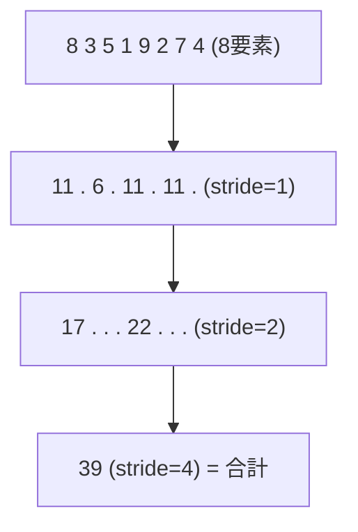

# 並列アルゴリズム — Reduction / Prefix Sum (Scan)

## 概要

逐次なら自明なループ (合計を取る、累積和を作る) は、数千スレッドのGPUでは**専用の並列アルゴリズム**になります。代表が **Reduction** (集約: 合計・最大値など) と **Prefix Sum / Scan** (累積和) です。特にScanは「並列プログラミングの万能部品」であり、コンパクション・ソート・パーティクル管理・GPU Drivenの可視リスト構築など、あらゆる場面の裏で動いています。

## なぜ必要なのか

- `for (i) sum += a[i]` は逐次依存の塊 — 並列化には**構造の変換**が必要
- 「N個から可視なものだけ詰めた配列を作る」(コンパクション) はGPU Drivenレンダリングの心臓部で、その実装はScanそのもの
- 自動露出 (平均輝度)、ヒストグラム、Bloom縮小、SAT、Radixソート — レンダラーの至る所に登場する

## 歴史・誕生した背景

- 理論は古い: Scanの並列アルゴリズムは Blelloch (1990) が体系化。「Prefix Sums and Their Applications」は必読古典
- 回路的起源: 桁上げ先読み加算器 (carry-lookahead adder) は本質的にScan
- 2007: Mark Harris の *"Optimizing Parallel Reduction in CUDA"* がGPU実装の教科書に
- 2010年代: CUB/Thrust (CUDA) がライブラリ化。グラフィックス側でもDX11世代からライトカリング・パーティクルで常用
- 現在: **Wave命令（`WavePrefixSum`等）でWave内の集団演算を表現**でき、実装を簡潔にできる。対応する機械命令数はGPU・コンパイラーによる。single-pass scan（decoupled look-back）等の発展形もある

## それ以前の技術

CPUへの読み戻し (Readback) による集計。GPU→CPU転送は同期ストールを起こすため、フレーム内で完結する処理には使えませんでした。

## 解決した課題

O(N)の逐次依存を **O(log N) 段の並列ステップ**に変換し、GPU内で完結させました。

## 現在の位置づけ

レンダリングエンジニアの基礎教養です。フルスクラッチ実装の機会は減りました (Wave命令+定型パターンで済む) が、構造を理解していないとGPU Drivenパイプラインの設計もデバッグもできません。

## 内部動作

### Reduction (並列集約)

木構造で半分ずつ畳みます — N要素を log₂N ステップで:



実装の要点:
1. 各グループがタイルをSharedに載せ、グループ内で木状に集約
2. グループごとの部分和をバッファへ書き出し
3. 部分和の配列をもう一度Reduction (要素数が1グループに収まるまで再帰)
4. 現代は最内段を `WaveActiveSum` に置き換えてバリア回数を削減

### Prefix Sum / Scan

入力 $[a_0, a_1, a_2, ...]$ に対し:
- **Exclusive scan**: $[0,\; a_0,\; a_0{+}a_1,\; a_0{+}a_1{+}a_2, ...]$ (自分を含まない)
- **Inclusive scan**: $[a_0,\; a_0{+}a_1,\; a_0{+}a_1{+}a_2, ...]$

**なぜ万能か**: 「各要素が可変個の出力を持つとき、自分の書き込み開始位置は『自分より前の全要素の出力数の合計』」— これがExclusive Scanです。

```text
コンパクション (可視要素の詰め込み):
  flags:   [1, 0, 1, 1, 0, 1]   (可視=1)
  exscan:  [0, 1, 1, 2, 3, 3]   (書き込み先インデックス!)
  出力:    要素0→slot0, 要素2→slot1, 要素3→slot2, 要素5→slot3
```

### Blellochの2フェーズ (work-efficient scan)

グループ内Scanの古典実装。**Up-sweep** (Reductionと同じ木で部分和を作る) → **Down-sweep** (根に0を置いて木を降りながら交換・加算) の2段で、加算回数 O(N) を保ちます。

### マルチグループへの拡張

1. 各グループ内でScan
2. グループ合計の配列を (別ディスパッチで) Scan
3. 各グループの要素に「自グループより前の総和」を加算

3ディスパッチ構成が基本形です。各段の書き込みを次段から読めるよう、APIで必要なメモリ依存・バリアも指定します。1パスで済ませる **decoupled look-back**（Merrill & Garland 2016）は、グループ間でatomicと状態フラグを使って通信する発展形です。ただし、メモリ可視性と実行の前進を成立させる設計が必要で、任意のグループ間スピン待ちが安全になるわけではありません。

## 各環境での扱い

### Unity
GPU Resident Drawer・VFX GraphのカリングがこのパターンをC++/Compute内部で使用。ユーザーレベルでは `GraphicsBuffer` + 自作Computeで実装します。

### Unreal Engine
Niagaraのパーティクルコンパクション、Naniteのクラスタカリング、`FGPUSort` (Radixソート実装) など、エンジン内に実装が多数。`WaveOps` 対応プラットフォームでは高速経路が選ばれます。

### DirectX 12
`WavePrefixSum` / `WaveActiveSum` (SM6.0) が最内段の標準部品。DirectX-Graphics-SamplesのnBodyやMiniEngineに実例。

### Vulkan
`subgroupExclusiveAdd` 等。Vulkan-Samplesや各種オープンソースレンダラー (Granite等) に実装例があります。

## コード例

まず、Wave幅やWaveと`SV_GroupIndex`の対応に依存しない、256スレッド固定のBlelloch Exclusive Scanを示します。説明用の断片で、全スレッドが同じ回数バリアへ到達する必要があります。Wave命令による高速化を加える場合も、単に`gi / WaveGetLaneCount()`をWave IDとして使えると決めつけず、対象の実行モデルを確認します。

```hlsl
// 256要素のグループ内exclusive scan。uintの加算は32bit範囲内で使う
groupshared uint sScan[256];

uint GroupExclusiveScan(uint value, uint gi) {
    sScan[gi] = value;
    GroupMemoryBarrierWithGroupSync();

    // Up-sweep: 各部分木の和
    for (uint upStride = 1; upStride < 256; upStride <<= 1) {
        uint upIndex = (gi + 1) * (2 * upStride) - 1;
        if (upIndex < 256) sScan[upIndex] += sScan[upIndex - upStride];
        GroupMemoryBarrierWithGroupSync();
    }
    if (gi == 0) sScan[255] = 0; // Exclusive Scanの根
    GroupMemoryBarrierWithGroupSync();

    // Down-sweep: 左の和を保存し、親からprefixを配る
    for (uint downStride = 128; downStride > 0; downStride >>= 1) {
        uint downIndex = (gi + 1) * (2 * downStride) - 1;
        if (downIndex < 256) {
            uint leftSum = sScan[downIndex - downStride];
            sScan[downIndex - downStride] = sScan[downIndex];
            sScan[downIndex] += leftSum;
        }
        GroupMemoryBarrierWithGroupSync();
    }
    return sScan[gi];
}

// 利用例。gGroupBase[gid.x]は、各グループの総数を別段でscanした開始位置
[numthreads(256, 1, 1)]
void CompactCS(uint3 dtid : SV_DispatchThreadID, uint gi : SV_GroupIndex,
               uint3 gid : SV_GroupID) {
    bool visible = false;
    if (dtid.x < gInputCount) visible = TestVisible(dtid.x);
    // 範囲外スレッドも0を入力して、全員がバリアへ到達する
    uint offset  = GroupExclusiveScan(visible ? 1u : 0u, gi);
    if (visible)
        gVisible[gGroupBase[gid.x] + offset] = dtid.x;
}
```

Reduction: 平均輝度 (自動露出用) の骨格:

```hlsl
groupshared float sLum[64];

[numthreads(64, 1, 1)]
void LumReduceCS(uint gi : SV_GroupIndex, uint3 gid : SV_GroupID) {
    float lum = ComputeLuminance(LoadTile(gid, gi));  // 各自の担当分
    sLum[gi] = lum;
    GroupMemoryBarrierWithGroupSync();
    for (uint stride = 32; stride > 0; stride >>= 1) {
        if (gi < stride) sLum[gi] += sLum[gi + stride];
        GroupMemoryBarrierWithGroupSync();
    }
    if (gi == 0) gPartialSums[gid.x] = sLum[0]; // 次段へ。要素数は別に管理する
}
```

## 前提知識

- [Compute Shader](/graphics/compute/compute-shader.html)
- [GPU並列実行モデル](/graphics/compute/execution-model.html), [Shared Memory と Atomic](/graphics/compute/shared-memory.html)

## 次に読むべきページ

- [GPU Driven Rendering](/graphics/optimization/gpu-driven.html) — Scanの最大の実戦場
- [CUDA と OpenCL](/graphics/compute/cuda-opencl.html)

## 理解度チェック

1. **Exclusive Scanが「並列プログラミングの万能部品」と呼ばれる理由を、メモリ割り当ての観点から説明せよ。**
   ::: details 解答
   並列処理で各スレッドが可変個の出力を持つとき、衝突しない書き込み位置の決定が本質的課題になる。各スレッドの出力数の配列にExclusive Scanをかけると「自分より前の出力総数」=自分の書き込み開始オフセットが全スレッド分一括で求まる。これはコンパクション、ソート、可変長リスト構築など、あらゆる並列出力問題の共通解になっている。
   :::

2. **Reductionで「グループ内はShared/Wave、グループ間は複数ディスパッチ」とする理由は。**
   ::: details 解答
   同期の可能な範囲が異なるため。グループ内はバリアとShared/Wave命令で協調できるが、通常のdispatchに全グループのバリアや任意の前進保証はない。グループ間のatomic通信自体は可能でも、単純な相互待ちはデッドロックしうる。移植しやすい基本形はdispatchを分割し、必要なAPIのメモリ依存・バリアで前段の書き込みを次段へ渡す。decoupled look-backのような単一dispatch手法には、別途可視性と前進を成立させる設計が要る。
   :::

3. **Atomicカウンタ (`InterlockedAdd`) によるコンパクションとScanベースのコンパクションの違いは何か。**
   ::: details 解答
   Atomic方式は実装が単純だが出力順序が非決定的(実行順依存)で、高競合時に直列化する。Scan方式は元の順序を保存した決定的な出力が得られ、競合もない。順序が必要な場合(描画順、再現性)はScan、順序不問で疎な出力ならWave集約付きAtomicが手軽、と使い分ける。
   :::

## 参考資料

- Guy Blelloch, *"Prefix Sums and Their Applications"* (1990) — 理論の原典
- Mark Harris, *"Optimizing Parallel Reduction in CUDA"* (2007)
- Merrill & Garland, *"Single-pass Parallel Prefix Scan with Decoupled Look-back"* (2016)
- NVIDIA CUB / Thrust ライブラリのソース
- [Blelloch: Prefix Sums and Their Applications](https://www.cs.cmu.edu/~guyb/papers/Ble93.pdf)
- [Merrill & Garland: Single-pass Parallel Prefix Scan with Decoupled Look-back](https://research.nvidia.com/publication/2016-03_single-pass-parallel-prefix-scan-decoupled-look-back)
- [Microsoft: HLSL Wave Intrinsics](https://github.com/microsoft/DirectXShaderCompiler/wiki/Wave-Intrinsics)
- [Microsoft: Waveとgroup indexの対応を仮定しない (SM6.10の解説)](https://devblogs.microsoft.com/directx/shader-model-6-10-agilitysdk-720-preview/)
