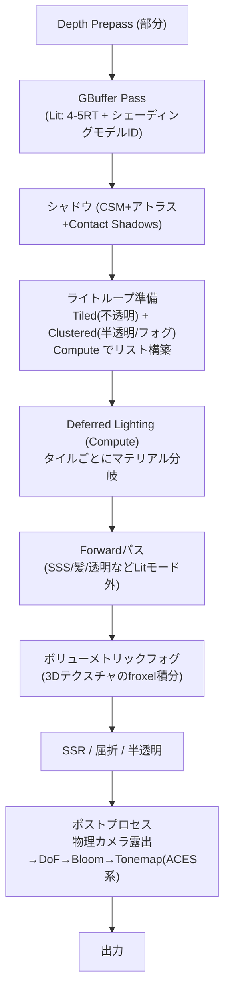

# HDRP (High Definition Render Pipeline)

## 概要

HDRPは**ハイエンドPC・コンソール・映像制作向けのUnity公式レンダーパイプライン**です。物理単位のライティング (lux/lumen/EV)、Tiled/Clusteredハイブリッドのライトループ、SSGI/RTGI・パストレーサ、水面・雲・ボリューメトリックフォグなど、AAA級の機能セットを持ちます。「Unityで到達できる最高画質」であると同時に、**現代のDeferred系AAAレンダラーの標準構成を学べる教材**でもあります。

## なぜ必要なのか

- URPではカバーしない領域 — 物理ライティング単位・高度なマテリアル (SSS/異方性/虹彩)・RT機能群・映像品質 — の受け皿
- コンソール/PC専用タイトルや映像 (Unity発のシネマティック) の制作基盤
- 「物理ベースのカメラ・露出・ライト単位で絵を組み立てる」ワークフローの学習

## 歴史・誕生した背景

- 2018: SRPと同時に発表・プレビュー (Sébastien Lagarde ら — *Moving Frostbite to PBR* の著者がリード)。Frostbiteの物理ベースワークフローの思想が濃く流入
- 2019-20: 正式化、RT機能 (DXR) 統合
- 2021-23: 水系・雲 (Volumetric Clouds)・パストレーサ・APVなど大型機能の追加
- 現在: URPとのコア共通化 (RenderGraph/Volume) が進み、将来的統合構想の中で「ハイエンド機能群」としての位置づけ

## それ以前の技術

ビルトインRPのDeferred+PostProcessing Stack v2という寄せ集め構成。物理単位もなく、ハイエンド表現はアセットストア頼みでした。

## 解決した課題

1. 物理ライティングユニットとカメラ露出の一貫システム (実測値でシーンを組める)
2. AAA級機能 (SSR/SSGI/RT/ボリューメトリクス/高度マテリアル) の標準搭載
3. Lit Shader Mode (Deferred/Forward) の切替による品質・性能の選択

## 現在の位置づけ

ハイエンド専用 (モバイル非対応)。採用は映像・シミュレータ・PC/コンソールタイトル。学習面では「HDRPの機能名 = 本Wikiの各技術ページ」がほぼ1対1対応するため、**このWikiの総復習としてHDRPの設定画面を読む**ことができます。

## 内部動作

### フレーム構造 (Deferredモード)



### 特徴的なサブシステム

| システム | 内容 | 対応するWikiページ |
|---|---|---|
| 物理ライト単位 | Lumen/Lux/Candela/EV100、露出は物理カメラ準拠 | [ポストプロセス](/graphics/postprocess/overview.html) |
| ライトループ | FPTL (不透明) + Clustered (体積/半透明) | [Forward+/Clustered](/graphics/path/forward-plus.html) |
| マテリアル | Lit/Layered/StackLit/SSS/Hair/Fabric/Eye | [PBR](/graphics/lighting/pbr.html) |
| APV | プローブボリュームの自動配置GI | [IBL](/graphics/lighting/ibl.html) / [GI](/graphics/lighting/gi.html) |
| SSGI / RTGI / RTAO / RTR | スクリーンスペース〜DXRのGI/反射群 | [SSR](/graphics/lighting/ssr.html), [レイトレーシング](/graphics/lighting/raytracing.html) |
| Path Tracer | 参照品質のプログレッシブPT | [パストレーシング](/graphics/lighting/path-tracing.html) |
| Volumetric Fog | froxelベースの散乱積分 | — |

### HDRPのDeferredの工夫

- G-Bufferにシェーディングモデルビットを持ち、**タイル単位でマテリアル種別ごとのCompute分岐** (分岐の均一化 → [実行モデル](/graphics/compute/execution-model.html) の教科書的応用)
- ライトループはFPTL (Fine Pruned Tiled Lighting) — タイルごとの精密プルーニング
- デカール (DBuffer)、Distortionなど専用バッファ群が絡む本格構成

## 各環境での扱い

### Unity
本体。要求スペックが高い (Compute必須、DX12/Vulkan/Metal/コンソール)。プロジェクト設定は HDRP Asset + HDRP Global Settings + Volume の3層。

### Unreal Engine
思想的な対応物はUE標準レンダラーそのもの (Deferred+物理単位+RT+シネマティック志向)。HDRPは「UnityにおけるUE型レンダラー」と要約できます。機能比較では Lumen/Nanite 相当が (現時点で) HDRPに無い点が最大の差です。

### DirectX 12
RT機能群 (RTGI/RTR/RTAO/PT) はDX12+DXR必須。非同期コンピュートもDX12/コンソールで有効化されます。

### Vulkan
対応バックエンドの一つ (LinuxビルドやSteamDeck向け)。RT系はVK_KHR_ray_tracing対応GPUで動作します。

## コード例

物理ライティングでのシーン設定 (C#):

```csharp
// 太陽: 130,000 lux (晴天の実測値)
var sun = sunLight.GetComponent<HDAdditionalLightData>();
sun.SetIntensity(130000f, LightUnit.Lux);
sun.EnableColorTemperature(true);
sun.colorTemperature = 5800f;   // ケルビン

// 露出をカメラ実機の感覚で (Volumeプロファイル)
var exposure = profile.Add<Exposure>();
exposure.mode.Override(ExposureMode.Automatic);
exposure.limitMin.Override(10f);   // EV100: 屋外晴天〜
exposure.limitMax.Override(15f);
```

Custom Pass (HDRPの拡張機構):

```csharp
class OutlinePass : CustomPass {
    public LayerMask outlineLayer;
    public Material outlineMaterial;

    protected override void Execute(CustomPassContext ctx) {
        // 指定レイヤをオーバーライドマテリアルで描き直す
        CustomPassUtils.DrawRenderers(ctx, outlineLayer,
            overrideMaterial: outlineMaterial);
    }
}
// Volume上の Custom Pass Volume コンポーネントに登録し、
// 挿入位置 (Before/After Post Process等) を選ぶ
```

## 前提知識

- [Unity のレンダラーと SRP](/graphics/engine/unity-renderer.html), [URP](/graphics/engine/urp.html)
- [Deferred](/graphics/path/deferred.html), [PBR](/graphics/lighting/pbr.html)

## 次に読むべきページ

- [Unreal Engineのレンダラー](/graphics/engine/unreal-renderer.html) — 思想的対応物との比較
- [パストレーシング](/graphics/lighting/path-tracing.html), [レイトレーシング](/graphics/lighting/raytracing.html)

## 理解度チェック

1. **HDRPが物理ライティング単位を採用した実務上の利点を2つ挙げよ。**
   ::: details 解答
   (1)実世界の測光値(晴天13万lux、室内300lux等)や撮影機材の値(EV、ISO)をそのまま入力でき、リファレンス(実写・物理法則)と照合可能な一貫した絵作りができる。(2)露出が物理カメラモデルで管理されるため、明るさの調整が「ライトの強さのいじり合い」ではなく露出制御に一元化され、HDRパイプライン全体(Bloom閾値、フォグ濃度等)が破綻しない。
   :::

2. **HDRPが不透明にTiled、半透明・フォグにClusteredを使い分ける理由は。**
   ::: details 解答
   不透明は深度バッファが確定しているためタイルの深度範囲による精密なプルーニング(FPTL)が可能で最速。半透明やボリューメトリックフォグは任意の深度の空間でライトを引く必要があり、深度バッファに依存しないClustered構造が必要。両者を併設して各対象に最適な構造を使う。[Forward+のページ](/graphics/path/forward-plus.html)の理論の商用実装形。
   :::

3. **URPとHDRPの選択基準を、機能でなくプロジェクト特性で述べよ。**
   ::: details 解答
   対象ハードの下限(モバイル/Quest/Switchを含むならURP一択)、絵作りの目標(実写照合・物理単位・シネマティックならHDRP)、チームの技術予算(HDRPは設定・プロファイリングの学習コストが高い)。中間的なPC向けスタイライズド作品はURP+拡張が近年の主流。
   :::

## 参考資料

- Unity, *HDRP ドキュメント* / HDRPパッケージソース
- SIGGRAPH 2018-, Sébastien Lagarde らのHDRP講演 (*"The Road toward Unified Rendering"* 等)
- Lagarde & de Rousiers, *"Moving Frostbite to PBR"* — HDRPの思想的源流
