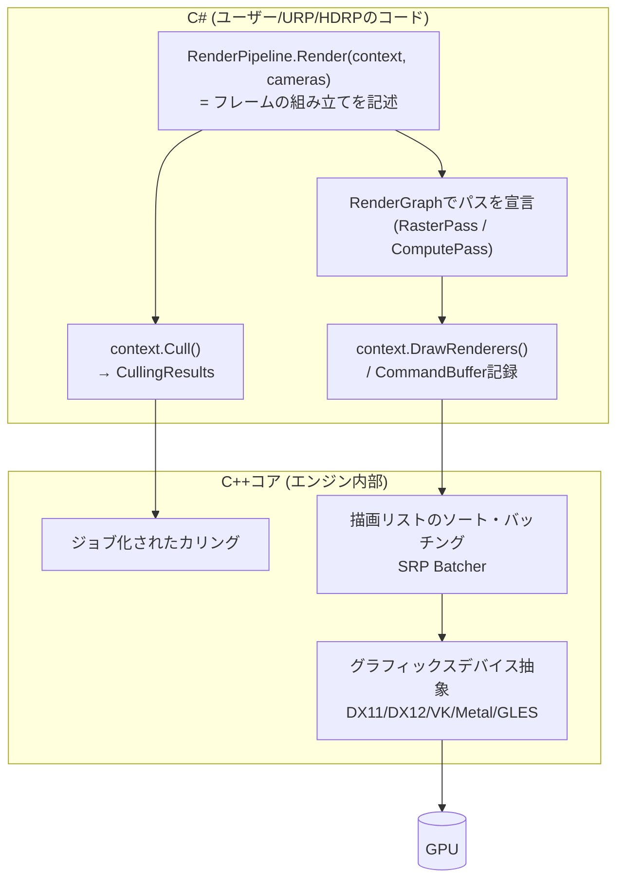

# Unity のレンダラーと SRP

## 概要

Unityのレンダリングは、**SRP (Scriptable Render Pipeline)** — 「レンダーパイプラインの構成をC#で記述する」アーキテクチャ — を土台に、その上の2つの公式実装 **[URP](/graphics/engine/urp.html)** (幅広い機種) と **[HDRP](/graphics/engine/hdrp.html)** (ハイエンド) で構成されます。このページではSRPの仕組みと、C#からGPUまでの道のり (カリング→描画リスト→CommandBuffer→グラフィックスAPI) を解説します。

## なぜ必要なのか

- Unityユーザーとして: 「なぜURPとHDRPがあるのか」「ビルトインRPと何が違うのか」を理解しないと最適化もカスタムもできない
- エンジン開発の視点: SRPは「エンジンのレンダラーをユーザーに開放する」設計の代表例で、レンダラーアーキテクチャの教材として優れている

## 歴史・誕生した背景

- 〜2017: **ビルトインRP** — C++内部に固定されたパイプライン (Forward/Deferred)。カスタムはコールバックとコマンドバッファ注入のみで、根本的な変更は不可能だった
- モバイルからハイエンドまで単一パイプラインで賄う矛盾が限界に
- **2018: SRP発表** (Unity 2018.1) — カリングとバッチ描画はC++の高速コアが担い、「パスの構成」をC#に開放する分離設計
- 2018-19: LWRP (軽量) → **URP** に改名、**HDRP** 登場
- 2019-22: SRP Batcher、Shader Graph、VFX Graphなど周辺整備。「ビルトインからの移行」の長い過渡期
- 2024: Unity 6.0 / URP 17.0 — **RenderGraphを標準化**。Render Graphを無効にするCompatibility Modeもあり、必須ではない。新しい描画機能にはRenderGraph APIが推奨される。GPU Resident Drawer、STPも導入

## それ以前の技術

ビルトインRP。`Camera.onPreRender` 等のイベントフックと `CommandBuffer.AddCommandBuffer` によるパッチ的カスタムが限界でした。

## 解決した課題

1. プロジェクトの要求 (モバイル2D〜映像品質) ごとに最適なパイプラインを選択/自作可能に
2. パイプラインコードがC#として読める・デバッグできる — ブラックボックスの解消
3. SRP Batcherによる「マテリアルごとの定数バッファ常駐化」でセットパスコールを削減

## 現在の位置づけ

新規プロジェクトはURPが既定。SRPコア (`com.unity.render-pipelines.core`) はRenderGraph・Volume・シェーダライブラリを提供する共通基盤で、URP/HDRPはその上のアプリケーションです。完全自作SRPも可能ですが、実務では「URPを拡張する」のが主流です。

## 内部動作

### 全体アーキテクチャ



役割分担が明確です: **「何をどの順で描くか」= C#、「速く描く」= C++**。`ScriptableRenderContext` がその境界のAPIで、`Submit()` で初めて実行されます。

### SRP Batcher

マテリアルのプロパティをGPU常駐の定数バッファ (`UnityPerMaterial`) に保持し、**同一シェーダバリアントならマテリアルが違ってもステート切替を最小化**する仕組み。シェーダ側の対応 (CBUFFER_START/END でプロパティを囲む) が必要です。「ドローコール数」より「セットパスコール数」を削る、という視点の転換が重要です。

### カメラとVolume

- カメラごとに `UniversalAdditionalCameraData` (URP) 等の拡張データ
- **Volumeシステム**: ポストプロセスや環境設定を空間ブレンド (SRPコア共通)

### シェーダとバリアント

- ShaderLabコンテナ+HLSL → [HLSL](/graphics/shader/hlsl.html)
- `multi_compile` / `shader_feature` によるバリアント。ビルド肥大とロード時ヒッチの主因であり、Shader Stripping と Shader Variant Collection (プリウォーム) が実務の重要トピック → PSOコンパイル問題のUnity版 ([SPIR-V](/graphics/shader/spirv.html) 参照)

## 各環境での扱い

### Unity
本体です。学び方: URPパッケージのソース (`Packages/com.unity.render-pipelines.universal`) は全部C#で読めます — **UniversalRenderPipeline.cs → UniversalRenderer.cs → 各Passの順に読むのが最短の教材**。

### Unreal Engine
対応物は「RHI+レンダラーモジュール」ですがC++でありユーザー拡張の粒度が違います (UEは差し替えでなく改造)。SRPの「C#に開放」というアプローチはUnity独自です → [Unreal Engineのレンダラー](/graphics/engine/unreal-renderer.html)

### DirectX 12
Unityの下層で `Direct3D12` デバイスとして動作。SRPのCommandBufferは内部でDX12コマンドリストに変換されます。NativeRenderingPlugin APIで生のDX12リソースにアクセスも可能。

### Vulkan
同様にバックエンドの一つ。モバイルVulkanではRenderGraphがrenderpass/subpass統合 (タイルメモリ活用) を自動化します。

## コード例

最小のカスタムSRP (仕組みの理解用 — 実務はURP拡張を推奨):

```csharp
[CreateAssetMenu(menuName = "Rendering/MiniPipeline")]
public class MiniPipelineAsset : RenderPipelineAsset {
    protected override RenderPipeline CreatePipeline() => new MiniPipeline();
}

public class MiniPipeline : RenderPipeline {
    protected override void Render(ScriptableRenderContext ctx, Camera[] cameras) {
        foreach (var cam in cameras) {
            // 1. カリング (C++ジョブが走る)
            if (!cam.TryGetCullingParameters(out var cullParams)) continue;
            CullingResults cull = ctx.Cull(ref cullParams);

            // 2. カメラ定数のセットアップ
            ctx.SetupCameraProperties(cam);

            // 3. クリア
            var cmd = new CommandBuffer { name = "Clear" };
            cmd.ClearRenderTarget(true, true, Color.darkGray);
            ctx.ExecuteCommandBuffer(cmd);
            cmd.Release();

            // 4. 不透明の描画リストを発行
            var sorting = new SortingSettings(cam) { criteria = SortingCriteria.CommonOpaque };
            var drawing = new DrawingSettings(new ShaderTagId("SRPDefaultUnlit"), sorting);
            var filtering = new FilteringSettings(RenderQueueRange.opaque);
            ctx.DrawRenderers(cull, ref drawing, ref filtering);

            // 5. スカイボックスと提出
            if (cam.clearFlags == CameraClearFlags.Skybox) ctx.DrawSkybox(cam);
            ctx.Submit();   // ここで初めて実行される
        }
    }
}
```

SRP Batcher対応シェーダの要点:

```hlsl
// プロパティをUnityPerMaterialに揃える — これがSRP Batcher互換の条件
CBUFFER_START(UnityPerMaterial)
    float4 _BaseColor;
    float4 _BaseMap_ST;
    float  _Cutoff;
CBUFFER_END
```

## 前提知識

- [CPUとGPUの役割分担](/hardware/gpu/cpu-vs-gpu.html), [パイプライン全体像](/graphics/pipeline/overview.html)
- [レンダリング方式](/graphics/path/forward.html) の各ページ

## 次に読むべきページ

- [URP](/graphics/engine/urp.html) — 実務の主戦場
- [HDRP](/graphics/engine/hdrp.html)
- [RenderGraph](/graphics/optimization/render-graph.html) — Unity 6 URPの土台

## 理解度チェック

1. **SRPの「C#とC++の分担」の境界はどこにあり、なぜそこに引かれたか。**
   ::: details 解答
   「パイプラインの構成(何をどの順で、どのターゲットに描くか)」はC#、「性能クリティカルな内側ループ(カリング、ソート、バッチング、API呼び出し)」はC++。前者は柔軟性・可読性が価値でフレームあたりの実行回数が少なく、後者はオブジェクト数に比例するホットパスだから。DrawRenderersが「描画リスト一式の発行」という粗い粒度のAPIなのはこの境界設計の現れ。
   :::

2. **SRP Batcherは何を削減するのか。「ドローコールを減らす」と言うのはなぜ不正確か。**
   ::: details 解答
   削減するのはドロー間のステート変更・定数バッファ更新のCPUコスト(セットパスコール)。マテリアルごとの定数をGPU常駐CBufferに保持し、同一シェーダバリアント内ではバインド切替を最小にして連続ドローを高速化する。ドローコールの数自体は減らない(それを減らすのはインスタンシングやGPU Resident Drawerの仕事)。
   :::

3. **シェーダバリアントがUnityで問題になる仕組みと対策を述べよ。**
   ::: details 解答
   multi_compile/shader_featureの組み合わせ爆発でバリアント数が数万〜数百万になり、ビルド時間・ビルドサイズ・実行時の初回使用時コンパイル(PSO作成)によるヒッチを生む。対策: 不要キーワードのStripping(IPreprocessShadersやStrip設定)、shader_featureで未使用組み合わせをビルドから除外、Shader Variant Collection / Experimental.Rendering.PrewarmでのPSO事前ウォーム。
   :::

## 参考資料

- Unity公式, *SRP ドキュメント* / URPパッケージソースコード
- Catlike Coding, *"Custom SRP"* チュートリアルシリーズ — SRP自作の決定版教材
- Unity Blog, *SRP Batcher* 解説記事
- Unite/GDC の Unity グラフィックス講演各年
- [Unity 6.0: Compatibility Mode in URP](https://docs.unity.com/en-us/engine/6000.0/manual/render-pipelines/universal-render-pipeline/customizing-urp/compatibility-mode)
