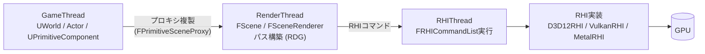
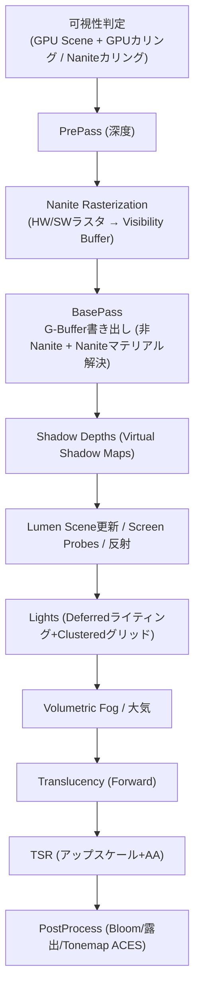

# Unreal Engine のレンダラー

## 概要

Unreal Engineのレンダラーは、**Deferred Shadingを基軸に、Nanite (仮想化ジオメトリ)・Lumen (動的GI)・Virtual Shadow Maps・TSRという「UE5四点セット」を統合した、現代最先端の商用レンダラー**です。アーキテクチャは GameThread → RenderThread → RHIThread の3段パイプラインと、RHI (API抽象) + RDG (レンダーグラフ) の階層で構成されます。ソースコードが読める商用AAAレンダラーとして、レンダリングエンジニアの最高の教材の一つです。

## なぜ必要なのか

- UEはAAA開発の事実上の共通基盤 — その描画の仕組みの理解は業界での共通言語
- Nanite/Lumenは「このWikiで学んだ全技術の統合実演」— 総復習の題材として最適
- エンジン改造 (カスタムパス、シェーディングモデル追加) にはレンダラー構造の知識が必須

## 歴史・誕生した背景

- 1998: UE1 (Unreal) — ソフトウェアレンダラ+Glide。Tim Sweeneyの設計
- 2002: UE2、2006: **UE3** — シェーダ世代。Gears of WarでDeferred系へ
- 2014: **UE4** — 物理ベースレンダリング標準化 (Karis 2013)、Blueprintとマーケットプレイスで民主化
- 2020: **UE5発表デモ** (Nanite/Lumen on PS5) — 業界に衝撃
- 2022: UE5.0正式版。以降 5.x で VSM/TSR/Nanite Tessellation/Substrate (次世代マテリアル) 等を継続追加
- The Matrix Awakens、Fortnite UE5化、多数のAAA採用へ

## それ以前の技術

UE4のレンダラー: 静的ライティング (Lightmass) + CSM + LOD階層 + TAA。UE5はこのうち「ジオメトリのLOD」「ライティングのベイク」「影のカスケード」「AAのTAA」をそれぞれ Nanite / Lumen / VSM / TSR で置き換えた、と整理できます。

## 解決した課題

1. **アセットのポリゴン予算の撤廃** (Nanite): 映画品質アセットの直接インポート
2. **ライティングのイテレーション** (Lumen): ベイク待ちゼロの動的GI
3. Naniteジオメトリに見合う影 (VSM) とアップスケーリング (TSR)
4. RHI/RDGによるマルチプラットフォーム (DX12/VK/Metal/コンソール) の吸収

## 現在の位置づけ

商用エンジンのレンダリング技術の先頭走者。Substrate (レイヤードマテリアル)、MegaLights (大量シャドウライト)、Nanite拡張 (スキン/植生) など進化が続いています。

## 内部動作

### スレッドとデータフロー



- **ゲーム状態とレンダリング状態の分離**が根幹: RenderThreadはActorに触れず、複製された `SceneProxy` だけを見る (1フレーム遅れの並走) → [CPUとGPUの役割分担](/hardware/gpu/cpu-vs-gpu.html)
- **RHI**: APIの抽象層。`FRHICommandList` に対する呼び出しが各APIへ変換される
- **RDG**: パスとリソースの依存グラフ → [RenderGraph](/graphics/optimization/render-graph.html)

### フレームの構造 (Deferred, UE5)



`ProfileGPU` コマンドやUnreal Insightsでこの構造がそのまま観察できます。

### UE5四点セットの相互依存

| 技術 | 依存関係 |
|---|---|
| **Nanite** | 高密度ジオメトリを可能に → VSMがその影を、Lumenがその簡略表現 (SDF/カード) を要求 |
| **VSM** | 16K仮想ページの影 — Naniteの高速深度ラスタライズが前提 |
| **Lumen** | SDF/Surface Cache (SW) or BVH (HW) — Naniteとは別のシーン表現を併走 |
| **TSR** | 全体の性能予算を成立させるアップスケーラ |

「ジオメトリ・影・GI・AAは独立に置換できない」— システムとしての統合設計が最大の学びです。

### シェーダとマテリアル

- `.usf/.ush` (HLSL)。マテリアルエディタのグラフ → HLSL生成 → **Vertex Factory** (メッシュ種別) × **Shading Model** の組み合わせでバリアント化
- グローバルシェーダは `FGlobalShader` +C++登録。エンジン改造の入口
- Substrate (実験的): マテリアルをスラブの積層として再定義する次世代システム

## 各環境での扱い

### Unity
対応物はSRP+URP/HDRPですが、「エンジン本体をユーザーが差し替える」Unityと「単一の最先端実装を提供し改造は本体で」のUEという思想の違いがあります。Nanite/Lumen相当の統合はUnity側の未踏領域。

### Unreal Engine
本体。学習リソース: ソース (`Engine/Source/Runtime/Renderer/`)、公式の *Graphics Programming* ドキュメント、`ShaderPrint`/`VisualizeTexture` などの内蔵デバッグ機能。

### DirectX 12
既定RHI (Windows)。SM6必須化 (UE5.2+) はNanite/Lumenの要件。バインドレスやWork Graphs等の新機能もD3D12RHIから採用されます。

### Vulkan
Linux/Android/SteamDeckのRHI。機能パリティはDX12にやや遅行しますが、Nanite/LumenはVulkanでも動作します (プラットフォーム要件あり)。

## コード例

グローバルシェーダの追加 (エンジン拡張の定石、C++):

```cpp
// 1. シェーダクラス宣言
class FMyComputeCS : public FGlobalShader {
    DECLARE_GLOBAL_SHADER(FMyComputeCS);
    SHADER_USE_PARAMETER_STRUCT(FMyComputeCS, FGlobalShader);
    BEGIN_SHADER_PARAMETER_STRUCT(FParameters, )
        SHADER_PARAMETER_RDG_TEXTURE_SRV(Texture2D, InputTexture)
        SHADER_PARAMETER_RDG_TEXTURE_UAV(RWTexture2D<float4>, OutputTexture)
        SHADER_PARAMETER(FVector2f, InvSize)
    END_SHADER_PARAMETER_STRUCT()
};
IMPLEMENT_GLOBAL_SHADER(FMyComputeCS,
    "/MyPlugin/MyCompute.usf", "MainCS", SF_Compute);

// 2. RDGパスとして実行 (SceneViewExtension等から)
void AddMyPass(FRDGBuilder& GraphBuilder, const FSceneView& View,
               FRDGTextureRef SceneColor)
{
    FRDGTextureRef Output = GraphBuilder.CreateTexture(
        SceneColor->Desc, TEXT("MyOutput"));

    auto* Params = GraphBuilder.AllocParameters<FMyComputeCS::FParameters>();
    Params->InputTexture  = GraphBuilder.CreateSRV(SceneColor);
    Params->OutputTexture = GraphBuilder.CreateUAV(Output);

    TShaderMapRef<FMyComputeCS> Shader(GetGlobalShaderMap(View.FeatureLevel));
    FComputeShaderUtils::AddPass(GraphBuilder,
        RDG_EVENT_NAME("MyEffect"), Shader, Params,
        FComputeShaderUtils::GetGroupCount(
            SceneColor->Desc.Extent, 8));
}
```

観察コマンド集 (実物で学ぶ):

```text
stat unit / stat gpu        … スレッド別・パス別時間
ProfileGPU                  … 詳細なGPUパス分解
vis SceneDepthZ / vis GBufferA … 中間バッファの可視化
show VisualizeLumenScene    … Lumenの内部シーン表現を見る
r.Nanite.Visualize Overdraw … Naniteの統計可視化
freezerendering             … カリング結果を固定してカメラだけ動かす
```

## 前提知識

- [Deferred](/graphics/path/deferred.html), [Lumen](/graphics/lighting/lumen.html), [GPU Driven Rendering](/graphics/optimization/gpu-driven.html)
- [RenderGraph](/graphics/optimization/render-graph.html), [シャドウ](/graphics/lighting/shadow.html)

## 次に読むべきページ

- [最終章: ゼロからレンダラーを作る](/graphics/capstone/01-design.html) — 学んだ構造を自分の手で
- [Mesh Shader](/graphics/pipeline/mesh-shader.html), [TAA](/graphics/postprocess/taa.html) — 四点セットの構成技術

## 理解度チェック

1. **GameThreadとRenderThreadの間で「プロキシ複製」を行う設計の理由を述べよ。**
   ::: details 解答
   両スレッドは並走しており(RenderThreadは1フレーム前を描画)、Actorの状態をRenderThreadが直接読むと、ゲームロジックによる変更と競合する。描画に必要な最小データをFPrimitiveSceneProxyとして複製・所有権分離することで、ロックなしの並列実行と「描画中にゲーム状態が変わっても安全」を保証する。エンジンのマルチスレッド設計の教科書的パターン。
   :::

2. **UE5四点セット (Nanite/Lumen/VSM/TSR) が「セット」でなければならない理由を1つの因果連鎖で説明せよ。**
   ::: details 解答
   映画品質アセット(数百万ポリゴン)を使いたい→従来LODでは無理なのでNanite→その密度のジオメトリにライトマップUVとベイクは非現実的なので動的GIのLumen→高密度ジオメトリの精細な影はCSM解像度では破綻するのでVSM→これら全部のGPUコストはネイティブ4Kでは払えないのでTSRで内部解像度を下げる。1つの要求(ジオメトリ密度)が影・GI・AAの全面刷新を連鎖的に要求した。
   :::

3. **RHIとRDGの役割の違いを述べよ。**
   ::: details 解答
   RHIは「単一APIコールの抽象」— DX12/Vulkan/Metal等の差を関数レベルで吸収する移植層。RDGは「フレーム構造の抽象」— パス間の依存・リソース生存期間・バリアをグラフとして管理する設計層。RDGはRHIの上に構築され、レンダラーコードはRDGに対して書かれる。
   :::

## 参考資料

- Epic, *Unreal Engine Graphics Programming* 公式ドキュメント / エンジンソース
- SIGGRAPH 2021-22, *Nanite / Lumen Deep Dive* 講演
- 各所の *"UE5 Rendering Pipeline"* 解析記事 (毛星云のRendering解析等)
- Unreal Fest / GDC の Epic 講演各年
