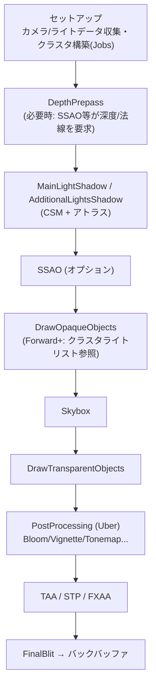

# URP (Universal Render Pipeline)

## 概要

URPは**Unityの標準レンダーパイプライン**で、モバイルからPC・コンソールまでを単一のスケーラブルな設計でカバーします。Unity 6.0 / URP 17.0ではForward / **Forward+** / Deferredを選択でき、**RenderGraphが標準**です。Render Graphを無効にするCompatibility Modeもあります。Deferred+等の選択肢は後続バージョンで増えているため、使用するUnity/URPの版を確認してください。「読めるサイズの本格レンダラー」としてソースコードの教材価値も高い実装です。

## なぜ必要なのか

- Unity新規プロジェクトの既定 — 実務でUnityを使うなら避けて通れない
- ビルトインRPの後継として、SRP Batcher・Volume・Shader Graph等の現代機能の前提
- カスタムパス (`ScriptableRenderPass`) でレンダラー拡張を学ぶ入口として最適

## 歴史・誕生した背景

- 2018: **LWRP (Lightweight RP)** として登場 — 当初は「モバイル向け軽量版」
- 2019: **URPに改名** — 「軽量版」でなく「ビルトインRPの後継の汎用パイプライン」への路線変更
- 2020-22: Deferredパス追加 (2021)、**Forward+** 追加 (2022) でper-objectライト上限を撤廃（per-camera上限は残る）
- 2024 (Unity 6.0 / URP 17.0): **RenderGraphを標準化**。Compatibility Modeで従来経路も利用可能だが、Unityは新しい描画機能にはRenderGraph APIを推奨。GPU Resident Drawer / GPU Occlusion Culling、STPも導入
- 後続のUnity 6世代ではDeferred+等も追加。Unity 6.0と後続版の機能を混同しない

## それ以前の技術

ビルトインRP (Forward/レガシーDeferred)。→ [Unity のレンダラーと SRP](/graphics/engine/unity-renderer.html)

## 解決した課題

1. モバイル〜PCの単一パイプライン化 (ビルトインの機能玉石混交を整理)
2. Forwardのper-objectライト上限 (Forward+で撤廃。per-camera上限は別に存在)
3. パイプラインのC#ソース公開による拡張性・学習性

## 現在の位置づけ

Unityの主流。HDRPとの関係は「別物の2本」から「共通コア (RenderGraph/Volume/シェーダライブラリ) の上の2実装」へ収斂しつつあり、将来的な統合が示唆されています (Unified Renderer構想)。

## 内部動作

### フレームの構造 (Forward+ の場合)



RenderDocやFrame Debuggerでこのパス列がそのまま見えます — **実物で確認しながら読むのが最良の学習法**です。

### 主要クラス地図 (ソースを読む人向け)

| クラス | 役割 |
|---|---|
| `UniversalRenderPipeline` | エントリ。カメラループと `RenderSingleCamera` |
| `UniversalRenderer` | パスの構成本体 (旧ForwardRenderer) |
| `ScriptableRenderPass` | パスの基底クラス — カスタムの単位 |
| `ScriptableRendererFeature` | パスをレンダラーに注入するアセット |
| `UniversalRenderPipelineAsset` | 品質・機能設定 (シャドウ解像度、レンダリングパス等) |

### ライティング

- Main Light (1本のディレクショナル) + Additional Lights という2階建て
- **Forward+**: 画面タイル+Zビン方式のクラスタライトカリング ([Forward+](/graphics/path/forward-plus.html) の実装形)。Forwardのper-objectライト上限はなくなるが、カメラで可視なライト数等の実装上限は残る（Unity 6.0公式資料ではdesktopのForward+上限は256）。shadow設定や対象platformの制約も別に確認する
- シェーダ側: `Lighting.hlsl` の `UniversalFragmentPBR()` が標準ライティングの入口

### 拡張の作法

1. **Renderer Feature + ScriptableRenderPass**: パス注入の方法。RenderGraph経路では `RecordRenderGraph` を実装し、Compatibility Modeの従来APIとは区別する
2. Shader Graph / カスタムHLSL: マテリアルレベル
3. `RenderPipelineManager` のコールバック: 軽量なフック

## 各環境での扱い

### Unity
本体。設定はURP Asset+Renderer Assetの2階層 (「品質」と「パス構成」の分離)。

### Unreal Engine
規模感の対応物はモバイルレンダラー+デスクトップレンダラーの単一コードベースですが、UEはユーザーがパイプラインを差し替える設計ではありません。

### DirectX 12
UnityのDX12バックエンドで動作。Unity 6のGPU Resident DrawerはDX12/Vulkan/Metalで最良のパフォーマンスパスを持ちます。

### Vulkan
モバイル (Android) の主要バックエンド。RenderGraphによるNative RenderPass統合 (subpass融合) でTBDRのタイルメモリを活用します。

## コード例

Unity 6.0 / URP 17のRenderGraph経路での説明用断片（using・material shader・適切なintermediate colorの設定等は省略）:

```csharp
public class TintFeature : ScriptableRendererFeature {
    class TintPass : ScriptableRenderPass {
        Material m_Material;
        public TintPass(Material mat) {
            m_Material = mat;
            renderPassEvent = RenderPassEvent.BeforeRenderingPostProcessing;
        }

        class PassData { public TextureHandle src; public Material mat; }

        public override void RecordRenderGraph(RenderGraph rg,
                                               ContextContainer frameData) {
            var res = frameData.Get<UniversalResourceData>();

            // 一時ターゲットに書いてから差し替える (in-place不可のため)
            var desc = rg.GetTextureDesc(res.activeColorTexture);
            desc.name = "TintTarget";
            var dest = rg.CreateTexture(desc);

            using var builder = rg.AddRasterRenderPass<PassData>("Tint", out var data);
            data.src = res.activeColorTexture;
            data.mat = m_Material;
            builder.UseTexture(data.src);
            builder.SetRenderAttachment(dest, 0);
            builder.SetRenderFunc((PassData d, RasterGraphContext ctx) =>
                Blitter.BlitTexture(ctx.cmd, d.src, Vector2.one, d.mat, 0));

            res.cameraColor = dest;   // 以降のパスは新ターゲットを使う
        }
    }

    public Material material;
    TintPass m_Pass;
    public override void Create() => m_Pass = new TintPass(material);
    public override void AddRenderPasses(ScriptableRenderer r,
                                         ref RenderingData d) => r.EnqueuePass(m_Pass);
}
```

## 前提知識

- [Unity のレンダラーと SRP](/graphics/engine/unity-renderer.html)
- [Forward+](/graphics/path/forward-plus.html), [RenderGraph](/graphics/optimization/render-graph.html)

## 次に読むべきページ

- [HDRP](/graphics/engine/hdrp.html) — もう一つの公式SRP
- [ポストプロセス](/graphics/postprocess/overview.html) — Volumeシステムの中身
- [GPU Driven Rendering](/graphics/optimization/gpu-driven.html) — GPU Resident Drawerの背景

## 理解度チェック

1. **URPが「LWRP」から改名された背景にある設計方針の転換は。**
   ::: details 解答
   当初はビルトインRPと併存する「モバイル向け軽量版」だったが、2本柱の保守コストと機能分裂の問題から、「全プラットフォームをスケーラブルにカバーするビルトインの後継」へ位置づけを変更した。名前の変更は「軽量=機能減」ではなく「Universal=既定」への戦略転換の表明。
   :::

2. **URPのForward+はビルトインForwardの何を解決したか。**
   ::: details 解答
   URP Forwardはオブジェクトごとに影響ライトを選ぶため、per-object上限や選定の切替がある。Forward+はタイル/深度のライトリストを参照し、Forwardのper-object上限をなくして粒度を細かくする。ただしper-camera可視ライト数には上限があり、ライト数が無制限になるわけではない。ビルトインForwardとは設定・上限も別に確認する。
   :::

3. **カスタムパスで `res.cameraColor = dest` と差し替える設計の意味は。**
   ::: details 解答
   RenderGraphでは「現在のカメラカラー」が仮想ハンドルで表され、パスがin-placeで書き換えるのではなく、新しいターゲットに書いてハンドルを差し替える(ping-pong)。これによりグラフが依存関係を正確に把握でき、バリア・メモリエイリアシングの自動管理が成立する。
   :::

## 参考資料

- Unity, *URP ドキュメント* / パッケージソース (最重要教材)
- Catlike Coding *Custom SRP* — URPの内部構造理解の補助線
- Unity 6 の *RenderGraph* サンプル (Package Managerから導入可)
- [Unity 6.0: Compatibility Mode in URP](https://docs.unity.com/en-us/engine/6000.0/manual/render-pipelines/universal-render-pipeline/customizing-urp/compatibility-mode)
- [Unity 6.0: Forward and Forward+ rendering paths](https://docs.unity.com/en-us/engine/6000.0/manual/render-pipelines/universal-render-pipeline/introduction/urp-concepts/rendering-paths/forward-rendering-paths)
- [Unity 6.0: Forward+ limits](https://docs.unity.com/en-us/engine/6000.0/manual/render-pipelines/universal-render-pipeline/introduction/urp-concepts/rendering-paths/forward-plus-rendering-path-limitations)
- [Unity 6.3: Deferred and Deferred+ rendering paths](https://docs.unity.com/en-us/engine/6000.3/manual/render-pipelines/universal-render-pipeline/introduction/urp-concepts/rendering-paths/deferred-rendering-path)
