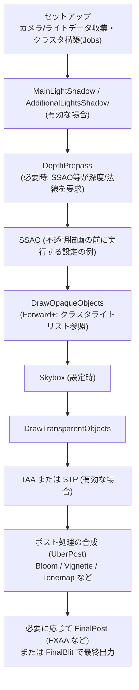

# URP (Universal Render Pipeline)

## 概要

URPは、モバイルからPCやコンソールまでを一つの設計でカバーする、Unityの標準レンダーパイプラインです。Unity 6.0 / URP 17.0ではForward、Forward+、Deferredを選択でき、RenderGraphを標準で使います。Render Graphを無効にするCompatibility Modeもあります。後続バージョンではDeferred+などの選択肢が増えているため、使用するUnityとURPの版を確認してください。ソースコードを読み通しやすく、実際に使われるレンダラーの構成を学ぶ題材にもなります。

## なぜ必要なのか

- Unity新規プロジェクトの既定 — 実務でUnityを使うなら避けて通れない
- ビルトインRPの後継として、SRP Batcher・Volume・Shader Graph等の現代機能の前提
- カスタムパス (`ScriptableRenderPass`) でレンダラー拡張を学ぶ入口として最適

## 歴史・誕生した背景

- 2018: **LWRP (Lightweight RP)** として登場 — 当初は「モバイル向け軽量版」
- 2019: **URPに改名** — 「軽量版」でなく「ビルトインRPの後継の汎用パイプライン」への路線変更
- 2020-22: Deferredパス追加 (2021)、**Forward+** 追加 (2022) でper-objectライト上限を撤廃（per-camera上限は残る）
- 2024 (Unity 6.0 / URP 17.0): **RenderGraphを標準化**。Compatibility Modeで従来経路も利用可能だが、Unityは新しい描画機能にはRenderGraph APIを推奨。GPU Resident Drawer / GPU Occlusion Culling、STPも導入
- 後続のUnity 6世代ではDeferred+等も追加。Unity 6.0と後続版の機能を混同しない

## それ以前の技術

ビルトインRP (Forward/レガシーDeferred)。→ [Unity のレンダラーと SRP](/graphics/engine/unity-renderer.html)

## 解決した課題

1. モバイル〜PCの単一パイプライン化 (ビルトインの機能玉石混交を整理)
2. Forwardのper-objectライト上限 (Forward+で撤廃。per-camera上限は別に存在)
3. パイプラインのC#ソース公開による拡張性・学習性

## 現在の位置づけ

Unityの2026年の公式方針では、URPの機能と対応範囲の拡充に開発を集中し、HDRPは安定性・回帰・重大問題を中心に保守します。Built-in RPはUnity 6.5から非推奨化する方針で、即時削除とは異なります。「将来すべてが同じレンダラーになる」と決めつけず、採用するUnity版と必要機能から選びます。

## 内部動作

### フレームの構造 (Forward+ の場合)



図は Unity 6.0 / URP 17.0 での代表的な流れです。影を描くパスはカメラの深度プリパスより先にあり、TAA または STP はポスト処理の合成より先に実行されます。SSAO を不透明描画の後に実行する設定もあります。パスの有無や統合結果は、カメラと Renderer の設定を変えて Render Graph Viewer や Frame Debugger で確認できます。[Unity 6.0 — Render Graph の分析](https://docs.unity3d.com/6000.0/Documentation/Manual/urp/render-graph-view.html) / [Unity Technologies — URP のパス記録](https://github.com/Unity-Technologies/Graphics/blob/6000.0/staging/Packages/com.unity.render-pipelines.universal/Runtime/UniversalRendererRenderGraph.cs) / [Unity Technologies — URP のポスト処理](https://github.com/Unity-Technologies/Graphics/blob/6000.0/staging/Packages/com.unity.render-pipelines.universal/Runtime/Passes/PostProcessPassRenderGraph.cs)

### 主要クラス地図 (ソースを読む人向け)

| クラス | 役割 |
|---|---|
| `UniversalRenderPipeline` | エントリ。カメラループと `RenderSingleCamera` |
| `UniversalRenderer` | パスの構成本体 (旧ForwardRenderer) |
| `ScriptableRenderPass` | パスの基底クラス — カスタムの単位 |
| `ScriptableRendererFeature` | パスをレンダラーに注入するアセット |
| `UniversalRenderPipelineAsset` | 品質・機能設定 (シャドウ解像度、レンダリングパス等) |

### ライティング

- Main Light (1本のディレクショナル) + Additional Lights という2階建て
- **Forward+**: 画面タイル+Zビン方式のクラスタライトカリング ([Forward+](/graphics/path/forward-plus.html) の実装形)。Forwardのper-objectライト上限はなくなるが、カメラで可視なライト数等の実装上限は残る（Unity 6.0公式資料ではdesktopのForward+上限は256）。shadow設定や対象platformの制約も別に確認する
- シェーダ側: `Lighting.hlsl` の `UniversalFragmentPBR()` が標準ライティングの入口

### 拡張の作法

1. **Renderer Feature + ScriptableRenderPass**: パス注入の方法。RenderGraph経路では `RecordRenderGraph` を実装し、Compatibility Modeの従来APIとは区別する
2. Shader Graph / カスタムHLSL: マテリアルレベル
3. `RenderPipelineManager` のコールバック: 軽量なフック

## 各環境での扱い

### Unity
本体。設定はURP Asset+Renderer Assetの2階層 (「品質」と「パス構成」の分離)。

### Unreal Engine
規模感の対応物はモバイルレンダラー+デスクトップレンダラーの単一コードベースですが、UEはユーザーがパイプラインを差し替える設計ではありません。

### DirectX 12
UnityのDX12バックエンドで動作。Unity 6のGPU Resident DrawerはDX12/Vulkan/Metalで最良のパフォーマンスパスを持ちます。

### Vulkan
モバイル (Android) の主要バックエンド。RenderGraphによるNative RenderPass統合 (subpass融合) でTBDRのタイルメモリを活用します。

## コード例

Unity 6.0 / URP 17.0 の RenderGraph 用 `TintFeature.cs` です。Universal Renderer Data の Renderer Feature に追加し、下の `StudyTint.shader` を使うマテリアルを割り当てます。`requiresIntermediateTexture` によって、Renderer の **Intermediate Texture** が **Auto** の場合も、現在のカメラ色をサンプリングできる中間テクスチャを要求します。描画先がバックバッファのままならパスを記録せずに戻ります。[Unity 6.0 — URP のブリットと色バッファの差し替え](https://docs.unity3d.com/6000.0/Documentation/Manual/urp/render-graph-optimize.html) / [URP 17.0 — ScriptableRenderPass.requiresIntermediateTexture](https://docs.unity3d.com/Packages/com.unity.render-pipelines.universal@17.0/api/UnityEngine.Rendering.Universal.ScriptableRenderPass.html#UnityEngine_Rendering_Universal_ScriptableRenderPass_requiresIntermediateTexture)

```csharp
using UnityEngine;
using UnityEngine.Rendering;
using UnityEngine.Rendering.RenderGraphModule;
using UnityEngine.Rendering.Universal;

public class TintFeature : ScriptableRendererFeature {
    class TintPass : ScriptableRenderPass {
        Material m_Material;
        public TintPass(Material mat) {
            m_Material = mat;
            renderPassEvent = RenderPassEvent.BeforeRenderingPostProcessing;
            requiresIntermediateTexture = true;
        }

        class PassData { public TextureHandle src; public Material mat; }

        public override void RecordRenderGraph(RenderGraph rg,
                                               ContextContainer frameData) {
            var res = frameData.Get<UniversalResourceData>();
            if (res.isActiveTargetBackBuffer) return;

            // 一時ターゲットに書いてから差し替える (in-place不可のため)
            var desc = rg.GetTextureDesc(res.activeColorTexture);
            desc.name = "TintTarget";
            desc.clearBuffer = false;
            desc.depthBufferBits = 0;
            var dest = rg.CreateTexture(desc);

            using var builder = rg.AddRasterRenderPass<PassData>("Tint", out var data);
            data.src = res.activeColorTexture;
            data.mat = m_Material;
            builder.UseTexture(data.src);
            builder.SetRenderAttachment(dest, 0);
            builder.SetRenderFunc((PassData d, RasterGraphContext ctx) =>
                Blitter.BlitTexture(ctx.cmd, d.src, new Vector4(1, 1, 0, 0), d.mat, 0));

            res.cameraColor = dest;   // 以降のパスは新ターゲットを使う
        }
    }

    public Material material;
    TintPass m_Pass;
    public override void Create() => m_Pass = new TintPass(material);
    public override void AddRenderPasses(ScriptableRenderer r,
                                         ref RenderingData d) {
        if (material != null) r.EnqueuePass(m_Pass);
    }
}
```

`StudyTint.shader` は元のカメラ色を `_BlitTexture` から読み、RGB にそれぞれ 0.5、1.0、0.25 を掛けます。出力先は `TintTarget` です。アルファは元の値を保持します。

```hlsl
Shader "Hidden/Study/Tint"
{
    SubShader
    {
        Tags { "RenderPipeline" = "UniversalPipeline" }
        Pass
        {
            ZTest Always
            ZWrite Off
            Cull Off

            HLSLPROGRAM
            #pragma vertex Vert
            #pragma fragment Frag
            #include "Packages/com.unity.render-pipelines.universal/ShaderLibrary/Core.hlsl"
            #include "Packages/com.unity.render-pipelines.core/Runtime/Utilities/Blit.hlsl"

            half4 Frag(Varyings input) : SV_Target
            {
                UNITY_SETUP_STEREO_EYE_INDEX_POST_VERTEX(input);
                half4 color = SAMPLE_TEXTURE2D_X(
                    _BlitTexture, sampler_LinearClamp, input.texcoord);
                color.rgb *= half3(0.5h, 1.0h, 0.25h);
                return color;
            }
            ENDHLSL
        }
    }
}
```

Unity 6000.0.85f1 / URP 17.0.4 の Forward レンダラーで、`Intermediate Texture` を `Auto` にし、カメラの Opaque Texture、Depth Texture、HDR、MSAA、ポスト処理を無効にして確認しました。白い背景を Direct3D 11 のリニアな 8 ビット出力から読み戻すと、Renderer Feature がオフのときの RGB は `(1.000, 1.000, 1.000)`、オンのときは `(0.498, 1.000, 0.251)` で、およそ `(0.5, 1.0, 0.25)` になりました。

## 前提知識

- [Unity のレンダラーと SRP](/graphics/engine/unity-renderer.html)
- [Forward+](/graphics/path/forward-plus.html), [RenderGraph](/graphics/optimization/render-graph.html)

## 次に読むべきページ

- [HDRP](/graphics/engine/hdrp.html) — もう一つの公式SRP
- [ポストプロセス](/graphics/postprocess/overview.html) — Volumeシステムの中身
- [GPU Driven Rendering](/graphics/optimization/gpu-driven.html) — GPU Resident Drawerの背景

## 理解度チェック

1. **URPが「LWRP」から改名された背景にある設計方針の転換は。**
   ::: details 解答
   当初はビルトインRPと併存する「モバイル向け軽量版」だったが、2本柱の保守コストと機能分裂の問題から、「全プラットフォームをスケーラブルにカバーするビルトインの後継」へ位置づけを変更した。名前の変更は「軽量=機能減」ではなく「Universal=既定」への戦略転換の表明。
   :::

2. **URPのForward+はビルトインForwardの何を解決したか。**
   ::: details 解答
   URP Forwardはオブジェクトごとに影響ライトを選ぶため、per-object上限や選定の切替がある。Forward+はタイル/深度のライトリストを参照し、Forwardのper-object上限をなくして粒度を細かくする。ただしper-camera可視ライト数には上限があり、ライト数が無制限になるわけではない。ビルトインForwardとは設定・上限も別に確認する。
   :::

3. **カスタムパスで `res.cameraColor = dest` と差し替える設計の意味は。**
   ::: details 解答
   `res.cameraColor = dest` は、後続パスが取得するカメラ色を `TintTarget` に切り替えます。RenderGraph が入出力の依存関係を把握するための宣言は、元の色を読む `UseTexture` と、出力へ書く `SetRenderAttachment` です。元の色を読みながら、結果は別のテクスチャへ書きます。
   :::

## 参考資料

- Unity, *URP ドキュメント* / パッケージソース (最重要教材)
- Catlike Coding *Custom SRP* — URPの内部構造理解の補助線
- Unity 6 の *RenderGraph* サンプル (Package Managerから導入可)
- [Unity 6.0: Compatibility Mode in URP](https://docs.unity.com/en-us/engine/6000.0/manual/render-pipelines/universal-render-pipeline/customizing-urp/compatibility-mode)
- [Unity 6.0: Forward and Forward+ rendering paths](https://docs.unity.com/en-us/engine/6000.0/manual/render-pipelines/universal-render-pipeline/introduction/urp-concepts/rendering-paths/forward-rendering-paths)
- [Unity 6.0: Forward+ limits](https://docs.unity.com/en-us/engine/6000.0/manual/render-pipelines/universal-render-pipeline/introduction/urp-concepts/rendering-paths/forward-plus-rendering-path-limitations)
- [Unity 6.3: Deferred and Deferred+ rendering paths](https://docs.unity.com/en-us/engine/6000.3/manual/render-pipelines/universal-render-pipeline/introduction/urp-concepts/rendering-paths/deferred-rendering-path)
- [Unity: Render Pipelines strategy for 2026](https://unity.com/topics/render-pipelines-strategy-for-2026)
