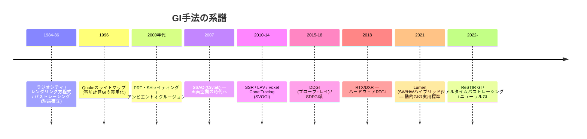
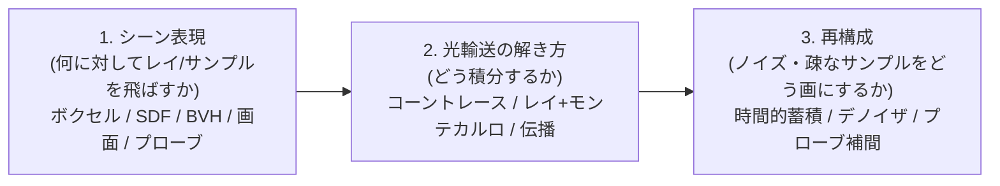

# グローバルイルミネーション総論

## 概要

グローバルイルミネーション (GI) は、**光が物体に反射して他の物体を照らす「間接光」まで含めた照明計算**の総称です。直接光のみのレンダリングは硬く不自然になり、GIこそが「フォトリアル」の正体です。このページはGI技術の系譜全体の地図であり、各手法 ([SSAO](/graphics/lighting/ssao.html)、[SSR](/graphics/lighting/ssr.html)、[レイトレーシング](/graphics/lighting/raytracing.html)、[パストレーシング](/graphics/lighting/path-tracing.html)、[Lumen](/graphics/lighting/lumen.html)) への入口です。

## なぜ必要なのか

- 現実の室内では、窓から入る光の大半は壁・床で反射した間接光として空間を満たす。直接光だけでは影が真っ黒になる
- 色にじみ (赤い壁の隣が赤く染まる)、コーナーの陰り、空からの青い照らされ — 「その場にある感」はすべて間接光
- レンダリング方程式 (下記) の完全解はリアルタイム不可能 — **どう近似するかの選択がレンダラーの個性**そのもの

## 歴史・誕生した背景 — GIの系譜

理論的原点は **Kajiya のレンダリング方程式 (1986)**:

$$L_o(\mathbf{x}, \omega_o) = L_e + \int_\Omega f_r(\mathbf{x}, \omega_i, \omega_o) \, L_i(\mathbf{x}, \omega_i) \, (\mathbf{n} \cdot \omega_i) \, d\omega_i$$

「ある点から出る光 = 自己発光 + 入ってくる全ての光の反射」。$L_i$ の中に再び $L_o$ が現れる再帰構造が、GIの難しさの正体です。



## それ以前の技術 → 各世代の課題と回答

### 第1世代: 事前計算 (ベイク)

| 手法 | 内容 | 限界 |
|---|---|---|
| **ライトマップ** | オフラインでGIを解きテクスチャに焼く (Quake 1996〜現在) | 静的シーン限定、UV作業、ビルド時間 |
| **ライトプローブ (SH)** | 空間点の入射光をSH係数で保存、動的物体が補間 | 低周波のみ、リーク |
| PRT | 遮蔽まで事前計算した転送関数 | 変形不可 |

**今も現役**: モバイル・Quest系VRではベイクが第一選択です。

### 第2世代: 画面空間 (Screen-Space)

G-Bufferと深度バッファ「画面に見えているもの」だけで近似:

- [SSAO](/graphics/lighting/ssao.html) (2007): 近傍遮蔽の暗さ
- [SSR](/graphics/lighting/ssr.html): 画面内の映り込み
- SSGI: 画面内の1バウンス拡散

**共通の限界**: 画面外・遮蔽された情報は存在しない → カメラを振ると破綻する

### 第3世代: シーン表現を別に持つ

- **LPV** (Crytek 2009): ライトをボクセル格子に注入して伝播
- **Voxel Cone Tracing / SVOGI** (Crassin 2011): ボクセル化したシーンをコーントレース
- **DDGI** (NVIDIA 2019): プローブグリッド+レイトレースの動的更新
- Distance Field (SDF) ベース: UEのDFAO等

### 第4世代: レイトレーシングとハイブリッド

- [ハードウェアRT](/graphics/lighting/raytracing.html) (2018〜): BVHに対する正確なレイ
- [Lumen](/graphics/lighting/lumen.html) (2021): SDF+Surface Cache+スクリーンスペース+HW RTの総力戦
- [リアルタイムパストレーシング](/graphics/lighting/path-tracing.html) (2022〜): ReSTIR+デノイザで統一的に解く

## 解決した課題 / 現在の位置づけ

現在の実務は**ハイブリッドの選択問題**です:

| プラットフォーム | 現実的な構成 |
|---|---|
| モバイル / Quest | ベイク (ライトマップ+プローブ) 一択に近い |
| コンソール / PC (中設定) | ベイク or Lumen SW / SSGI+プローブ |
| ハイエンドPC | Lumen HW / RTGI / パストレーシング |

**評価軸**: 動的対応 (時刻変化・破壊)、リーク耐性、遅延 (光の伝播が何フレーム遅れるか)、コスト、スケーラビリティ。

## 内部動作 — 共通の構成要素

あらゆる動的GIは次の3つの部品の組み合わせとして理解できます:



例: Lumen = (SDF+Surface Cache) × (レイ+Radiance Cache) × (時間的蓄積+スクリーンプローブ補間)。この分解フレームで新手法を読むと理解が速くなります。

### アンビエントオクルージョンという特殊ケース

AOは「環境光の可視性のみ」を解く簡易GIです: $AO = \frac{1}{\pi}\int_\Omega V(\omega)(\mathbf{n}\cdot\omega)d\omega$。安価に「隅の暗さ」を出せるため、フルGIの補助として今も全域で使われます → [SSAO](/graphics/lighting/ssao.html)

## 各環境での扱い

### Unity
ベイク: Progressive Lightmapper (GPU版あり) + Light Probes / APV。動的: SSAO (URP)、SSGI/RTGI (HDRP)。「Mixed Lighting」(ShadowmaskやSubtractive) がベイクと動的の折衷モードです。

### Unreal Engine
UE4: Lightmass (ベイク) + LPV/DFAO。**UE5: Lumenが既定** — ベイク不要の動的GIを標準化した歴史的転換。Lightmassも静的用に残存します。

### DirectX 12 / Vulkan
GIはAPIの上のアルゴリズム。DXR/VK RTがレイ系GIの、ComputeがSDF/ボクセル系の基盤です。

## コード例

もっとも単純な「1バウンス拡散GI」の概念コード (レイトレース、HLSL DXR風疑似コード):

```hlsl
// 各ピクセル: 法線半球からコサイン重点サンプリングで1レイ
float3 OneBounceGI(float3 posWS, float3 N, uint2 pixel, uint frame) {
    float2 xi = BlueNoise(pixel, frame);
    float3 dir = CosineSampleHemisphere(N, xi);       // 拡散BRDFの重点サンプル

    HitInfo hit = TraceRay(posWS + N * 0.01, dir);    // シーンにレイ
    if (!hit.valid)
        return SampleSky(dir);                        // 空に抜けた

    // ヒット面の直接光を評価 (=2バウンス目は打ち切り or キャッシュ参照)
    float3 hitRadiance = EvaluateDirectLight(hit.pos, hit.normal, hit.albedo);
    return hitRadiance;                               // コサイン項はサンプリングに内包
}
// このままでは1sppの激しいノイズ → 時間的蓄積+デノイザが必須 (再構成の部品)
```

この「1レイでは全くノイズだらけ→再構成で画にする」構造が、現代GIの共通の姿です。

## 前提知識

- [PBR](/graphics/lighting/pbr.html), [IBL](/graphics/lighting/ibl.html), [シャドウ](/graphics/lighting/shadow.html)

## 次に読むべきページ

- [SSAO](/graphics/lighting/ssao.html) → [SSR](/graphics/lighting/ssr.html) — 画面空間の2大技法
- [ハードウェアレイトレーシング](/graphics/lighting/raytracing.html)
- [パストレーシング](/graphics/lighting/path-tracing.html) → [Lumen](/graphics/lighting/lumen.html)

## 理解度チェック

1. **レンダリング方程式が「解けない」理由を、式の構造から説明せよ。**
   ::: details 解答
   出射輝度L_oを求めるには入射輝度L_iの半球積分が必要だが、L_iは他の点のL_oそのものであり、方程式が全空間の相互再帰(無限次元の積分方程式)になっている。解析解は自明なシーン以外で存在せず、数値的にもモンテカルロ(パストレーシング)等の確率的近似か、有限要素化(ラジオシティ)、あるいは打ち切り近似しかない。
   :::

2. **画面空間GI手法群の共通の限界と、それがユーザー体験にどう現れるかを述べよ。**
   ::: details 解答
   G-Buffer/深度に写っている表面の情報しか使えないため、画面外や遮蔽された物体からの反射・遮蔽・映り込みが計算できない。カメラを回すと画面から消えた物体の映り込みや間接光が急に消える、画面端で反射が途切れる、といった不安定さとして知覚される。
   :::

3. **「シーン表現・光輸送・再構成」の3分解で、ライトマップベイクを説明せよ。**
   ::: details 解答
   シーン表現=完全なオフラインシーン(制約なし)。光輸送=オフラインのパストレーシング等で完全解に近い積分。再構成=結果をテクスチャ(ライトマップ)とSHプローブに格納し、実行時は参照のみ。実行時コストほぼゼロと高品質を得る代わりに、シーンが静的であることと事前計算時間を差し出している。
   :::

## 参考資料

- Kajiya, *"The Rendering Equation"* (SIGGRAPH 1986)
- Ritschel et al., *"The State of the Art in Interactive Global Illumination"* (2012) — サーベイ
- SIGGRAPH Courses: *"Advances in Real-Time Rendering"* 各年 — 実務GIの最前線が集まる場
- PBR Book (pbrt) — オフライン側の理論の標準教科書 (無料公開)
