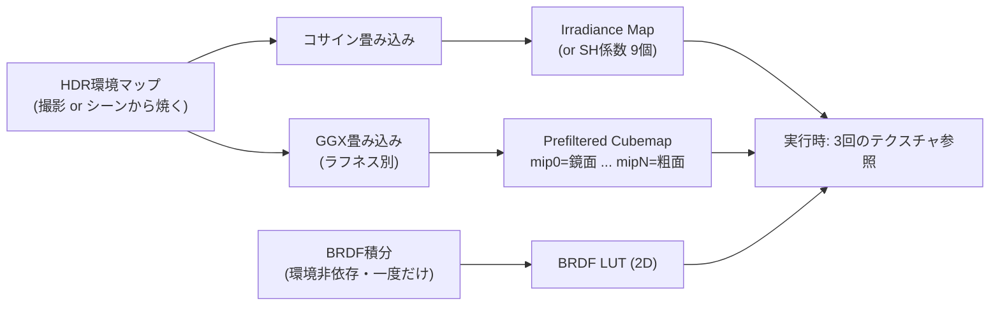

# IBL (イメージベースドライティング)

## 概要

IBL (Image-Based Lighting) は、**環境全体を撮影/描画した画像 (環境マップ) を光源として使う**技術です。PBRの反射率方程式のうち「環境光の積分」部分を、**事前畳み込み済みキューブマップ**で近似します。「解析ライト+IBL」が現代のリアルタイムライティングの基本形であり、PBRマテリアルが美しく見えるかどうかはIBLの品質で決まります。

## なぜ必要なのか

- 現実の物体は太陽だけでなく**空・地面・周囲の全てから**照らされている。この環境光なしのPBRは黒く沈んで見える
- 金属は環境の映り込みがなければ表現不可能 (拡散項がないため)
- レンダリング方程式の積分を毎ピクセル解くのは不可能 → 事前計算による近似が必要

## 歴史・誕生した背景

- 1976: Blinn & Newell の環境マッピング (反射の模様として)
- 1998: **Debevec の "Rendering Synthetic Objects into Real Scenes"** — HDR環境マップによる照明という概念の確立 (映画VFX発)
- 2001: Ramamoorthi & Hanrahan の **球面調和関数 (SH) による放射照度環境マップ** — 拡散IBLの理論的基盤
- 2000年代: ゲームでは低解像度キューブマップ+アドホックな利用
- **2013: Karis の split-sum approximation** (UE4) — スペキュラIBLの実用的事前畳み込み。リアルタイムPBRのIBLの標準形が確立
- 2010年代後半〜: ローカルリフレクションプローブ、パララックス補正、SHプローブグリッドが標準装備に

## それ以前の技術

定数アンビエント項 (`color += ambient * albedo`)。方向性がなく、陰影のない部分が平坦な単色になっていました。半球ライティング (空色/地面色の2色補間) が中間段階です。

## 解決した課題

1. 全方位からの環境光の方向性・色を持った照明
2. 金属・粗い表面・滑らかな表面それぞれの正しい環境反射
3. 実行時コストを「テクスチャ参照2〜3回」に固定

## 現在の位置づけ

全エンジンの標準機能。ただし静的な事前計算という本質的制約 (動的な遮蔽・動的なシーン変化に追従しない) があり、それを解決するのが [GI](/graphics/lighting/gi.html) や [レイトレーシング](/graphics/lighting/raytracing.html)、[Lumen](/graphics/lighting/lumen.html) の役割です。IBLは「GIの静的な近似」と位置づけられます。

## 内部動作

環境光の積分を **拡散 (Diffuse)** と **鏡面 (Specular)** に分けて事前計算します。

### 拡散IBL — Irradiance Map

$$L_d = \frac{albedo}{\pi} \int_\Omega L_i(\mathbf{l})(\mathbf{n}\cdot\mathbf{l}) \, d\mathbf{l} = albedo \cdot E(\mathbf{n})$$

放射照度 $E$ は**法線方向だけの関数**なので、環境マップをコサイン畳み込みした「Irradiance Map」(低解像度キューブマップ、または **SH 9係数**) を事前計算し、実行時は法線で1回参照するだけです。

### スペキュラIBL — Split-Sum近似 (Karis 2013)

$$\int_\Omega f_r L_i (\mathbf{n}\cdot\mathbf{l}) d\mathbf{l} \approx \underbrace{\left(\int_\Omega L_i \, d\mathbf{l}_{GGX}\right)}_{\text{Prefiltered Envmap}} \cdot \underbrace{\left(\int_\Omega f_r (\mathbf{n}\cdot\mathbf{l}) d\mathbf{l}\right)}_{\text{BRDF LUT}}$$

1. **Prefiltered Environment Map**: ラフネスごとにGGX分布で環境マップをぼかし、**ミップレベル=ラフネス**として格納
2. **BRDF LUT**: $(N \cdot V, roughness)$ を引数とする2Dテーブル (scale/biasの2値)。環境に依存しないため全シーン共通

実行時:

```hlsl
float3 R = reflect(-V, N);
float3 prefiltered = gEnvMap.SampleLevel(gLinear, R, roughness * MAX_MIP).rgb;
float2 brdf = gBrdfLUT.Sample(gLinearClamp, float2(NdotV, roughness)).rg;
float3 specularIBL = prefiltered * (F0 * brdf.x + brdf.y);
```

### 図解: IBLアセットの生成パイプライン



### ローカルプローブとブレンド

1枚のグローバルマップでは屋内外の差を表現できないため:

- **リフレクションプローブ**: シーン内の複数地点で焼いたキューブマップ。影響範囲でブレンド
- **パララックス補正**: プローブをボックス/球に投影して映り込み位置を補正
- **SHプローブ (Light Probe)**: 拡散IBLを空間に格子/グラフ状に配置し、動的オブジェクトが補間参照

## 各環境での扱い

### Unity
Skybox由来の環境ライティング (`Environment Lighting`)、**Reflection Probe** (ボックス投影対応)、**Light Probe Group** (SH、動的物体の拡散環境光)。URP/HDRPでは `GlossyEnvironmentReflection()` 等の実装が `ImageBasedLighting.hlsl` にあります。Adaptive Probe Volumes (APV) がプローブ配置を自動化する新システムです。

### Unreal Engine
**Sky Light** (環境キューブマップのキャプチャ)、**Reflection Capture** (Sphere/Box)、Lumen有効時はLumenが環境反射も引き継ぎます。BRDF LUTは `PreIntegratedGF` テクスチャとしてエンジンに内蔵。

### DirectX 12 / Vulkan
自前実装: 起動時にCompute Shaderで畳み込み (irradiance/prefilter/LUT生成) を行うのが定番。cmgen (Filament) や IBLBaker などのツールでオフライン生成も可能です。

## コード例

Prefiltered map生成 (importance sampling、Compute) の核心:

```hlsl
// GGX重点サンプリングによる環境マップ畳み込み
float3 PrefilterEnvMap(float roughness, float3 R) {
    float3 N = R, V = R;                  // 等方近似 (split-sumの仮定)
    float3 color = 0; float weight = 0;
    const uint SAMPLES = 1024;
    for (uint i = 0; i < SAMPLES; ++i) {
        float2 Xi = Hammersley(i, SAMPLES);          // 低食い違い列
        float3 H  = ImportanceSampleGGX(Xi, roughness, N);
        float3 L  = 2 * dot(V, H) * H - V;
        float NdotL = saturate(dot(N, L));
        if (NdotL > 0) {
            color  += gEnvMap.SampleLevel(gLinear, L, 0).rgb * NdotL;
            weight += NdotL;
        }
    }
    return color / max(weight, 1e-4);
}
```

実行時のIBL合成 (PBR本体との接続):

```hlsl
float3 EvaluateIBL(float3 N, float3 V, float3 baseColor,
                   float metallic, float roughness, float ao)
{
    float NdotV = saturate(dot(N, V));
    float3 F0 = lerp(0.04, baseColor, metallic);

    // 拡散: Irradiance map (or SH評価)
    float3 irradiance = gIrradianceMap.Sample(gLinear, N).rgb;
    float3 diffuse = irradiance * baseColor * (1.0 - metallic);

    // 鏡面: Prefiltered + LUT
    float3 R = reflect(-V, N);
    float3 pre = gPrefilteredMap.SampleLevel(gLinear, R, roughness * 4.0).rgb;
    float2 brdf = gBrdfLUT.Sample(gLinearClamp, float2(NdotV, roughness)).rg;
    float3 specular = pre * (F0 * brdf.x + brdf.y);

    return (diffuse + specular) * ao;
}
```

## 前提知識

- [PBR](/graphics/lighting/pbr.html) — BRDFの理解が前提
- [ベクトル](/math/rendering/vector.html)

## 次に読むべきページ

- [GI総論](/graphics/lighting/gi.html) — IBLの限界を超える動的GIへ
- [SSR](/graphics/lighting/ssr.html) — プローブ反射を画面空間で補完する技術
- [シャドウ](/graphics/lighting/shadow.html)

## 理解度チェック

1. **拡散IBLが「法線方向だけの関数」に事前計算できる理由を述べよ。**
   ::: details 解答
   Lambert拡散のBRDFは方向に依存しない定数(albedo/π)なので、積分はL_i(l)(n·l)の半球積分=放射照度E(n)となり、これは法線方向nのみで決まる。環境マップを事前にコサイン畳み込みしてE(n)をキューブマップやSH係数として保存すれば、実行時はnで1回参照するだけでよい。
   :::

2. **Split-Sum近似は何を「2つに分けた」のか。それにより何が事前計算可能になったか。**
   ::: details 解答
   環境光×BRDFの積の積分を、「環境光のGGX分布による畳み込み(Prefiltered map)」と「BRDF自体の積分(BRDF LUT)」の2つの積分の積で近似した。前者はラフネスごとのミップとして環境依存で焼け、後者は(NdotV, roughness)の2D関数として環境非依存で一度だけ焼ける。実行時コストがテクスチャ2参照に落ちる。
   :::

3. **リフレクションプローブの「パララックス補正」が必要な理由は。**
   ::: details 解答
   キューブマップは撮影点から無限遠の環境を仮定しており、そのまま反射ベクトルで参照すると、部屋の壁のような近距離の映り込みが視点・位置の移動に対して正しく動かない(常に無限遠にあるように見える)。プローブの影響範囲を近似するボックス/球と反射レイの交点を求め、その交点方向でキューブマップを引くことで近距離反射の視差を補正する。
   :::

## 参考資料

- Paul Debevec, *"Rendering Synthetic Objects into Real Scenes"* (SIGGRAPH 1998)
- Ramamoorthi & Hanrahan, *"An Efficient Representation for Irradiance Environment Maps"* (2001)
- Karis, *"Real Shading in UE4"* (2013) — split-sum
- LearnOpenGL *PBR/IBL* 章 — 実装チュートリアルの定番
- Google Filament ドキュメント — IBL数式の完全な導出
