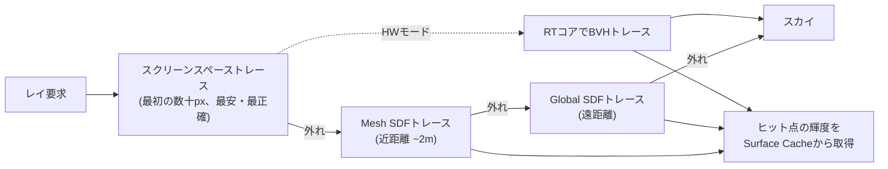

# Lumen

## 概要

Lumenは**UE5の完全動的グローバルイルミネーション&リフレクションシステム**です (2021)。ライトマップベイクを不要にし、時刻変化・破壊・動的ジオメトリに追従するGIを、ハイエンドだけでなくコンソール(30/60fps)でも動かすことを目標に設計されました。技術的には**単一の新技術ではなく、SDF・Surface Cache・スクリーンスペース・ハードウェアRT・プローブ階層の総力戦システム**であり、「実用的な動的GIはこう作る」の現時点での到達点です。

## なぜ必要なのか

- ライトマップは高品質だが、**制作イテレーションの敵** (ビルド待ち・UV作業・静的シーン限定)
- オープンワールド+時刻変化+破壊が標準要求になり、事前計算が破綻
- UE5のもう一つの柱Nanite (超高密度ジオメトリ) はライトマップUVと相性が悪く、動的GIが必須だった

## 歴史・誕生した背景

- UE4時代: Lightmass (ベイク) + 各種動的補助 (LPV、DFAO) の限界が明確化
- Epicは長年SDFベースの技術 (Distance Field AO/Shadows, 2014〜) を蓄積 — これがLumenの土壌
- **2020: UE5発表デモ "Lumen in the Land of Nanite"** — PS5実機でのNanite+Lumen初公開
- 2021: UE5 Early Access / **2022: UE5.0正式版** — Lumenが既定GIに
- 以降のバージョンで Hardware Ray Tracingモードの成熟、ヘアやTranslucency対応、性能改善が継続

## それ以前の技術

[GI総論](/graphics/lighting/gi.html) の全世代 — ライトマップ、SHプローブ、LPV、SVOGI (UE4初期に実装されたが出荷前に削除された経緯があり、その反省もLumenに繋がっています)、スクリーンスペースGI。

## 解決した課題

1. **ベイク工程の廃止** — アーティストがライトを動かした瞬間にGIが追従
2. 大規模シーンでの動的GI (階層的なシーン表現とキャッシュで償却)
3. ソフトウェア実装 (RTコア不要) とハードウェアRTの**両対応** — 幅広いハードで同一のアート

## 現在の位置づけ

UE5の既定GI/反射システムとしてAAAで広く出荷中 (Fortnite、Alan Wake 2ほか多数)。競合他エンジンにも同型の設計 (SDF/プローブ+RTハイブリッド) が波及しています。制約は半透明・高速移動物体・ミラー級の完全鏡面などで、そこはRT反射やパストレーシングが補完します。

## 内部動作 — 部品の分解

[GI総論](/graphics/lighting/gi.html) の「シーン表現 × 光輸送 × 再構成」フレームで分解すると:

### 1. シーン表現 — Lumen Scene

レイを飛ばす相手として、実シーンの**簡略コピー**を維持します:

| 部品 | 内容 |
|---|---|
| **Mesh SDF** | メッシュごとの符号付き距離場。SWレイマーチの対象 |
| **Global SDF** | シーン全体を粗く統合したSDF (遠距離用・高速) |
| **Surface Cache (Cards)** | メッシュを6方向程度から撮影した「カード」にマテリアル・ライティングを焼き、**ヒット点の輝度を即答できるキャッシュ**として毎フレーム一部ずつ更新 |
| (HWモード) BVH | RTコアで実ジオメトリ (Naniteはフォールバックメッシュ) をトレース |

**Surface Cacheが核心**です: レイがヒットした点の「その面の明るさ」を再帰計算せずキャッシュから即答することで、マルチバウンスGIを償却します (キャッシュ自身が前フレームのGIで照らされている=無限バウンスの漸近)。

### 2. 光輸送 — ハイブリッドトレーシング



### 3. 再構成 — プローブ階層と時間的蓄積

1ピクセル1レイすら撃てない予算のため、サンプリングは階層化されています:

- **Screen Probes**: 画面を16px格子で覆うプローブが半球をレイサンプル (ここが主要なレイ予算)
- **Radiance Cache (World Probes)**: 遠方向けのワールド空間プローブ
- ピクセルへは**プローブ補間+時間的蓄積**で展開 (Irradiance Fieldの発想)
- 反射は別系統: ラフネス低い面にはレイ/SSR、粗い面はGIプローブで代用

## 各環境での扱い

### Unity
直接の対応物はありません。HDRPの SSGI+RTGI+APV (プローブ) の組み合わせが部分的に相当。Unity 6世代でも「Lumen相当の統合動的GI」は未達で、比較の論点になっています。

### Unreal Engine
本体。主要設定: `Software / Hardware Ray Tracing` 選択、`Lumen Scene Detail`、`Final Gather Quality`。デバッグ表示 `Show > Visualize > Lumen Scene / Surface Cache` でSurface CacheやSDFを直接目視できます — **必ず見るべき教材**です。

### DirectX 12
HWモードはDXR (RayQuery中心) を使用。SWモードはComputeのみで動作 — DX11では動きません (SM6要件)。

### Vulkan
VulkanでもSW Lumenは動作、HWモードは `VK_KHR_ray_query` 対応GPUで。SteamDeck等ではSWモードが選択されます。

## コード例

SDFレイマーチング (Lumen SWトレースの原理、HLSL疑似コード):

```hlsl
// 符号付き距離場に対するスフィアトレーシング
// SDF値 = その点から最近傍表面までの距離 → その分だけ安全に進める
float TraceSDF(float3 origin, float3 dir, float maxDist) {
    float t = 0;
    for (int i = 0; i < 64 && t < maxDist; ++i) {
        float d = SampleGlobalSDF(origin + dir * t);  // 3Dテクスチャ参照
        if (d < 0.01)
            return t;         // 表面に十分接近 = ヒット
        t += d;               // 最近傍表面までの距離だけ大股で進む
    }
    return -1;                // ミス
}

// ヒットしたら: 位置からSurface Cache (カードのアトラス) のUVを引き、
// キャッシュ済み輝度を返す — 再帰トレース不要、これがLumenの償却の心臓
float3 ShadeHit(float3 hitPos, float3 hitNormal) {
    CardSample c = SampleSurfaceCache(hitPos, hitNormal);
    return c.radiance;        // 前フレームまでのGI込み ≒ 無限バウンス
}
```

Lumen調整の実務チートシート (UE5):

```text
品質を上げたい:
  r.Lumen.ScreenProbeGather.RadianceCache.ProbeResolution 上げ
  Final Gather Quality (PPV) 上げ / HWRT有効化
リークが出る:
  壁の厚みをSDF解像度以上に / Mesh Distance Field解像度を上げる
反射が粗い:
  Lumen Reflections Quality 上げ、必要ならRT Reflectionsへ
遅い:
  Lumen Scene Detail下げ / SWモード確認 / 半解像度化 (既定)
```

## 前提知識

- [GI総論](/graphics/lighting/gi.html) — 3部品フレーム
- [ハードウェアレイトレーシング](/graphics/lighting/raytracing.html), [SSR](/graphics/lighting/ssr.html)
- [Compute Shader](/graphics/compute/compute-shader.html)

## 次に読むべきページ

- [Unreal Engineのレンダラー](/graphics/engine/unreal-renderer.html) — Lumenが組み込まれる全体像
- [パストレーシング](/graphics/lighting/path-tracing.html) — 品質の参照点
- [GPU Driven Rendering](/graphics/optimization/gpu-driven.html) — 相棒のNanite

## 理解度チェック

1. **Surface Cacheが「マルチバウンスGIの償却」になる仕組みを説明せよ。**
   ::: details 解答
   レイがヒットした面の輝度を毎回再帰的に計算する代わりに、面ごとのカードに輝度をキャッシュし参照だけで返す。カード自身のライティング更新には前フレームまでのGI(=Surface Cache参照を含む)が使われるため、フレームを重ねるごとに2バウンス、3バウンス…の寄与が蓄積し、時間方向に償却された無限バウンスに漸近する。
   :::

2. **LumenがSDFトレースとHW RTの両方を持つ理由と、それぞれの得失を述べよ。**
   ::: details 解答
   RTコア非搭載GPU(旧世代・一部コンソール設定)でも動的GIを提供するため。SDF: RTコア不要・トレースが安価で安定だが、シーンの簡略表現ゆえ薄い形状の欠落やリーク、細部の不正確さがある。HW RT: 実ジオメトリに正確で鏡面反射にも使えるが、RTコア必須でBVH管理コストがあり、Naniteはフォールバックメッシュへのトレースになる。
   :::

3. **Lumenで壁からの光漏れ(リーク)が起きる典型的原因は。**
   ::: details 解答
   SDFやプローブの解像度に対して壁が薄すぎる場合。SDFの粗いボクセルが薄い壁を捉えられず「壁がない」ものとしてレイが貫通したり、プローブ補間が壁の内外を跨いで輝度を混ぜてしまう。対策はジオメトリを厚くする、Distance Field解像度を上げる、プローブ配置の調整。事前計算GI(ライトマップ)にはない、実行時の簡略シーン表現ゆえの代償。
   :::

## 参考資料

- SIGGRAPH 2022, *"Lumen: Real-time Global Illumination in Unreal Engine 5"* (Wright, Karlik) — 一次資料の決定版
- Epic, *Lumen Technical Details* 公式ドキュメント
- SIGGRAPH 2021 Advances course の Lumen 講演
- Daniel Wright, *"Radiance Caching for Real-Time Global Illumination"*
