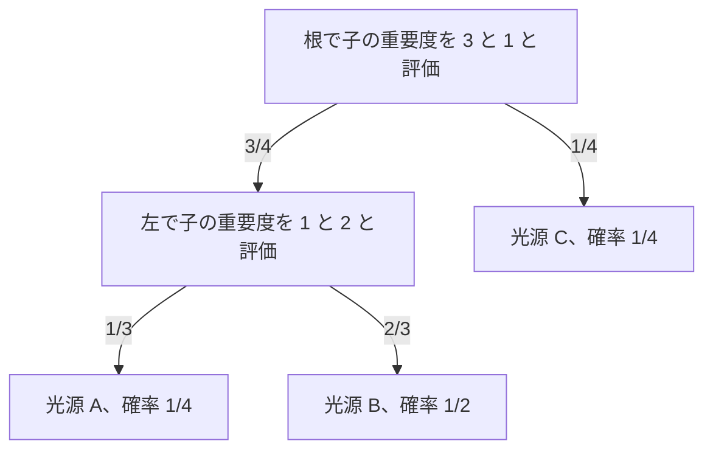
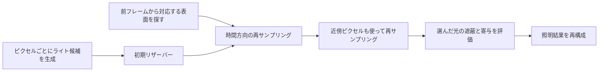
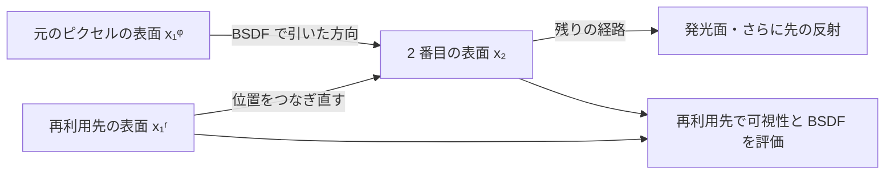

# 大量光源のサンプリング — ReSTIR DI・GIとMegaLights

ネオン看板や窓からの光が重なる夜景では、一つのピクセルに多くのライトが届きます。各ライトの寄与と遮蔽を毎回調べると、候補が増えるほど評価回数が増えます。そこで寄与の大きそうな光を少数だけ選び、選んだ確率を使って照明の合計を推定します。[Forward+のライトリスト](/graphics/path/forward-plus.html)が評価対象を絞るのに対して、ここでは候補が多く残った場所でも評価回数を抑えます。

## 選んだ光を、選ばれた確率で補正する

あるピクセルでライト $i$ が直接照明に与える寄与を $F(i)$ とします。ここでは有限個の点光源を考え、反射の計算に遮蔽も含めます。確率 $p(i)$ で1灯を選ぶ場合、$F(i)/p(i)$ の期待値はライト全体の寄与の和です。

$$
\operatorname{E}_{i\sim p}\left[\frac{F(i)}{p(i)}\right]=\sum_i F(i)
$$

$F(i)$ が0でないライトには正の選択確率が必要です。一様抽選では、弱い光が多く、数灯だけが明るい場面で結果が大きくばらつきます。明るさ、距離、面の向きなどから寄与の目安を求め、値が大きい光を選びやすくするのが**重要度サンプリング**です。面光源ではライトの番号に加えて、光源面のどの位置を選んだかと、その確率密度も計算に入ります。

### 位置を問わず候補を引く — エイリアステーブル

ライトごとにワールド全体で使う重み $w_i$ を決めて $p_i=w_i/\sum_j w_j$ と正規化します。たとえばライトの放射束を重みにすると、弱い装飾灯より強い主照明が選ばれやすくなります。累積分布を二分探索すれば 1 回の抽選は $O(\log N)$。エイリアステーブルは $N$ 本の等幅の列を作り、各列に元のライトと別のライト（エイリアス）を割り当てます。構築に $O(N)$、記憶量に $O(N)$ を使い、抽選を $O(1)$ で行えます。 [Vose — A Linear Algorithm for Generating Random Numbers with a Given Distribution（1991）](https://doi.org/10.1109/32.92917)、[pbrt 第4版 — Power Light Sampler](https://pbr-book.org/4ed/Light_Sources/Light_Sampling#PowerLightSampler)

構築時の仕事は、確率の総量を列の間で移すことです。全ての重みを $N p_i$ に換算し、1 未満の列と 1 以上の列を一つずつ取ります。小さい列の不足分を大きい列のライトで埋め、小さい列は完成です。大きい列から移した量を引き、残りが 1 未満になれば小さい列の側へ戻します。最後に残った列は、浮動小数点の丸めを許容して割合 1 で確定します。

重み $1,2,5$ の 3 灯では $p_A=1/8$、$p_B=2/8$、$p_C=5/8$。テーブルを 3 列にするので $N p_i$ は $0.375,0.75,1.875$ です。A の列は 0.625 を C から、B の列は 0.25 を C から受け取り、C の列には 1 が残ります。

| 一様に選ぶ列 | しきい値未満で返すライト | しきい値以上で返すライト |
| --- | --- | --- |
| A | 0.375 の割合で A | 0.625 の割合で C |
| B | 0.750 の割合で B | 0.250 の割合で C |
| C | 1.000 の割合で C | なし |

C が返る経路は 3 通りあるので、全体の選択確率は $(0.625+0.25+1)/3=0.625$ です。0.625 は表の A 列の残りの割合とこの例ではたまたま同じです。実装では列内のしきい値と、最終的に選ばれたライトの確率 $p_i$ を分けて持ちます。寄与の補正や MIS（Multiple Importance Sampling）に使うのは後者です。面光源なら、このライト選択確率にライト面上で選んだ点の条件付き PDF を掛けます。BSDF で方向を選んだときの PDF と比較する場合は、光源面の面積当たりの PDF を、シェーディング点での立体角当たりの PDF へ変換して測度を揃えます。 [pbrt 第4版 — The Alias Method](https://www.pbr-book.org/4ed/Sampling_Algorithms/The_Alias_Method)、[pbrt 第4版 — Light Interface](https://pbr-book.org/4ed/Light_Sources/Light_Interface)

### シェーディング点ごとに候補を変える — ライト BVH

光源の全放射束だけで抽選すると、遠くの巨大なライトが優先され、すぐ近くの弱いライトを引きにくいことがあります。ライト BVH では空間的に近い光源をまとめ、内部ノードにグループの AABB、光の強さの集計値、放射方向の範囲を保持します。あるシェーディング点から見て左の子の重要度が $I_L$、右が $I_R$ なら、左を選ぶ確率を $I_L/(I_L+I_R)$ とし、葉まで繰り返します。評価するのは選んだ経路に沿う子ノードで、木が偏らず葉のライト数が一定なら 1 灯の選択は $O(\log N)$ が目安です。 [Conty Estevez・Kulla — Importance Sampling of Many Lights with Adaptive Tree Splitting（2018）](https://fpsunflower.github.io/ckulla/data/many-lights-hpg2018.pdf)



図の B が選ばれる確率は $3/4 \times 2/3=1/2$。最初の乱数を $u\in[0,1)$ とすると、左を選んだ場合は $u/(3/4)$、右を選んだ場合は $(u-3/4)/(1/4)$ と戻せば、子でも 0〜1 の乱数として使えます。逆に MIS で、別の方法が選んだライト B の確率が必要になった場合は、その葉への経路をたどり、同じシェーディング点で枝の確率を掛けます。pbrt 第4版は、光源から枝の左右の列を引けるよう、木の構築時に経路をビット列に保存します。 [pbrt 第4版 — BVH Light Sampling](https://pbr-book.org/4ed/Light_Sources/Light_Sampling#BVHLightSampling)

重要度を計算する際は、近距離で距離項が発散しないようにします。グループの中央だけを代表にすると、点がグループの中にあるときに近い光と遠い光の寄与を同じように見積もってしまいます。Conty Estevez と Kulla の手法では、推定の信頼性が低い箇所で木をさらに分割して複数の部分木をサンプルします。硬い打ち切りを入れる場合は、切った光が本当に寄与しないかを確認します。単なる近似スコアを 0 にすると、正の寄与があるのに確率 0 となるためです。必要なら正の確率を持つ別の候補分布を混ぜ、補正には混合後の確率を使います。

| 候補の分布 | 向く場面 | 主な費用 |
| --- | --- | --- |
| 一様 | 候補が少ない、基準となる実装を作る | 抽選は安い。強さに偏りがあると分散が大きい。 |
| エイリアステーブル | ライト全体またはタイル単位の固定した分布を多数回引く | 分布の変化に応じて表を更新する。 |
| ライト BVH | 位置・法線に応じた分布を引く。発光三角形が多数ある | 木の構築・更新と、抽選ごとの経路の走査。 |
| リザーバー | 上の分布から得た候補や再利用候補から代表を選び直す | 時空間の再評価と履歴・近傍バッファ。 |

エイリアステーブルとライト BVH は最初の候補を作る手段であり、リザーバーの候補にも使えます。たとえばライト BVH で各ピクセルの候補を生成し、ReSTIR DI で前フレームや近傍の候補も見たうえで再サンプリングします。初期候補の確率は、候補を引いた構造の確率を使います。

## ReSTIR DI — 候補を再サンプリングする

Bitterliらの2020年の手法は、ライト候補を逐次処理し、**リザーバー**に代表の1サンプル、重みの合計、候補数を保持します。候補 $i$ の重みは、寄与の目安となる非負の値 $\hat p(i)$ を候補の抽選確率 $p(i)$ で割った $w_i=\hat p(i)/p(i)$ です。新しい候補の追加後、重みの合計を $W$ とすると、確率 $w_i/W$ で代表を置き換えます。重み1、3、6を順に入れると、最後に3つの候補を選んでいる確率はそれぞれ0.1、0.3、0.6です。



遮蔽を除いた寄与を $\hat p$ に使えば、候補すべてにシャドウレイを飛ばさずに重みを決められます。候補数が $M$ で代表が $y$ なら、初期の再サンプリングで使う補正は $W/(M\hat p(y))$ です。選んだ光だけ遮蔽を含めて $F(y)$ を求め、この補正を掛けます。

ReSTIR DIでは、さらに前フレームで同じ表面だったピクセルや、近傍ピクセルのリザーバーを再利用します。再利用先の表面で候補の重要度を評価し直し、履歴や近傍を深度・法線などで選びます。物体が動いて遮蔽物の裏が見えた場合や、近くの面でも法線が大きく違う場合は、履歴の代表が現在の表面に適していないことがあります。重み付けや可視性の扱いは方式ごとに異なり、原論文にもバイアスと分散の取引が異なる実装があります。

## コード例 — 1ピクセルでの初期リザーバー

C++20の単体プログラムです。`cl /std:c++20 /O2 /EHsc reservoir.cpp` でコンパイルできます。3灯の候補を一様に引き、遮蔽を無視した寄与で重み付けします。選ばれた1灯だけに遮蔽を適用し、照明の推定値を返します。再投影、空間再利用、GPUでの可視性の計算は別段階です。

```cpp
#include <array>
#include <cstddef>
#include <iomanip>
#include <iostream>
#include <random>

struct Light {
    double unoccluded;
    bool visible;
};

constexpr std::array lights{Light{2.0, true}, Light{8.0, false}, Light{1.0, true}};

double estimate(std::mt19937& rng)
{
    constexpr int candidateCount = 4;
    constexpr double proposal = 1.0 / static_cast<double>(lights.size());
    std::uniform_int_distribution<std::size_t> pick(0, lights.size() - 1);
    std::uniform_real_distribution<double> unit(0.0, 1.0);
    double weightSum = 0.0;
    std::size_t selected = 0;

    for (int sample = 0; sample < candidateCount; ++sample) {
        const std::size_t index = pick(rng);
        const double weight = lights[index].unoccluded / proposal;
        weightSum += weight;
        if (weight > 0.0 && unit(rng) < weight / weightSum) {
            selected = index;
        }
    }
    if (weightSum == 0.0) {
        return 0.0;
    }

    const Light& light = lights[selected];
    const double contribution = light.visible ? light.unoccluded : 0.0;
    return contribution * weightSum / (candidateCount * light.unoccluded);
}

int main()
{
    constexpr int trials = 200'000;
    std::mt19937 rng(42);
    double sum = 0.0;
    for (int trial = 0; trial < trials; ++trial) {
        sum += estimate(rng);
    }
    std::cout << std::fixed << std::setprecision(3)
              << "Reference: 3.000\nEstimated: " << sum / trials << '\n';
}
```

真値は $2+0+1=3$ です。Visual C++での20万回の平均は3.006でした。強い光でも隠れていれば、選んだ試行の出力は0になります。候補を固定し、各候補が選ばれる確率 $w_i/W$ をその出力に掛けて足すと、候補ごとの $F(i)/p(i)$ の平均になります。さらに候補抽選に対して期待値を取ると、真値3になります。目安が実際の寄与と大きく食い違う場面では、推定の期待値が真値でも、少ない試行でのばらつきが大きくなります。

### コード例 — エイリアステーブルからライトと選択確率を返す

C++20 の単体プログラムです。A、B、C の重みは表と同じ $1,2,5$。実際の寄与は $2,0,1$ とし、B は遮蔽で届かない場面を考えます。抽選したライトの実際の寄与を選択確率で割り、平均を取ります。構築時は有限かつ非負の重みを受け取り、合計が 0 の分布をエラーにします。数値の範囲を広げるため、最大の重みで割ってから正規化します。0 の重みを与えたライトには、実際の寄与も 0 であることが前提です。

```cpp
#include <algorithm>
#include <array>
#include <cmath>
#include <cstddef>
#include <iomanip>
#include <iostream>
#include <random>
#include <span>
#include <stdexcept>
#include <vector>

class AliasTable {
public:
    struct Sample {
        std::size_t light;
        double pmf;
    };

    explicit AliasTable(std::span<const double> weights)
        : bins_(weights.size())
    {
        double largest = 0.0;
        for (double weight : weights) {
            if (!std::isfinite(weight) || weight < 0.0) {
                throw std::invalid_argument("Expected finite nonnegative weights");
            }
            largest = std::max(largest, weight);
        }
        if (largest == 0.0) {
            throw std::invalid_argument("Expected at least one positive weight");
        }

        double total = 0.0;
        for (double weight : weights) {
            total += weight / largest;
        }

        const auto count = bins_.size();
        std::vector<double> remaining(count);
        std::vector<std::size_t> small;
        std::vector<std::size_t> large;
        for (std::size_t i = 0; i < count; ++i) {
            const double pmf = (weights[i] / largest) / total;
            bins_[i] = {1.0, i, pmf};
            remaining[i] = pmf * static_cast<double>(count);
            (remaining[i] < 1.0 ? small : large).push_back(i);
        }

        while (!small.empty() && !large.empty()) {
            const auto underfull = small.back();
            const auto donor = large.back();
            small.pop_back();
            large.pop_back();
            bins_[underfull].threshold = remaining[underfull];
            bins_[underfull].alias = donor;
            remaining[donor] -= 1.0 - remaining[underfull];
            (remaining[donor] < 1.0 ? small : large).push_back(donor);
        }
    }

    Sample sample(std::mt19937& rng) const
    {
        std::uniform_int_distribution<std::size_t> chooseColumn(0, bins_.size() - 1);
        std::uniform_real_distribution<double> chooseSide(0.0, 1.0);
        const auto column = chooseColumn(rng);
        const auto& bin = bins_[column];
        const auto light = chooseSide(rng) < bin.threshold ? column : bin.alias;
        return {light, bins_[light].pmf};
    }

private:
    struct Bin {
        double threshold;
        std::size_t alias;
        double pmf;
    };

    std::vector<Bin> bins_;
};

int main()
{
    constexpr std::array powers{1.0, 2.0, 5.0};
    constexpr std::array contributions{2.0, 0.0, 1.0};
    constexpr int trials = 200'000;
    AliasTable table(powers);
    std::mt19937 rng(42);
    std::array<int, powers.size()> counts{};
    double estimateSum = 0.0;

    for (int i = 0; i < trials; ++i) {
        const auto [light, pmf] = table.sample(rng);
        ++counts[light];
        estimateSum += contributions[light] / pmf;
    }

    std::cout << std::fixed << std::setprecision(4);
    for (std::size_t i = 0; i < counts.size(); ++i) {
        std::cout << i << ": " << static_cast<double>(counts[i]) / trials << '\n';
    }
    std::cout << "Estimated light: " << estimateSum / trials << '\n';
}
```

理論上、3 灯の出現比率は $0.125, 0.250, 0.625$。各試行の出力は A なら $2/0.125=16$、B なら 0、C なら $1/0.625=1.6$ です。期待値は $0.125\times16+0.625\times1.6=3$。MSVC で実行した例では、出現比率は約 $0.1248,0.2491,0.6261$、寄与の推定は $2.9985$ でした。この場面では重要な A の抽選確率が低いので、ピクセルごとに数サンプルだけ引くとばらつきます。抽選が速いことと、寄与に合った分布を選べていることは別々に測れます。

## ReSTIR GIとMegaLightsが扱う照明

| 手法 | 選び直す対象と目的 |
| --- | --- |
| ReSTIR DI（2020年） | 光源を直接見込むサンプルを再利用して、直接照明を求める |
| ReSTIR GI（2021年） | パストレーシングで得た複数反射を含む間接照明の経路を、時空間で再サンプリングする |
| MegaLights（Unreal Engine 5.8） | 多数の動的ライトの直接照明を確率的に評価し、結果をデノイズする |

Epic GamesのUnreal Engine 5.8資料では、MegaLightsは重要と見込んだライトへピクセルごとに固定本数のレイを向けます。既定では短いスクリーン空間レイで細部を調べ、必要に応じてハードウェアレイトレーシングを続けます。ライトごとにVirtual Shadow Map（VSM）を使う設定もあります。5.8ではリリースノート上の成熟度がProduction Readyです。ここでの比較はEpicが公開している直接照明の処理に基づきます。

1ピクセルに同程度に強い光が多いほど、同じサンプル予算で個々の光を選ぶ回数は減ります。MegaLightsでノイズや残像が目立つ場合は、時間を測るとともに、同じ面に重なるライトの範囲や遮蔽を確認します。間接照明との役割の違いは[グローバルイルミネーション](/graphics/lighting/gi.html)で確認できます。

### ReSTIR GI — 間接光の経路を隣のピクセルへつなぐ

画面に見える最初の面を $x_1$ とします。パストレーサーが $x_1$ の BSDF から方向を引き、レイが次の面の $x_2$ に当たると、$x_2$ から戻る放射輝度を求められます。その値には $x_2$ が受ける直接光と、さらに先の反射から得た光を含められます。ReSTIR GI はこの経路を、$x_2$ の位置・法線、そこから戻る放射輝度、初期サンプリングの確率密度を持つ候補として扱います。たとえば天井に当たった日光を、直接日光の当たらない床の複数のピクセルで共有します。RTXDI は 2.0 で ReSTIR GI を導入しました。RTXDI 3.2.0 ではパストレーサーが得た二次表面と、その面を見つけたレイの立体角 PDF を入力にします。 [Ouyang ほか — ReSTIR GI（2021）](https://doi.org/10.1111/cgf.14378)、[NVIDIA RTXDI — ReSTIR GI](https://github.com/NVIDIA-RTX/RTXDI/blob/v3.2.0/Doc/RestirGI.md)



隣のピクセル $q$ の候補を現在のピクセル $r$ で使うとき、経路の最初の面だけを $x_1^q$ から $x_1^r$ に変えて $x_2$ につなぎます。このとき二次表面の小さな面積 $\mathrm{d}A$ が覆う立体角は、各位置からの距離 $d$ と二次表面の法線に対する角度 $\theta$ で変わります。

$$
\mathrm{d}\omega = \frac{|\cos\theta|}{d^2}\mathrm{d}A,\qquad
J_{q\to r} = \frac{\mathrm{d}\omega_r}{\mathrm{d}\omega_q}
           = \frac{|\cos\theta_r|\,d_q^2}{|\cos\theta_q|\,d_r^2}
$$

元の立体角 PDF を $p_q$ とすると、移した候補の密度は $p_q/J_{q\to r}$。同じ二次面を旧位置から $d_q=2$、新位置から $d_r=4$ の距離で正面から見ると $J=1/4$ で、移した PDF は 4 倍になります。立体角が 1/4 に縮んだ領域へ同じ確率が移るためです。逆密度で補正する重みには $J$ を掛けます。この変換に現れる角度は二次面の向きであり、現在の一次面で評価する BRDF や余弦とは別に掛かります。両端の距離や元の余弦がゼロに近い場合は変換が不安定になるので、再利用可能かを検査します。 [Ouyang ほか — ReSTIR GI、式 (11)](https://doi.org/10.1111/cgf.14378)

候補の重みは、新しい一次面での BRDF や余弦、二次面の放射輝度を使って決め直します。時間方向では、モーションベクトルで前フレームの対応位置を探し、深度や法線から履歴が同じ表面を指すかを判定します。空間方向では、近傍から候補を取り、表面の差やヤコビアンを調べます。候補を最終的に使う前に新しい接続区間の遮蔽を評価します。隣では天井が見えていても、現在のピクセルからは梁に遮られている場合があるからです。前フレームの遮蔽結果を流用する近似や履歴の制限は、時間と画質の取引になります。

| 現象 | パスのどこを調べるか |
| --- | --- |
| 壁を挟んで間接光が漏れる | 移した $x_1 \to x_2$ の可視性と、レイ原点のオフセットを確認する。 |
| カメラ移動直後に古い反射が残る | 再投影の深度、法線、履歴の長さ、二次面の位置や放射輝度の変化を確認する。 |
| 鏡面に疎らな斑点が残る | 少し方向を変えるだけで BSDF が大きく変わる面で、再接続が妥当かを調べる。 |
| 近傍のノイズが同じ形に固まる | 同じ経路が繰り返し選ばれて、リザーバー間の候補が強く相関していないかを調べる。 |

2021 年の ReSTIR GI では二次面から戻る輝度を再利用するため、つなぎ直した方向でも同じ輝度を使えるという近似が入ります。粗い拡散反射では使いやすく、鋭い鏡面では一次面の BSDF や二次面から戻る輝度が方向に敏感です。RTXDI の実装資料では、粗さが低い面に元のパストレーシングのサンプルを組み合わせる方法も示しています。複数の頂点を扱う経路の変換については、後続の ReSTIR PT の研究が扱います。 [NVIDIA RTXDI — ReSTIR GI の統合](https://github.com/NVIDIA-RTX/RTXDI/blob/v3.2.0/Doc/RestirGI.md)、[Lin ほか — Generalized Resampled Importance Sampling: Foundations of ReSTIR（2022）](https://d1qx31qr3h6wln.cloudfront.net/publications/sig22_GRIS.pdf)

再サンプリングだけを切って、初期の経路とリザーバーから出した間接光を比較すると、PDF、余弦、スループットの二重適用を見つけやすくなります。次に時間方向、空間方向、デノイズを順に有効にすると、履歴が原因の誤差と、経路や遮蔽が原因の誤差を分けて調べられます。

## 理解度チェック

1. 重みが1、3、6の候補をすべて処理したあと、重み3の候補が残る確率は何ですか。
2. あるライトがとても明るいのに、初期リザーバーの推定値が0になることがあるのはなぜですか。
3. 画面に見えている面から壁を経由して届く光を再サンプリングするのは、DIとGIのどちらですか。
4. エイリアステーブルで A の列が選ばれ、その列から C が返りました。寄与は A の列の残りの割合と C の全体の選択確率のどちらで割りますか。
5. 二次面への再接続で距離だけが 2 倍になり、二次面での余弦は同じです。立体角 PDF はどう変わりますか。

::: details 解答
1. $3/(1+3+6)=0.3$ です。
2. 候補の重み付けには遮蔽前の寄与を使っています。そのライトが選ばれても、遮蔽を調べた結果、光が届かない場合は寄与が0になります。
3. 壁で反射した間接光なのでGIです。DIは光源から面に直接届く光を扱います。
4. C の全体の選択確率です。C は別の列からも返るため、その全経路の確率を含めます。
5. 立体角は 1/4、再接続後の立体角 PDF は 4 倍になります。
:::

## 関連項目

- [Forward+とタイル・クラスタ単位のライト選択](/graphics/path/forward-plus.html)
- [グローバルイルミネーション](/graphics/lighting/gi.html)
- [パストレーシング](/graphics/lighting/path-tracing.html)
- [BVH — 境界体積階層](/algorithms/bounding-volume-hierarchies.html)

## 参考資料

- [Bitterliほか、Spatiotemporal reservoir resampling for real-time ray tracing with dynamic direct lighting（SIGGRAPH 2020）](https://doi.org/10.1145/3386569.3392481)
- [Ouyangほか、ReSTIR GI: Path Resampling for Real-Time Path Tracing（2021）](https://doi.org/10.1111/cgf.14378)
- [Epic Games、MegaLights（Unreal Engine 5.8）](https://dev.epicgames.com/documentation/unreal-engine/megalights-in-unreal-engine?application_version=5.8)
- [Epic Games、Unreal Engine 5.8 Release Notes](https://dev.epicgames.com/documentation/unreal-engine/unreal-engine-5-8-release-notes?application_version=5.8)
- [Vose、A Linear Algorithm for Generating Random Numbers with a Given Distribution（IEEE、1991）](https://doi.org/10.1109/32.92917)
- [Conty Estevez・Kulla、Importance Sampling of Many Lights with Adaptive Tree Splitting（ACM、2018）](https://fpsunflower.github.io/ckulla/data/many-lights-hpg2018.pdf)
- [pbrt 第4版、Light Sampling とライト BVH の実装](https://pbr-book.org/4ed/Light_Sources/Light_Sampling)
- [pbrt 第4版、The Alias Method の実装](https://www.pbr-book.org/4ed/Sampling_Algorithms/The_Alias_Method)
- [pbrt 第4版、Light Interface と立体角 PDF](https://pbr-book.org/4ed/Light_Sources/Light_Interface)
- [NVIDIA RTXDI 3.2.0、ReSTIR GI の統合](https://github.com/NVIDIA-RTX/RTXDI/blob/v3.2.0/Doc/RestirGI.md)
- [Lin ほか、Generalized Resampled Importance Sampling: Foundations of ReSTIR（ACM、2022）](https://d1qx31qr3h6wln.cloudfront.net/publications/sig22_GRIS.pdf)
