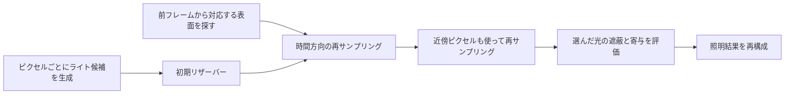

# 大量光源のサンプリング — ReSTIR DI・GIとMegaLights

ネオン看板や窓からの光が重なる夜景では、一つのピクセルに多くのライトが届きます。各ライトの寄与と遮蔽を毎回調べると、候補が増えるほど評価回数が増えます。そこで寄与の大きそうな光を少数だけ選び、選んだ確率を使って照明の合計を推定します。[Forward+のライトリスト](/graphics/path/forward-plus.html)が評価対象を絞るのに対して、ここでは候補が多く残った場所でも評価回数を抑えます。

## 選んだ光を、選ばれた確率で補正する

あるピクセルでライト $i$ が直接照明に与える寄与を $F(i)$ とします。ここでは有限個の点光源を考え、反射の計算に遮蔽も含めます。確率 $p(i)$ で1灯を選ぶ場合、$F(i)/p(i)$ の期待値はライト全体の寄与の和です。

$$
\operatorname{E}_{i\sim p}\left[\frac{F(i)}{p(i)}\right]=\sum_i F(i)
$$

$F(i)$ が0でないライトには正の選択確率が必要です。一様抽選では、弱い光が多く、数灯だけが明るい場面で結果が大きくばらつきます。明るさ、距離、面の向きなどから寄与の目安を求め、値が大きい光を選びやすくするのが**重要度サンプリング**です。面光源ではライトの番号に加えて、光源面のどの位置を選んだかと、その確率密度も計算に入ります。

## ReSTIR DI — 候補を再サンプリングする

Bitterliらの2020年の手法は、ライト候補を逐次処理し、**リザーバー**に代表の1サンプル、重みの合計、候補数を保持します。候補 $i$ の重みは、寄与の目安となる非負の値 $\hat p(i)$ を候補の抽選確率 $p(i)$ で割った $w_i=\hat p(i)/p(i)$ です。新しい候補の追加後、重みの合計を $W$ とすると、確率 $w_i/W$ で代表を置き換えます。重み1、3、6を順に入れると、最後に3つの候補を選んでいる確率はそれぞれ0.1、0.3、0.6です。



遮蔽を除いた寄与を $\hat p$ に使えば、候補すべてにシャドウレイを飛ばさずに重みを決められます。候補数が $M$ で代表が $y$ なら、初期の再サンプリングで使う補正は $W/(M\hat p(y))$ です。選んだ光だけ遮蔽を含めて $F(y)$ を求め、この補正を掛けます。

ReSTIR DIでは、さらに前フレームで同じ表面だったピクセルや、近傍ピクセルのリザーバーを再利用します。再利用先の表面で候補の重要度を評価し直し、履歴や近傍を深度・法線などで選びます。物体が動いて遮蔽物の裏が見えた場合や、近くの面でも法線が大きく違う場合は、履歴の代表が現在の表面に適していないことがあります。重み付けや可視性の扱いは方式ごとに異なり、原論文にもバイアスと分散の取引が異なる実装があります。

## コード例 — 1ピクセルでの初期リザーバー

C++20の単体プログラムです。`cl /std:c++20 /O2 /EHsc reservoir.cpp` でコンパイルできます。3灯の候補を一様に引き、遮蔽を無視した寄与で重み付けします。選ばれた1灯だけに遮蔽を適用し、照明の推定値を返します。再投影、空間再利用、GPUでの可視性の計算は別段階です。

```cpp
#include <array>
#include <cstddef>
#include <iomanip>
#include <iostream>
#include <random>

struct Light {
    double unoccluded;
    bool visible;
};

constexpr std::array lights{Light{2.0, true}, Light{8.0, false}, Light{1.0, true}};

double estimate(std::mt19937& rng)
{
    constexpr int candidateCount = 4;
    constexpr double proposal = 1.0 / static_cast<double>(lights.size());
    std::uniform_int_distribution<std::size_t> pick(0, lights.size() - 1);
    std::uniform_real_distribution<double> unit(0.0, 1.0);
    double weightSum = 0.0;
    std::size_t selected = 0;

    for (int sample = 0; sample < candidateCount; ++sample) {
        const std::size_t index = pick(rng);
        const double weight = lights[index].unoccluded / proposal;
        weightSum += weight;
        if (weight > 0.0 && unit(rng) < weight / weightSum) {
            selected = index;
        }
    }
    if (weightSum == 0.0) {
        return 0.0;
    }

    const Light& light = lights[selected];
    const double contribution = light.visible ? light.unoccluded : 0.0;
    return contribution * weightSum / (candidateCount * light.unoccluded);
}

int main()
{
    constexpr int trials = 200'000;
    std::mt19937 rng(42);
    double sum = 0.0;
    for (int trial = 0; trial < trials; ++trial) {
        sum += estimate(rng);
    }
    std::cout << std::fixed << std::setprecision(3)
              << "Reference: 3.000\nEstimated: " << sum / trials << '\n';
}
```

真値は $2+0+1=3$ です。Visual C++での20万回の平均は3.006でした。強い光でも隠れていれば、選んだ試行の出力は0になります。候補を固定し、各候補が選ばれる確率 $w_i/W$ をその出力に掛けて足すと、候補ごとの $F(i)/p(i)$ の平均になります。さらに候補抽選に対して期待値を取ると、真値3になります。目安が実際の寄与と大きく食い違う場面では、推定の期待値が真値でも、少ない試行でのばらつきが大きくなります。

## ReSTIR GIとMegaLightsが扱う照明

| 手法 | 選び直す対象と目的 |
| --- | --- |
| ReSTIR DI（2020年） | 光源を直接見込むサンプルを再利用して、直接照明を求める |
| ReSTIR GI（2021年） | パストレーシングで得た複数反射を含む間接照明の経路を、時空間で再サンプリングする |
| MegaLights（Unreal Engine 5.8） | 多数の動的ライトの直接照明を確率的に評価し、結果をデノイズする |

Epic GamesのUnreal Engine 5.8資料では、MegaLightsは重要と見込んだライトへピクセルごとに固定本数のレイを向けます。既定では短いスクリーン空間レイで細部を調べ、必要に応じてハードウェアレイトレーシングを続けます。ライトごとにVirtual Shadow Map（VSM）を使う設定もあります。5.8ではリリースノート上の成熟度がProduction Readyです。ここでの比較はEpicが公開している直接照明の処理に基づきます。

1ピクセルに同程度に強い光が多いほど、同じサンプル予算で個々の光を選ぶ回数は減ります。MegaLightsでノイズや残像が目立つ場合は、時間を測るとともに、同じ面に重なるライトの範囲や遮蔽を確認します。間接照明との役割の違いは[グローバルイルミネーション](/graphics/lighting/gi.html)で確認できます。

## 理解度チェック

1. 重みが1、3、6の候補をすべて処理したあと、重み3の候補が残る確率は何ですか。
2. あるライトがとても明るいのに、初期リザーバーの推定値が0になることがあるのはなぜですか。
3. 画面に見えている面から壁を経由して届く光を再サンプリングするのは、DIとGIのどちらですか。

::: details 解答
1. $3/(1+3+6)=0.3$ です。
2. 候補の重み付けには遮蔽前の寄与を使っています。そのライトが選ばれても、遮蔽を調べた結果、光が届かない場合は寄与が0になります。
3. 壁で反射した間接光なのでGIです。DIは光源から面に直接届く光を扱います。
:::

## 関連項目

- [Forward+とタイル・クラスタ単位のライト選択](/graphics/path/forward-plus.html)
- [グローバルイルミネーション](/graphics/lighting/gi.html)
- [パストレーシング](/graphics/lighting/path-tracing.html)

## 参考資料

- [Bitterliほか、Spatiotemporal reservoir resampling for real-time ray tracing with dynamic direct lighting（SIGGRAPH 2020）](https://doi.org/10.1145/3386569.3392481)
- [Ouyangほか、ReSTIR GI: Path Resampling for Real-Time Path Tracing（2021）](https://doi.org/10.1111/cgf.14378)
- [Epic Games、MegaLights（Unreal Engine 5.8）](https://dev.epicgames.com/documentation/unreal-engine/megalights-in-unreal-engine?application_version=5.8)
- [Epic Games、Unreal Engine 5.8 Release Notes](https://dev.epicgames.com/documentation/unreal-engine/unreal-engine-5-8-release-notes?application_version=5.8)
