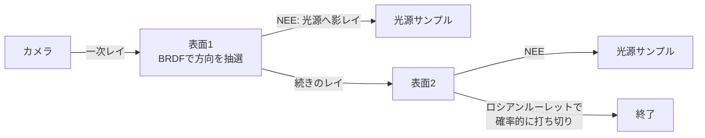

# パストレーシング

## 概要

パストレーシングは、**レンダリング方程式をモンテカルロ積分で確率的に解く**手法です。カメラからレイを飛ばし、表面で確率的に反射させながら光源に到達するまで追跡し、その平均として輝度を推定します。映画のレンダリングは2010年代に完全移行済みで、リアルタイムでも **ReSTIR + デノイザ + アップスケーラ**の三点セットにより2022年頃から実用が始まりました (Cyberpunk 2077 Overdrive、Alan Wake 2、Portal RTX)。

## なぜ必要なのか

- 影・反射・GI・エリアライト・屈折・コースティクスを**個別の近似の寄せ集めでなく単一のアルゴリズム**で解ける — レンダラーの最終形
- ラスタライズ+近似の積み重ね (シャドウマップ+SSR+プローブ+...) はメンテコストと組み合わせバグが増大しており、統一解への圧力が強い
- 「参照解」として、他の全手法の品質評価の基準でもある

## 歴史・誕生した背景

- **1986: Kajiya がレンダリング方程式とパストレーシングを同時に提示** — 「方程式」と「解き方」が同じ論文
- 1990年代: 双方向パストレーシング、Metropolis光輸送などの発展 (オフライン)
- 1997: Veach の博士論文 — MIS (Multiple Importance Sampling) 等、現代サンプリング理論の礎
- 2010年代: 映画産業がレイトレ系 (Arnold, RenderMan RIS, Hyperion) へ全面移行
- 2018: RTX/DXR → Quake II RTX (2019) が「古いゲームのフルパストレース化」を実証
- **2020: ReSTIR (Bitterli et al.)** — 時空間リサンプリングによる桁違いのサンプル効率化
- 2022-23: **Cyberpunk 2077 RT: Overdrive** — AAA初のリアルタイムパストレーシングモード。DLSS 3.5 Ray Reconstruction (AIデノイザ) が支える
- 現在: ニューラルデノイズ/Radiance Cachingと融合しつつ「最高画質設定」として普及開始

## それ以前の技術

Whitted式レイトレーシング (完全鏡面のみ再帰)、ラジオシティ (拡散のみ・有限要素)、そしてリアルタイム側の各種近似 ([GI総論](/graphics/lighting/gi.html) の系譜すべて)。

## 解決した課題

1. **一般性**: 任意のBRDF・任意の光源・任意のジオメトリで漸近的に正しい解
2. **統一性**: 影も反射もGIも同じコードパス
3. スケーラビリティ: サンプル数を増やせば単調に品質が上がる (アーティファクトではなくノイズとして劣化する優れた性質)

## 現在の位置づけ

リアルタイムでは「ウルトラ設定」。**1ピクセルあたり1〜2サンプル**しか撃てないため、勝負はサンプルの質 (重点サンプリング・ReSTIR) と再構成 (デノイザ) にあります。UEのPath Tracer (非リアルタイム参照モード) のように「グラウンドトゥルース生成器」としての役割も重要です。

## 内部動作

### モンテカルロ積分

積分 $\int f(x)dx$ を、確率密度 $p(x)$ からのサンプル平均で推定します:

$$\int f(x)\,dx \approx \frac{1}{N}\sum_{i=1}^{N} \frac{f(x_i)}{p(x_i)}$$

- **不偏**: 期待値は真値に一致。誤差は $O(1/\sqrt{N})$ で減る (4倍サンプルでノイズ半減)
- **重点サンプリング**: $p(x)$ を $f(x)$ に似せるほど分散 (ノイズ) が減る — BRDF形状に沿ったサンプリング、光源に向けたサンプリング (NEE)、その両立 (**MIS**)

### パスの構築



実務的な標準形は **NEE (Next Event Estimation)**: 各バウンスで明示的に光源上の点をサンプルして影レイを飛ばし、BRDFサンプリングとMISで結合します。ロシアンルーレットでパス長を不偏に打ち切ります。

### リアルタイム化の三本柱

| 柱 | 内容 |
|---|---|
| **ReSTIR** | 隣接ピクセル・前フレームの「良いサンプル」を再利用 (リサンプリング)。直接光 (ReSTIR DI) → GI (ReSTIR GI/PT) へ拡大。数千光源シーンを1sppで可能に |
| **デノイザ** | SVGF系 (時空間分散誘導フィルタ) → AI (DLSS Ray Reconstruction / NRD / OptiX)。1sppのノイズ画像から驚異的な再構成 |
| **アップスケーラ** | 内部解像度を下げてレイ数を確保 → [DLSS/FSR](/graphics/postprocess/upscaling.html) |

### 分散(ノイズ)との戦いの直感

パストレーシングの本体は「いかに撃つレイを減らして同じ画を得るか」です。歴史は分散削減の歴史 — 重点サンプリング (1986〜)、MIS (1995)、そしてリサンプリング (2020) — と言えます。

## 各環境での扱い

### Unity
HDRPに **Path Tracing** モード (DXR必須、プログレッシブ収束型)。ルックデブ・参照画像用が主用途で、リアルタイム用途ではありません。

### Unreal Engine
**Path Tracer** (`Show > Path Tracing`) — Movie Render Queueと組み合わせたシネマティック/参照レンダリング用。Lumenの品質検証のグラウンドトゥルースとしても公式に位置づけられています。

### DirectX 12
DXRの上に自前実装。NVIDIAの **Falcor** フレームワーク+ReSTIRサンプル、RTXDI/RTXGI SDKが実装リファレンス。

### Vulkan
`VK_KHR_ray_tracing_pipeline` で同様に実装可能。Quake II RTX (vkQ2RTX) がオープンソースの完全な実例です。

## コード例

パストレーサの核心ループ (HLSL風疑似コード、NEE+ロシアンルーレット):

```hlsl
float3 TracePath(RayDesc ray, inout uint rngState) {
    float3 radiance = 0;
    float3 throughput = 1;                     // パスの累積減衰

    for (int bounce = 0; bounce < MAX_BOUNCES; ++bounce) {
        HitInfo hit = TraceClosestHit(ray);
        if (!hit.valid) {
            radiance += throughput * SampleSky(ray.Direction);
            break;
        }
        Surface s = GetSurface(hit);
        radiance += throughput * s.emissive;    // 発光面に到達

        // --- NEE: 光源を明示的にサンプルして影レイ ---
        LightSample ls = SampleOneLight(s.pos, rngState);
        if (ls.pdf > 0 && TraceShadowRay(s.pos, ls.dir, ls.dist)) {
            float3 brdf = EvalBRDF(s, ls.dir, -ray.Direction);
            float misW = PowerHeuristic(ls.pdf, BrdfPdf(s, ls.dir));
            radiance += throughput * brdf * ls.radiance
                      * saturate(dot(s.normal, ls.dir)) * misW / ls.pdf;
        }

        // --- BRDFサンプリングで次のレイ ---
        BsdfSample bs = SampleBRDF(s, -ray.Direction, rngState);
        if (bs.pdf <= 0) break;
        throughput *= bs.value * saturate(dot(s.normal, bs.dir)) / bs.pdf;

        // --- ロシアンルーレット (不偏な打ち切り) ---
        float p = max(throughput.r, max(throughput.g, throughput.b));
        if (Rand(rngState) > p) break;
        throughput /= p;

        ray.Origin = s.pos + s.normal * 1e-4;
        ray.Direction = bs.dir;
    }
    return radiance;   // 1spp → 蓄積 or デノイザへ
}
```

## 前提知識

- [ハードウェアレイトレーシング](/graphics/lighting/raytracing.html)
- [PBR](/graphics/lighting/pbr.html) — BRDFとpdfの対応
- [GI総論](/graphics/lighting/gi.html)

## 次に読むべきページ

- [Lumen](/graphics/lighting/lumen.html) — 「パストレ未満・実用最大」の現在解
- [アップスケーリング](/graphics/postprocess/upscaling.html) — 三本柱の一角
- [TAA](/graphics/postprocess/taa.html) — 時間的蓄積の基礎

## 理解度チェック

1. **モンテカルロ推定の誤差が $O(1/\sqrt{N})$ であることの実務的な意味を述べよ。**
   ::: details 解答
   ノイズを半分にするにはサンプル数を4倍にする必要があり、力任せの収束は極めて高くつく。ゆえにリアルタイムでは「Nを増やす」のではなく「1サンプルあたりの分散を下げる」(重点サンプリング、ReSTIR)と「ノイズを再構成で除く」(デノイザ)が本質的な戦場になる。
   :::

2. **NEE (Next Event Estimation) がないと何が起きるか。**
   ::: details 解答
   光源への到達がBRDFサンプリングの偶然に頼ることになり、小さい光源にはほぼ当たらず、直接光ですら激しいノイズになる。NEEは各バウンスで光源上の点を明示的にサンプルすることで直接光の分散を劇的に下げる。ただし鏡面на表面ではBRDFサンプリングが有利なため、両者をMISで重み付けして結合するのが標準形。
   :::

3. **ReSTIRの中心的アイデアを一言で述べ、なぜ多光源シーンに強いのか説明せよ。**
   ::: details 解答
   「自分で新しくサンプルを引く代わりに、隣接ピクセルと前フレームが見つけた良いサンプルを重み付きで再利用(リサンプリング)する」。数千光源では各ピクセルが独立に良い光源を探すのは絶望的だが、空間的・時間的に近いピクセルの当たりサンプルは高確率で自分にも有効であり、実質的なサンプル数を桁違いに増幅できる。
   :::

## 参考資料

- Kajiya, *"The Rendering Equation"* (1986) / Veach 博士論文 (1997)
- *Physically Based Rendering: From Theory to Implementation* (pbrt, 無料公開) — 標準教科書
- Bitterli et al., *"Spatiotemporal reservoir resampling (ReSTIR)"* (SIGGRAPH 2020)
- *Ray Tracing Gems II* / NVIDIA Falcor & RTXDI サンプル
- CD PROJEKT RED & NVIDIA, Cyberpunk 2077 Overdrive 技術講演 (2023)
