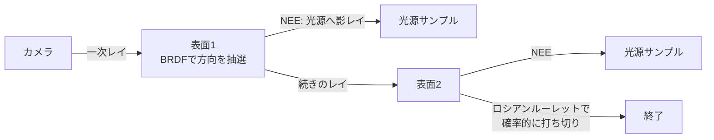

# パストレーシング

## 概要

パストレーシングは、レンダリング方程式をモンテカルロ積分で確率的に解く手法です。カメラからレイを飛ばして、光源に到達するまで表面で確率的に反射させながら追跡し、平均から輝度を推定します。映画のレンダリングは2010年代に完全に移行しました。リアルタイム描画でも、ReSTIR、デノイザ、アップスケーラを組み合わせて2022年頃から実用化が始まりました (Cyberpunk 2077 Overdrive、Alan Wake 2、Portal RTX)。

## なぜ必要なのか

- 影・反射・GI・エリアライト・屈折・コースティクスを**個別の近似の寄せ集めでなく単一のアルゴリズム**で解ける — レンダラーの最終形
- ラスタライズ+近似の積み重ね (シャドウマップ+SSR+プローブ+...) はメンテコストと組み合わせバグが増大しており、統一解への圧力が強い
- 「参照解」として、他の全手法の品質評価の基準でもある

## 歴史・誕生した背景

- **1986: Kajiya がレンダリング方程式とパストレーシングを同時に提示** — 「方程式」と「解き方」が同じ論文
- 1990年代: 双方向パストレーシング、Metropolis光輸送などの発展 (オフライン)
- 1997: Veach の博士論文 — MIS (Multiple Importance Sampling) 等、現代サンプリング理論の礎
- 2010年代: 映画産業がレイトレ系 (Arnold, RenderMan RIS, Hyperion) へ全面移行
- 2018: RTX/DXR → Quake II RTX (2019) が「古いゲームのフルパストレース化」を実証
- **2020: ReSTIR (Bitterli et al.)** — 時空間リサンプリングによる桁違いのサンプル効率化
- 2023年4月: **Cyberpunk 2077 RT: Overdrive** 技術プレビューを公開。2023年9月のUpdate 2.0でDLSS 3.5 Ray Reconstructionを追加。公開当初からRRがあったわけではない
- 現在: ニューラルデノイズ/Radiance Cachingと融合しつつ「最高画質設定」として普及開始

## それ以前の技術

Whitted式レイトレーシング (完全鏡面のみ再帰)、ラジオシティ (拡散のみ・有限要素)、そしてリアルタイム側の各種近似 ([GI総論](/graphics/lighting/gi.html) の系譜すべて)。

## 解決した課題

1. **一般性**: 任意のBRDF・任意の光源・任意のジオメトリで漸近的に正しい解
2. **統一性**: 影も反射もGIも同じコードパス
3. スケーラビリティ: 同じ分布から独立に取る有限分散のサンプルを増やすと、平均で求めた推定値の分散が下がる。個々の画像では、サンプルを追加しても真値との差が大きくなることがある

## 現在の位置づけ

リアルタイムでは「ウルトラ設定」。**1ピクセルあたり1〜2サンプル**しか撃てないため、勝負はサンプルの質 (重点サンプリング・ReSTIR) と再構成 (デノイザ) にあります。UEのPath Tracer (非リアルタイム参照モード) のように「グラウンドトゥルース生成器」としての役割も重要です。

## 内部動作

### モンテカルロ積分

積分 $\int f(x)dx$ を、確率密度 $p(x)$ からのサンプル平均で推定します:

$$\int f(x)\,dx \approx \frac{1}{N}\sum_{i=1}^{N} \frac{f(x_i)}{p(x_i)}$$

- **不偏な推定**: 適切なpdfと重みを使うと期待値は真値に一致。独立サンプルで有限分散なら、推定量の分散は$O(1/N)$、標準偏差（ノイズの目安）は$O(1/\sqrt{N})$で減る（4倍サンプルでノイズ半減）。個々の画像の誤差が単調に減る保証ではない
- **重点サンプリング**: $p(x)$ を $f(x)$ に似せるほど分散 (ノイズ) が減る — BRDF形状に沿ったサンプリング、光源に向けたサンプリング (NEE)、その両立 (**MIS**)

### パスの構築



実務的な標準形は **NEE (Next Event Estimation)**: 各バウンスで明示的に光源上の点をサンプルして影レイを飛ばし、BRDFサンプリングとMISで結合します。ロシアンルーレットでパス長を不偏に打ち切ります。

### リアルタイム化の三本柱

| 柱 | 内容 |
|---|---|
| **ReSTIR** | 隣接ピクセル・前フレームの「良いサンプル」を再利用 (リサンプリング)。直接光 (ReSTIR DI) → GI (ReSTIR GI/PT) へ拡大。数千光源シーンを1sppで可能に |
| **デノイザ** | SVGF系 (時空間分散誘導フィルタ) → AI (DLSS Ray Reconstruction / NRD / OptiX)。1sppのノイズ画像から驚異的な再構成 |
| **アップスケーラ** | 内部解像度を下げてレイ数を確保 → [DLSS/FSR](/graphics/postprocess/upscaling.html) |

### 分散(ノイズ)との戦いの直感

パストレーシングの本体は「いかに撃つレイを減らして同じ画を得るか」です。歴史は分散削減の歴史 — 重点サンプリング (1986〜)、MIS (1995)、そしてリサンプリング (2020) — と言えます。

## 各環境での扱い

### Unity
HDRPに **Path Tracing** モード (プログレッシブ収束型)。WindowsではDXR対応環境が必要です。機能ごとの対応は、対象プラットフォームと採用するHDRPの版で確認します。ルックデブ・参照画像用が主用途で、リアルタイム用途ではありません。[HDRPのRT対応環境](/graphics/engine/hdrp.html#directx-12)

### Unreal Engine
**Path Tracer** (`Show > Path Tracing`) — Movie Render Queueと組み合わせたシネマティック/参照レンダリング用。Lumenの品質検証のグラウンドトゥルースとしても公式に位置づけられています。

### DirectX 12
DXRの上に自前実装。NVIDIAの **Falcor** フレームワーク+ReSTIRサンプル、RTXDI/RTXGI SDKが実装リファレンス。

### Vulkan
`VK_KHR_ray_tracing_pipeline` で同様に実装可能。Quake II RTX (vkQ2RTX) がオープンソースの完全な実例です。

## コード例

パストレーサの核心ループ（HLSL風疑似コード、NEE+MIS+ロシアンルーレット）です。`LightPdf`系のhelperは、**光源を選ぶ確率を含む立体角あたりのpdf**を返します。BRDFで偶然当たった発光面や環境光にも、直前の光源サンプリングと対応するMIS重みを掛けることが要点です。

```hlsl
float3 TracePath(RayDesc ray, inout uint rngState) {
    float3 radiance = 0;
    float3 throughput = 1;                     // パスの累積減衰
    float previousBsdfPdf = 0;
    bool previousDelta = true;
    float3 previousPosition = ray.Origin;

    for (int bounce = 0; bounce < MAX_BOUNCES; ++bounce) {
        HitInfo hit = TraceClosestHit(ray);
        if (!hit.valid) {
            // 環境光もNEEで選ぶ場合は、BRDF側に対応するMIS重みを掛ける
            float skyPdf = SkyLightPdf(previousPosition, ray.Direction);
            float w = (bounce == 0 || previousDelta) ? 1.0
                    : PowerHeuristic(previousBsdfPdf, skyPdf);
            radiance += throughput * SampleSky(ray.Direction) * w;
            break;
        }
        Surface s = GetSurface(hit);
        float lightPdf = EmissionLightPdf(hit, previousPosition, ray.Direction);
        float emissionW = (bounce == 0 || previousDelta) ? 1.0
                        : PowerHeuristic(previousBsdfPdf, lightPdf);
        radiance += throughput * s.emissive * emissionW;

        // --- NEE: 光源を明示的にサンプルして影レイ ---
        LightSample ls = SampleOneLight(s.pos, rngState);
        if (ls.pdf > 0 && IsUnoccluded(s.pos, ls.dir, ls.dist)) {
            float3 brdf = EvalBRDF(s, ls.dir, -ray.Direction);
            // 点光源等のdelta lightは通常のBRDFサンプルでは選べない
            float misW = ls.isDelta ? 1.0
                       : PowerHeuristic(ls.pdf, BrdfPdf(s, -ray.Direction, ls.dir));
            radiance += throughput * brdf * ls.radiance
                      * saturate(dot(s.normal, ls.dir)) * misW / ls.pdf;
        }

        // --- BRDFサンプリングで次のレイ ---
        BsdfSample bs = SampleBRDF(s, -ray.Direction, rngState);
        if (bs.pdf <= 0) break;
        throughput *= bs.value * saturate(dot(s.normal, bs.dir)) / bs.pdf;
        previousBsdfPdf = bs.pdf;
        previousDelta = bs.isDelta;
        previousPosition = s.pos;

        // --- ロシアンルーレット (不偏な打ち切り) ---
        float p = min(0.95, max(throughput.r, max(throughput.g, throughput.b)));
        if (p <= 0 || Rand(rngState) >= p) break;
        throughput /= p;

        ray.Origin = s.pos + s.normal * 1e-4;
        ray.Direction = bs.dir;
    }
    return radiance;   // 1spp → 蓄積 or デノイザへ
}
```

NEEの対象外の発光面・環境光については、対応する`LightPdf`を`0`とし、BRDF側の重みを`1`にします。`PowerHeuristic(a, b)`は$a^2/(a^2+b^2)$です。両方の戦略のpdfの単位、光源の選択確率、deltaかどうかが一致しないと、MISを入れただけでは正しい推定になりません。理想鏡面のサンプル値・pdfの表現、自己交差を避けるレイ原点の生成はhelper側の契約です。この例の有限な`MAX_BOUNCES`による打ち切りにはバイアスがあり、ロシアンルーレット自体の不偏性とは区別します。

## 前提知識

- [ハードウェアレイトレーシング](/graphics/lighting/raytracing.html)
- [PBR](/graphics/lighting/pbr.html) — BRDFとpdfの対応
- [GI総論](/graphics/lighting/gi.html)

## 次に読むべきページ

- [Lumen](/graphics/lighting/lumen.html) — 「パストレ未満・実用最大」の現在解
- [アップスケーリング](/graphics/postprocess/upscaling.html) — 三本柱の一角
- [TAA](/graphics/postprocess/taa.html) — 時間的蓄積の基礎

## 理解度チェック

1. **モンテカルロ推定の誤差が $O(1/\sqrt{N})$ であることの実務的な意味を述べよ。**
   ::: details 解答
   同じ分布から独立にサンプルを取る場合、推定値の標準偏差を半分にするにはサンプル数が4倍必要になる。リアルタイムでは重点サンプリングやReSTIRで推定の分散を下げ、デノイザで残るノイズを抑える。
   :::

2. **NEE (Next Event Estimation) がないと何が起きるか。**
   ::: details 解答
   光源への到達がBRDFサンプリングの偶然に頼ることになり、小さい光源にはほぼ当たらず、直接光ですら激しいノイズになる。NEEは各バウンスで光源上の点を明示的にサンプルすることで直接光の分散を劇的に下げる。ただし鏡面的な表面ではBRDFサンプリングが有利なため、両者をMISで重み付けして結合するのが標準形。
   :::

3. **ReSTIRの中心的アイデアを一言で述べ、なぜ多光源シーンに強いのか説明せよ。**
   ::: details 解答
   「自分で新しくサンプルを引く代わりに、隣接ピクセルと前フレームが見つけた良いサンプルを重み付きで再利用(リサンプリング)する」。数千光源では各ピクセルが独立に良い光源を探すのは絶望的だが、空間的・時間的に近いピクセルの当たりサンプルは高確率で自分にも有効であり、実質的なサンプル数を桁違いに増幅できる。
   :::

## 参考資料

- [*Physically Based Rendering*, Monte Carlo: Basics §2.1.4](https://pbr-book.org/4ed/Monte_Carlo_Integration/Monte_Carlo_Basics)
- Kajiya, *"The Rendering Equation"* (1986) / Veach 博士論文 (1997)
- *Physically Based Rendering: From Theory to Implementation* (pbrt, 無料公開) — 標準教科書
- Bitterli et al., *"Spatiotemporal reservoir resampling (ReSTIR)"* (SIGGRAPH 2020)
- *Ray Tracing Gems II* / NVIDIA Falcor & RTXDI サンプル
- CD PROJEKT RED & NVIDIA, Cyberpunk 2077 Overdrive 技術講演 (2023)
- [pbrt v4: A Better Path Tracer — MISと発光面の扱い](https://pbr-book.org/4ed/Light_Transport_I_Surface_Reflection/A_Better_Path_Tracer)
- [pbrt v4: Monte Carlo Basics](https://pbr-book.org/4ed/Monte_Carlo_Integration/Monte_Carlo_Basics)
- [CD PROJEKT RED: Cyberpunk 2077 Update 2.0](https://www.cyberpunk.net/en/news/49060/update-2-0)
