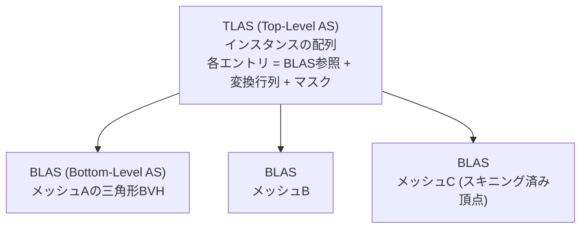

# ハードウェアレイトレーシング (DXR / Vulkan Ray Tracing)

## 概要

ハードウェアレイトレーシングは、**BVH (境界ボリューム階層) の走査と三角形交差判定を専用回路 (RTコア) で加速し、シーンに対して任意のレイを飛ばせる**機能です。2018年のNVIDIA Turing + DXRで幕を開け、影・反射・GI・パストレーシングという「ラスタライズが苦手な問題」への直接解を提供します。ラスタライズを置き換えるのではなく、**共存するもう一つの可視性クエリ**です。

## なぜ必要なのか

ラスタライズは「カメラから見えるもの」しか知りません。しかし:

- 反射は「別の場所から見えるもの」、影は「光源から見えるもの」、GIは「あらゆる場所から見えるもの」が必要
- 画面空間技法 ([SSR](/graphics/lighting/ssr.html)/[SSAO](/graphics/lighting/ssao.html)) はこの欠落の応急処置であり、画面外・遮蔽領域で原理的に破綻する
- レイトレーシングは**任意の点から任意の方向の可視性**を問える唯一の統一解

## 歴史・誕生した背景

- 1968: Appel のレイキャスティング / **1980: Whitted の再帰レイトレーシング** — 理論の原点
- 1986: Kajiya のパストレーシング → オフラインレンダリングは2010年代までにフルパストレーシングへ移行済み
- 2000年代: リアルタイムRT研究 (OpenRT、IntelのLarrabee構想、NVIDIA OptiX 2009)
- **2018: Turing (RTX 20) + DXR** — BVHトラバーサル/三角形交差の固定機能化。Battlefield V (反射)、Metro Exodus (GI) が初陣
- 2020: Vulkan Ray Tracing (KHR) 標準化、PS5/Xbox Series X|S にRT搭載 (RDNA2)
- 2022-23: Ada/RDNA3世代で性能向上、Cyberpunk 2077 Overdrive (フルパストレーシング) → [パストレーシング](/graphics/lighting/path-tracing.html)
- 現在: 影・反射・GIの「品質オプション」から、Lumen HWモードやRestir系を通じて標準機能へ浸透中

## それ以前の技術

画面空間技法 (SSR/SSAO/SSGI)、シャドウマップ、プローブ群 — いずれも「レイを飛ばせない」制約下の近似でした。

## 解決した課題

1. 画面外・遮蔽領域を含む正確な可視性クエリ
2. 面光源の物理的に正しいソフトシャドウ
3. 任意曲面の正確な反射・屈折
4. パストレーシングによる統一的なGI

## 現在の位置づけ

ハイエンドPC/コンソールで実用段階。**コストの主戦場はレイそのものより「少ないレイからのノイズ除去 (デノイズ)」と「BVH更新」**に移っています。モバイルにもRT搭載SoCが登場済み。「レイ予算は1ピクセル1本以下」が普通であり、確率的サンプリング+時間的再構成 (ReSTIR等) が本体と言える状況です。

## 内部動作

### 加速構造 (BVH)

シーンを包む階層ボックス木。DXR/VKでは2階層に標準化されています:



- **BLAS**: メッシュ単位。構築は重い (ビルド/リフィット)。変形メッシュは毎フレーム**リフィット**
- **TLAS**: シーン単位。毎フレーム再構築が普通
- RTコアが行うのは**ボックス交差とレイ-三角形交差**。シェーディングは通常のシェーダコアで実行

### シェーダパイプライン (DXR)

| シェーダ | 実行タイミング |
|---|---|
| **Ray Generation** | 起点。ピクセルごと等でレイを発射 |
| **Closest Hit** | 最も近いヒットで実行 (シェーディング) |
| **Any Hit** | 全ヒット候補で実行 (アルファテスト用、重い) |
| **Miss** | 何にも当たらなかった (スカイ) |
| **Intersection** | カスタム形状 (球・SDF等) の交差判定 |

シェーダは **Shader Binding Table (SBT)** で「どのジオメトリに当たったらどのシェーダ+リソースを使うか」を引く、GPU上の仮想関数テーブルのような構造で結ばれます。

**DXR 1.1 / VK Ray Query**: 別方式として、通常のCompute/PixelシェーダからレイをインラインでトレースできるRayQuery APIがあり、影やAOのような単純用途ではこちらが軽量で主流です。

### レイのコスト特性

- ラスタと逆で、**コヒーレンス (レイの揃い具合) が性能を支配**: 一次レイは速いが、拡散GIのランダムレイはメモリアクセスが散乱して遅い
- Any-Hit (アルファテスト) はトラバーサルを中断するため高価 — RTでは「不透明フラグ」の管理が重要
- BVH品質 (ビルドオプション) とインスタンスマスクによる選別が実効性能を左右

## 各環境での扱い

### Unity
HDRPでRT対応 (RT Shadows / Reflections / GI / AO、`Ray Tracing` 対応シェーダ)。`SystemInfo.supportsRayTracing`、C#では `RayTracingAccelerationStructure` / `RayTracingShader`。URPは非対応 (2025時点)。

### Unreal Engine
UE4.22でRT機能導入 → UE5では **Lumen HW モード / Virtual Shadow Map補完 / Path Tracer** に整理。`r.Lumen.HardwareRayTracing 1`。スタンドアロンRT機能 (RT Reflections等の旧UI) は非推奨化しLumenへ統合されました。

### DirectX 12
**DXR** (`ID3D12Device5::CreateStateObject`、`DispatchRays`)。SM6.3のHLSL (`TraceRay`, `RayDesc`)。DXR 1.1で `RayQuery` (インライン)。

### Vulkan
`VK_KHR_acceleration_structure` + `VK_KHR_ray_tracing_pipeline` + `VK_KHR_ray_query`。GLSLでは `GL_EXT_ray_tracing`。概念はDXRとほぼ1対1です。

## コード例

RayQuery (インラインRT) によるレイトレース影 — 最も実用的な入口 (HLSL SM6.5):

```hlsl
RaytracingAccelerationStructure gScene : register(t0);

float TraceShadowRay(float3 posWS, float3 dirToLight, float maxDist)
{
    RayDesc ray;
    ray.Origin    = posWS;
    ray.Direction = dirToLight;
    ray.TMin      = 0.01;        // セルフヒット回避
    ray.TMax      = maxDist;

    RayQuery<RAY_FLAG_ACCEPT_FIRST_HIT_AND_END_SEARCH |
             RAY_FLAG_SKIP_CLOSEST_HIT_SHADER> q;
    q.TraceRayInline(gScene, RAY_FLAG_NONE, 0xFF, ray);
    q.Proceed();                 // 不透明のみなら1回で完了

    // 何かに当たれば影 (最初のヒットで打ち切り = 影レイの定石)
    return (q.CommittedStatus() == COMMITTED_TRIANGLE_HIT) ? 0.0 : 1.0;
}

// 面光源のソフトシャドウ: 光源上のランダム点へ複数レイ + デノイズが実戦形
```

DXRパイプラインのRay Generation (概形):

```hlsl
[shader("raygeneration")]
void RayGen() {
    uint2 pixel = DispatchRaysIndex().xy;
    RayDesc ray = GeneratePrimaryRay(pixel);   // カメラからのレイ

    Payload p = { float3(0,0,0) };
    TraceRay(gScene, RAY_FLAG_NONE, 0xFF,
             0 /*hitGroup*/, 1, 0 /*miss*/, ray, p);
    gOutput[pixel] = float4(p.color, 1);
}
```

## 前提知識

- [GI総論](/graphics/lighting/gi.html), [シャドウ](/graphics/lighting/shadow.html), [SSR](/graphics/lighting/ssr.html) — 解こうとしている問題
- [DirectX 12](/graphics/api/directx12.html) / [Vulkan](/graphics/api/vulkan.html)

## 次に読むべきページ

- [パストレーシング](/graphics/lighting/path-tracing.html) — RTの究極形
- [Lumen](/graphics/lighting/lumen.html) — HW RTの実戦投入例
- [アップスケーリング](/graphics/postprocess/upscaling.html) — RTコストを賄う相棒

## 理解度チェック

1. **RTコアがハードウェア化したのは何で、していないのは何か。この分担の理由は。**
   ::: details 解答
   ハードウェア化: BVHノード(AABB)との交差判定とレイ-三角形交差判定、およびトラバーサルの制御。していない: ヒット後のシェーディング、レイの生成、BVHの構築(ドライバ/Computeで実行)。交差判定は演算パターンが固定的で頻度が桁違いに高く専用回路の効果が大きい一方、シェーディングは任意コードなので汎用コアに残すのが合理的なため。
   :::

2. **影レイが「最初のヒットで打ち切れる」のはなぜか。Closest Hitが不要な理由と合わせて述べよ。**
   ::: details 解答
   影の判定は「光源との間に遮蔽物が1つでもあるか」という二値の可視性クエリであり、最も近いヒットがどれか・その表面が何かという情報は不要。よってACCEPT_FIRST_HIT_AND_END_SEARCHで任意の1ヒットを見つけた時点で打ち切り、シェーディング(Closest Hit)もスキップできる。これが影レイが反射レイより大幅に安い理由。
   :::

3. **「拡散GIのレイは一次レイより遅い」理由をメモリの観点から説明せよ。**
   ::: details 解答
   一次レイは隣接ピクセルでレイ方向・通過するBVHノードがほぼ同じ(コヒーレント)で、キャッシュが効く。拡散GIは各ピクセルが半球上のランダム方向へ飛ぶため、隣接レイが全く別のBVH枝・別のジオメトリにアクセスし、メモリアクセスが散乱してキャッシュ効率とSIMT効率が崩壊する。レイソートやコヒーレンス回復が研究テーマになっている理由。
   :::

## 参考資料

- Microsoft, *DirectX Raytracing (DXR) Functional Spec*
- NVIDIA, *"Introduction to NVIDIA RTX and DirectX Ray Tracing"* / *Ray Tracing Gems I & II* (無料公開)
- Khronos, *Vulkan Ray Tracing Best Practices*
- *Physically Based Rendering* (pbrt) — 理論の標準教科書
