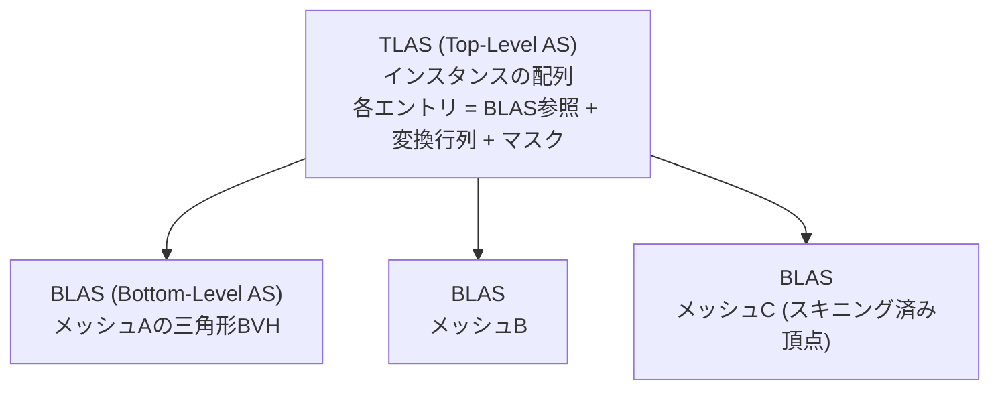

# ハードウェアレイトレーシング (DXR / Vulkan Ray Tracing)

## 概要

ハードウェアレイトレーシングでは、シーンに対して任意のレイを飛ばし、BVH（境界ボリューム階層）を使う処理のうち、ボックスや三角形との交差判定などを専用回路で加速します。走査制御まで専用化する範囲はベンダーや世代によります。2018年のNVIDIA TuringとDXRで実用化が始まり、ラスタライズでは扱いにくい影、反射、GI、パストレーシングを直接計算できるようになりました。ラスタライズと併用して、レイがシーンの何に当たるかを調べます。

## なぜ必要なのか

ラスタライズは「カメラから見えるもの」しか知りません。しかし:

- 反射は「別の場所から見えるもの」、影は「光源から見えるもの」、GIは「あらゆる場所から見えるもの」が必要
- 画面空間技法 ([SSR](/graphics/lighting/ssr.html)/[SSAO](/graphics/lighting/ssao.html)) はこの欠落の応急処置であり、画面外・遮蔽領域で原理的に破綻する
- レイトレーシングは**任意の点から任意の方向の可視性**を問える唯一の統一解

## 歴史・誕生した背景

- 1968: Appel のレイキャスティング / **1980: Whitted の再帰レイトレーシング** — 理論の原点
- 1986: Kajiya がレンダリング方程式とパストレーシングを提示。2010年代には映画制作でもパストレーシングを用いるレンダラーが普及した。[パストレーシングの系譜](/graphics/lighting/path-tracing.html)
- 2000年代: リアルタイムRT研究 (OpenRT、IntelのLarrabee構想、NVIDIA OptiX 2009)
- **2018: Turing (RTX 20) + DXR** — BVH走査と三角形交差をハードウェアで加速。『Battlefield V』は2018年11月の更新でDXRによる反射を追加
- **2019: Metro Exodus** — 2019年2月の発売時にレイトレーシングによる間接照明を採用
- 2020: Vulkan Ray Tracing (KHR) 標準化、PS5/Xbox Series X|S にRT搭載 (RDNA2)
- 2022-23: Ada/RDNA3世代で性能向上、Cyberpunk 2077 Overdrive (フルパストレーシング) → [パストレーシング](/graphics/lighting/path-tracing.html)
- 現在: 影・反射・GIの「品質オプション」から、Lumen HWモードやRestir系を通じて標準機能へ浸透中

## それ以前の技術

画面空間技法 (SSR/SSAO/SSGI)、シャドウマップ、プローブ群 — いずれも「レイを飛ばせない」制約下の近似でした。

## 解決した課題

1. 画面外・遮蔽領域を含む正確な可視性クエリ
2. 面光源の物理的に正しいソフトシャドウ
3. 任意曲面の正確な反射・屈折
4. パストレーシングによる統一的なGI

## 現在の位置づけ

ハイエンドPC/コンソールで実用段階。**コストの主戦場はレイそのものより「少ないレイからのノイズ除去 (デノイズ)」と「BVH更新」**に移っています。モバイルにもRT搭載SoCが登場済み。「レイ予算は1ピクセル1本以下」が普通であり、確率的サンプリング+時間的再構成 (ReSTIR等) が本体と言える状況です。

## 内部動作

### 加速構造 (BVH)

シーンを包む階層ボックス木。DXR/VKでは2階層に標準化されています:



- **BLAS**: 三角形や手続き形状の境界箱をまとめます。形状が変わった場合は、APIの更新条件と、更新後の走査効率を見て、更新か再構築を選びます。
- **TLAS**: BLASを参照するインスタンスをまとめます。インスタンスの変換や構成が変わったら、反映に必要な更新や再構築を行います。[Direct3D 12の更新フラグ](https://learn.microsoft.com/en-us/windows/win32/api/d3d12/ne-d3d12-d3d12_raytracing_acceleration_structure_build_flags) · [Vulkanの更新条件](https://docs.vulkan.org/refpages/latest/refpages/source/vkCmdBuildAccelerationStructuresKHR.html)
- RTコアが行うのは**ボックス交差とレイ-三角形交差**。シェーディングは通常のシェーダコアで実行

境界箱がどのように枝を省くかは、[BVHとAABB](/algorithms/bounding-volume-hierarchies.html)で図を使って説明しています。

### シェーダパイプライン (DXR)

| シェーダ | 実行タイミング |
|---|---|
| **Ray Generation** | 起点。ピクセルごと等でレイを発射 |
| **Closest Hit** | 最も近いヒットで実行 (シェーディング) |
| **Any Hit** | 全ヒット候補で実行 (アルファテスト用、重い) |
| **Miss** | 何にも当たらなかった (スカイ) |
| **Intersection** | カスタム形状 (球・SDF等) の交差判定 |

シェーダは **Shader Binding Table (SBT)** で「どのジオメトリに当たったらどのシェーダ+リソースを使うか」を引く、GPU上の仮想関数テーブルのような構造で結ばれます。

**DXR 1.1 / VK Ray Query**: 別方式として、通常のCompute/PixelシェーダからレイをインラインでトレースできるRayQuery APIがあり、影やAOのような単純用途ではこちらが軽量で主流です。

### レイのコスト特性

- ラスタと逆で、**コヒーレンス (レイの揃い具合) が性能を支配**: 一次レイは速いが、拡散GIのランダムレイはメモリアクセスが散乱して遅い
- Any-Hit (アルファテスト) はトラバーサルを中断するため高価 — RTでは「不透明フラグ」の管理が重要
- BVH品質 (ビルドオプション) とインスタンスマスクによる選別が実効性能を左右

## 各環境での扱い

### Unity
HDRPでRT対応 (RT Shadows / Reflections / GI / AO、`Ray Tracing` 対応シェーダ)。Unity 6.0の機能比較表では、WindowsのDirectX 12環境とPS5・Xbox Seriesが対応します。`SystemInfo.supportsRayTracing`、C#では `RayTracingAccelerationStructure` / `RayTracingShader`。URPは非対応 (2025時点)。[Unity 6.0の機能比較表](https://docs.unity.com/en-us/engine/6000.0/manual/render-pipelines/choose-a-render-pipeline/feature-comparison#raytracing)

### Unreal Engine
UE4.22でRT機能導入 → UE5では **Lumen HW モード / Virtual Shadow Map補完 / Path Tracer** に整理。`r.Lumen.HardwareRayTracing 1`。スタンドアロンRT機能 (RT Reflections等の旧UI) は非推奨化しLumenへ統合されました。

### DirectX 12
**DXR** (`ID3D12Device5::CreateStateObject`、`DispatchRays`)。SM6.3のHLSL (`TraceRay`, `RayDesc`)。DXR 1.1で `RayQuery` (インライン)。

### Vulkan
`VK_KHR_acceleration_structure` で加速構造を扱います。レイトレーシング専用のシェーダーステージを使うときは `VK_KHR_ray_tracing_pipeline`、既存のステージ内でレイの結果を問い合わせるときは `VK_KHR_ray_query` を使います。二つの機能は別々に対応を確認します。GLSLでは、前者に `GL_EXT_ray_tracing`、後者に `GL_EXT_ray_query` を使います。

## コード例

RayQuery（インラインRT）による二値の影です。DXR Tier 1.1とHLSL Shader Model 6.5が必要です。`dxc -T ps_6_5 -E ShadowPS RayQueryShadow.hlsl` でコンパイルできます。例では不透明な三角形だけを調べ、非不透明のプリミティブと手続き的プリミティブを除外します。`dirToLight` は正規化した光源方向、`maxDist` はその方向の光源までの距離です。

```hlsl
RaytracingAccelerationStructure gScene : register(t0);

float TraceShadowRay(float3 posWS, float3 dirToLight, float maxDist)
{
    RayDesc ray;
    ray.Origin    = posWS;
    ray.Direction = dirToLight;
    ray.TMin      = 0.01;        // シーンの単位に合わせた最小距離
    ray.TMax      = maxDist;

    RayQuery<RAY_FLAG_ACCEPT_FIRST_HIT_AND_END_SEARCH |
             RAY_FLAG_CULL_NON_OPAQUE |
             RAY_FLAG_SKIP_PROCEDURAL_PRIMITIVES> q;
    q.TraceRayInline(gScene, RAY_FLAG_NONE, 0xFF, ray);
    q.Proceed();                 // 不透明な三角形のみなので1回で完了

    // 何かに当たれば影 (最初のヒットで打ち切り = 影レイの定石)
    return (q.CommittedStatus() == COMMITTED_TRIANGLE_HIT) ? 0.0 : 1.0;
}

float4 ShadowPS(float3 posWS : TEXCOORD0) : SV_Target
{
    const float3 sunDirection = normalize(float3(1.0, 2.0, 1.0));
    float visibility = TraceShadowRay(posWS, sunDirection, 100.0);
    return float4(visibility.xxx, 1.0);
}

// 面光源のソフトシャドウ: 光源上のランダム点へ複数レイ + デノイズが実戦形
```

アルファテスト付きの草や柵も遮蔽物にする場合は、非不透明の三角形を除外せず、`Proceed()` が `true` を返すたびに候補を調べます。不透明と判定した候補を `CommitNonOpaqueTriangleHit()` で確定します。

DXRパイプラインのRay Generation (概形):

```hlsl
[shader("raygeneration")]
void RayGen() {
    uint2 pixel = DispatchRaysIndex().xy;
    RayDesc ray = GeneratePrimaryRay(pixel);   // カメラからのレイ

    Payload p = { float3(0,0,0) };
    TraceRay(gScene, RAY_FLAG_NONE, 0xFF,
             0 /*hitGroup*/, 1, 0 /*miss*/, ray, p);
    gOutput[pixel] = float4(p.color, 1);
}
```

## 前提知識

- [GI総論](/graphics/lighting/gi.html), [シャドウ](/graphics/lighting/shadow.html), [SSR](/graphics/lighting/ssr.html) — 解こうとしている問題
- [DirectX 12](/graphics/api/directx12.html) / [Vulkan](/graphics/api/vulkan.html)

## 次に読むべきページ

- [パストレーシング](/graphics/lighting/path-tracing.html) — RTの究極形
- [Lumen](/graphics/lighting/lumen.html) — HW RTの実戦投入例
- [アップスケーリング](/graphics/postprocess/upscaling.html) — RTコストを賄う相棒

## 理解度チェック

1. **RTコアがハードウェア化したのは何で、していないのは何か。この分担の理由は。**
   ::: details 解答
   ハードウェア化の代表例はBVHノード(AABB)との交差判定とレイ-三角形交差判定。NVIDIAのRTコアは走査制御も担当する一方、AMD RDNA 2/3はシェーダー側の走査と交差判定用の専用回路を組み合わせるなど、分担はベンダー・世代による。通常のシェーダー等が行うのは: ヒット後のシェーディング、レイの生成、BVHの構築(ドライバ/Computeで実行)。交差判定は演算パターンが固定的で頻度が桁違いに高く専用回路の効果が大きい一方、シェーディングは任意コードなので汎用コアに残すのが合理的なため。
   :::

2. **影レイが「最初のヒットで打ち切れる」のはなぜか。Closest Hitが不要な理由と合わせて述べよ。**
   ::: details 解答
   影の判定は「光源との間に遮蔽物が1つでもあるか」という二値の可視性クエリなので、最も近い遮蔽物を求める必要はない。`RAY_FLAG_ACCEPT_FIRST_HIT_AND_END_SEARCH` を指定すれば、遮蔽物として確定した最初のヒットで打ち切れる。インラインの `RayQuery` は探索結果を呼び出し元に返し、Closest Hit シェーダーは起動しない。
   :::

3. **「拡散GIのレイは一次レイより遅い」理由をメモリの観点から説明せよ。**
   ::: details 解答
   一次レイは隣接ピクセルでレイ方向・通過するBVHノードがほぼ同じ(コヒーレント)で、キャッシュが効く。拡散GIは各ピクセルが半球上のランダム方向へ飛ぶため、隣接レイが全く別のBVH枝・別のジオメトリにアクセスし、メモリアクセスが散乱してキャッシュ効率とSIMT効率が崩壊する。レイソートやコヒーレンス回復が研究テーマになっている理由。
   :::

## 参考資料

- [Microsoft — DirectX Raytracing (DXR) Functional Spec、RayQuery::Proceed](https://microsoft.github.io/DirectX-Specs/d3d/Raytracing.html#rayquery-proceed)
- [Khronos — VK_KHR_ray_tracing_pipeline](https://docs.vulkan.org/refpages/latest/refpages/source/VK_KHR_ray_tracing_pipeline.html)、[VK_KHR_ray_query](https://docs.vulkan.org/refpages/latest/refpages/source/VK_KHR_ray_query.html)、[GL_EXT_ray_query](https://github.com/KhronosGroup/GLSL/blob/main/extensions/ext/GLSL_EXT_ray_query.txt)
- [NVIDIA — Battlefield V のDXR反射の提供開始（2018年11月）](https://www.nvidia.com/en-us/geforce/news/battlefield-v-rtx-ray-tracing-out-now/)、[Metro Exodus の発売日とレイトレーシングによるGI（2019年2月）](https://www.nvidia.com/en-us/geforce/news/battlefield-v-metro-exodus-ray-tracing-dlss/)
- NVIDIA, *"Introduction to NVIDIA RTX and DirectX Ray Tracing"* / *Ray Tracing Gems I & II* (無料公開)
- Khronos, *Vulkan Ray Tracing Best Practices*
- *Physically Based Rendering* (pbrt) — 理論の標準教科書
- [AMD: RDNA performance guide — ray traversal](https://gpuopen.com/learn/rdna-performance-guide/)
- [NVIDIA: Turing GPU architecture](https://images.nvidia.com/aem-dam/en-zz/Solutions/design-visualization/technologies/turing-architecture/NVIDIA-Turing-Architecture-Whitepaper.pdf)
