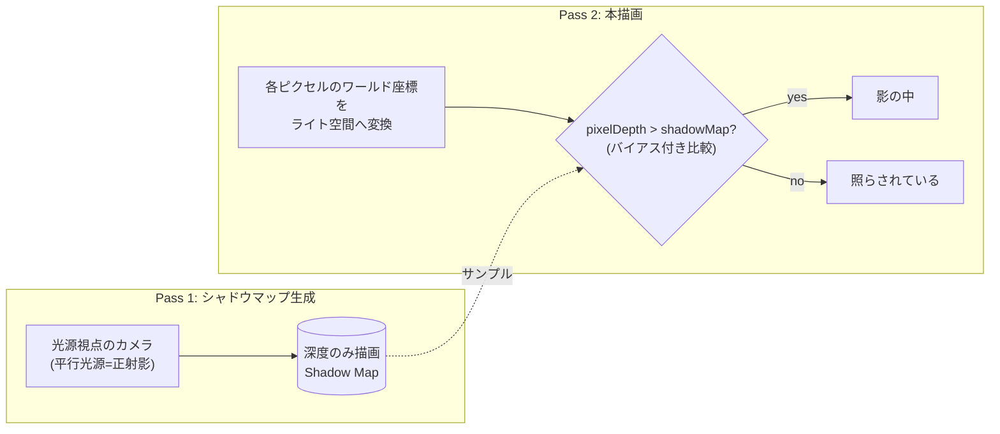

# シャドウ

## 概要

影は「光源から見えない場所」です。リアルタイムでの標準解は**シャドウマッピング** — 光源を仮想カメラとして深度マップを描き、シェーディング時に「その点は光源から見えるか」を深度比較で判定する手法です。単純な原理に対し、**エイリアシング・アクネ・ピーターパニング**という魔物が潜み、CSM・PCF・PCSSなど無数の改良が積み重ねられてきた、リアルタイムレンダリング随一の「沼」です。

## なぜ必要なのか

- 影は**接地感と空間関係の知覚**そのもの。影のないCGは即座に嘘くさくなる
- ライティング方程式の可視性項 $V(\mathbf{p}, \mathbf{l})$ の実装 — PBRがどれだけ正しくても、影がなければ光は壁を透過する
- 影の品質とコストはフレーム予算の主要項目 (AAAでGPU時間の10-20%は普通)

## 歴史・誕生した背景

- **1978: Williams がシャドウマッピング提案** — 深度バッファの発明 (Catmull 1974) の直後
- 1977: Crow の**シャドウボリューム** — もう一つの系譜
- 2004: Doom 3 がステンシルシャドウボリューム (Carmack's Reverse) の頂点に — ピクセル精度だがジオメトリコストと柔らかい影の困難で衰退
- 2001-06: ハードウェアPCF (NVIDIA)、**PSM/LiSPSM/CSM** — 透視エイリアシングとの戦い
- 2005: Fernando の **PCSS** (コンタクトハードニング)
- 2006: **VSM** (分散シャドウマップ)、2011: Moment SM 系
- 2007頃〜: **CSM (Cascaded Shadow Maps)** が屋外の平行光源の標準として定着
- 2018〜: レイトレース影 (DXR) — 正確なソフトシャドウの新系譜 → [レイトレーシング](/graphics/lighting/raytracing.html)
- 2021: UE5 **Virtual Shadow Maps** — 16K仮想解像度のページング式シャドウマップ (Nanite世代の解)

## それ以前の技術

**丸影 (blob shadow)** — キャラの足元に楕円テクスチャを置くだけ。PS1/PS2時代の標準で、接地感のみを最低限確保していました。シャドウボリュームはその後の代替でしたが上記の理由で敗退しました。

## 解決した課題

シャドウマッピングは「任意のジオメトリが任意のジオメトリに落とす動的な影」を、ラスタライザの速度で解きました。

## 現在の位置づけ

CSM+PCFが依然として業界標準。最先端はVirtual Shadow Maps (UE5) とレイトレース影の併用期に入っています。「シャドウマップの各種アーティファクトと対策」はレンダリングエンジニア面接の定番でもあります。

## 内部動作

### 基本アルゴリズム



```hlsl
float ShadowFactor(float3 posWS) {
    float4 posLS = mul(gLightViewProj, float4(posWS, 1));
    posLS.xyz /= posLS.w;
    float2 uv = posLS.xy * float2(0.5, -0.5) + 0.5;
    float depth = posLS.z;
    // ハードウェアPCF比較サンプラ (SampleCmp)
    return gShadowMap.SampleCmpLevelZero(gShadowSampler, uv, depth - gBias);
}
```

### 三大アーティファクトと対策

| 症状 | 原因 | 対策 |
|---|---|---|
| **シャドウアクネ** (縞模様のセルフシャドウ) | シャドウマップのテクセルが面を階段状に量子化し、自分の影に入る | 深度バイアス、**slope-scaled bias**、法線方向オフセット |
| **ピーターパニング** (影が浮く) | バイアスのかけすぎ | バイアス最小化+front-face culling でマップを描く |
| **エイリアシング** (ギザギザ) | カメラ近くでテクセル密度不足 (透視エイリアシング) | **CSM**、解像度、PCF/フィルタリング |

### CSM (Cascaded Shadow Maps)

視錐台をカメラ距離で3〜4分割し、**近くは高密度・遠くは低密度**の複数マップを使い分けます。分割は対数+線形のブレンドが定石。カスケード境界のちらつきは、テクセルスナップ (光源空間でマップをテクセル単位に量子化) で抑えます。

### ソフトシャドウ

- **PCF**: 近傍を複数サンプルして平均 — 半影というより「柔らかい縁」。Poisson диスクサンプル+回転が定番
- **PCSS**: 遮蔽物までの距離から半影サイズを推定して可変フィルタ — 光源サイズに応じた「コンタクトハードニング」(接地部はシャープ、離れるとボケる)
- **VSM/ESM/MSM**: 深度の統計量 (分散等) を格納しハードウェアフィルタ・ミップを可能に。ライトリーク (light bleeding) が代償
- **レイトレース影**: 面光源への複数レイ+デノイズ。物理的に正しい半影 → [レイトレーシング](/graphics/lighting/raytracing.html)

## 各環境での扱い

### Unity
Directional は CSM (最大4分割、`Shadow Cascades` 設定)。URPは `ShadowCaster` パスを持つシェーダが投影。ソフトシャドウはPCF。`Shadows.hlsl` の `MainLightRealtimeShadow()`。ポイントライトはキューブマップ6面 (URPは対応バージョン以降)。

### Unreal Engine
既定はCSM+PCF。**Virtual Shadow Maps** (UE5, Nanite前提で16Kページング、`r.Shadow.Virtual.Enable`)、Distance Field Shadows (中距離のSDFレイマーチ影)、レイトレース影の4系統を距離と設定で使い分けます。

### DirectX 12
深度専用パス (PSOのRTV無し+DSVのみ、`SlopeScaledDepthBias` をラスタライザステートに設定) → 比較サンプラ (`D3D12_FILTER_COMPARISON_MIN_MAG_LINEAR_MIP_POINT`) で参照。

### Vulkan
同様に `VkSamplerCreateInfo::compareEnable = VK_TRUE`。深度フォーマットは `VK_FORMAT_D32_SFLOAT`、`vkCmdSetDepthBias` が利用可能です。

## コード例

CSM選択+PCFの実装骨格 (HLSL):

```hlsl
Texture2DArray gCascades : register(t3);       // 4カスケードを配列テクスチャに
SamplerComparisonState gCmp : register(s3);
cbuffer ShadowCB : register(b2) {
    float4x4 gCascadeVP[4];
    float4   gCascadeSplits;                   // ビュー空間分割深度
};

float SampleShadowPCF(int cascade, float3 posWS, float NdotL) {
    float4 p = mul(gCascadeVP[cascade], float4(posWS, 1));
    p.xyz /= p.w;
    float2 uv = p.xy * float2(0.5, -0.5) + 0.5;

    // 法線・勾配に応じたバイアス
    float bias = max(0.002 * (1.0 - NdotL), 0.0005);

    // 3x3 PCF
    float sum = 0;
    [unroll] for (int y = -1; y <= 1; ++y)
    [unroll] for (int x = -1; x <= 1; ++x)
        sum += gCascades.SampleCmpLevelZero(gCmp,
                 float3(uv + float2(x, y) * gTexelSize, cascade),
                 p.z - bias);
    return sum / 9.0;
}

float ShadowCSM(float3 posWS, float viewZ, float NdotL) {
    int c = (viewZ < gCascadeSplits.x) ? 0 :
            (viewZ < gCascadeSplits.y) ? 1 :
            (viewZ < gCascadeSplits.z) ? 2 : 3;
    return SampleShadowPCF(c, posWS, NdotL);
}
```

## 前提知識

- [カメラと射影](/math/rendering/camera.html) — 光源視点の正射影/透視射影
- [座標変換](/math/rendering/transform.html), [出力結合](/graphics/pipeline/output-merger.html) (深度)

## 次に読むべきページ

- [GI総論](/graphics/lighting/gi.html) — 影の先にある間接光
- [レイトレーシング](/graphics/lighting/raytracing.html) — 影の次世代解
- [PBR](/graphics/lighting/pbr.html) — 可視性項が繋がる先

## 理解度チェック

1. **シャドウアクネの発生原理と、slope-scaled biasが有効な理由を説明せよ。**
   ::: details 解答
   シャドウマップは光源から見た深度を有限解像度のテクセルで量子化するため、1テクセルが表す深度は面上の代表1点の値になる。斜めの面ではテクセル内で実際の深度が連続的に変化するので、比較時に「自分自身の記録値より奥」と誤判定される点が縞状に生じる。面の勾配が急なほど量子化誤差が大きいため、深度の傾き(slope)に比例したバイアスを加えるslope-scaled biasが幾何学的に正しい補正になる。
   :::

2. **CSMが解決する「透視エイリアシング」とは何か。**
   ::: details 解答
   カメラの透視投影により画面上の手前は狭いワールド領域が大きく映り、遠方は広い領域が小さく映る。一様解像度のシャドウマップでは手前のスクリーンピクセルあたりのシャドウテクセル数が不足しギザギザになる。CSMは視錐台を距離分割し、近距離ほど狭い範囲に高解像度マップを割り当てて、スクリーン上のテクセル密度を均す。
   :::

3. **PCSSが「コンタクトハードニング」を実現する仕組みを述べよ。**
   ::: details 解答
   面光源の半影サイズは、遮蔽物と受光面の距離に比例し、遮蔽物と光源の距離に反比例する。PCSSはまずシャドウマップ近傍から平均遮蔽物深度を求め(blocker search)、相似関係から半影幅を推定し、その幅でPCFフィルタ半径を可変にする。接地点では遮蔽物距離≈0で半径が小さくシャープに、離れるほど半径が大きくボケる。
   :::

## 参考資料

- Lance Williams, *"Casting Curved Shadows on Curved Surfaces"* (1978) — 原典
- Fernando, *"Percentage-Closer Soft Shadows"* (2005)
- Eisemann et al., *Real-Time Shadows* (書籍) — 影技術の百科事典
- MJP, *"Shadow Sample"* シリーズ / *"A Sampling of Shadow Techniques"*
- SIGGRAPH 2021/2022, *"Virtual Shadow Maps in UE5"* 関連講演
