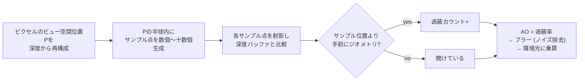

# SSAO (Screen-Space Ambient Occlusion)

## 概要

SSAOは**深度バッファ (と法線) だけを使って、近傍ジオメトリによる環境光の遮蔽 (Ambient Occlusion) を画面空間で近似する**技術です。2007年のCrysisで登場し、「G-Bufferから安価にGI風の陰影を得る」画面空間技法時代の扉を開きました。原理・限界・進化 (HBAO→GTAO) の全てが、スクリーンスペース技法の教科書です。

## なぜ必要なのか

- [IBL](/graphics/lighting/ibl.html) の環境光は遮蔽を考慮しない — 隅・溝・接地部も明るく照らしてしまい、物体が「浮いて」見える
- AOはこの環境光に可視性を掛ける項: 隅の暗さ・接地感という**知覚上極めて重要な手がかり**を安価に供給する
- フルGI (Lumen等) が使えない予算・プラットフォームでの「GIらしさ」の主力

## 歴史・誕生した背景

- 2002頃: 映画業界でAO (Landis, ILM) がGIの安価な代用として定着
- 事前計算AO (テクスチャベイク) はゲームでも普及したが、動的シーンに追従できない
- **2007: Crytek の Mittring が Crysis で SSAO を発表** ("Finding Next Gen") — 深度バッファを「シーンの近似」として使う発想の転換
- 2008: NVIDIA **HBAO** (Horizon-Based AO) — 水平線走査による精度向上
- 2012: **SSDO** (方向性を持つAO)、Alchemy AO
- **2016: GTAO** (Jimenez et al., Ground-Truth AO) — 現在の標準。コサイン重み付き可視性を正しく積分
- 2020年代: レイトレースAO、そしてフルGI (Lumen/RTGI) への吸収が進行

## それ以前の技術

頂点AO・テクスチャベイクAO (静的)、そして「AOなし」(2000年代半ばまでの大半のゲーム)。

## 解決した課題

動的シーン・動的カメラで毎フレーム更新される遮蔽項を、ジオメトリの複雑さに依存しない**O(ピクセル数)のコスト**で実現しました。

## 現在の位置づけ

依然ほぼ全タイトルに搭載されています (URPのSSAO、HDRP/UEのGTAO)。フルGI環境ではGIが広域遮蔽を担い、SSAOは「小規模ディテールの遮蔽 (micro-occlusion)」担当として共存します。限界 (画面外・厚み不明) は画面空間技法共通のものです → [GI総論](/graphics/lighting/gi.html)

## 内部動作

### 原理

各ピクセルについて「半球内の近傍がどれだけ塞がれているか」を、深度バッファへのサンプリングで推定します:



### 世代別アルゴリズム

| 世代 | 方式 | 特徴 |
|---|---|---|
| Crysis SSAO (2007) | 球状サンプル+深度比較 | 法線不使用。平面が灰色になる自己遮蔽アーティファクト |
| Normal-oriented (2008-) | 法線半球内でサンプル | 自己遮蔽解消。ランダム回転+ブラーでノイズ処理 |
| **HBAO** (2008) | 画面上を放射状に行進し「水平線角」を求める | 深度をハイトフィールドとみなす。高品質 |
| **GTAO** (2016) | 水平線ベース+コサイン重みの解析的積分+時間的蓄積 | 参照解 (レイトレAO) に一致するよう設計。現行標準 |

### 品質を支える周辺技術

- **ノイズと再構成**: 少サンプル+ピクセルごとの回転 (ブルーノイズ) → エッジ保存ブラー (bilateral) + **時間的蓄積 (TAA連携)** — 「確率的サンプリング+再構成」の典型構造
- **半解像度実行**: AOは低周波なので半解像度+アップサンプルが定番
- **バイアス/範囲設定**: サンプル半径 (ワールド固定か画面固定か)、薄い物体の**過剰遮蔽** (thickness仮定) の調整

## 各環境での扱い

### Unity
URP: Renderer Feature の SSAO (Depth/Depth-Normals ソース選択可)。HDRP: **GTAO実装** (`Ambient Occlusion` ボリューム)。どちらも `ScreenSpaceAmbientOcclusion` パスとしてFrame Debuggerで確認できます。

### Unreal Engine
既定でSSAO (旧) / **GTAO** (`r.AmbientOcclusion.Method 1`)。さらにDFAO (Distance Field AO、中距離)、RTAO (レイトレ)、Lumen有効時はLumenが遮蔽の大半を担当します。マテリアルのAOマップ (micro) とは乗算合成。

### DirectX 12 / Vulkan
Computeパスとして実装 (深度+法線SRV→AO UAV→ブラー→合成)。Intel の **XeGTAO** (オープンソース) が現代的リファレンス実装です。

## コード例

法線指向SSAOの核心 (HLSL Compute、簡略版):

```hlsl
Texture2D<float>  gDepth  : register(t0);
Texture2D<float3> gNormal : register(t1);
RWTexture2D<float> gAO    : register(u0);

[numthreads(8, 8, 1)]
void SSAOCS(uint3 id : SV_DispatchThreadID)
{
    float  depth = gDepth[id.xy];
    float3 P = ReconstructViewPos(id.xy, depth);      // 深度→ビュー空間位置
    float3 N = DecodeViewNormal(gNormal[id.xy]);

    // ピクセルごとに回転するサンプルカーネル (ブルーノイズ)
    float3x3 rot = MakeRotation(BlueNoise(id.xy));

    float occlusion = 0;
    const int SAMPLES = 8;
    for (int i = 0; i < SAMPLES; ++i) {
        float3 offset = mul(rot, gKernel[i].xyz);      // 半球内サンプル
        offset = (dot(offset, N) < 0) ? -offset : offset; // 法線半球へ
        float3 samplePos = P + offset * gRadius;

        float2 uv = ProjectToUV(samplePos);            // 再射影
        float  sceneDepth = LinearizeDepth(gDepth.SampleLevel(gPoint, uv, 0));

        // サンプル点よりシーンが手前 = 遮蔽。範囲チェックで遠景の誤遮蔽を防ぐ
        float rangeCheck = smoothstep(0, 1, gRadius / abs(P.z - sceneDepth));
        occlusion += (sceneDepth < samplePos.z - gBias) ? rangeCheck : 0;
    }
    gAO[id.xy] = 1.0 - (occlusion / SAMPLES);
    // 後段: bilateral blur → 環境光項に乗算
}
```

適用側 (ライティング統合):

```hlsl
// AOは環境光(IBL/アンビエント)のみに掛けるのが物理的に正しい
float3 color = directLighting                       // 直接光には掛けない
             + EvaluateIBL(...) * gAOTex[pixel];    // 環境光にのみ乗算
```

## 前提知識

- [座標変換](/math/rendering/transform.html) — 深度からの位置再構成
- [Deferred Rendering](/graphics/path/deferred.html) — G-Buffer/深度の由来
- [Compute Shader](/graphics/compute/compute-shader.html)

## 次に読むべきページ

- [SSR](/graphics/lighting/ssr.html) — 同じ画面空間の鏡面版
- [GI総論](/graphics/lighting/gi.html) — AOの位置づけ
- [TAA](/graphics/postprocess/taa.html) — 時間的蓄積という共通部品

## 理解度チェック

1. **AOを直接光に掛けてはいけない理由は。**
   ::: details 解答
   直接光の遮蔽は影(シャドウマップ)が正確に計算しており、AOは「全方位からの環境光がどれだけ遮られるか」の近似である。直接光にもAOを掛けると遮蔽が二重に適用され、光が当たっているのに黒ずむ物理的に誤った(そして汚く見える)結果になる。
   :::

2. **SSAOが「薄い物体の背後を過剰に暗くする」ことがある理由を述べよ。**
   ::: details 解答
   深度バッファは各ピクセルの最前面深度しか持たず、物体の厚みが分からない。サンプル点がシーン深度より奥にあると遮蔽と判定するが、実際には薄い板の裏側で空間が開いている場合もそう判定してしまう。thickness(想定厚)パラメータやrange checkで緩和するが、単一深度レイヤーである限り原理的に解決しない。
   :::

3. **GTAOが「Ground-Truth」を名乗る根拠は。**
   ::: details 解答
   従来のSSAOはヒューリスティックな遮蔽カウントで、レイトレースによる参照AO(コサイン重み付き可視性積分)と系統的にずれていた。GTAOは水平線角による可視円弧のコサイン重み付き積分を解析的に解く定式化を採り、同じ画面空間情報の制約下でモンテカルロ参照解に収束するよう設計されている点が名の由来。
   :::

## 参考資料

- Mittring, *"Finding Next Gen – CryEngine 2"* (SIGGRAPH 2007)
- Bavoil et al., *"Image-Space Horizon-Based Ambient Occlusion"* (2008)
- Jimenez et al., *"Practical Realtime Strategies for Accurate Indirect Occlusion"* (GTAO, 2016)
- Intel, *XeGTAO* (GitHub) — 実装リファレンス
