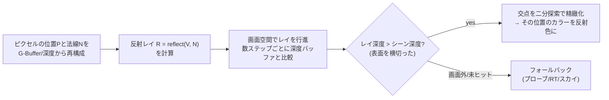

# SSR (Screen-Space Reflections)

## 概要

SSR (Screen-Space Reflections) は、**深度バッファとカラーバッファを使い、画面内に映っているものの反射をレイマーチングで求める**技術です。濡れた床・水面・光沢のある机に映る像を、追加のシーン描画なしで実現します。リフレクションプローブ ([IBL](/graphics/lighting/ibl.html)) の「動的でない・視差が粗い」という穴を埋める、現代の反射パイプラインの中核部品です。

## なぜ必要なのか

- プローブは事前撮影のため**動的オブジェクト (キャラクタ) が映らない**、位置精度も粗い
- 平面リフレクション (シーンをもう1回描く) は高品質だが**コストが倍**で平面にしか使えない
- SSRは「すでに描いた絵」を再利用するため、動くものが正しく映り、コストも一定 — 3者のいいとこ取りの位置にある

## 歴史・誕生した背景

- 2011-12: Crysis 2 / Killzone Shadow Fall 等で実用化が始まる (深度バッファレイマーチングというアイデア自体はリレーフマッピング等の延長)
- 2014: **Morgan McGuire & Mara の "Efficient GPU Screen-Space Ray Tracing"** — DDAベースの正確な行進の標準的定式化
- 2015: Frostbite の **Stochastic Screen-Space Reflections** (Stachowiak) — ラフネス対応の確率的SSRとフィルタリング。現代実装の原型
- 2018〜: レイトレース反射 (DXR) が上位互換として登場。ただしコスト差から**SSRでヒットしなければRT/プローブへフォールバック**というハイブリッドが定着
- 2021: Lumen反射 — SSR→SDF/BVHトレースの多段フォールバックとして統合

## それ以前の技術

- **平面リフレクション**: 反射行列でシーンを再描画。鏡・水面専用で高コスト
- **リフレクションプローブ**: 静的キューブマップ → [IBL](/graphics/lighting/ibl.html)
- キューブマップ+フレネルのみ (2000年代の「濡れ」表現)

## 解決した課題

動的シーンの映り込みを、シーン複雑度に依存しないスクリーンスペースコストで実現。特に「地面に映るキャラクタ」という知覚的に重要なケースを解決しました。

## 現在の位置づけ

ほぼ全AAAタイトルに搭載。単独では画面空間の限界 (後述) があるため、**SSR → (RT / SDFトレース) → プローブ → スカイ**という多段フォールバックチェーンの最前段として位置づけられます。

## 内部動作

### 基本アルゴリズム



### 実装の要点

1. **画面空間DDA (McGuire-Mara)**: レイをビュー空間でなく**画面空間でピクセル単位に行進**することで、遠近によるステップの過疎・過密を防ぐ
2. **階層Zトラバーサル (Hi-Z)**: 深度のminミップピラミッドを使い、空いている空間を大股で跳ぶ — 高速化の定番
3. **ラフネス対応 (Stochastic SSR)**: GGX重点サンプリングで反射方向を確率的に散らし、1spp+**時間的蓄積+空間フィルタ**でざらつきを解消。プレフィルタ済みカラー (mip) の併用
4. **エッジフェード**: 画面端・レイ方向がカメラへ向く場合に減衰させ、破綻を隠す
5. **フォールバック合成**: ヒット信頼度でSSR/プローブをブレンド

### 画面空間の限界 (SSAOと共通)

- **画面外のものは映らない**: 背後の物体、カメラ外の空
- **遮蔽領域の情報がない**: 手前の物体の裏は映せない
- 単一深度レイヤー: 薄い物体の裏側等で破綻
- カメラ移動で反射が「剥がれる」— これらの解決がRT反射の動機です

## 各環境での扱い

### Unity
HDRP: SSR標準搭載 (`Screen Space Reflection` ボリューム、Transparent対応、RTフォールバックあり)。URP: 標準にはなく、カスタム実装かアセットで対応 (モバイル帯域への配慮)。

### Unreal Engine
`r.SSR.Quality`。既定で有効な歴史の長い実装。Lumen有効時はLumen Reflections (SSR→Lumen Scene トレースの多段) に置き換わります。High Quality時はStochastic方式。

### DirectX 12 / Vulkan
Computeパスとして実装。AMD **FidelityFX SSSR** (Stochastic Screen Space Reflections) がオープンソースの高品質リファレンスです。

## コード例

画面空間レイマーチの骨格 (HLSL、簡略線形版):

```hlsl
float3 TraceSSR(float3 posVS, float3 normalVS, float2 uv)
{
    float3 V = normalize(posVS);                   // ビュー空間: カメラは原点
    float3 R = reflect(V, normalVS);

    // レイの始点・終点をクリップ空間→画面空間へ
    float3 rayStart = posVS + normalVS * 0.01;
    float3 rayEnd   = rayStart + R * gMaxDistance;
    float4 h0 = mul(gProj, float4(rayStart, 1));
    float4 h1 = mul(gProj, float4(rayEnd, 1));
    float2 uv0 = NdcToUv(h0.xy / h0.w);
    float2 uv1 = NdcToUv(h1.xy / h1.w);

    const int STEPS = 64;
    float prevRayZ = posVS.z;
    for (int i = 1; i <= STEPS; ++i) {
        float t = (float)i / STEPS;
        float2 uvCur = lerp(uv0, uv1, t);
        if (any(uvCur < 0) || any(uvCur > 1)) break;      // 画面外

        // 透視補正付きでレイのビュー深度を補間 (1/zが線形)
        float rayZ = 1.0 / lerp(1.0 / rayStart.z, 1.0 / rayEnd.z, t);
        float sceneZ = LinearDepth(gDepth.SampleLevel(gPoint, uvCur, 0));

        if (rayZ > sceneZ + 0.01 && rayZ < sceneZ + gThickness) {
            // ヒット: 二分探索で精緻化後、カラーを返す (簡略化)
            return gSceneColor.SampleLevel(gLinear, uvCur, 0).rgb
                 * EdgeFade(uvCur);
        }
        prevRayZ = rayZ;
    }
    return SampleReflectionProbe(R);               // フォールバック
}
```

## 前提知識

- [座標変換](/math/rendering/transform.html) — 空間の往復 (再構成と再射影)
- [IBL](/graphics/lighting/ibl.html) — フォールバック先
- [PBR](/graphics/lighting/pbr.html) — ラフネスと反射の関係

## 次に読むべきページ

- [ハードウェアレイトレーシング](/graphics/lighting/raytracing.html) — SSRの限界の解
- [Lumen](/graphics/lighting/lumen.html) — 多段フォールバックの完成形
- [TAA](/graphics/postprocess/taa.html) — 確率的手法の再構成部品

## 理解度チェック

1. **SSRのレイマーチをビュー空間の等間隔でなく画面空間で行う理由は。**
   ::: details 解答
   ビュー空間等間隔だと、手前のレイは画面上で数十ピクセルを飛び越え(交差の見逃し)、遠方では同じピクセルを何度も踏む(無駄)。画面空間でピクセル単位に行進すれば、深度バッファの解像度に整合したサンプリング密度になり、見逃しと重複の両方を防げる。ビュー深度は1/zが画面上で線形なことを利用して透視補正補間する。
   :::

2. **「thickness」パラメータは何の情報の欠如を補っているか。**
   ::: details 解答
   深度バッファは表面の深度のみで物体の厚みを持たないため、レイが表面より奥に入った際に「物体を貫通した」のか「物体の裏の空間を通っている」のか区別できない。仮定の厚みを設定し、表面からthickness以内ならヒット、それより奥なら貫通として扱うことで、無限に厚い壁とみなす誤ヒットを防いでいる。
   :::

3. **現代エンジンの反射が「SSR→RT/SDF→プローブ」の多段構成をとる理由を、各段の特性から説明せよ。**
   ::: details 解答
   SSRは最安価で動的物体も映るが画面内限定。RT/SDFトレースは画面外も正確だが高コスト(または粗い)。プローブはほぼ無料だが静的で粗い。ヒット可能ならSSR、外れたらRT/SDF、それも無効ならプローブ、と信頼度順にフォールバックすることで、品質とコストの期待値を最適化している。
   :::

## 参考資料

- McGuire & Mara, *"Efficient GPU Screen-Space Ray Tracing"* (JCGT 2014)
- Stachowiak, *"Stochastic Screen-Space Reflections"* (SIGGRAPH 2015, Frostbite)
- AMD FidelityFX SSSR (GPUOpen)
- EA SEED / Frostbite の Hybrid RT Reflections 講演 (2018-)
