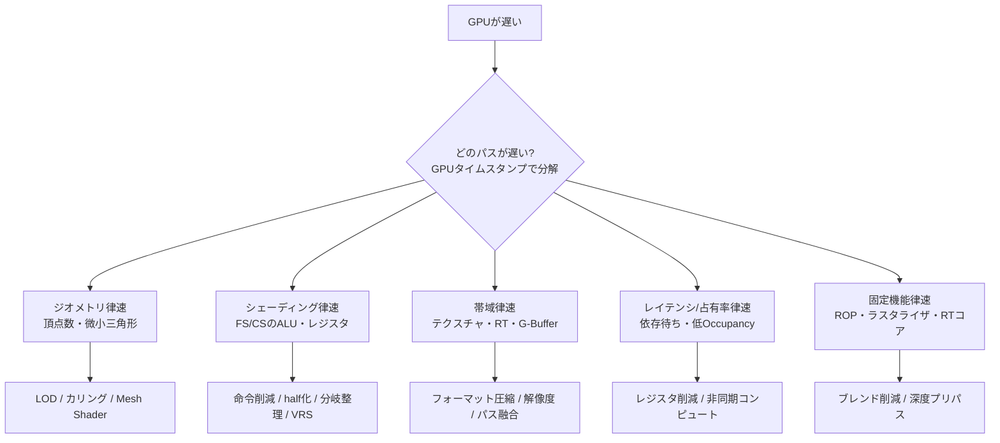

# GPU最適化の基礎

## 概要

GPU最適化とは、**フレーム時間を計測し、ボトルネックを特定し、それを解消する**という規律あるプロセスです。このページでは最適化の方法論 (計測→特定→仮説→検証)、GPUのボトルネックの分類 (ジオメトリ/シェーディング/帯域/CPU)、そして定番の最適化技法カタログを提供します。**憶測での最適化は禁物 — 全てはプロファイラから始まります** → [ツール](/graphics/optimization/tools.html)

## なぜ必要なのか

- フレーム予算は非情です: 60fps = **16.6ms**、VRの90fps = 11.1ms。この中に全てを収める
- GPUは「どこが遅いか」が直感に反しやすい (ALUは余りがち、真犯人は帯域・レイテンシ・占有率)
- 最適化の知識は設計の知識: 後から直すより、遅くならない設計を最初から選べるようになる

## 歴史・誕生した背景

- 固定機能時代: フィルレートとポリゴン数がすべての単純な世界
- 2000年代: プログラマブル化で「シェーダの書き方」が性能を左右し始める。GPU Gems等でテクニック集積
- 2010年代: プロファイラの成熟 (PIX、Nsight、RenderDoc 2014〜) で計測駆動が可能に
- DX12/Vulkan世代: バリア・PSO・メモリ管理がアプリ責務になり、**「APIの使い方」自体が最適化領域**に
- 現在: 非同期コンピュート、アップスケーラ前提の予算設計、GPU Drivenによるドローコール問題の根絶が主戦場

## それ以前の技術 / 解決した課題

「経験則と勘」から「計測とアーキテクチャ理解」への転換が、この分野の歴史そのものです。

## 現在の位置づけ

レンダリングエンジニアの日常業務です。以下のフレームワークはハードウェアが変わっても通用する「考え方」として整理しています。

## 内部動作 — ボトルネックの分類学

### まず二分する: CPUバウンドか GPUバウンドか

→ [CPUとGPUの役割分担](/hardware/gpu/cpu-vs-gpu.html) の通り、解像度を変えて変化すればGPU、しなければCPUが第一容疑者です。

### GPU内のボトルネック分類



判定はプロファイラのユニット稼働率カウンタ (SM Occupancy, L2ヒット率, DRAM帯域, ROP稼働率...) で行います。

### 頻出ボトルネックと定番の対策

| 症状 | 原因 | 対策 |
|---|---|---|
| 不透明パスが重い | オーバードロー | 手前→奥ソート、深度プリパス、Hi-Z活用 |
| 遠景で重い | 微小三角形のクワッド非効率 | LOD、[Nanite的アプローチ](/graphics/optimization/gpu-driven.html) |
| パーティクルで激重 | 半透明オーバードロー (帯域+ROP) | 低解像度パーティクル、枚数/重なり削減 |
| シェーダが遅い | レジスタ圧でOccupancy低下 | 複雑シェーダの分割、`half`、ループ内再計算 → [実行モデル](/graphics/compute/execution-model.html) |
| テクスチャ律速 | キャッシュミス | ミップ必須、BC圧縮、アクセスの局所性 |
| ポストプロセスが重い | フル解像度・多パス | 半解像度化、パス融合、Compute化+LDS活用 |
| 何も描いてないのに遅い | バリアによるパイプラインバブル | バリアの統合・非同期コンピュートで埋める |

### 非同期コンピュート

固定機能が律速するパス (シャドウマップ=ラスタ/ROP律速) の裏で、ALU律速のCompute (SSAO、ライトカリング) を別キューで重ねる技法。DX12/Vulkanの明示的キューで実現します。効果はハードウェア依存 (AMDが伝統的に得意) で、**依存関係の設計 (フェンス) を誤ると逆効果**になるため計測必須です。

### 最適化の作法

1. **計測してから触る** (プロファイラのキャプチャがすべての起点)
2. **1度に1つ変える** (複合変更は因果が分からなくなる)
3. **代表シーンを固定する** (再現可能なベンチマークシーン+カメラパス)
4. ターゲットハードの**最下限機**で計測する
5. 「平均fps」でなく**フレーム時間の分布 (スパイク)** を見る

## 各環境での扱い

### Unity
Profiler (CPU/GPU)、**Frame Debugger** (ドロー単位)、Memory Profiler。SRP Batcher・GPU Instancing・GPU Resident Drawerがドローコール対策の柱。モバイルは帯域 (LoadAction/StoreAction) が最重要。

### Unreal Engine
`stat unit` / `stat gpu` / **Unreal Insights** / `ProfileGPU`。Scalability設定の体系 (sg.*) とNanite/VSM/Lumenの各品質ノブ。`r.ScreenPercentage` とTSRが予算調整の主役。

### DirectX 12
PIXのタイムライン+カウンタ分析。Enhanced Barriersでバリアを細粒度化、Copy/Computeキューの活用、PSOキャッシュ整備がAPIレベルの最適化。

### Vulkan
タイムスタンプクエリ+RenderDoc/Nsight/RGP。`VK_KHR_performance_query`。モバイルではrenderpassのload/storeOpとsubpass統合が帯域最適化の核心。

## コード例

GPUタイムスタンプによるパス別計測 (DX12):

```cpp
// クエリヒープ作成 (初期化時)
D3D12_QUERY_HEAP_DESC qd = { D3D12_QUERY_HEAP_TYPE_TIMESTAMP, kMaxQueries };
device->CreateQueryHeap(&qd, IID_PPV_ARGS(&queryHeap));

// 各パスの前後で記録
cmd->EndQuery(queryHeap.Get(), D3D12_QUERY_TYPE_TIMESTAMP, idx0); // パス開始
DrawShadowPass(cmd);
cmd->EndQuery(queryHeap.Get(), D3D12_QUERY_TYPE_TIMESTAMP, idx1); // パス終了

// フレーム末尾で読み戻しバッファへ解決 (数フレーム遅れて読む)
cmd->ResolveQueryData(queryHeap.Get(), D3D12_QUERY_TYPE_TIMESTAMP,
                      0, queryCount, readbackBuf.Get(), 0);
// CPU側: (t1 - t0) / timestampFrequency * 1000.0 = パスのms
```

オーバードロー可視化 (デバッグシェーダの定石):

```hlsl
// 加算ブレンドで「塗られた回数」を熱として見る
float4 OverdrawPS() : SV_Target {
    return float4(0.1, 0.02, 0.0, 1.0);   // Blend One One で加算
}
// 赤熱している場所 = オーバードロー地獄 = 最適化対象
```

## 前提知識

- [GPUアーキテクチャ詳解](/hardware/gpu/architecture.html), [GPU並列実行モデル](/graphics/compute/execution-model.html)
- [CPUとGPUの役割分担](/hardware/gpu/cpu-vs-gpu.html)

## 次に読むべきページ

- [デバッグ・プロファイリングツール](/graphics/optimization/tools.html) — 計測の道具
- [RenderGraph](/graphics/optimization/render-graph.html) — バリア・リソース管理の体系化
- [GPU Driven Rendering](/graphics/optimization/gpu-driven.html)

## 理解度チェック

1. **「ALUを減らす最適化」が効かないことが多いのはなぜか。**
   ::: details 解答
   現代GPUは演算能力(TFLOPS)に対しメモリ帯域が相対的に細く、多くのシェーダはメモリ待ちで演算器が遊んでいる(レイテンシ/帯域律速)。その状態でALU命令を減らしても待ち時間は変わらず総時間は改善しない。プロファイラでSM稼働率・メモリ帯域・ストール理由を確認し、律速要因に対応した最適化(アクセス削減、局所性改善、Occupancy向上)を選ぶ必要がある。
   :::

2. **深度プリパスと非同期コンピュートを組み合わせる典型的なフレーム構成を述べよ。**
   ::: details 解答
   フレーム冒頭の深度プリパス/シャドウマップはラスタライザ・ROP律速でシェーダコアが空きがちなので、その裏の非同期コンピュートキューでALU律速の処理(ライトカリング、SSAOの前段、スキニング等)を重ねる。互いに独立な資源を使う仕事を重ねることでGPU全体の稼働率を上げ、直列実行より総フレーム時間を短縮する。
   :::

3. **「平均60fpsなのにカクつく」場合、何を計測すべきか。**
   ::: details 解答
   フレーム時間の時系列とパーセンタイル(1% low等)。スパイクの原因は平均に埋もれる — 典型犯はシェーダ/PSOの実行時コンパイル、ストリーミングIO、GCやメモリアロケーション、特定イベント時のパス追加など。スパイクフレームをプロファイラで個別捕捉し、通常フレームとの差分を見る。
   :::

## 参考資料

- AMD GPUOpen / NVIDIA Developer の各性能ガイド (RDNA/Adaチューニングガイド)
- Emil Persson (Humus), 各種最適化講演
- SIGGRAPH *"Advances in Real-Time Rendering"* の性能系講演各年
- ARM *Mali Best Practices* — モバイル帯域最適化
