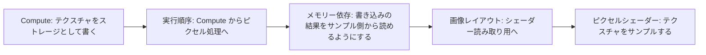

# Enhanced Barriers と Vulkan synchronization2 — 順序・アクセス・レイアウト

GPU 上で Compute シェーダーがテクスチャを書き、次の描画がそのテクスチャを読むとき、読み取りが先に走ったり、書いた内容が読み取り側に見えなかったりすると結果が壊れる。バリアには、どの処理を待つか、どのアクセス間で結果を引き渡すか、画像をどの用途のレイアウトにするかを指定する。

## バリアで指定する三つの情報



図の三つの項目は、一つのバリアに記述する役割。ハードウェアが三段階のコマンドを順に実行するという意味ではない。レイアウトの変更は画像で必要に応じて行い、バッファーには画像レイアウトがない。画像のレイアウトを変えない場合も、書き込みの結果を後で使うなら依存関係が必要になる。

| 指定 | Direct3D 12 Enhanced Barriers | Vulkan synchronization2 |
| --- | --- | --- |
| 実行の範囲 | `SyncBefore` と `SyncAfter` | `srcStageMask` と `dstStageMask` |
| メモリーアクセス | `AccessBefore` と `AccessAfter` | `srcAccessMask` と `dstAccessMask` |
| 画像のレイアウト | `LayoutBefore` と `LayoutAfter` | `oldLayout` と `newLayout` |
| 対象 | テクスチャのサブリソース、バッファー、またはグローバルのバリア | 画像のサブリソース、バッファーの範囲、またはグローバルのメモリーバリア |

列の項目は考え方を比較するための対応で、指定できる値やキュー間の規則は API ごとに異なる。下の例は同じグラフィックスキュー上に Compute と描画を記録する。別のキューにまたがるときは、Direct3D 12 ならキューのフェンス、Vulkan ならセマフォによる順序付けが加わる。Vulkan の排他共有画像を別のキューファミリーに渡す場合は、原則として所有権の移譲も扱う。

### 従来の API との違い

Direct3D 12 の従来の `ResourceBarrier` なら、この例は `D3D12_RESOURCE_STATE_UNORDERED_ACCESS` から `D3D12_RESOURCE_STATE_PIXEL_SHADER_RESOURCE` への遷移になる。このステートにはアクセス用途が含まれる。Enhanced Barriers は、実行の範囲、メモリーアクセス、画像レイアウトを分けて指定できる。遷移しない UAV 同士の依存も扱える。既存の `ResourceBarrier` と同じサブリソースで混在させる場合は、仕様の `COMMON` を介する規則に従う。

Vulkan の従来の `vkCmdPipelineBarrier` は、一回の呼び出しに渡すステージマスクを、その呼び出しのバリア群で共有する。synchronization2 はステージとアクセスの組を個々のバリアに持たせ、`VkDependencyInfo` にまとめる。ステージとアクセスのビットマスクは 64 ビットで、シェーダーの読み取りをサンプルとストレージなどに分けて指定できる。

広いマスクを使うと依存関係を記述しやすいが、関係のない処理まで待たせる可能性がある。使うステージや書き込みと読み取りの組を実際のパスと照合して指定する。

## コード例 — Compute の出力を描画で読む

次は同じ用途を二つの API で記録する C++20 の関数。デバイスやコマンドリストの初期化を行うアプリから呼ぶ形で、各コードブロックは一つの翻訳単位としてコンパイルできる。バリアより前に Compute の書き込みがあり、後にピクセルシェーダーでサンプルする描画があることを前提にする。

### Direct3D 12 — Agility SDK 1.608 以降

対応は `D3D12_FEATURE_D3D12_OPTIONS12` の `EnhancedBarriersSupported` で確認し、記録先の `ID3D12GraphicsCommandList7` を用意する。テクスチャは UAV と SRV に使える形式・フラグで作り、処理の前半で `UNORDERED_ACCESS` のレイアウトにしておく。例ではテクスチャの全サブリソースが同じレイアウトにあり、すべてを読み取り用へ切り替える。

```cpp
#include <d3d12.h>

bool supportsEnhancedBarriers(ID3D12Device& device)
{
    D3D12_FEATURE_DATA_D3D12_OPTIONS12 options{};
    return SUCCEEDED(device.CheckFeatureSupport(
               D3D12_FEATURE_D3D12_OPTIONS12, &options, sizeof(options)))
        && options.EnhancedBarriersSupported;
}

void recordD3D12TextureBarrier(ID3D12GraphicsCommandList7& commands,
                               ID3D12Resource& texture)
{
    D3D12_TEXTURE_BARRIER barrier{};
    barrier.SyncBefore = D3D12_BARRIER_SYNC_COMPUTE_SHADING;
    barrier.SyncAfter = D3D12_BARRIER_SYNC_PIXEL_SHADING;
    barrier.AccessBefore = D3D12_BARRIER_ACCESS_UNORDERED_ACCESS;
    barrier.AccessAfter = D3D12_BARRIER_ACCESS_SHADER_RESOURCE;
    barrier.LayoutBefore = D3D12_BARRIER_LAYOUT_UNORDERED_ACCESS;
    barrier.LayoutAfter = D3D12_BARRIER_LAYOUT_SHADER_RESOURCE;
    barrier.pResource = &texture;
    barrier.Subresources.IndexOrFirstMipLevel = D3D12_RESOURCE_BARRIER_ALL_SUBRESOURCES;
    barrier.Flags = D3D12_TEXTURE_BARRIER_FLAG_NONE;

    D3D12_BARRIER_GROUP group{};
    group.Type = D3D12_BARRIER_TYPE_TEXTURE;
    group.NumBarriers = 1;
    group.pTextureBarriers = &barrier;
    commands.Barrier(1, &group);
}
```

`NumMipLevels` を 0 にした場合、`IndexOrFirstMipLevel` は単独のサブリソース番号または全サブリソースの指定として解釈される。

### Vulkan 1.3 — synchronization2

Vulkan 1.3 のコア API を使う。デバイス作成時に `synchronization2` 機能を有効にする。Vulkan 1.3 より前では、対応する `VK_KHR_synchronization2` 拡張を有効にして `vkCmdPipelineBarrier2KHR` を使う。例では画像の用途に `VK_IMAGE_USAGE_STORAGE_BIT` と `VK_IMAGE_USAGE_SAMPLED_BIT` を含め、カラーのミップ 0・配列レイヤー 0 を `GENERAL` から切り替える。バリアはレンダリング区間の外に記録する。読み取り側の画像ディスクリプターも、使用時のレイアウトに合わせる。

```cpp
#include <vulkan/vulkan_core.h>

void recordVulkanImageBarrier(VkCommandBuffer commands, VkImage image)
{
    VkImageMemoryBarrier2 barrier{};
    barrier.sType = VK_STRUCTURE_TYPE_IMAGE_MEMORY_BARRIER_2;
    barrier.srcStageMask = VK_PIPELINE_STAGE_2_COMPUTE_SHADER_BIT;
    barrier.srcAccessMask = VK_ACCESS_2_SHADER_STORAGE_WRITE_BIT;
    barrier.dstStageMask = VK_PIPELINE_STAGE_2_FRAGMENT_SHADER_BIT;
    barrier.dstAccessMask = VK_ACCESS_2_SHADER_SAMPLED_READ_BIT;
    barrier.oldLayout = VK_IMAGE_LAYOUT_GENERAL;
    barrier.newLayout = VK_IMAGE_LAYOUT_SHADER_READ_ONLY_OPTIMAL;
    barrier.srcQueueFamilyIndex = VK_QUEUE_FAMILY_IGNORED;
    barrier.dstQueueFamilyIndex = VK_QUEUE_FAMILY_IGNORED;
    barrier.image = image;
    barrier.subresourceRange = {VK_IMAGE_ASPECT_COLOR_BIT, 0, 1, 0, 1};

    VkDependencyInfo dependencies{};
    dependencies.sType = VK_STRUCTURE_TYPE_DEPENDENCY_INFO;
    dependencies.imageMemoryBarrierCount = 1;
    dependencies.pImageMemoryBarriers = &barrier;
    vkCmdPipelineBarrier2(commands, &dependencies);
}
```

画像の再利用時に描画の読み取りから Compute の書き込みに戻す場合は、その向きの依存とレイアウトも設計する。複数フレームで使い回す場合は、フレームをまたいで実行中のアクセスまで考慮する。

## 理解度チェック

<details><summary>Compute の書き込みを別の Compute が読む。レイアウトを同じままにできるならバリアも省ける？</summary>

同じ画像の領域に依存がある場合、書き込みの結果を読むためのメモリー依存が必要。たとえば Vulkan のストレージ画像を `GENERAL` のまま使うなら、レイアウト遷移を伴わないメモリーバリアで依存を表せる。

</details>

<details><summary>サンプル先がピクセルシェーダーから頂点シェーダーに変わった。どこを見直す？</summary>

バリアの後段の実行範囲を見直す。Vulkan なら頂点シェーダーのステージにする。Direct3D 12 なら用途に対応する非ピクセル側の同期範囲を選ぶ。用途が引き続き SRV なら、シェーダー読み取り用のアクセスとレイアウトは維持できる。

</details>

<details><summary>同じバリアを記録するだけで別キューの Compute と描画を順序付けられる？</summary>

キュー間の順序はフェンスやセマフォで表す。画像が対応するレイアウトにあることと、必要な場合のキューファミリー所有権も確認する。

</details>

## 関連項目

- [Direct3D 12 のリソースバリア](/graphics/optimization/d3d12-resource-barriers.html)
- [Vulkan](/graphics/api/vulkan.html)
- [Visibility Buffer と Deferred Texturing](/graphics/path/visibility-buffer.html)

## 参考資料

- [Microsoft DirectX-Specs — Enhanced Barriers](https://microsoft.github.io/DirectX-Specs/d3d/D3D12EnhancedBarriers.html)
- [Microsoft — DirectX 12 Agility SDK 1.608.0](https://devblogs.microsoft.com/directx/agility-sdk-1-608-0/)
- [Microsoft — ID3D12GraphicsCommandList7::Barrier](https://learn.microsoft.com/en-us/windows/win32/api/d3d12/nf-d3d12-id3d12graphicscommandlist7-barrier)
- [Khronos Vulkan Guide — VK_KHR_synchronization2](https://docs.vulkan.org/guide/latest/extensions/VK_KHR_synchronization2.html)
- [Khronos Vulkan Specification — Synchronization and Cache Control](https://docs.vulkan.org/spec/latest/chapters/synchronization.html)
- [Khronos Vulkan Reference — VkPhysicalDeviceSynchronization2Features](https://docs.vulkan.org/refpages/latest/refpages/source/VkPhysicalDeviceSynchronization2Features.html)
