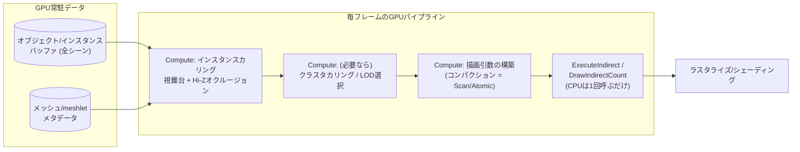

# GPU Driven Rendering

## 概要

GPU Driven Renderingは、**「何を描くか」の決定 (カリング・LOD選択・描画リスト構築) をCPUからGPUへ移す**アーキテクチャです。Compute Shaderでシーン全体の可視性を判定し、**Indirect Draw** (GPUが書いた引数でGPU自身が描画) で実行します。ドローコールボトルネックを根絶し、数十万オブジェクト・数億ポリゴンのシーンを可能にする、現代AAAレンダラーの中核設計です。UE5のNaniteはその極致です。

## なぜ必要なのか

- CPUのドローコール発行・カリングループは、オブジェクト数に比例してスケール限界を迎える
- CPUのカリングは保守的 (オブジェクト単位のバウンディングボックス) — GPUなら**クラスタ単位・オクルージョン込み**の細粒度カリングが毎フレーム可能
- シーンデータをGPU常駐にすれば、CPU→GPU転送も毎フレームの状態設定も消える

## 歴史・誕生した背景

- 2008-12: `DrawIndirect` / `MultiDrawIndirect` がAPIに登場 (GL4/DX11) — 種が撒かれる
- **2015: "GPU-Driven Rendering Pipelines" (SIGGRAPH, Assassin's Creed Unity / Haar & Aaltonen)** — クラスタカリング+ExecuteIndirectによる大規模シーンの実証。記念碑的講演
- 2016: `ExecuteIndirect` (DX12)、Vulkanの`vkCmdDrawIndexedIndirectCount` 系で開花
- 2016-19: Frostbite、id Tech、Decima等が採用。**2パスオクルージョンカリング** (前フレーム深度のHi-Z利用) が定石化
- **2021: Nanite (UE5)** — クラスタ階層LOD+SWラスタライザまで含む完成形 → 三角形単位までGPU Drivenに
- 現在: Unityも **GPU Resident Drawer / GPU Occlusion Culling** (Unity 6) で追随。Work Graphs (2024) が次の進化 (GPUがパスの構成すら自律決定) を予告

## それ以前の技術

CPUカリング (視錐台・ポータル・PVS) + オブジェクトごとのドローコール + インスタンシング。CPU側の限界がシーン規模の上限でした。

## 解決した課題

1. **ドローコール数の呪縛からの解放**: 描画リスト構築がGPU内で完結、CPUは「Indirect実行1回」を発行するだけ
2. **オクルージョンカリングの実用化**: 深度ピラミッド (Hi-Z) に対するGPU判定で「見えない物は頂点処理すらしない」
3. クラスタ (meshlet) 単位の細粒度LOD・カリング
4. CPU/GPU間の同期削減 (オクルージョンクエリの読み戻し等が不要に)

## 現在の位置づけ

AAAの標準アーキテクチャであり、エンジンの競争軸。要素技術 (Indirect、カリングCompute、バインドレス、[Scan](/graphics/compute/parallel-algorithms.html)) はレンダリングエンジニアの必修セットです。

## 内部動作

### 基本構成



### 2パスオクルージョンカリング (定石)

「今フレームの遮蔽物」を知るには描く必要があり、描くにはカリングが必要 — この鶏卵を解く標準解:

1. **Pass 1**: 前フレームの可視物 (十中八九今も見える) を描画 → 深度を得る
2. 深度から **Hi-Zピラミッド** (min深度のミップチェーン) を構築
3. **Pass 2**: 前フレームで不可視だった物をHi-Zでテストし、新たに見えたものだけ追加描画
4. 今フレームの可視リストを保存して次フレームへ

誤検出がなく (保守的)、読み戻しゼロで完結します。

### Hi-Zテストの原理

オブジェクトのバウンディングボックスをスクリーンに投影し、そのサイズに応じたミップレベル (1〜2テクセルで覆える粗さ) の深度と比較します。「AABBの最近点が、その領域の最遠深度より奥なら不可視」— テクセル数個の読みで判定できます。

### 必要な要素技術

| 技術 | 役割 |
|---|---|
| Indirect Draw/Dispatch | GPUが仕事量を決める実行機構 |
| バインドレス / Vertex Pulling | 単一ドローで多様なメッシュ・マテリアルを描く → [DX12](/graphics/api/directx12.html), [VS](/graphics/pipeline/vertex-shader.html) |
| [Scan/コンパクション](/graphics/compute/parallel-algorithms.html) | 可視リストの詰め込み |
| マテリアルソート/バケツ | ステート切替の削減 (マテリアルIDごとにIndirect引数を分ける) |
| [Mesh Shader](/graphics/pipeline/mesh-shader.html) | クラスタカリングとの自然な統合 (代替: Compute+Indirect) |

### Nanite — 完成形のスケッチ

- メッシュを**クラスタ (128тр) の階層DAG**へ事前変換 (LODを連続的に選べる)
- GPUで階層カリング+「スクリーンエッジ長」基準のLODカット選択
- 小さい三角形は**Compute SWラスタライザ** (64bit Atomicで深度+ID書き込み)、大きい三角形はHWラスタライズ
- 出力は Visibility Buffer (三角形ID) → マテリアルは後段で解決

## 各環境での扱い

### Unity
**GPU Resident Drawer** (Unity 6, BatchRendererGroup上に構築) がインスタンスデータのGPU常駐化と描画、**GPU Occlusion Culling** がHi-Z式カリングを提供。手動では `Graphics.RenderMeshIndirect` + ComputeBufferで自作できます。

### Unreal Engine
**Naniteが本体** (対応ジオメトリ)。非Naniteでも `r.InstanceCulling.OcclusionCull` などGPUカリング基盤 (GPU Scene) が動いています。UE5のレンダラーは「シーンデータのGPU常駐化 (GPU Scene)」を前提に再設計されました。

### DirectX 12
`ExecuteIndirect` (Command Signatureで「描画引数+ルート定数変更」まで間接化可能)。SM6.6バインドレスとの組み合わせが標準形。Work Graphs (2024) がさらに一般化します。

### Vulkan
`vkCmdDrawIndexedIndirectCount` (カウントもGPUバッファから)、`VK_EXT_descriptor_indexing` によるバインドレス。デバイス生成コマンド (`VK_EXT_device_generated_commands`) がExecuteIndirect相当の拡張です。

## コード例

インスタンスカリング+Indirect構築 (HLSL):

```hlsl
struct InstanceData { float4x4 world; float4 boundsSphere; uint meshIndex; };
struct DrawArgs { uint indexCount; uint instanceCount;
                  uint startIndex; int baseVertex; uint startInstance; };

StructuredBuffer<InstanceData> gInstances : register(t0);
Texture2D<float> gHiZ : register(t1);
RWStructuredBuffer<uint> gVisibleInstances : register(u0);
RWStructuredBuffer<DrawArgs> gDrawArgs : register(u1);

[numthreads(64, 1, 1)]
void CullCS(uint3 dtid : SV_DispatchThreadID) {
    if (dtid.x >= gInstanceCount) return;
    InstanceData inst = gInstances[dtid.x];

    // 1. 視錐台テスト
    bool visible = SphereInFrustum(inst.boundsSphere, gFrustumPlanes);

    // 2. Hi-Zオクルージョンテスト
    if (visible) {
        ScreenRect r = ProjectSphere(inst.boundsSphere, gViewProj);
        float mip = ceil(log2(max(r.width, r.height)));   // 数テクセルで覆うmip
        float sceneMaxDepth = MaxDepthInRect(gHiZ, r, mip); // 4隅サンプル
        visible = r.nearestDepth >= sceneMaxDepth;          // Reverse-Z: 手前=大
    }

    // 3. Wave集約で可視リストへコンパクション
    uint localIdx = WavePrefixCountBits(visible);
    uint total    = WaveActiveCountBits(visible);
    uint base;
    if (WaveIsFirstLane())
        InterlockedAdd(gDrawArgs[0].instanceCount, total, base);
    base = WaveReadLaneFirst(base);
    if (visible)
        gVisibleInstances[base + localIdx] = dtid.x;
}
```

CPU側 (DX12) は毎フレームこれだけ:

```cpp
// カリング → バリア → 描画。オブジェクト数がいくつでもCPUコストは一定
cmd->Dispatch((instanceCount + 63) / 64, 1, 1);
Transition(cmd, drawArgsBuf, UAV, INDIRECT_ARGUMENT);
cmd->ExecuteIndirect(cmdSignature.Get(), 1, drawArgsBuf.Get(), 0, nullptr, 0);
```

## 前提知識

- [Compute Shader](/graphics/compute/compute-shader.html), [並列アルゴリズム](/graphics/compute/parallel-algorithms.html)
- [GPU並列実行モデル](/graphics/compute/execution-model.html) — Wave命令
- [Vertex Shader](/graphics/pipeline/vertex-shader.html) — Vertex Pulling

## 次に読むべきページ

- [Mesh Shader](/graphics/pipeline/mesh-shader.html) — クラスタパイプラインの相棒
- [RenderGraph](/graphics/optimization/render-graph.html)
- [Unreal Engineのレンダラー](/graphics/engine/unreal-renderer.html) — Naniteの文脈

## 理解度チェック

1. **2パスオクルージョンカリングが「前フレームの可視物」から始める理由を、鶏卵問題として説明せよ。**
   ::: details 解答
   オクルージョンテストには遮蔽物が描かれた深度バッファが必要だが、深度バッファを作るには何を描くか決める(カリングする)必要がある、という循環がある。時間的コヒーレンス(前フレームで見えた物はほぼ今も見える)を利用し、まず前フレーム可視集合を描いて近似的な深度を得ることでこの循環を断つ。前フレームで不可視だった物は第2パスでその深度に対してテストし、新規に見えたものだけ追加描画するので、結果は保守的に正しい。
   :::

2. **Hi-Zテストでオブジェクトサイズに応じたミップレベルを選ぶ理由は。**
   ::: details 解答
   スクリーン上の投影矩形をフル解像度深度でテストすると矩形内の全テクセル読みが必要になり高価。矩形が1〜2テクセルで覆えるミップ(各テクセルが領域内の最遠深度を保持)を選べば、4隅程度のサンプルで「この領域の最遠深度より手前か」を保守的に判定でき、コストがオブジェクトサイズに依存しなくなる。
    :::

3. **GPU Drivenが要求する「バインドレス」の役割を説明せよ。**
   ::: details 解答
   従来はドローごとにCPUがそのメッシュのテクスチャ・バッファをバインドしていたが、GPU Drivenでは描く物をGPUが決めるためCPUは個別バインドできない。全リソースを巨大なディスクリプタ配列に載せ、インスタンスデータ内のインデックスでシェーダが自分で参照する(バインドレス)ことで、単一のExecuteIndirectで任意のマテリアル・メッシュの組を描けるようになる。
   :::

## 参考資料

- Haar & Aaltonen, *"GPU-Driven Rendering Pipelines"* (SIGGRAPH 2015) — 原典
- Brian Karis et al., *"Nanite: A Deep Dive"* (SIGGRAPH 2021)
- vkguide.dev *"GPU Driven Rendering"* 章 — 実装チュートリアル
- Unity, *GPU Resident Drawer* ドキュメント
