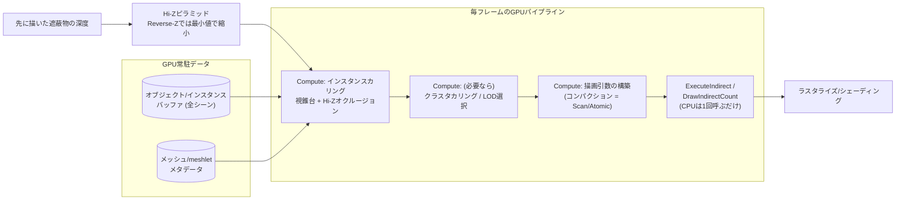

# GPU Driven Rendering

## 概要

GPU Driven Renderingでは、描画対象の決定にあたるカリング、LOD選択、描画リスト構築をCPUからGPUへ移します。Compute Shaderでシーン全体の可視性を判定し、GPUが生成した引数を使ってIndirect Drawで描画します。CPUから多数のドローコールを発行することによるボトルネックを解消し、数十万オブジェクトや数億ポリゴンからなるシーンを扱えるため、現代のAAAレンダラーで使われています。UE5のNaniteは、この設計を大規模なジオメトリ処理に使う例です。

## なぜ必要なのか

- CPUのドローコール発行・カリングループは、オブジェクト数に比例してスケール限界を迎える
- CPUのカリングは保守的 (オブジェクト単位のバウンディングボックス) — GPUなら**クラスタ単位・オクルージョン込み**の細粒度カリングが毎フレーム可能
- シーンデータをGPU常駐にすれば、CPU→GPU転送も毎フレームの状態設定も消える

## 歴史・誕生した背景

- 2008-12: `DrawIndirect` / `MultiDrawIndirect` がAPIに登場 (GL4/DX11) — 種が撒かれる
- **2015: "GPU-Driven Rendering Pipelines" (SIGGRAPH, Assassin's Creed Unity / Haar & Aaltonen)** — クラスタカリング+ExecuteIndirectによる大規模シーンの実証。記念碑的講演
- 2015: DX12の`ExecuteIndirect`でGPU生成の描画・dispatchを実行
- 2018: Vulkanの`VK_KHR_draw_indirect_count`。2020年のVulkan 1.2でコア化
- 2016-19: Frostbite、id Tech、Decima等が採用。**2パスオクルージョンカリング** (前フレーム深度のHi-Z利用) が定石化
- **2021: Nanite (UE5)** — クラスタ階層LODと、三角形の大きさに応じたハードウェア/ソフトウェアラスタライズ
- 現在: Unityも **GPU Resident Drawer / GPU Occlusion Culling** (Unity 6) で追随。Work Graphs (2024) が次の進化 (GPUがパスの構成すら自律決定) を予告

## それ以前の技術

CPUカリング (視錐台・ポータル・PVS) + オブジェクトごとのドローコール + インスタンシング。CPU側の限界がシーン規模の上限でした。

## 解決した課題

1. **ドローコール数の呪縛からの解放**: 描画リスト構築がGPU内で完結、CPUは「Indirect実行1回」を発行するだけ
2. **オクルージョンカリングの実用化**: 深度ピラミッド (Hi-Z) に対するGPU判定で「見えない物は頂点処理すらしない」
3. クラスタ (meshlet) 単位の細粒度LOD・カリング
4. CPU/GPU間の同期削減 (オクルージョンクエリの読み戻し等が不要に)

## 現在の位置づけ

AAAの標準アーキテクチャであり、エンジンの競争軸。要素技術 (Indirect、カリングCompute、バインドレス、[Scan](/graphics/compute/parallel-algorithms.html)) はレンダリングエンジニアの必修セットです。

## 内部動作

### 基本構成



### 2パスオクルージョンカリング (定石)

「今フレームの遮蔽物」を知るには先に何かを描く必要があります。前フレームの可視リストを使う方式では、次の順で処理します。

1. **Pass 1**: 前フレームの可視物 (十中八九今も見える) を描画 → 深度を得る
2. 深度から **Hi-Zピラミッド**（領域内の最遠深度。以下のReverse-Zではmin、通常Zではmaxを保持するミップチェーン） を構築
3. **Pass 2**: 残りを今フレームのHi-Zでテストし、見える可能性があるものを追加描画
4. 今フレームの可視リストを保存して次フレームへ

現在の遮蔽物の深度と、対象を完全に覆う投影範囲・最近深度の上界を使えば、隠れていると確実に判断できた対象だけを除外できます。粗いミップでは、実際には隠れている対象が描画候補に残ることがあります。GPU上の可視リストを間接描画へ渡す構成なら、描画のたびにCPUへ結果を読み戻す必要はありません。前フレームの深度ピラミッドで先に判定し、除外した候補を今フレームの深度で再判定する方式もあります。[Haar・Aaltonen — GPU-Driven Rendering Pipelines](https://advances.realtimerendering.com/s2015/aaltonenhaar_siggraph2015_combined_final_footer_220dpi.pdf)

### Hi-Zテストの原理

オブジェクト全体を覆う投影矩形を作り、その大きさに応じて深度ピラミッドのミップを選びます。矩形と重なるテクセルすべての最遠深度を求め、対象の最近点がそれより奥にある場合に除外します。Reverse-Zなら最近深度は大きい側、深度ピラミッドは小さい側を使います。背景のクリア値 `0` を含むタイルは最遠深度が `0` になり、そのタイルを含む矩形からは完全に隠れたと判断できません。[Greene・Kass・Miller — Hierarchical Z-Buffer Visibility](https://www.cs.princeton.edu/courses/archive/spr01/cs598b/papers/greene93.pdf)

### 必要な要素技術

| 技術 | 役割 |
|---|---|
| Indirect Draw/Dispatch | GPUが仕事量を決める実行機構 |
| バインドレス / Vertex Pulling | 単一ドローで多様なメッシュ・マテリアルを描く → [DX12](/graphics/api/directx12.html), [VS](/graphics/pipeline/vertex-shader.html) |
| [Scan/コンパクション](/graphics/compute/parallel-algorithms.html) | 可視リストの詰め込み |
| マテリアルソート/バケツ | ステート切替の削減 (マテリアルIDごとにIndirect引数を分ける) |
| [Mesh Shader](/graphics/pipeline/mesh-shader.html) | クラスタカリングとの自然な統合 (代替: Compute+Indirect) |

### Nanite — 完成形のスケッチ

- メッシュを**クラスタ （最大128三角形程度の単位） の階層DAG**へ事前変換 (LODを連続的に選べる)
- GPUで階層カリング+「スクリーンエッジ長」基準のLODカット選択
- 小さい三角形は**Compute SWラスタライザ** (64bit Atomicで深度+ID書き込み)、大きい三角形はHWラスタライズ
- 出力は Visibility Buffer (三角形ID) → マテリアルは後段で解決

## 各環境での扱い

### Unity
**GPU Resident Drawer** (Unity 6, BatchRendererGroup上に構築) がインスタンスデータのGPU常駐化と描画、**GPU Occlusion Culling** がHi-Z式カリングを提供。手動では `Graphics.RenderMeshIndirect` + `GraphicsBuffer`（`Target.IndirectArguments`）で自作できます。

### Unreal Engine
**Naniteが本体** (対応ジオメトリ)。非Naniteでも `r.InstanceCulling.OcclusionCull` などGPUカリング基盤 (GPU Scene) が動いています。UE5のレンダラーは「シーンデータのGPU常駐化 (GPU Scene)」を前提に再設計されました。

### DirectX 12
`ExecuteIndirect` (Command Signatureで「描画引数+ルート定数変更」まで間接化可能)。SM6.6バインドレスとの組み合わせが標準形。Work Graphs (2024) がさらに一般化します。

### Vulkan
`vkCmdDrawIndexedIndirectCount` (カウントもGPUバッファから)、`VK_EXT_descriptor_indexing` によるバインドレス。デバイス生成コマンド (`VK_EXT_device_generated_commands`) がExecuteIndirect相当の拡張です。

## コード例

インスタンスカリング+Indirect構築 (HLSL):

```hlsl
struct InstanceData { float4x4 world; float4 boundsSphere; uint meshIndex; };
struct DrawArgs { uint indexCount; uint instanceCount;
                  uint startIndex; int baseVertex; uint startInstance; };

StructuredBuffer<InstanceData> gInstances : register(t0);
Texture2D<float> gHiZ : register(t1);
RWStructuredBuffer<uint> gVisibleInstances : register(u0);
RWStructuredBuffer<DrawArgs> gDrawArgs : register(u1);

[numthreads(64, 1, 1)]
void CullCS(uint3 dtid : SV_DispatchThreadID) {
    if (dtid.x >= gInstanceCount) return;
    InstanceData inst = gInstances[dtid.x];

    // 1. 視錐台テスト
    bool visible = SphereInFrustum(inst.boundsSphere, gFrustumPlanes);

    // 2. Hi-Zオクルージョンテスト
    if (visible) {
        ScreenRect r = ProjectSphere(inst.boundsSphere, gViewProj);
        if (r.canTest) {
            float mip = ceil(log2(max(r.width, r.height)));  // 幅・高さは元画像のピクセル数
            float sceneFarthestDepth = MinDepthInRect(gHiZ, r, mip); // Reverse-Zの最遠値
            visible = r.nearestDepth >= sceneFarthestDepth; // 手前=大、奥=小
        }
    }

    // 3. Wave集約で可視リストへコンパクション
    uint localIdx = WavePrefixCountBits(visible);
    uint total    = WaveActiveCountBits(visible);
    uint base;
    if (WaveIsFirstLane())
        InterlockedAdd(gDrawArgs[0].instanceCount, total, base);
    base = WaveReadLaneFirst(base);
    if (visible)
        gVisibleInstances[base + localIdx] = dtid.x;
}
```

この抜粋では、`ProjectSphere` が境界球全体を含む画面上の矩形と、対象の最近深度の上界を返します。近平面との交差などで保守的な範囲を求められないときは `canTest` を `false` にします。判定できる矩形の幅と高さは少なくとも1ピクセルです。`MinDepthInRect` はミップ番号を有効範囲に収め、画面端でクリップした矩形と重なる全テクセルを読み、最小値を返します。通常の線形フィルターでは深度が平均され、最遠深度が失われます。`gVisibleInstances`には全インスタンスを格納できる容量を用意し、`instanceCount`はdispatch前に0へ初期化します。

CPU側 (Direct3D 12) は、カリングと描画を同じ Direct キューで実行する例です。引数バッファと可視リストを再利用するときは、明示的な遷移で次の書き込みに備えます。ここでは頂点シェーダーが可視リストをSRVで読みます。`resetArgs` は `COPY_SOURCE` で使える初期値のバッファで、描画引数の `InstanceCount` を0にしておきます。初回も下の `Transition` の変更前の状態に合わせてバッファを作成します。

```cpp
// カリング用パイプラインとバッファのバインドは省略
Transition(cmd, drawArgsBuf, INDIRECT_ARGUMENT, COPY_DEST);
cmd->CopyBufferRegion(drawArgsBuf.Get(), 0, resetArgs.Get(), 0,
                      sizeof(D3D12_DRAW_INDEXED_ARGUMENTS));
Transition(cmd, drawArgsBuf, COPY_DEST, UAV);
Transition(cmd, visibleBuf, NON_PIXEL_SHADER_RESOURCE, UAV);
if (instanceCount != 0)
    cmd->Dispatch((instanceCount - 1) / 64 + 1, 1, 1);
Transition(cmd, drawArgsBuf, UAV, INDIRECT_ARGUMENT);
Transition(cmd, visibleBuf, UAV, NON_PIXEL_SHADER_RESOURCE);
// 描画用パイプラインとSRVをバインドしてから実行
cmd->ExecuteIndirect(cmdSignature.Get(), 1, drawArgsBuf.Get(), 0, nullptr, 0);
```

Direct3D 12のデバッグレイヤーを有効にし、簡略化したカリング用Compute Shaderで2件、1件、0件を順に渡してこの手順を確認しました。引数バッファを再利用しても、読み戻した描画引数の `InstanceCount` は2、1、0でした。描画先のピクセルも最初の2回で更新され、0件ではクリア値のままでした。

### 遮蔽物のあるシーンで確認する

Direct3D 12とGeForce RTX 3060で、壁1枚と直方体4個を正投影で描画しました。壁のメッシュを128 × 128の深度バッファへ描き、Reverse-Zの最小値で縮小して8段のHi-Zを作りました。更新した深度を使って、4個の境界球を上の `CullCS` で判定し、可視リストと `InstanceCount` を間接描画に渡します。ここでは遮蔽物を最初に描く構成で、上で説明した前フレームの可視リストは使っていません。

<figure>
  
  <figcaption>描画出力のIDを色分けした実測画像です。下段のIDは、間接描画の可視リストから読み戻した値です。<a href="/study/images/graphics/hiz-culling-validation.png" target="_blank" rel="noopener noreferrer">画像を拡大</a></figcaption>
</figure>

壁の後ろに完全に隠れた赤のID 1は、Hi-Zを有効にすると描画リストから外れました。壁の端から一部が見える黄のID 3、壁の外の緑のID 2、壁より手前の青のID 4は残りました。壁を横にずらすとID 1が描画リストに戻り、56ピクセルが現れました。それぞれ同じ配置でHi-Zを無効にした参照描画と比較すると、全16,384ピクセルのIDが一致しました。可視リストと描画先をCPUへ読み戻したのは、この比較のためです。

## 前提知識

- [Compute Shader](/graphics/compute/compute-shader.html), [並列アルゴリズム](/graphics/compute/parallel-algorithms.html)
- [GPU並列実行モデル](/graphics/compute/execution-model.html) — Wave命令
- [Vertex Shader](/graphics/pipeline/vertex-shader.html) — Vertex Pulling

## 次に読むべきページ

- [Mesh Shader](/graphics/pipeline/mesh-shader.html) — クラスタパイプラインの相棒
- [RenderGraph](/graphics/optimization/render-graph.html)
- [Unreal Engineのレンダラー](/graphics/engine/unreal-renderer.html) — Naniteの文脈

## 理解度チェック

1. **2パスオクルージョンカリングが「前フレームの可視物」から始める理由を、鶏卵問題として説明せよ。**
   ::: details 解答
   前フレームの可視物を先に描くことで、今フレームの判定に使える遮蔽物の深度を得ます。第2パスでは残りをテストし、完全に隠れたと確かめられないものを描きます。実測例では前フレームのリストの代わりに、先に描く遮蔽物として壁を指定しました。
   :::

2. **Hi-Zテストでオブジェクトサイズに応じたミップレベルを選ぶ理由は。**
   ::: details 解答
   投影矩形の幅と高さがそれぞれ1テクセル以内になるミップなら、境界をまたいでも通常は最大2 × 2テクセルを調べれば済みます。背景を含むテクセルも最遠深度の計算に入るため、完全に隠れたと判断できる範囲は粗いミップほど狭くなる場合があります。
   :::

3. **GPU Drivenが要求する「バインドレス」の役割を説明せよ。**
   ::: details 解答
   従来はドローごとにCPUがそのメッシュのテクスチャ・バッファをバインドしていたが、GPU Drivenでは描く物をGPUが決めるためCPUは個別バインドできない。全リソースを巨大なディスクリプタ配列に載せ、インスタンスデータ内のインデックスでシェーダが自分で参照する(バインドレス)ことで、単一のExecuteIndirectで任意のマテリアル・メッシュの組を描けるようになる。
   :::

## 参考資料

- Haar & Aaltonen, [GPU-Driven Rendering Pipelines](https://advances.realtimerendering.com/s2015/aaltonenhaar_siggraph2015_combined_final_footer_220dpi.pdf) (SIGGRAPH 2015)
- Greene, Kass & Miller, [Hierarchical Z-Buffer Visibility](https://www.cs.princeton.edu/courses/archive/spr01/cs598b/papers/greene93.pdf) (SIGGRAPH 1993)
- [Microsoft — Direct3D 12のリソース状態とバリア](https://learn.microsoft.com/en-us/windows/win32/direct3d12/using-resource-barriers-to-synchronize-resource-states-in-direct3d-12)
- Brian Karis et al., *"Nanite: A Deep Dive"* (SIGGRAPH 2021)
- vkguide.dev *"GPU Driven Rendering"* 章 — 実装チュートリアル
- Unity, *GPU Resident Drawer* ドキュメント
- [Microsoft: Windows 10 and DirectX 12 released (2015)](https://devblogs.microsoft.com/directx/windows-10-and-directx-12-released/)
- [Unity: Graphics.RenderMeshIndirect](https://docs.unity3d.com/6000.0/Documentation/ScriptReference/Graphics.RenderMeshIndirect.html)
- [Khronos: VK_KHR_draw_indirect_count](https://docs.vulkan.org/refpages/latest/refpages/source/VK_KHR_draw_indirect_count.html)
