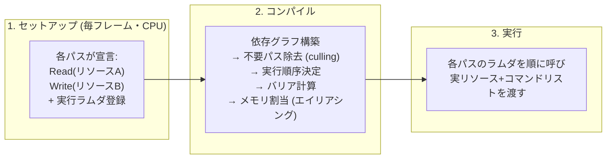

# RenderGraph / FrameGraph

## 概要

RenderGraph (FrameGraph) は、**フレームの全レンダーパスとリソースの依存関係を宣言的なグラフとして構築し、バリア挿入・リソース生存期間管理・パス順序を自動化する**アーキテクチャです。DX12/Vulkanの「明示的な自由」がもたらした管理地獄への、エンジンレベルの回答であり、Frostbite (2017) の発表以降、UE (RDG)・Unity (RenderGraph)・ほぼ全ての現代エンジンが採用しています。

## なぜ必要なのか

明示的APIでレンダラーを素朴に書くと:

- **バリア管理が破綻する**: パスの追加・削除のたびに、前後のパスのリソース状態を知る誰かが遷移を書く必要がある。パスが50個を超えるとモジュール性が崩壊
- **メモリが無駄になる**: 一時RT (ブラー中間バッファ等) がフレーム中ずっと確保されたまま
- パスの追加・入れ替え (機能トグル、プラットフォーム分岐) が密結合で困難

RenderGraphは「**各パスは自分の入出力だけ宣言する。全体の整合はグラフが取る**」という関心の分離でこれを解決します。

## 歴史・誕生した背景

- 〜2015: DX11時代はドライバが自動管理していたため不要だった
- 2015-16: DX12/Vulkan移行で各社がバリア管理の泥沼を経験
- **2017: GDC "FrameGraph: Extensible Rendering Architecture in Frostbite"** (Yuriy O'Donnell) — 概念の命名と設計の公開。トランジェントリソースのメモリエイリアシングまで含む完成形を提示
- 2017-19: UE4の **RDG (Render Dependency Graph)** 化が進行、UE5で全面採用
- 2020〜: UnityがSRPに **RenderGraph API** を導入 (URP 17/Unity 6で標準化)
- 現在: 内製エンジン含め標準アーキテクチャ。研究はマルチキュー自動化・分散コンパイルへ

## それ以前の技術

即時実行のレンダラー (パスが直接APIを呼ぶ)、手書きのバリア、固定のRTプール。

## 解決した課題

1. **バリアの自動導出**: グラフから「誰が書き、誰が読むか」が分かるため、必要最小限の遷移を計算できる
2. **メモリエイリアシング**: 生存期間が重ならない一時リソースに同じメモリを使い回す (数百MB規模の節約)
3. **デッドコード除去**: 最終出力に寄与しないパスの自動カット
4. モジュール性: パスの追加が「1関数の追加」で完結

## 現在の位置づけ

現代エンジンの標準骨格。エンジン開発者にとっては設計必修、エンジン利用者にとっても「カスタムパスを書く際のAPI」(UnityのRenderGraph API、UEのRDG) として日常的に触れるものになりました。

## 内部動作

### 2フェーズ構造



- パス宣言時のリソースは**仮想ハンドル** (実メモリ未割当)。コンパイル時に実体化される
- 毎フレーム作り直すのが基本 (シーン状態でパス構成が変わるため)。セットアップコストは軽量に設計する

### メモリエイリアシングの原理

```text
フレーム内の生存期間:
  ShadowMap      |----|
  SSAO_Temp           |--|
  BloomChain               |----|
  → 生存期間が重ならなければ同じヒープ領域に配置できる
    (DX12: Placed Resources / VK: 1つのVkDeviceMemoryにバインド)
```

グラフはパスの実行順とリソースの最初/最後の使用点を知っているため、この割当を毎フレーム最適に解けます。

### バリア導出

「リソースAは パス3でRTV書き込み → パス5でSRV読み」がグラフから分かるので、パス3と5の間に1回だけ遷移を挿入します。人間が書くより正確で、**過剰同期 (とりあえず全部バリア) も過少同期 (書き忘れ) も構造的に防げます**。

## 各環境での扱い

### Unity
**RenderGraph API** (Unity 6のURP標準)。`builder.UseTexture(handle, AccessFlags.Read)` のように宣言し、`SetRenderFunc` で実行コードを登録。RasterPass/ComputePass/UnsafePassの3種。モバイルTBDRのパス融合 (Native Render Pass) も自動化されます。

### Unreal Engine
**RDG (Render Dependency Graph)**。`FRDGBuilder` に `GraphBuilder.AddPass(...)` で登録、リソースは `FRDGTextureRef` 等の仮想ハンドル。`RDG_EVENT_SCOPE` がプロファイラ表示に連動。UEのレンダラーコードはほぼ全てRDG上に書かれており、**UE改造の必須知識**です。

### DirectX 12
自作する側のAPI。Placed Resources + `ResourceBarrier` (Enhanced Barriers) がグラフの出力先。O'Donnellの講演と各種オープンソース実装 (下記) が参考になります。

### Vulkan
同様。`VkEvent`/`vkCmdPipelineBarrier2` へ落とし込み、モバイルではsubpassへの自動融合も研究対象。Granite (Themaister) などが実装例です。

## コード例

Unity RenderGraph APIでのカスタムパス (Unity 6 / URP):

```csharp
class BlurPass : ScriptableRenderPass {
    class PassData {
        public TextureHandle source;
        public TextureHandle destination;
        public Material material;
    }

    public override void RecordRenderGraph(RenderGraph rg,
                                           ContextContainer frameData) {
        var resourceData = frameData.Get<UniversalResourceData>();

        // 一時RTを「宣言」(実確保はグラフが行う)
        var desc = rg.GetTextureDesc(resourceData.activeColorTexture);
        desc.name = "BlurTemp";
        TextureHandle temp = rg.CreateTexture(desc);

        using (var builder = rg.AddRasterRenderPass<PassData>(
                   "Blur", out PassData data)) {
            data.source = resourceData.activeColorTexture;
            data.destination = temp;
            data.material = blurMaterial;

            builder.UseTexture(data.source, AccessFlags.Read);   // 依存を宣言
            builder.SetRenderAttachment(data.destination, 0);    // 書き込み先

            builder.SetRenderFunc((PassData d, RasterGraphContext ctx) => {
                Blitter.BlitTexture(ctx.cmd, d.source,
                                    new Vector4(1, 1, 0, 0), d.material, 0);
            });
        }
        // バリア・メモリ・パス順序はRenderGraphが解決する
    }
}
```

UE RDGでのComputeパス (C++):

```cpp
FRDGTextureRef OutputTexture = GraphBuilder.CreateTexture(
    FRDGTextureDesc::Create2D(Extent, PF_FloatRGBA,
        FClearValueBinding::None, TexCreate_UAV), TEXT("MyOutput"));

FMyCS::FParameters* Params = GraphBuilder.AllocParameters<FMyCS::FParameters>();
Params->InputTexture  = GraphBuilder.CreateSRV(SceneColor);
Params->OutputTexture = GraphBuilder.CreateUAV(OutputTexture);

FComputeShaderUtils::AddPass(GraphBuilder,
    RDG_EVENT_NAME("MyEffect"),
    TShaderMapRef<FMyCS>(GetGlobalShaderMap(FeatureLevel)),
    Params,
    FComputeShaderUtils::GetGroupCount(Extent, 8));
// 遷移・生存期間はRDGが管理
```

## 前提知識

- [DirectX 12](/graphics/api/directx12.html) / [Vulkan](/graphics/api/vulkan.html) — バリアとメモリの手動管理の痛み
- [GPU最適化の基礎](/graphics/optimization/basics.html)

## 次に読むべきページ

- [GPU Driven Rendering](/graphics/optimization/gpu-driven.html)
- [URP](/graphics/engine/urp.html) / [Unreal Engineのレンダラー](/graphics/engine/unreal-renderer.html) — 実装の現物

## 理解度チェック

1. **RenderGraphが「毎フレームグラフを作り直す」設計を採る理由は。**
   ::: details 解答
   フレームごとにパス構成が変わるため(機能のオンオフ、可視性による省略、解像度変更、エディタ操作)。静的なグラフではこの動的性を扱えない。セットアップは仮想ハンドルの登録だけの軽量な処理に抑え、「宣言は毎フレーム、最適化(コンパイル)は高速」という設計でコストを許容範囲にしている。
   :::

2. **メモリエイリアシングが安全である条件と、それをグラフが保証できる理由を述べよ。**
   ::: details 解答
   条件は2つのリソースの使用期間(最初の書き込み〜最後の読み取り)がフレーム内で重ならないこと、およびエイリアス切替時に適切なバリア(エイリアシングバリア)と初期化が入ること。グラフは全パスの依存関係から各リソースの正確な生存区間と実行順序を静的に知っているため、重複判定と必要バリアの挿入をコンパイル時に厳密に行える。
   :::

3. **「デッドコード除去 (パスカリング)」はどう機能し、何に役立つか。**
   ::: details 解答
   最終出力(バックバッファ等)から依存を逆に辿り、到達しないパスを実行対象から外す。機能フラグでどこにも読まれなくなった中間パス(例: 無効化したデバッグ表示の生成パス)が自動でスキップされるため、パスを書く側は「使われるかどうか」を気にせず宣言でき、モジュール性と性能が両立する。
   :::

## 参考資料

- Yuriy O'Donnell, *"FrameGraph: Extensible Rendering Architecture in Frostbite"* (GDC 2017) — 原典
- Epic, *Render Dependency Graph* 公式ドキュメント
- Unity, *Render graph system* マニュアル (URP 17+)
- Themaister, *"Render graphs and Vulkan — a deep dive"* (Granite実装解説)
