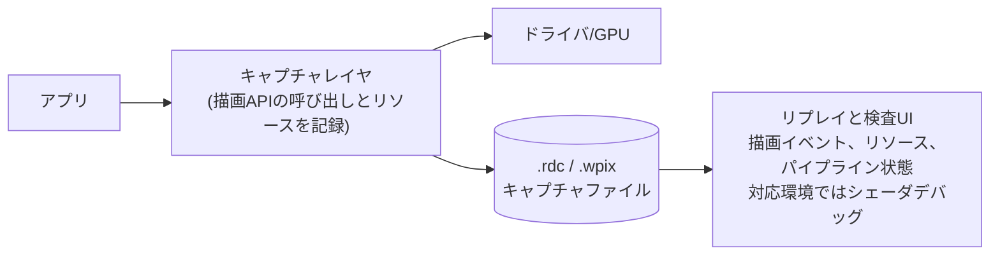

# デバッグ・プロファイリングツール — RenderDoc / PIX / Nsight / Frame Debugger

## 概要

GPUで何が起きているかを調べるには、描画や処理時間を観察するツールを使います。主な選択肢は、幅広い環境で使えるフレームデバッガのRenderDoc、DX12公式のPIX、NVIDIA GPUを詳しく調べるNsight Graphics、Unity Frame Debuggerです。描画結果の異常はRenderDoc、処理の遅さはPIXやNsightのプロファイラで調べる、というように目的に応じて使い分けます。

## なぜ必要なのか

- フレームキャプチャでは、描画時に使ったリソースや各パスの出力を調べられます。途中の値を調べるときは、法線をRGBで出力したり、対応するVulkan環境でシェーダのDebug Printfを使ったりする方法もあります。[Vulkan SamplesのShader Debug Printf](https://docs.vulkan.org/samples/latest/samples/extensions/shader_debugprintf/README.html)
- 「真っ黒になった」「ちらつく」「遅い」の3大症状は、それぞれ異なるツール・異なる調べ方を要求する
- レンダリングエンジニアの採用面接で「RenderDocでどうデバッグするか」は定番質問

## 歴史・誕生した背景

- 2000年代: PIX for Windows (DX9世代)、gDEBugger等 — 世代ごとに現れては消えた
- **2014: RenderDoc公開** (Baldur Karlsson, 当時Crytek) — オープンソース・高品質・API横断で一気に標準へ。後にValveが支援
- 2017: **PIX on Windows** — DX12専用の公式ツールとして復活
- Nsight系はNVIDIAのドライバレベル計測ツールとして発展 (Nsight Graphics / Systems / Compute に分化)
- Unity Frame Debugger / RenderDoc連携、UEのInsightsなど、エンジン内蔵ツールも整備が進む
- 現在: GPUクラッシュ解析 (Aftermath, DRED)、レイトレ専用ビュー、AIワークロード対応へ拡張中

## それ以前の技術

「色を出力して目視」(いわゆるprintfデバッグの色版)。今も補助手段としては現役です (法線をRGBで出す等)。

## 解決した課題

記録したフレームを再生し、対象のドローの入出力を観察できます。ツールとAPIが対応する範囲では、シェーダのステップ実行やパスごとのGPU時間の計測もできます。

## 現在の位置づけ・使い分け

| ツール | 対応API | 得意分野 |
|---|---|---|
| **RenderDoc** | 下のRenderDoc対応表を参照 | フレームキャプチャと再生。描画イベント、リソース、パイプライン状態を検査 |
| **PIX** | DX12 (+Xbox) | DX12の公式プロファイラ。タイミングキャプチャ、占有率、メモリ、GPUクラッシュ (DRED) |
| **Nsight Graphics** | VK / DX12 / GL | NVIDIA HWカウンタでの深掘り (SM稼働率、スループット限界の特定)。GPU Trace |
| **Unity Frame Debugger** | Unity内 | ドロー単位のステップ実行、SRP Batcher状態、シェーダバリアント確認。軽くて速い |
| (補助) RGP / Xcode GPU Debugger | AMD / Metal | 各ベンダー/プラットフォームの深掘り |

| RenderDocの機能 | 対応API |
|---|---|
| フレームキャプチャ | Vulkan、D3D11、D3D12、OpenGL Core Profile、OpenGL ES。対応するAPIの版とプラットフォームは公式の一覧を確認 |
| シェーダのステップ実行 | D3D11、D3D12、Vulkan。未対応のシェーダステージや拡張機能を使うと、対応APIでもデバッグ操作が無効になる場合がある |

OpenGLとOpenGL ESのキャプチャでも、描画イベントやリソースを調べられます。ソース行に沿ってシェーダを追うには、対応するシェーダに加え、コンパイル時に付けたデバッグ情報も必要です。[RenderDocのキャプチャ対応表](https://github.com/baldurk/renderdoc#api-support) · [シェーダデバッグの対応条件](https://github.com/baldurk/renderdoc/blob/v1.x/docs/how/how_debug_shader.rst)

**UnityやUEからでも本物のキャプチャはRenderDoc/PIXで取る** (エディタにアタッチ、またはスタンドアロンビルドを起動) のが実務の型です。

## 内部動作

### フレームキャプチャの仕組み

キャプチャツールはアプリとAPIの間で呼び出しを記録し、再生に必要なリソースの内容も保存します。再生時にイベントを選ぶと、選んだ描画の入出力やパイプライン状態を調べられます。



### 「見た目がおかしい」デバッグの型 (RenderDoc)

1. 症状のフレームをキャプチャ (`F12`)
2. **Event Browser**で該当ドローを特定 (Texture Viewerの出力を遡るのが早い)
3. **Pipeline State**を検査: 正しいシェーダ? 正しいテクスチャがバインドされている? ブレンド/深度設定は?
4. **Mesh Viewer**でVS入出力を確認 (頂点が壊れていれば入力アセンブリ/行列の問題)
5. 利用できる場合は **Pixel History** で対象ピクセルへの書き込みを調べ、シェーダデバッグでそのピクセルの計算を追う

チェックリスト (黒画面の三大犯): 行列が壊れている (NaN/転置忘れ)、リソース未バインド、深度テスト設定ミス。

### 「遅い」プロファイリングの型 (PIX/Nsight)

1. **タイミングキャプチャ**でパス別GPU時間を取得 — まず「どのパスが高いか」
2. 高いパスのHWカウンタを見る: SM稼働率が低い→レイテンシ/占有率問題、DRAM帯域が飽和→帯域律速、等 → [GPU最適化の基礎](/graphics/optimization/basics.html)
3. 仮説→修正→再計測のループ

### GPUクラッシュ (Device Removed) の解析

TDR/DEVICE_REMOVEDは最難関のバグ。**DRED** (DX12のパンくずリスト)、**NVIDIA Aftermath**、Vulkanの `VK_EXT_device_fault` でクラッシュ時のGPU実行位置を特定します。典型犯は不正なディスクリプタ (バインドレスの索引ミス) と未初期化メモリ、無限ループです。

## 各環境での扱い

### Unity
Frame Debugger (Window > Analysis) でドロー単位確認、`RenderDoc` ボタンがエディタに統合 (Linux/Windows)。GPUプロファイルは Profiler の GPU モジュール+プラットフォームツール。`FrameTimingManager` でランタイム計測も可能。

### Unreal Engine
`ProfileGPU` (Ctrl+Shift+,) でパス別時間、**Unreal Insights** で総合分析。RenderDocプラグイン内蔵 (`-AttachRenderDoc`)。`r.RDG.Debug` 系でRDGパスの検査。コンソール開発ではPIX (Xbox) / Razor (PS) が対応物です。

### DirectX 12
PIXが第一。デバッグレイヤ (`D3D12GetDebugInterface`) + GPU-Based Validation を開発中は常時有効に。`SetName()` でリソースに名前を付けるのが可読性の生命線。

### Vulkan
**Validation Layers** (`VK_LAYER_KHRONOS_validation`) が最初の防衛線 — synchronization validationは特に重要。`VK_EXT_debug_utils` でオブジェクト命名+コマンドバッファのラベル区間 (RenderDocの表示に反映)。

## コード例

デバッグ名とマーカーの整備 (キャプチャを読みやすくする実務の基本):

```cpp
// DX12: リソース命名 + PIXマーカー
shadowMap->SetName(L"ShadowMap_2048");
PIXBeginEvent(cmd, PIX_COLOR(255, 0, 0), "ShadowPass");
DrawShadowCasters(cmd);
PIXEndEvent(cmd);

// Vulkan: debug utils
VkDebugUtilsObjectNameInfoEXT name{VK_STRUCTURE_TYPE_DEBUG_UTILS_OBJECT_NAME_INFO_EXT};
name.objectType = VK_OBJECT_TYPE_IMAGE;
name.objectHandle = (uint64_t)shadowImage;
name.pObjectName = "ShadowMap_2048";
vkSetDebugUtilsObjectNameEXT(device, &name);

VkDebugUtilsLabelEXT label{VK_STRUCTURE_TYPE_DEBUG_UTILS_LABEL_EXT};
label.pLabelName = "ShadowPass";
vkCmdBeginDebugUtilsLabelEXT(cmd, &label);
DrawShadowCasters(cmd);
vkCmdEndDebugUtilsLabelEXT(cmd);
```

プログラムからのキャプチャトリガ (RenderDoc In-App API):

```cpp
#include "renderdoc_app.h"
RENDERDOC_API_1_6_0* rdoc = nullptr;
if (HMODULE mod = GetModuleHandleA("renderdoc.dll")) {
    auto get = (pRENDERDOC_GetAPI)GetProcAddress(mod, "RENDERDOC_GetAPI");
    get(eRENDERDOC_API_Version_1_6_0, (void**)&rdoc);
}
// 問題の瞬間だけ自動キャプチャ (再現困難なバグに絶大)
if (rdoc && frameHasArtifact) {
    rdoc->TriggerCapture();
}
```

## 前提知識

- [パイプライン全体像](/graphics/pipeline/overview.html) — 何を見ているか分かるために
- [GPU最適化の基礎](/graphics/optimization/basics.html) — カウンタの解釈

## 次に読むべきページ

- [GPU最適化の基礎](/graphics/optimization/basics.html) と往復して使う
- [最終章: ゼロからレンダラーを作る](/graphics/capstone/01-design.html) — 自作レンダラーはツールの練習台として最高

## 理解度チェック

1. **「画面が真っ黒」のとき、RenderDocでどの順に調べるか。**
   ::: details 解答
   (1)キャプチャしてTexture Viewerでバックバッファと各パスの出力を遡り、どの段階から黒いか特定。(2)該当ドローのPipeline Stateで、シェーダ・RTV/DSV・ビューポート・ブレンド/深度設定・バインドリソースを確認。(3)Mesh ViewerでVS出力座標を見る(クリップ空間外や NaN なら行列疑い)。(4)対応環境では、必要に応じてピクセルシェーダをデバッグ実行し、どの項が0になるか追う。
   :::

2. **RenderDocとNsight/PIXの計測値の使い分けを述べよ。**
   ::: details 解答
   RenderDocのタイミングはリプレイ環境での参考値で、状態検査・見た目のデバッグが本領。性能判断は実行環境で計測するPIX(タイミングキャプチャ、DX12公式カウンタ)やNsight(NVIDIA HWカウンタ、スループット限界の内訳)を使う。「絵はRenderDoc、時間はPIX/Nsight」が基本の型。
   :::

3. **リソース命名とデバッグマーカーを最初から整備すべき理由は。**
   ::: details 解答
   キャプチャでは「Texture 247」のような名前の一覧から目的のテクスチャを探しにくい。パスの区間をマーカーで示さないと、イベントリストには数千のコールが平坦に並ぶ。リソースに名前を付け、パスをマーカーで区切ると、キャプチャを大幅に読みやすくでき、チーム全員がデバッグしやすくなる。コストはほぼゼロで、リリースビルドでは無効にできる。
   :::

## 参考資料

- RenderDoc 公式ドキュメント (How do I... シリーズが実践的)
- Microsoft, *PIX on Windows* ドキュメント/ブログ
- NVIDIA, *Nsight Graphics* ユーザーガイド / *GPU Trace* 解説
- 各GDC "Debugging GPU..." 系講演
