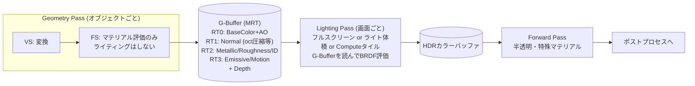

# Deferred Rendering

## 概要

Deferred Rendering (遅延レンダリング) は、**「何が見えるか」と「どう照らすか」を分離**する方式です。第1パス (Geometry Pass) で全オブジェクトのマテリアル属性 (アルベド・法線・粗さ...) を **G-Buffer** と呼ばれる複数のテクスチャに書き出し、第2パス (Lighting Pass) で画面のピクセルごとに一度だけライティングを計算します。PS3/X360世代 (2007〜) のAAA開発を支配した方式です。

## なぜ必要なのか

- Forwardの計算量 O(オブジェクト × ライト) を **O(ピクセル × 影響ライト)** に変える — 動的ライトを数十〜数百個置ける
- ライティングがスクリーンスペースの後処理になるため、**SSAO・SSR・スクリーンスペースGIとの親和性が高い** (G-Bufferの法線・深度をそのまま使える)
- オーバードローによるライティングの無駄撃ちが構造的に消える (最前面しかG-Bufferに残らない)

## 歴史・誕生した背景

- 1988: Deering らが概念を提案 (ハードウェア構想として)
- 2004: **S.T.A.L.K.E.R.** が商用ゲームでの本格採用を発表 (GSC / Shishkovtsov, GPU Gems 2)
- **2007-09: 黄金期の到来** — Killzone 2 (Guerrilla, 2007のGDC資料が伝説的)、Gears of War、Crysis 2 など。PS3/X360のメモリ帯域とMRT対応が方式を後押し
- 2010年代: **Tiled Deferred** (Andersson 2009, Frostbite) — Computeでライトカリングし帯域を削減
- 2013〜: PBR標準化でG-Bufferレイアウトも標準化 (BaseColor/Metallic/Roughness/Normal)
- 現在: UE5・HDRPの既定は依然Deferred系。ただしForward+の復権とモバイルの制約で「唯一の正解」ではなくなった

## それ以前の技術

[Forward Rendering](/graphics/path/forward.html) のマルチパスライティング。ライトごとの再描画で頂点・ラスタライズコストがライト数倍になっていました。

## 解決した課題

1. 多数の動的ライト (ライトの計算範囲を画面上の影響ピクセルだけに限定できる)
2. ライティングとジオメトリの分離によるパス設計の柔軟性
3. シェーディングの無駄撃ち排除

## 生んだ課題 (重要)

| 課題 | 内容 | 対策 |
|---|---|---|
| **半透明** | G-Bufferは1ピクセル1面しか持てない | 半透明だけ別途Forwardで描く (全エンジンがこのハイブリッド) |
| **MSAA** | G-Buffer全部をマルチサンプル化するとメモリ・帯域が爆発 | TAAへ移行 (これがTAA時代の一因) → [TAA](/graphics/postprocess/taa.html) |
| **帯域** | G-Buffer書き出し+読み戻しが巨大 | フォーマット圧縮、Tiled化、モバイルではsubpass/タイルメモリ |
| **マテリアル多様性** | 固定レイアウトに縛られる | Shading Model ID + 分岐 (UEの方式) |

## 現在の位置づけ

デスクトップ/コンソールのAAAでは今も主流 (UE5, HDRP, 多くの内製エンジン)。スクリーンスペース技法とRT/GIがG-Buffer前提で設計されるため、エコシステム全体がDeferredに最適化されています。一方、モバイルはタイルメモリ内でG-Bufferを完結させる設計 (Vulkan subpass / Metal imageblock) が使える場合のみ現実的です。

## 内部動作

### パス構成



### G-Bufferレイアウト設計

典型例 (1080pで合計 ~30-40MB):

| RT | R | G | B | A |
|---|---|---|---|---|
| RT0 (RGBA8) | BaseColor.r | .g | .b | AO |
| RT1 (RGB10A2 / RG16) | Normal (octahedral encoding) | | Shading ID | |
| RT2 (RGBA8) | Metallic | Roughness | Specular | Flags |
| Depth (D32) | 深度 → ワールド位置は**再構成**する | | | |

**ワールド位置はG-Bufferに入れない**のが定石です — 深度+逆射影行列から再構成できるため ([座標変換](/math/rendering/transform.html)のコード例参照)。法線の octahedral encoding も頻出技法です。

### Lighting Pass の実装3方式

1. **フルスクリーンパス**: ライトごと (または全ライトループ) に全画面FS。単純だが範囲外ピクセルも評価
2. **ライト体積**: ポイントライトを球メッシュとして描き、影響ピクセルだけFSを起動。ステンシルで体積内外を厳密化 → [出力結合](/graphics/pipeline/output-merger.html)
3. **Tiled Deferred (現代の標準)**: Computeで画面を16x16タイルに分割し、タイルごとのライトリストを作って1パスで全ライト評価 → [Forward+](/graphics/path/forward-plus.html) と同じカリング構造

## 各環境での扱い

### Unity
HDRPはDeferred (+ForwardオプションのLit Shader Mode)。URPにもDeferredパスあり (Unity 2021〜、さらにGPU Resident Drawer対応のDeferred+)。ビルトインRPのレガシーDeferredも存在。Frame DebuggerでG-Bufferの各RTを確認できます。

### Unreal Engine
**UEの根幹**。`FDeferredShadingSceneRenderer` がその名の通りの中心クラス。G-BufferはShading Model ID付きの可変レイアウト (`BasePassPixelShader.usf` → `DeferredLightPixelShaders.usf`)。`vis GBufferA` 等のコンソールコマンドで可視化できます。

### DirectX 12
MRT (最大8RT) へ同時出力するPSOを組み、Lighting PassはCompute (Tiled) が現代的。G-BufferのSRV遷移にリソースバリアが必要です。

### Vulkan
同様。モバイルでは **subpass** でG-Bufferをタイルメモリ内に閉じ込め、`VK_ATTACHMENT_STORE_OP_DONT_CARE` + `TRANSIENT_ATTACHMENT` でVRAMに書き出さない構成が可能 — Vulkanの設計思想が活きる代表例です。

## コード例

Geometry Pass のFS (G-Buffer書き出し):

```hlsl
struct GBufferOut {
    float4 rt0 : SV_Target0;  // BaseColor + AO
    float4 rt1 : SV_Target1;  // Normal (packed) + ID
    float4 rt2 : SV_Target2;  // Metallic/Roughness
};

GBufferOut PSGBuffer(Varyings IN) {
    Material m = SampleMaterial(IN);
    GBufferOut o;
    o.rt0 = float4(m.baseColor, m.ao);
    o.rt1 = float4(EncodeOctNormal(normalize(IN.normalWS)), m.shadingID, 0);
    o.rt2 = float4(m.metallic, m.roughness, m.specular, 0);
    return o;   // ライティングは一切しない
}
```

Lighting Pass (Compute, Tiled) の骨格:

```hlsl
[numthreads(16, 16, 1)]
void TiledLightingCS(uint3 dtid : SV_DispatchThreadID, uint gi : SV_GroupIndex) {
    // 1. タイルの深度範囲をShared+Atomicで求める
    // 2. タイル錐台 vs 全ライトの交差判定を256スレッドで分担 → Sharedにリスト構築
    // 3. 各ピクセル: G-Bufferを読んでリスト内ライトのみ評価
    Surface s = DecodeGBuffer(dtid.xy);            // RT0-2 + 深度から復元
    float3 P = ReconstructWorldPos(dtid.xy, s.depth);
    float3 c = 0;
    for (uint i = 0; i < sTileLightCount; ++i)
        c += ShadeLight(gLights[sTileLightList[i]], s, P);
    gOutput[dtid.xy] = float4(c, 1);
}
```

## 前提知識

- [Forward Rendering](/graphics/path/forward.html), [Fragment Shader](/graphics/pipeline/fragment-shader.html)
- [座標変換](/math/rendering/transform.html) — 深度からの位置再構成

## 次に読むべきページ

- [Forward+ / Tiled / Clustered](/graphics/path/forward-plus.html) — カリング構造の共通化
- [SSAO](/graphics/lighting/ssao.html) / [SSR](/graphics/lighting/ssr.html) — G-Bufferの上に建つ技法
- [PBR](/graphics/lighting/pbr.html) — G-Bufferに何を入れるかの理論

## 理解度チェック

1. **Deferredが半透明を苦手とする原理的な理由を述べよ。**
   ::: details 解答
   G-Bufferは1ピクセルにつき1つの表面の属性しか保持できないが、半透明は同一ピクセルに複数の表面(半透明面とその背後)の寄与が必要。ライティングを遅延させる時点で「最前面以外の情報」が失われるため、半透明はG-Bufferに書けず、別途Forwardパスで描くハイブリッド構成が必須になる。
   :::

2. **G-Bufferにワールド座標を格納しないのはなぜか。**
   ::: details 解答
   ワールド座標は高精度(float3=12バイト以上)を要求しG-Bufferを肥大化させるが、深度バッファとピクセル座標+逆射影行列があれば数命令で正確に再構成できる冗長な情報だから。帯域とメモリの節約のため、再構成可能な情報は格納しないのが原則。
   :::

3. **DeferredとTAAの普及に歴史的な因果関係があると言われるのはなぜか。**
   ::: details 解答
   DeferredではMSAAのコスト(G-Buffer全枚数のマルチサンプル化とサンプルごとのライティング)が非現実的で、AAの代替手段が必要になった。ポストプロセスAA(FXAA)を経て、時間的蓄積で品質を出すTAAがDeferred世代の標準AAとして定着した。方式の制約が別分野(AA)の技術進化を駆動した例。
   :::

## 参考資料

- Shishkovtsov, *"Deferred Shading in S.T.A.L.K.E.R."* (GPU Gems 2, 2005)
- Valient, *"Deferred Rendering in Killzone 2"* (Develop 2007) — 伝説的資料
- Andersson, *"Parallel Graphics in Frostbite - Current & Future"* (SIGGRAPH 2009) — Tiled Deferred
- Unreal Engine ソース: `DeferredShadingRenderer.cpp`
