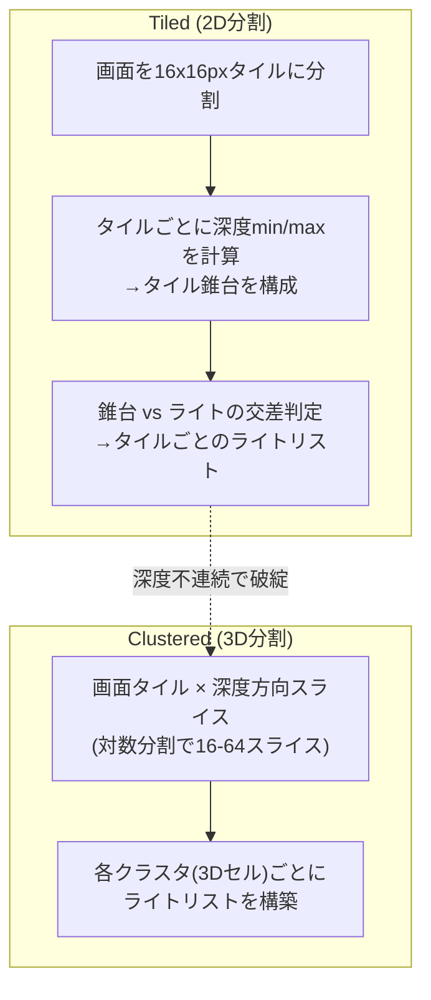
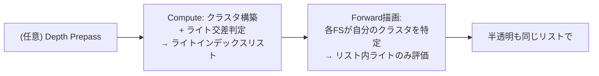

# Forward+ / Tiled / Clustered Rendering

## 概要

Forward+ (Tiled Forward) と Clustered Shading は、**Compute Shaderによるライトカリング**をForward Renderingに組み合わせた方式です。画面をタイル (2D) またはクラスタ (3D=タイル×深度スライス) に分割し、各領域に影響するライトのリストを事前計算してからシェーディングします。「Deferredのライトスケーラビリティ」と「Forwardの柔軟性 (半透明・MSAA・任意マテリアル)」の両立が本質です。

## なぜ必要なのか

- Deferredの限界 (半透明・MSAA・帯域・マテリアル固定) を抱えずに数百〜数千ライトを扱いたい
- VR・モバイル・スタイライズド表現など、Deferredが不利な領域でもライトを増やしたい
- 同じカリング構造はTiled **Deferred**にもそのまま使え、現代レンダラーの共通基盤になっている

## 歴史・誕生した背景

- 2009: Andersson (DICE) の **Tiled Deferred** — Computeでタイルごとのライトリストを作る発想の起点
- 2011: Olsson & Assarsson がTiled Shadingを体系化
- **2012: Harada らが "Forward+: Bringing Deferred Lighting to the Forward Pass"** を発表 (AMD Leo demo) — Tiled手法をForwardへ
- **2012: Olsson らの "Clustered Deferred and Forward Shading"** — 深度方向の分割を加えたClustered登場
- 2014-16: DOOM (2016, idTech6) がClustered Forwardの成功例に。Unity HDRP、Detroit等が採用
- 現在: **Clusteredが業界標準のライト管理構造** — HDRP、URP Forward+、UE (ライトグリッド)、ほぼ全ての内製AAAエンジン

## それ以前の技術

- [Forward](/graphics/path/forward.html) の per-objectライトリスト (CPUで最も近いN個を選ぶ) — 粒度が粗くポッピングする
- [Deferred](/graphics/path/deferred.html) のライト体積描画 — ステンシル設定が煩雑で、ライトごとのパス切替コストも大きい

## 解決した課題

1. ライトカリングの粒度を「オブジェクト」から「タイル/クラスタ」へ細分化
2. Forwardのままライト数をスケールさせた (半透明・MSAA・任意BRDFを保持)
3. ライトリスト構築を完全にGPU化 (CPUのライト管理コスト削減)

## 現在の位置づけ

新規レンダラー設計の第一候補です。「不透明はTiled DeferredでもForward+でもよいが、**ライトのクラスタ構造は必ず作る**」というのが現代の共通認識で、半透明・ボリューメトリックフォグ・パーティクルのライティングにも同じクラスタを使い回します。

## 内部動作

### Tiled と Clustered の違い



**Tiledの弱点**: タイル内に手前と奥のオブジェクトが混在すると (深度不連続)、min/maxの張る錐台が巨大になり、無関係なライトまでリストに入ります。**Clustered**は深度方向も分割してこれを解決し、さらに:

- 深度プリパスなしでもリストを作れる (ジオメトリと独立に構築可能)
- **半透明にも同じリストが使える** (Tiledは不透明の深度に依存)

深度スライスは目の感度に合わせ**対数分割**が定石です:

$$slice = \left\lfloor \frac{\log(z / near)}{\log(far / near)} \cdot numSlices \right\rfloor$$

### パイプライン全体



データ構造 (典型):

- `clusterLightGrid[cluster] = { offset, count }` — クラスタごとのリスト範囲
- `lightIndexList[]` — 全クラスタのライトインデックスを連結した配列 (構築にはAtomicか [Prefix Sum](/graphics/compute/parallel-algorithms.html) を使用)

## 各環境での扱い

### Unity
**URP Forward+** (Unity 2022〜): タイルと深度binでライトを絞り、Forwardのper-objectライト上限を撤廃。ただしper-camera上限は残り、Unity 6.0のdesktopでは256。以下のCompute例は一般的な自作実装の説明で、URPのライトリスト構築コードそのものではありません。HDRPはTile/Cluster両構造を持ち、不透明=Tiled Deferred/Forward、半透明=Clusteredと使い分けます (Lit Shader Mode)。

### Unreal Engine
DeferredベースだがライトはClusteredグリッド (`FLightGridInjection`) で管理し、半透明・フォグ・ボリューメトリックのライティングに使用。Forward Shadingモード時はこのグリッドがメインのライト供給源になります。

### DirectX 12 / Vulkan
アプリ実装。ライトリスト構築はCompute+UAV、シェーディングパスでSRVとして参照。Indirect引数と組み合わせればライト数もGPU管理にできます。実装例はDirectX-Graphics-SamplesやvkguideのGPU Driven章など。

## コード例

クラスタ内ライト評価 (FS側、HLSL):

```hlsl
StructuredBuffer<uint2> gClusterGrid : register(t4);   // {offset, count}
StructuredBuffer<uint>  gLightIndices : register(t5);
StructuredBuffer<Light> gLights : register(t6);

uint GetClusterIndex(float4 svPos, float viewZ) {
    uint2 tile = uint2(svPos.xy) / TILE_SIZE;
    uint  slice = (uint)(log(viewZ / gNear) / log(gFar / gNear) * NUM_SLICES);
    return (slice * gTileCountY + tile.y) * gTileCountX + tile.x;
}

float4 PSMain(Varyings IN) : SV_Target {
    Surface s = MakeSurface(IN);
    uint2 grid = gClusterGrid[GetClusterIndex(IN.positionCS, IN.viewZ)];

    float3 color = EvaluateIBL(s);
    for (uint i = 0; i < grid.y; ++i) {               // このクラスタのライトのみ
        Light L = gLights[gLightIndices[grid.x + i]];
        color += ShadeLight(L, s);
    }
    return float4(color, 1);
}
```

ライトカリングCompute (球 vs クラスタAABBの骨格):

```hlsl
groupshared uint sCount;
groupshared uint sOffset; // lane 0が確保した書込み先をgroup内へ共有
groupshared uint sList[MAX_LIGHTS_PER_CLUSTER];

[numthreads(64, 1, 1)]
void CullLightsCS(uint3 gid : SV_GroupID, uint gi : SV_GroupIndex) {
    if (gi == 0) sCount = 0;
    GroupMemoryBarrierWithGroupSync();

    AABB cluster = gClusterAABBs[ClusterIndex(gid)];   // ビュー空間AABB (事前計算)
    for (uint i = gi; i < gLightCount; i += 64) {      // 64スレッドで全ライトを分担
        if (SphereIntersectsAABB(gLights[i].posVS, gLights[i].range, cluster)) {
            uint slot;
            InterlockedAdd(sCount, 1, slot);
            if (slot < MAX_LIGHTS_PER_CLUSTER) sList[slot] = i;
        }
    }
    GroupMemoryBarrierWithGroupSync();

    // sCountは候補総数。sListへ実際に保存できた件数だけを公開する。
    uint storedCount = min(sCount, (uint)MAX_LIGHTS_PER_CLUSTER);
    if (gi == 0) {  // グローバルリストへ書き出し (Atomicで領域確保)
        uint offset;
        InterlockedAdd(gGlobalCounter[0], storedCount, offset);
        sOffset = offset;
        gClusterGrid[ClusterIndex(gid)] = uint2(offset, storedCount);
    }
    GroupMemoryBarrierWithGroupSync(); // groupsharedのsOffset/sListを共有
    for (uint j = gi; j < storedCount; j += 64)
        gLightIndices[sOffset + j] = sList[j];
}
```

この固定長の説明例では、クラスタ内の上限を超えたライトを切り捨てます。実用実装ではoverflowを記録し、容量拡張・別パス・優先度選定等で対処します。グローバルリストは少なくとも `クラスタ数 × MAX_LIGHTS_PER_CLUSTER` 個を確保し、カウンタはdispatch前に0へ初期化します。書込み後の次の描画へは、Computeのstorage書込みからFragmentのstorage読込みへの適切なAPIバリアを入れる前提です。

## 前提知識

- [Forward](/graphics/path/forward.html), [Deferred](/graphics/path/deferred.html)
- [Compute Shader](/graphics/compute/compute-shader.html), [Shared Memory と Atomic](/graphics/compute/shared-memory.html)

## 次に読むべきページ

- [PBR](/graphics/lighting/pbr.html) — ShadeLightの中身
- [GPU Driven Rendering](/graphics/optimization/gpu-driven.html) — 同じ思想のジオメトリ版
- [URP](/graphics/engine/urp.html) — Forward+の商用実装

## 理解度チェック

1. **TiledからClusteredへ進化した動機を「深度不連続」の観点から説明せよ。**
   ::: details 解答
   Tiledはタイル内の深度min/maxから1つの錐台を作るため、手前のキャラクタと遠景が同居するタイルでは錐台が極端に長くなり、その間の空間にしか影響しないライトも全てリストに入って無駄な評価が発生する。Clusteredは深度方向をスライスして各セルを小さく保つため、深度不連続の影響を受けず、カリング精度が距離に依らず安定する。
   :::

2. **Clusteredのライトリストが半透明にも使える理由を、Tiledと対比して述べよ。**
   ::: details 解答
   Tiledのタイル錐台は不透明ジオメトリの深度バッファ(min/max)から作られるため、深度を書かない半透明や、不透明面より手前の空間のライト情報を持たない。Clusteredは視錐台全体を幾何学的に分割しジオメトリと独立にリストを作るため、任意の深度にある半透明・パーティクル・フォグが自分の位置のクラスタからライトを引ける。
   :::

3. **深度スライスに対数分割を使う理由は。**
   ::: details 解答
   透視投影では画面上の単位変化に対応するビュー空間深度の幅が遠方ほど広がる。線形分割では近距離のスライスが過剰に細かく遠方が粗くなりすぎる。対数分割はスライスの「画面上での見かけの厚み」を均等化し、クラスタのスクリーン空間サイズを距離に依らず揃えられる。
   :::

## 参考資料

- Takahiro Harada et al., *"Forward+: Bringing Deferred Lighting to the Forward Pass"* (2012)
- Ola Olsson et al., *"Clustered Deferred and Forward Shading"* (HPG 2012)
- Tiago Sousa, *"The Devil is in the Details: idTech 666"* (SIGGRAPH 2016) — DOOMの実装
- Ángel Ortiz, *"A Primer On Efficient Rendering Algorithms & Clustered Shading"* (実装解説)
- [Unity 6.0: Forward and Forward+ rendering paths](https://docs.unity.com/en-us/engine/6000.0/manual/render-pipelines/universal-render-pipeline/introduction/urp-concepts/rendering-paths/forward-rendering-paths)
- [Unity 6.0: Forward+ limits](https://docs.unity.com/en-us/engine/6000.0/manual/render-pipelines/universal-render-pipeline/introduction/urp-concepts/rendering-paths/forward-plus-rendering-path-limitations)
- [Microsoft: HLSL Operators](https://learn.microsoft.com/en-us/windows/win32/direct3dhlsl/dx-graphics-hlsl-operators)
- [Microsoft: GroupMemoryBarrierWithGroupSync](https://learn.microsoft.com/en-us/windows/win32/direct3dhlsl/groupmemorybarrierwithgroupsync)
