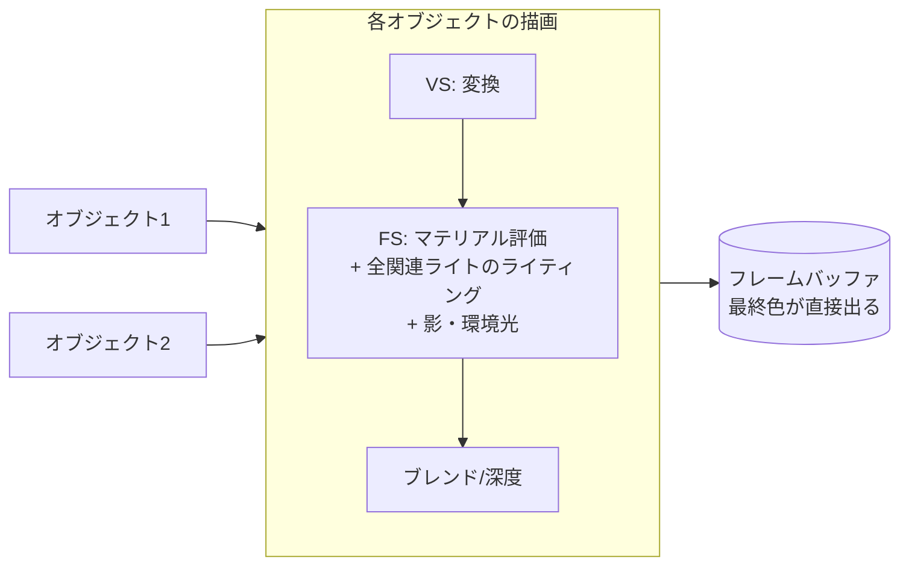

# Forward Rendering

## 概要

Forward Renderingは**最も素直なレンダリング方式**です: オブジェクトを1つずつ描画し、そのFragment Shader内で**その場でライティングまで完結**させます。歴史的に最初の方式であり、Deferredの隆盛を経て、Forward+/Clusteredという進化形で現代の主役に返り咲いています。半透明・MSAA・多様なマテリアルとの相性が良いのが本質的な強みです。

## なぜ必要なのか

- レンダリング方式 (どの順番で何を計算するか) は、レンダラー設計の最初で最大の決定
- Forwardの限界 (ライト数) を理解しないとDeferredの存在理由が分からず、Deferredの限界を理解しないとForward+の意味が分からない — **方式の系譜の出発点**

## 歴史・誕生した背景

- 1990年代〜: 固定機能時代はForward一択 (ハードウェアライトが最大8個、頂点ライティング)
- 2001-05: プログラマブル化により per-pixel ライティングへ。**マルチパスライティング** (ライト1つごとに加算ブレンドで再描画) が Doom 3 (2004) 等で全盛
- 2007頃〜: シェーダの長大化とライト数増加要求で限界 → Deferredへ主流が移動
- 2012: **Forward+** (Harada) がComputeによるライトカリングでForwardを復権 → [Forward+](/graphics/path/forward-plus.html)
- 現在: モバイル (帯域制約でDeferredが不利) とVR (MSAA必須) ではForward系が標準。URPのForward+、UnityビルトインのForward、UEのForward Shading (VR向け) など

## それ以前の技術

(最初の方式なので「以前」はソフトウェアレンダリングの頂点ライティングです)

## 内部動作

### 基本構造



シングルパスForwardのシェーダ疑似コード:

```hlsl
float4 PSMain(Varyings IN) : SV_Target {
    Material mat = EvaluateMaterial(IN);       // テクスチャ群の取得
    float3 color = AmbientIBL(mat, IN);        // 環境光
    for (int i = 0; i < gLightCount; ++i)      // ★ここが問題の中心
        color += ShadeLight(gLights[i], mat, IN);
    return float4(color, mat.alpha);
}
```

### ライト数問題 — Forwardの本質的課題

計算量は **O(オブジェクト数 × ライト数)**。対処の歴史:

| 手法 | 内容 | 問題 |
|---|---|---|
| ライト上限 | オブジェクトごとに近い数個だけ選ぶ (Unityビルトインの per-object lights) | ポッピング、選定コスト |
| マルチパス | ライトごとに再描画+加算 | 頂点変換・ラスタライズがライト数倍 |
| Uber-shader | 全ライトをループ | 無関係なピクセルにも全ライト評価 |
| **タイル/クラスタカリング** | 画面分割してタイルごとのライトリストを作る | → [Forward+](/graphics/path/forward-plus.html) で解決 |

### Z-Prepass

Forwardの定番補助パス。先に深度だけを描いておき、本描画をEarly-Zで「見えるピクセルだけ」実行させ、**オーバードローによる高価なFSの無駄撃ちを排除**します。頂点を2回処理するコストとのトレードオフです。

### Forwardの強み (Deferredとの対比で)

1. **半透明が普通に描ける** (Deferredは原理的に苦手 → [Deferred](/graphics/path/deferred.html))
2. **MSAAがそのまま効く** (VRで決定的) → [アンチエイリアシング](/graphics/postprocess/antialiasing.html)
3. **マテリアルの多様性** — G-Bufferの形式に縛られず、任意のBRDF・特殊シェーディングが自由
4. メモリ帯域が軽い (G-Bufferなし) — モバイルのTBDRと好相性

## 各環境での扱い

### Unity
ビルトインRPのForward (per-objectライト上限方式)、URPのForward/**Forward+** (クラスタ方式、Unity 2022〜)。VR推奨構成はForward+MSAA。

### Unreal Engine
既定はDeferredですが、`Forward Shading` オプション (主にVR向け) が存在。Forward時はMSAAが使用可能になり、一部機能 (SSR等) が制限されます。

### DirectX 12 / Vulkan
方式はAPIの上のアプリ設計です。Forwardは「PSOにライティング込みのPSを設定し、ライトデータを定数/構造化バッファで渡す」だけの最小構成で始められます → [最終章](/graphics/capstone/05-frame.html)

## コード例

シンプルなForwardライティングループ (HLSL、構造化バッファでライト供給):

```hlsl
struct Light { float3 posWS; float range; float3 color; uint type; };
StructuredBuffer<Light> gLights : register(t0);
cbuffer Frame : register(b0) { uint gLightCount; float3 gCameraPos; };

float3 ShadePoint(Light L, float3 P, float3 N, float3 V, Material m) {
    float3 toL = L.posWS - P;
    float  dist = length(toL);
    float3 Ldir = toL / dist;
    float  att  = saturate(1.0 - dist / L.range);
    att *= att;                                   // 滑らかな減衰
    return BRDF(m, N, V, Ldir) * L.color * att * saturate(dot(N, Ldir));
}

float4 PSMain(Varyings IN) : SV_Target {
    Material m = SampleMaterial(IN.uv);
    float3 N = normalize(IN.normalWS);
    float3 V = normalize(gCameraPos - IN.positionWS);
    float3 c = EvaluateIBL(m, N, V);
    for (uint i = 0; i < gLightCount; ++i)
        c += ShadePoint(gLights[i], IN.positionWS, N, V, m);
    return float4(c, 1);
}
```

## 前提知識

- [Fragment Shader](/graphics/pipeline/fragment-shader.html), [出力結合](/graphics/pipeline/output-merger.html)
- [ベクトル](/math/rendering/vector.html)

## 次に読むべきページ

- [Deferred Rendering](/graphics/path/deferred.html) — Forwardの限界への最初の回答
- [Forward+ / Tiled / Clustered](/graphics/path/forward-plus.html) — 現代の回答
- [PBR](/graphics/lighting/pbr.html) — ShadeLight の中身

## 理解度チェック

1. **ForwardがVRで好まれる理由を2つ挙げよ。**
   ::: details 解答
   (1) MSAAが使える — VRはジオメトリエッジのちらつきが没入感を壊すためAAが決定的に重要で、TAAのブレよりMSAAが好まれるが、MSAAはDeferredのG-Bufferと相性が悪い(メモリとシェーディングコストが爆発)。(2) 帯域が軽くGPU時間が読みやすい — 高解像度×2眼×90fpsという帯域制約下でG-Bufferの読み書きコストを避けられる。
   :::

2. **Z-Prepassが効くシーンと逆効果になりうるシーンを説明せよ。**
   ::: details 解答
   効く: FSが高価でオーバードローが多いシーン(重なりの深い不透明ジオメトリ)。深度のみのプリパスは高速で、本パスのFS実行を可視ピクセルに限定できる。逆効果: 頂点数が多くFSが軽いシーン(頂点処理2回のコストが、削減されるFSコストを上回る)。またアルファテストが多いとプリパス自体が重くなる。
   :::

3. **「Forwardはマテリアルの多様性に強い」— この理由をDeferredの制約と対比して述べよ。**
   ::: details 解答
   Forwardはオブジェクトごとに任意のシェーダでライティングまで完結するため、BRDFや特殊表現(布、髪、トゥーン、肌)をシェーダごとに自由に実装できる。DeferredはG-Bufferという固定フォーマットにマテリアル属性を書き出し、共通のライティングパスで処理するため、G-Bufferに収まらない表現はシェーディングモデルIDによる分岐や追加パスが必要になり自由度が低い。
   :::

## 参考資料

- Real-Time Rendering 4th ed., Chapter 20 "Efficient Shading"
- Unity Manual, *Forward+ rendering path*
- Epic, *Forward Shading Renderer* ドキュメント
