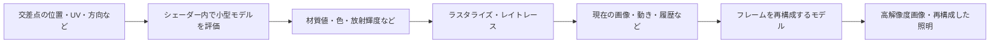
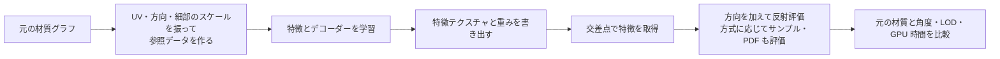
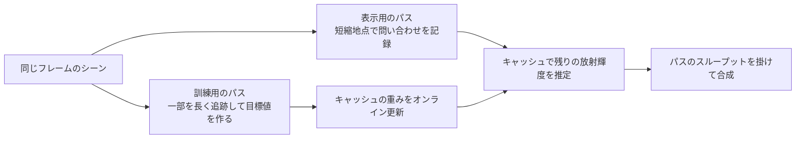

# ニューラルレンダリング — フレームを再構成する推論とシェーダー内の推論

レンダリングの一部に学習済みモデルを組み込むときは、推論がどこで走り、何を受け取って何を返すかを先に押さえる。DLSS の Super Resolution と材質シェーダー内の小型ネットワークでは、同じ GPU を使っても、入力も評価の単位も異なる。



## DLSS 4 の Transformer

Super Resolution は、低解像度の色と動きなどのエンジンデータを使い、時間方向の情報を利用して高解像度画像を得る。[TAA と時間方向のアップスケーリング](../postprocess/upscaling.md)で見るように、物体が動くと、前のフレームの同じ画素位置は別の点を表しうる。履歴を利用する方式では、エンジンから渡す動きやフレームの切り替わりの扱いが画質に関わる。

NVIDIA は **DLSS 4** で、Super Resolution、Ray Reconstruction、DLAA に Transformer ベースのモデルを導入した。従来の CNN 系から変わった点の一つは、自己注意（self-attention）を使い、空間や時間上の情報の関連性に応じて再構成に使う情報の重みを変えられること。Ray Reconstruction では、レイトレースでサンプルした情報から、従来はデノイザーが担当していた領域を再構成する。**DLSS 4.5** は Super Resolution に第 2 世代 Transformer を導入し、同世代の Ray Reconstruction も 2026 年 8 月に NVIDIA が公開した。

フレーム間の画像を作る機能については [フレーム生成](../postprocess/frame-generation.md)を参照。Super Resolution の設定を変えて比べる場合は、細線、動いている模様、新しく見えた領域を含めて、履歴によるちらつきや残像を観察する。

## シェーダー内のニューラルネットワーク

材質や照明を扱う方式では、UV、視線方向、法線などを入力にし、モデルが返す値をその場所のレンダリングに使う。例えば Vaidyanathan らのニューラルテクスチャ圧縮では、同じ材質の複数テクスチャと mip チェーンをまとめて圧縮し、小型モデルで必要な場所を復号する。テクスチャやその表現を読むための転送量と、復号の演算量を比較する必要がある。再構成した色や法線の誤差は、実際の照明を当てたときにも確認する。

**Cooperative Vectors** が扱うのは、こうしたモデルで使われる行列・ベクトル演算。モデルや学習済みの重みはアプリ側で用意する。Vulkan の `VK_NV_cooperative_vector` では、各呼び出しのベクトル演算を協調実行できる。Direct3D 12 では Shader Model 6.10 Preview の LinAlg のスレッドスコープにこの用途がある。NVIDIA **RTX Kit 2026.3** では、Neural Shading SDK 1.4.0 と Neural Texture Compression SDK 0.10.0 Beta がこの DirectX 12 API に対応した。実行条件の詳細は [最新のシェーダー技術](../shader/modern-shader-technologies.md)を参照。

### ニューラル材質 — どの段階を近似するか

ニューラルテクスチャ圧縮が復号するのは、ベースカラー、法線、粗さといった材質入力である。その後は既存のシェーディングを続けられる。Kuznetsov らの **Real-Time Neural Appearance Models**（2023 年）は、元の材質グラフの反射評価や方向サンプリングをまとめて近似する。UV や細部のスケールから学習済みの特徴を取得し、光の入射・出射方向と組み合わせて、小さなデコーダーで材質の応答を求める。元の材質の評価を正解データにできるため、実行時に重ねる層が多い材質を、オフラインで一つの学習済み表現にまとめられる。

| 近似する処理 | 推論が受け取るもの | 推論から後段へ渡すもの | 比較する参照 |
| --- | --- | --- | --- |
| ニューラルテクスチャ圧縮 | UV・mip・圧縮済み特徴 | ベースカラー、粗さ、法線など | 元の材質テクスチャと、それを使った描画 |
| ニューラル材質の反射評価 | 位置の特徴・入射と出射の方向・スケールなど | その方向の反射評価値。方式によってはサンプリング分布のパラメーターも求める | 元の材質グラフの反射とサンプリング |
| ニューラル放射輝度キャッシュ | パスの終端候補での位置・方向・材質など | 残りの光輸送の放射輝度 | 同じ位置から長く追跡したパスの統計 |

材質グラフを近似する方式では、評価用の関数と、重要度サンプリングに使う分布を区別する。ある方向 $\omega_i$ を確率密度 $p(\omega_i)$ で引いたとき、1 サンプルの反射側の重みは $f(\omega_i,\omega_o)|N\cdot\omega_i|/p(\omega_i)$ になる。評価する BRDF $f$ は学習結果で、分母は実際に方向を引いた分布の PDF。近似した BRDF の値をそのまま分母に入れると、描画の明るさが正しく収束しない。学習でサンプリング分布も作る場合は、サンプルを生成するコードと PDF を返すコードを同じ分布から組み立てる。マイクロファセット分布を利用して異方性をサンプルする例は、Kuznetsov らの論文にある。

特徴をどう格納するかでも、復号の演算と帯域の比が変わる。例えば **Real-Time Neural Materials using Block-Compressed Features**（2023 年の公開プレプリント）は、ネットワークへ入れる特徴をブロック圧縮で持つ。特徴をフィルタリングした結果をデコーダーに渡す構成と、材質を評価してから結果を平均する構成では、一般に結果が異なる。デコーダー $g$ が非線形なら $g((a+b)/2)$ と $(g(a)+g(b))/2$ が一致するとは限らないからだ。ミップ間を移動したときに粗さやハイライトが跳ばないかは、各 mip を固定した画像に加えて、カメラを連続移動させて確認する。



平均誤差が小さくても、金属の細い反射や法線の境界では目につくことがある。学習時と異なる環境マップ、斜めからの観察、粗い mip、強い鏡面のある部分を別に比較する。性能は材質数、各ワープ内で同じ材質を使う割合、重みの再利用率を変えて測る。同じ重みを参照するシーンで速くても、画面内の材質がばらけると重みの読み出しが増える。特徴のバイト数、デコーダーの命令、レジスタ使用量、シェーダー全体の時間を合わせて見る。

### Neural Radiance Cache — 長いパスの残りを近似する

Müller らの **Real-Time Neural Radiance Caching for Path Tracing**（2021 年）は、カメラから追跡したパスの一部を長く延ばして学習に使い、ほかのパスを途中でキャッシュに接続する。キャッシュはパスの途中の位置、方向、材質の特徴などを入力に持ち、シーン内の別のパスからでも似た点を問い合わせられる。シーンごとの長い事前学習を前提とせず、レンダリング中に訓練データを収集してネットワークを更新する。

パスを深さ $k$ で短縮し、そこまでに足した寄与を $L_\mathrm{prefix}$、終端に到達するまでの RGB のスループットを $\beta_k$、キャッシュの出射放射輝度を $\widehat L_o(x_k,\omega_o)$ とする。問い合わせ側の寄与は

$$
L_\mathrm{pixel}\approx L_\mathrm{prefix}+\beta_k\odot\widehat L_o(x_k,\omega_o)
$$

になる。$\odot$ はチャンネルごとの積。$\widehat L_o$ にその頂点の直接照明を含めるなら、同じ光を $L_\mathrm{prefix}$ に含めない。先に直接照明を加えてから打ち切る方式では、キャッシュへ期待する残りの範囲が変わる。例えば $L_\mathrm{prefix}=(0.05,0.02,0.01)$、$\beta_k=(0.3,0.2,0.1)$、$\widehat L_o=(0.8,0.5,0.2)$ なら、最終色は $(0.29,0.12,0.03)$。キャッシュの出力をそのまま足すと、終端までの反射や確率密度で重み付けした結果が失われる。



パスを早く打ち切れば交差判定は減るが、キャッシュの近似が効く区間は長くなる。学習データが少ない領域、ライトの急変、鋭い鏡面が続く経路では、推定が元の光輸送に追い付かないことがある。RTXGI SDK v2.8.0 の NRC ガイドには、パスが広がった時点で問い合わせる方法が載っている。滑らかな材質を経由してパスが狭いままなら追跡を続け、粗い反射を経て広がった時点で終端候補にする。表示用のパスから問い合わせデータを、更新用のパスから訓練データを作り、後段でキャッシュの結果を合成する。

画質を比較するときは、キャッシュを使わない長いパスで参照を作り、同じ視点の複数フレームを平均してノイズを下げる。時間を測るときは、訓練用の追跡、推論、学習更新、問い合わせ結果の合成まで含める。キャッシュ側の GPU 時間だけを測っても、削減した交差判定と釣り合うかは分からない。フレームごとに変化するライトを用意すると、静止時のノイズと、変化に追随するまでの偏りを分けて比較できる。

### Cooperative Vectors — 行列の配置と演算精度を指定する

層を $y=Wx+b$ と書くと、入力が $K$ 個、出力が $M$ 個の場合は $W$ が $M\times K$、$b$ が $M$ 要素。行優先のバッファなら $W_{ij}$ のアドレスは行列の開始位置に $i\cdot\mathrm{rowStride}+j\cdot\mathrm{elementSize}$ を足した位置で、列優先なら $j\cdot\mathrm{columnStride}+i\cdot\mathrm{elementSize}$ を足す。行優先を選ぶと要素をメモリに並べる順番が変わる。$W$ を $W^\mathsf{T}$ に置き換える操作は、行列の入出力の向きを変える。行列のサイズに含めるパディングと、行間のバイトストライドも区別する。

| API と対象の版 | 一般の配列レイアウト | デバイス向けのレイアウト | 変換・照会 |
| --- | --- | --- | --- |
| Vulkan `VK_NV_cooperative_vector`（拡張リビジョン 4） | Row Major / Column Major | Inferencing Optimal / Training Optimal | `vkGetPhysicalDeviceCooperativeVectorPropertiesNV` で演算の型の組み合わせを列挙し、`vkConvertCooperativeVectorMatrixNV` または `vkCmdConvertCooperativeVectorMatrixNV` で行列を変換する |
| D3D12 Shader Model 6.10 Preview の LinAlg（2026 年 10 月の実行時仕様） | Row Major / Column Major | Mul Optimal / Outer Product Optimal | スレッドスコープの演算対応を照会し、`GetLinearAlgebraMatrixConversionDestinationInfo` で変換先の必要容量を求める |

最適化レイアウトにはドライバーごとの配置やパディングがある。モデル配布時は、型、形状、バイトストライドが分かる行・列優先のデータを持ち、実行環境で選んだ配置に変換する。必要容量を `M * K * sizeof(element)` と仮定すると、変換後の配置では不足することがある。変換の前に各行列の出力サイズを問い合わせ、オフセットとアライメントを揃える。Vulkan の Training Optimal は、FP16・FP32 の場合に要素配列として要素ごとの操作ができる。パディングが有限値なら行列・ベクトル積に影響せず、NaN や無限大を入れると結果が NaN になりうる。Inferencing Optimal にはこの保証がない。Vulkan の最適化レイアウトの転置対応も、型の組み合わせごとに照会する。

#### FP8 の格納と FP16 の演算結果

| 形式 | 符号・指数・仮数のビット数 | 最大の有限値の大きさ | 1 の次の表現可能な正値 |
| --- | --- | ---: | ---: |
| FP16（IEEE 754 binary16） | 1 / 5 / 10 | 65,504 | $1+2^{-10}$ |
| FP8 E4M3（OCP OFP8） | 1 / 4 / 3 | 448 | 1.125 |
| FP8 E5M2（OCP OFP8） | 1 / 5 / 2 | 57,344 | 1.25 |

E4M3 は 1 付近を E5M2 より細かく表し、E5M2 はより大きい値を表す。OFP8 の E4M3 には無限大の表現がない。最近接丸めの例では、$1.10$ は E4M3 で $1.125$、E5M2 で $1.0$、FP16 で $1.099609375$ に丸められる。行列だけを FP8 にしても、入力ベクトルの解釈、バイアス、結果、内部累積の型はそれぞれ確認する。スケールを使って値を小さい形式に収めるなら、層の途中でスケールを戻す位置と、次の層に渡す量を決める。ReLU の直前が 0 に近い場合、丸めで符号が変わると活性化したニューロンの数も変わる。

Vulkan では型の組み合わせを `VkCooperativeVectorPropertiesNV` から調べる。例として、シェーダー上の FP16 の入力を E4M3 と解釈し、E4M3 の行列と FP16 のバイアスを用いて FP16 を返す組み合わせが定義されている。対象デバイスの列挙結果と、推論・学習それぞれのフィーチャーを確認する。D3D12 の 2026 年 10 月時点の LinAlg プレビュー仕様では、Tier 1 のスレッドスコープに FP8 × FP8 → FP16 の受け入れが含まれる。ドライバーは入力を広げて積和するなど、ネイティブの FP8 演算をエミュレーションできる。詳細照会の `EMULATED_INPUTS` / `EMULATED_OUTPUTS` で実行経路の違いを確認する。格納量が半分になっても、実行時間は対象 GPU とドライバーで測る必要がある。

例えばパディングを除いた $64\times64$ の重みは、FP16 で 8,192 バイト、FP8 で 4,096 バイト。これにバイアス、量子化のスケール、必要な行列の配置分を加える。比較時は参照の FP32、通常のシェーダーで読み出す FP16、対応がある場合の Cooperative Vectors を切り替え、画質・GPU 時間・作業用バッファの容量を測る。対応状況とプレビューの経緯は [最新のシェーダー技術](../shader/modern-shader-technologies.md) を参照。

## コード例 — 小さなモデルを材質に適用する

HLSL Shader Model 6.0 のピクセルシェーダーで、`DXC -T ps_6_0 -E main` を使う。2 入力・3 中間値・1 出力のモデル。重みは値を追うための手設定で、DLSS やニューラルテクスチャ圧縮の実装を使わず、ReLU の前後と出力だけを見られるようにしている。

```hlsl
float EvaluateMaterial(float2 input)
{
    float3 hidden = float3(
        dot(float2(0.6, -0.4), input) + 0.1,
        dot(float2(-0.2, 0.7), input) - 0.1,
        dot(float2(0.3, 0.2), input));
    hidden = max(hidden, 0.0);
    return saturate(dot(hidden, float3(0.5, 0.4, -0.2)) + 0.2);
}

float4 main(float2 uv : TEXCOORD0) : SV_Target0
{
    float value = EvaluateMaterial(uv);
    return float4(lerp(float3(0.05, 0.09, 0.20),
                       float3(0.93, 0.49, 0.16), value), 1.0);
}
```

入力 $(0.25,0.75)$ では中間値が $(-0.05,0.375,0.225)$、ReLU の後が $(0,0.375,0.225)$。混合係数は $0.4\times0.375-0.2\times0.225+0.2=0.305$ になる。学習済みモデルを使う場合も、演算の段数、重みの読み出し、出力の誤差を測る。Cooperative Vectors を使う場合は同じ入出力を持つ通常の演算版と比較できる。

### コード例 — 行優先の FP16 重みを読む参照実装

HLSL Shader Model 6.0 の `cs_6_0`、エントリーポイント `main`。FP16 の重みを行優先で格納し、通常のシェーダー命令で FP32 へ変換して $Wx+b$ を計算する。$M=2$、$K=3$ で、各行は 3 要素と 2 バイトのパディングで 8 バイト。符号付きの FP16 データを入力のバイトバッファ `t0` に入れ、出力の先頭 2 要素を確保した UAV `u0` をバインドし、`Dispatch(1, 1, 1)` で実行する。

```hlsl
ByteAddressBuffer Weights : register(t0);
RWStructuredBuffer<float> Output : register(u0);

static const uint RowStride = 8;
static const uint ColumnCount = 3;

float LoadHalfWeight(uint row, uint column)
{
    uint address = row * RowStride + column * 2;
    uint packed = Weights.Load(address & ~3u);
    uint halfBits = (packed >> ((address & 2u) * 8u)) & 0xffffu;
    return f16tof32(halfBits);
}

[numthreads(2, 1, 1)]
void main(uint3 id : SV_DispatchThreadID)
{
    const float3 input = float3(0.25, -0.5, 0.75);
    const float2 bias = float2(0.125, -0.125);
    uint row = id.x;
    float sum = bias[row];
    for (uint column = 0; column < ColumnCount; ++column)
        sum += LoadHalfWeight(row, column) * input[column];
    Output[row] = sum;
}
```

入力の先頭から、32 ビット語を `0xB4003800, 0x00003C00, 0x3800BC00, 0x00003400` の順に置く。各語の下位 16 ビットから読むと 1 行目は $(0.5,-0.25,1)$、2 行目は $(-1,0.5,0.25)$ になり、出力は $(1.125,-0.4375)$。行間のパディングを含めずに次の行を 6 バイト目から読めば、2 行目の先頭にパディングの値が混ざる。実装を移植するときは、まずこのように非対称な小さい行列で、レイアウト、転置、バイアスの向きを照合する。実際の FP8 経路との数値比較では、参照側も同じ形式へ丸めた重みを読み、入力の丸めと累積の型の違いを個別に調べる。

## 理解度チェック

1. Super Resolution とニューラル材質では、推論の入力と出力がどう違うか。
2. ニューラルテクスチャ圧縮で、重みと圧縮データの転送量が減ったとしても何を測るか。
3. Cooperative Vectors の対応デバイスがあれば、材質のネットワークを自動で作れるか。
4. ニューラル材質で生成した反射方向を評価するとき、モンテカルロ積分の分母は何を使うか。
5. NRC がパス終端で予測した値に、終端までのスループットを掛けるのはなぜか。
6. 推論で使う $64\times64$ の FP8 行列を最適化レイアウトに変換するとき、4,096 バイトを出力領域の大きさとしてそのまま使えるか。

::: details 解答

1. 前者は画像・動き・履歴などからフレームを再構成する。後者は UV や方向などから材質値などを求める。
2. 復号の演算を含む GPU 時間と、最終的に描画した画像の差を測る。
3. ネットワークと重みは別に必要。Cooperative Vectors が提供するのは、推論などに使う行列・ベクトル演算。
4. 実際にその方向を生成した確率密度。材質の反射評価値は分子に使う。
5. 終端より手前の反射や透過、方向サンプリングで重み付けして、カメラまで到達する寄与を求めるため。
6. 4,096 バイトは隙間のない通常の配列の大きさ。変換後の大きさと必要なアライメントを API で確認する。

:::

## 関連項目

- [アップスケーリング](../postprocess/upscaling.md)
- [フレーム生成](../postprocess/frame-generation.md)
- [パストレーシング](../lighting/path-tracing.md)
- [最新のシェーダー技術](../shader/modern-shader-technologies.md)

## 参考資料

- NVIDIA, [DLSS 4 — The New Transformer Model](https://www.nvidia.com/en-us/geforce/news/gfecnt/20251/dlss4-multi-frame-generation-ai-innovations/)
- NVIDIA, [DLSS 4.5 Super Resolution](https://developer.nvidia.com/blog/nvidia-dlss-4-5-delivers-super-resolution-upgrades-and-new-dynamic-multi-frame-generation/)・[DLSS 4.5 Ray Reconstruction](https://www.nvidia.com/en-us/geforce/news/gamescom-2026-nvidia-geforce-rtx-dlss-4-5-announcements/)
- Karthik Vaidyanathan et al., [Random-Access Neural Compression of Material Textures](https://research.nvidia.com/publication/2023-08_random-access-neural-compression-material-textures), SIGGRAPH 2023
- Alexandr Kuznetsov et al., [Real-Time Neural Appearance Models](https://research.nvidia.com/labs/rtr/neural_appearance_models/), SIGGRAPH 2023
- Clément Weinreich et al., [Real-Time Neural Materials using Block-Compressed Features](https://arxiv.org/abs/2311.16121), 2023 年公開プレプリント
- Thomas Müller et al., [Real-Time Neural Radiance Caching for Path Tracing](https://research.nvidia.com/labs/rtr/publication/muller2021nrc/), SIGGRAPH 2021
- NVIDIA, [RTXGI SDK v2.8.0 — NRC Guide](https://github.com/NVIDIA-RTX/RTXGI/blob/v2.8.0/Docs/NrcGuide.md)
- NVIDIA, [RTX Kit 2026.3](https://github.com/NVIDIA-RTX/RTX-Kit/releases/tag/2026.3)
- Microsoft, [D3D12 LinAlg Matrix Preview](https://devblogs.microsoft.com/directx/d3d12-linalg-preview/)
- Microsoft, [D3D12 Linear Algebra Runtime Feature Support](https://microsoft.github.io/DirectX-Specs/d3d/D3D12LinearAlgebraRuntimeFeatureSupport.html)
- Khronos Group, [VK_NV_cooperative_vector](https://docs.vulkan.org/refpages/latest/refpages/source/VK_NV_cooperative_vector.html)
- Khronos Group, [VkCooperativeVectorMatrixLayoutNV](https://docs.vulkan.org/refpages/latest/refpages/source/VkCooperativeVectorMatrixLayoutNV.html)・[VkCooperativeVectorPropertiesNV](https://docs.vulkan.org/refpages/latest/refpages/source/VkCooperativeVectorPropertiesNV.html)
- Open Compute Project, [OCP 8-bit Floating Point Specification (OFP8), Rev. 1.0](https://www.opencompute.org/documents/ocp-8-bit-floating-point-specification-ofp8-revision-1-0-2023-12-01-pdf-1)
