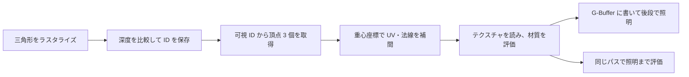

# Visibility Buffer と Deferred Texturing — 可視面から材質を復元する

ラスタライズでまず「このピクセルには、どの三角形が見えるか」を決め、残った面のテクスチャと材質を後で評価する。Visibility Buffer では、後段がメッシュを引き直せるように三角形やインスタンスの ID を保持する。テクスチャを後で読む Deferred Texturing には、UV など補間済みの属性を先に記録する構成もある。

## どの段階で何を計算するか

| パス | 可視面を求める段階の出力 | 後段で行う計算 |
| --- | --- | --- |
| Forward | 材質と光を評価した色、深度 | 必要に応じてポスト処理などを行う。 |
| G-Buffer を使う Deferred | 深度と、法線・ベース色・粗さなどの材質パラメーター | G-Buffer を読み、光を評価する。 |
| Visibility Buffer | 深度と、インスタンス・三角形などを特定する ID | 頂点属性を復元し、材質を評価する。光は同じ段階で評価するか、G-Buffer を介して別の段階で評価する。 |

Forward や通常の Deferred でも、Early-Z や深度プリパスで隠れた面の処理を減らせる。Visibility Buffer の利点は、可視面を選ぶパスを、材質の評価から分けられることにある。テクスチャのアルファで面を抜く材質など、可視性を決める時点で材質の一部を評価する場合もある。ブレンドで複数の面を重ねる半透明物体には、可視サンプルにつき ID を一組だけ持つ方式では情報が足りない。



## 重心座標とテクスチャの勾配

スクリーン上で求めた重心座標を `λ0, λ1, λ2`、頂点のクリップ座標の `w` を `w0, w1, w2` とする。属性の透視補正には、`qi = λi / wi` を求め、`qi / (q0 + q1 + q2)` を重みとして使う。たとえばスクリーン上の重みがすべて `1/3` で、`w=(1,2,4)` なら、補正後は `(4/7,2/7,1/7)`。

隣のピクセルが別の三角形なら、そのピクセルの UV との差をミップ選択に使うと、同じ面のテクスチャがどれだけ縮んで見えるかを表せない。同じ三角形で隣接座標の UV も再計算し、その差を `SampleGrad` に渡す方法がある。輪郭で隣の座標が三角形の外にあっても、この計算では同じ面を延長して勾配を求める。

### バッファーの削減量と追加の処理

Burns・Hunt の 2013 年の実装は、サンプルあたり三角形とインスタンスの ID を最小で 4 バイトに収めた。3840×2160、1 ピクセル 1 サンプルの場合、仮に 20 バイトの G-Buffer を 4 バイトの ID に置き換えると、画面サイズ分の記録は約 158.2 MiB から 31.6 MiB になる。この比較には深度、色、その他の一時バッファーを含めていない。ID を 32 ビットずつ二つ持つ場合は約 63.3 MiB になる。

削減できるのは画面サイズ分の材質属性の読み書き。一方で後段には頂点データの再読み込み、補間、テクスチャ勾配の計算が加わる。G-Buffer も使う構成ならその読み書きも残る。GPU キャプチャでは、ID と材質の各パスを分け、パス時間、帯域、キャッシュの利用状況を比較する。

## Nanite と組み合わせる例

Unreal Engine 5.8 の公式資料では、Nanite はメッシュを階層化したクラスタに分け、描画時に見える詳細度を選ぶ仮想化ジオメトリとして説明されている。Epic Games の SIGGRAPH 2021 講演では、Nanite が可視クラスタと三角形を特定できる情報を記録し、材質パスで頂点属性を復元して G-Buffer へ出力する設計を示している。この構成では、可視性と材質評価を分けつつ、エンジンの Deferred の照明処理を共有できる。

## コード例 — ID と UV を別々のパスで求める

HLSL Shader Model 6.0 のピクセルシェーダー 2 本を 1 ファイルに置いた例。DXC で `writeVisibility` と `sampleVisibleMaterial` をそれぞれ `ps_6_0` としてコンパイルできる。最初のパスでは `R32G32_UINT` のターゲットを 0 でクリアし、深度テストを有効にしてインスタンスを一つずつ描く。`drawInstanceIndex` は 0 始まり。`instanceFirstTriangle` は各インスタンスの三角形の開始位置を記録する。

サンプルでは単純化のため、三角形の頂点はインデックスなしで 3 個ずつ連続し、描画に使ったものと同じビューポートで投影済みとする。三角形の各頂点は正の `w` を持ち、スクリーン上で退化しない。材質には 1 枚の共有テクスチャを使う。2 番目のパスでは ID ターゲットを SRV で読み、全画面を描く。

```hlsl
cbuffer Draw : register(b0)
{
    uint drawInstanceIndex;
};

struct ScreenVertex
{
    float2 position;
    float2 uv;
    float inverseW;
};

Texture2D<uint2> visibility : register(t0);
StructuredBuffer<uint> instanceFirstTriangle : register(t1);
StructuredBuffer<ScreenVertex> vertices : register(t2);
Texture2D<float4> baseColor : register(t3);
SamplerState colorSampler : register(s0);

uint2 writeVisibility(uint primitiveId : SV_PrimitiveID) : SV_Target
{
    return uint2(drawInstanceIndex + 1u, primitiveId);
}

float cross2(float2 a, float2 b)
{
    return a.x * b.y - a.y * b.x;
}

float2 interpolateUV(float2 pixel, ScreenVertex a, ScreenVertex b, ScreenVertex c)
{
    float2 ab = b.position - a.position;
    float2 ac = c.position - a.position;
    float2 ap = pixel - a.position;
    float area = cross2(ab, ac);
    float wb = cross2(ap, ac) / area;
    float wc = cross2(ab, ap) / area;
    float3 q = float3(1.0 - wb - wc, wb, wc)
             * float3(a.inverseW, b.inverseW, c.inverseW);
    return (q.x * a.uv + q.y * b.uv + q.z * c.uv) / (q.x + q.y + q.z);
}

float4 sampleVisibleMaterial(float4 position : SV_Position) : SV_Target
{
    uint2 id = visibility.Load(int3(int2(position.xy), 0));
    if (id.x == 0)
    {
        return float4(0.0, 0.0, 0.0, 1.0);
    }

    uint firstVertex = 3u * (instanceFirstTriangle[id.x - 1u] + id.y);
    ScreenVertex a = vertices[firstVertex];
    ScreenVertex b = vertices[firstVertex + 1u];
    ScreenVertex c = vertices[firstVertex + 2u];
    float2 uv = interpolateUV(position.xy, a, b, c);
    float2 uvRight = interpolateUV(position.xy + float2(1, 0), a, b, c);
    float2 uvBelow = interpolateUV(position.xy + float2(0, 1), a, b, c);
    return baseColor.SampleGrad(colorSampler, uv, uvRight - uv, uvBelow - uv);
}
```

実際の描画では、ID を読み出してから材質を振り分ける処理、クリッピングや多重サンプルの取り扱いも必要になる。たとえば MSAA を使う場合、サンプル間で異なる面が見えるピクセルを扱う方法を決める。ID は連続した属性ではないため、複数サンプルの ID を平均すると三角形を引けなくなる。

## 理解度チェック

<details><summary>Visibility Buffer に UV を持たない構成では、後段でどこから取り出す？</summary>

インスタンスと三角形を ID から特定し、対応する 3 頂点の UV を取得する。画面位置から重心座標を計算し、透視補正した重みで補間する。

</details>

<details><summary>画面上で隣のピクセルを使った UV 差分が、三角形の境界で不適切になるのはなぜ？</summary>

隣のピクセルが別の面や材質の UV を持つ可能性がある。同じ三角形の UV を隣接座標で評価して差を取れば、その面の縮み方を求められる。

</details>

<details><summary>Visibility Buffer を使う描画と、Deferred の照明は同時に使える？</summary>

使える。材質評価の結果を G-Buffer に書けば、後段で通常の Deferred の照明を行える。

</details>

## 関連項目

- [Forward Rendering](/graphics/path/forward.html)
- [Deferred Rendering](/graphics/path/deferred.html)
- [テクスチャのフィルタリングとミップマップ](/graphics/texture/texture-filtering-and-mipmaps.html)

## 参考資料

- [Christopher A. Burns・Warren A. Hunt — The Visibility Buffer: A Cache-Friendly Approach to Deferred Shading（2013）](https://jcgt.org/published/0002/02/04/)
- [Brian Karis・Rune Stubbe・Graham Wihlidal — A Deep Dive into Nanite Virtualized Geometry（SIGGRAPH 2021）](https://advances.realtimerendering.com/s2021/Karis_Nanite_SIGGRAPH_Advances_2021_final.pdf)
- [Epic Games — Nanite Virtualized Geometry in Unreal Engine 5.8](https://dev.epicgames.com/documentation/unreal-engine/nanite-virtualized-geometry-in-unreal-engine?application_version=5.8)
- [Microsoft HLSL — System-value semantics](https://learn.microsoft.com/en-us/windows/win32/direct3dhlsl/dx-graphics-hlsl-semantics)
- [Microsoft HLSL — SampleGrad](https://learn.microsoft.com/en-us/windows/win32/direct3dhlsl/dx-graphics-hlsl-to-samplegrad)
