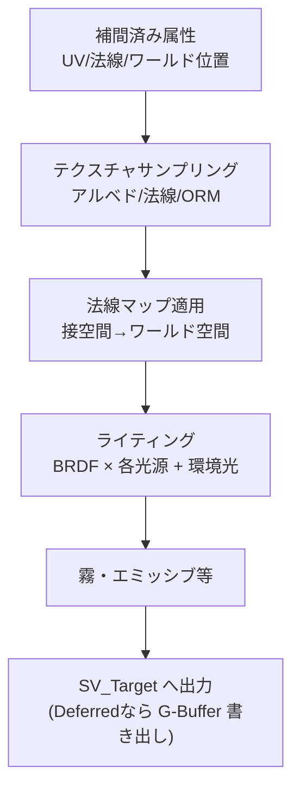

# Fragment Shader (Pixel Shader)

## 概要

Fragment Shader (FS、DirectX用語ではPixel Shader/PS) は、**ラスタライザが列挙した各フラグメントに対して色を計算するプログラム**です。ライティング・テクスチャリング・マテリアル表現という「絵作りの本体」はここに集中しており、GPU時間の大半を消費するステージでもあります。

## なぜ必要なのか

- ピクセル単位のライティング (法線マップ・PBR) は頂点単位では原理的に不可能
- 画面上の見た目の質はほぼFSの質 — マテリアル・影・反射・霧、すべての最終合成点
- ポストプロセスもフルスクリーン三角形のFSとして実行される → [ポストプロセス](/graphics/postprocess/overview.html)

## 歴史・誕生した背景

- 1998: **マルチテクスチャ** (`GL_ARB_multitexture`) と register combiner — 固定機能の組み合わせ表現の限界
- **2001: DirectX 8 Pixel Shader 1.1** (GeForce 3) — 8命令のアセンブリ。テクスチャ合成のプログラム化
- 2002: **PS 2.0** (Radeon 9700) — 浮動小数点演算・64+命令。ここから「ピクセルで計算する」時代へ
- 2004: SM3.0 (動的分岐)。Far Cry / HL2 が per-pixel lighting を主流化
- 2006: 統合シェーダ。以降FSの進化は言語機能 (SM5/SM6, Wave命令) と共に
- 2010年代: PBRの普及によりFSは「物理的な積分の近似計算機」になった → [PBR](/graphics/lighting/pbr.html)

## それ以前の技術

固定機能のテクスチャ環境 (`glTexEnv`) と register combiner。「テクスチャ2枚を乗算」程度の合成しかできず、法線マップによるピクセル単位ライティングは擬似的な手法 (embossing等) しかありませんでした。

## 解決した課題

ピクセル単位の任意計算。法線マップ・視差マッピング・PBR・手続きテクスチャ・スクリーンスペース技法 (SSAO/SSR) はすべてFSのプログラム可能性の産物です。

## 現在の位置づけ

描画コストの主戦場です。現代のFSは1ピクセルあたり数百〜数千命令を実行し、性能最適化の中心 (オーバードロー削減、可変レートシェーディング、アップスケーリングによるFS実行数削減) もここに集中しています。

## 内部動作

### 実行モデルと制約

- **2x2クワッド単位で起動** (微分のため) → [ラスタライゼーション](/graphics/pipeline/rasterization.html)
- 入力: 透視補正補間された頂点属性 + `SV_Position` (ピクセル座標) + システム値 (`SV_IsFrontFace` 等)
- 出力: `SV_Target0..7` (最大8枚のレンダーターゲット = MRT) + 任意で `SV_Depth`
- **書き込み位置は固定**: 自分のピクセル位置にしか書けない (散乱書き込みはUAV/Storage Imageの例外を除く)。この制約が並列実行と順序保証を可能にしている

### FSの主な仕事の内訳



### discard と Early-Z

`discard` (HLSL: `clip()`) はフラグメントを破棄しますが、**深度の早期棄却 (Early-Z) を無効化**し得ます。ハードウェアは「FSが深度書き込みに影響しない」と保証できる場合のみ、FS実行前に深度テストを済ませて無駄な実行を省きます:

| FSの行為 | Early-Z |
|---|---|
| 通常の色出力のみ | ✅ 有効 |
| `discard` を含む | ⚠️ 深度書き込み有効時は制限 (leaf/草で問題に) |
| `SV_Depth` 書き込み | ❌ 無効 (conservative depth `SV_DepthGreaterEqual` で部分回復) |

アルファテスト植生が重い理由はこれです。→ [出力結合](/graphics/pipeline/output-merger.html)

### テクスチャサンプリングと微分

`Sample()` はクワッド内の暗黙微分からミップレベルを決めます。**動的分岐の中で Sample を呼ぶと微分が未定義**になるため、コンパイラが分岐を平坦化するか、`SampleLevel` (明示LOD) を使う必要があります。

### オーバードローとオーバーシェーディング

- **オーバードロー**: 同じピクセルが複数回塗られること。不透明物は手前から奥へソートしEarly-Zで棄却するのが定石
- **クワッドオーバーシェーディング**: 微小三角形によるヘルパーレーン浪費
- 可変レートシェーディング (VRS): 2x2ピクセルに1回のFSなど、起動密度自体を落とす近年の機能

## 各環境での扱い

### Unity
`#pragma fragment frag`。URPでは `half4 frag(Varyings IN) : SV_Target`。ライティングは `Lighting.hlsl` のヘルパー (`UniversalFragmentPBR`)。Shader Graphのノードは最終的にFSコードへ合成されます。

### Unreal Engine
マテリアルエディタの出力ピン (BaseColor/Roughness/Normal...) がFSコード片に変換され、`BasePassPixelShader.usf` のテンプレートに埋め込まれます。Deferredでは G-Buffer 書き出し、シェーディングモデルIDで後段のライティングパスが分岐します。

### DirectX 12
`ps_6_x` プロファイル。MRT構成はPSOの `RTVFormats` と一致必須。`SV_DepthGreaterEqual`/`LessEqual` (conservative depth)、`SV_Coverage`、ROV (Rasterizer Ordered Views) など高度な機能もPS向け。

### Vulkan
GLSLの `layout(location=N) out vec4`。`layout(early_fragment_tests) in;` でEarly-Zを強制 (discardとの併用不可)。Subpass入力 (`subpassInput`) はTBDRでのオンチップG-Buffer読み出しに対応する独自概念です。

## コード例

法線マップ+単純PBR風のFS (HLSL):

```hlsl
Texture2D gAlbedo : register(t0);
Texture2D gNormalMap : register(t1);
SamplerState gLinear : register(s0);

float4 PSMain(Varyings IN) : SV_Target
{
    // 1. テクスチャ取得
    float3 albedo = gAlbedo.Sample(gLinear, IN.uv).rgb;
    float3 nTS = gNormalMap.Sample(gLinear, IN.uv).xyz * 2.0 - 1.0; // [0,1]→[-1,1]

    // 2. 接空間→ワールド空間 (TBN行列)
    float3 N = normalize(IN.normalWS);
    float3 T = normalize(IN.tangentWS.xyz);
    float3 B = cross(N, T) * IN.tangentWS.w;
    N = normalize(mul(nTS, float3x3(T, B, N)));

    // 3. ライティング
    float3 L = normalize(-gSunDirWS);
    float3 V = normalize(gCameraPosWS - IN.positionWS);
    float3 H = normalize(L + V);
    float NdotL = saturate(dot(N, L));
    float spec  = pow(saturate(dot(N, H)), 64);

    float3 color = albedo * (gSunColor * NdotL + gAmbient) + spec * gSunColor;
    return float4(color, 1.0);
}
```

フルスクリーンパス用FS (ポストプロセスの基本形):

```hlsl
// 頂点3つの巨大三角形で全画面を覆う定石 (頂点バッファ不要)
Varyings FullscreenVS(uint id : SV_VertexID) {
    Varyings o;
    float2 uv = float2((id << 1) & 2, id & 2);
    o.positionCS = float4(uv * 2.0 - 1.0, 0, 1);
    o.uv = float2(uv.x, 1.0 - uv.y);
    return o;
}
float4 PostPS(Varyings i) : SV_Target {
    float3 c = gSceneColor.Sample(gLinear, i.uv).rgb;
    return float4(c / (c + 1.0), 1);   // Reinhardトーンマップ
}
```

## 前提知識

- [ラスタライゼーション](/graphics/pipeline/rasterization.html) — クワッド・補間・微分の由来
- [ベクトル](/math/rendering/vector.html), [座標変換](/math/rendering/transform.html)

## 次に読むべきページ

- [出力結合](/graphics/pipeline/output-merger.html) — FSの出力のその後
- [PBR](/graphics/lighting/pbr.html) — 現代のFSの中身
- [シェーダ言語総論](/graphics/shader/overview.html)

## 理解度チェック

1. **FSが自分のピクセル位置にしか書き込めない制約は、何を可能にしているか。**
   ::: details 解答
   フラグメント間のデータ依存が存在しないことを保証し、数百万フラグメントの完全並列実行を可能にする。また書き込み先が固定であることで、ROPがプリミティブ投入順のブレンド順序保証をピクセル単位で効率的に実装できる。
   :::

2. **草や木の葉 (アルファテスト) の描画が不透明物より重くなりがちな理由を2つ挙げよ。**
   ::: details 解答
   (1) discardを使うため、深度書き込みと併用するとEarly-Z/Hi-Zの早期棄却が制限され、遮蔽されたフラグメントのFSも実行されてしまう。(2) 細かい形状ゆえ微小三角形+空白の多いテクスチャとなり、クワッドのヘルパーレーンと棄却されるフラグメントの実行が大量に無駄になる。
   :::

3. **動的分岐内でのテクスチャSampleが問題になる理由と対処法は。**
   ::: details 解答
   ミップ選択に使う暗黙微分はクワッド内の隣接レーンとの差分で計算されるが、分岐によりクワッド内でSampleに到達しないレーンがあると微分が未定義になる。対処は分岐の外でサンプルする、SampleLevel/SampleGradで明示的にLOD/勾配を与える、など。
   :::

## 参考資料

- Fabien Giesen, *"A trip through the Graphics Pipeline"* — Part 7 (クワッドとヘルパーレーン)
- Real-Time Rendering 4th ed., Chapter 3, 5
- Microsoft Learn, *Pixel Shader Stage* / *Variable-Rate Shading*
- Emil Persson, *"Depth In-Depth"* (Early-Z解説の古典)
