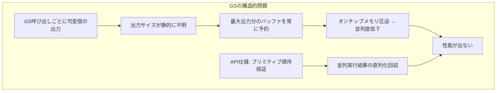

# Geometry Shader

## 概要

Geometry Shader (GS) は、**プリミティブ (三角形・線・点) 単位で実行され、プリミティブを増減・変形できる**オプションのステージです。DX10 (2006) で鳴り物入りで登場しましたが、**アーキテクチャ上の根本的な性能問題により「歴史に学ぶための技術」**となり、現在はMesh Shaderに役割を譲りつつあります。失敗からの学びが多い、教材として重要なステージです。

## なぜ必要なのか(と、されたのか)

当時期待された用途:
- ポイントスプライトの四角形展開 (パーティクル)
- ファー・シルエットのフィン/シェル生成
- キューブマップ6面への一括描画 (`SV_RenderTargetArrayIndex`)
- シャドウボリュームの押し出し

「頂点単位ではなくプリミティブ単位で、しかも出力数を可変にしたい」という要求は本物でした。**問題は要求ではなく実装形態**にありました。

## 歴史・誕生した背景

- 2006: **DirectX 10 / OpenGL 3.2** でGS導入 (G80世代)。「ジオメトリをGPUで増幅できる」と大きな期待
- 2007-08: 各社が採用を試みるも、性能が出ないことが判明していく
- 2010年代: 実用は「レイヤーターゲット振り分け」等の少数用途に縮小。「GSは使うな」が業界の共通見解に
- 2018: NVIDIA Turing が **Mesh Shader** を発表 — GSが目指したものの正しい設計としてやり直し
- 現在: Metalに至ってはGSを最初から実装せず。Vulkan/DX12では残るがモバイルでは非対応も多い

## それ以前の技術

プリミティブ増幅はCPUで行うか、インスタンシング+VSのトリックで代替していました (パーティクルの四角形はインスタンシングで展開する等)。

## 解決した課題と、解決できなかった課題

**解決**: プリミティブ単位の処理とレンダーターゲット配列への振り分けをパイプライン内で可能にした。

**失敗の本質** — GSの仕様がGPUの並列性と根本的に相性が悪かった:

1. **出力量が動的**: 各GS呼び出しが0〜N個の頂点を出すため、後段に渡す前に**出力順序を保証するバッファリング**が必要
2. **出力順序保証**: プリミティブの順序をAPIが保証するため、並列に実行したGSの結果を**入力順に直列化**して回収しなければならない
3. 結果、GPUはGS出力用のオンチップメモリを予約し、並列度が激減。「GSを有効にしただけで遅くなる」ハードウェアが多かった
4. AMD GCNではGS出力を一度メモリに書いて読み戻す実装すらあった



## 現在の位置づけ

**新規採用は非推奨**です。ただし以下の理解は現役です:

- 既存コードベース (ボリュームレンダリング、デバッグ表示等) で遭遇する
- 「なぜMesh Shaderはあの設計なのか」はGSの失敗を知らないと理解できない
- レイヤー振り分けは現在 `SV_RenderTargetArrayIndex` をVSから直接出力可能 (DX12/Vulkanの拡張) になり、最後の実用用途も置換が進む

## 内部動作

- 入力: 1プリミティブの全頂点 (隣接情報付きも可: `triangleadj` で6頂点)
- 出力: `TriangleStream<T>` 等への `Append()` / `RestartStrip()`。最大出力頂点数を**コンパイル時に宣言**
- インスタンス化GS (`[instance(N)]`) で同一プリミティブを複数回処理可能
- Stream Output (Transform Feedback): GS出力をバッファへ書き戻す機能 — これも現在はComputeで代替

## 各環境での扱い

### Unity
`#pragma geometry geom` で使用可能ですが、Metal非対応のためクロスプラットフォームでは使えません。草・ファーの実装例が多く出回っていますが、公式にもComputeベースへの移行が推奨されています。

### Unreal Engine
エンジンとしてGSの利用を段階的に排除してきました (かつてのキューブマップ描画等)。現在の標準機能でGSに依存するものはほぼありません。

### DirectX 12
`gs_6_x` としてサポート継続。PSOに `GS` バイトコードを設定。ただしMesh Shaderパイプラインとは排他です。

### Vulkan
`VkPhysicalDeviceFeatures::geometryShader` が必要 — **モバイルGPUの多くが非対応**。GLSLでは `layout(triangles) in; layout(triangle_strip, max_vertices=4) out;`。

## コード例

点をカメラ向きの四角形に展開する典型例 (HLSL) — **教材として**:

```hlsl
struct GSIn  { float3 centerWS : POSITION; float size : TEXCOORD0; };
struct GSOut { float4 posCS : SV_Position; float2 uv : TEXCOORD0; };

[maxvertexcount(4)]   // 最大出力数の静的宣言が必須 (これが性能問題の根源)
void GSMain(point GSIn input[1], inout TriangleStream<GSOut> stream)
{
    float3 right = gCameraRightWS * input[0].size;
    float3 up    = gCameraUpWS    * input[0].size;
    float2 uvs[4] = { {0,1}, {0,0}, {1,1}, {1,0} };
    float2 signs[4] = { {-1,-1}, {-1,1}, {1,-1}, {1,1} };

    [unroll]
    for (int i = 0; i < 4; ++i) {
        GSOut o;
        float3 posWS = input[0].centerWS
                     + right * signs[i].x + up * signs[i].y;
        o.posCS = mul(gViewProj, float4(posWS, 1));
        o.uv = uvs[i];
        stream.Append(o);
    }
}
```

**現代の代替**: 同じ処理はインスタンシング (4頂点×N個) か、Compute Shaderで頂点バッファを生成する方式で、より高速に書けます。

## 前提知識

- [Vertex Shader](/graphics/pipeline/vertex-shader.html), [パイプライン全体像](/graphics/pipeline/overview.html)

## 次に読むべきページ

- [Mesh Shader](/graphics/pipeline/mesh-shader.html) — GSの正しいやり直し
- [Tessellation](/graphics/pipeline/tessellation.html) — もう一つの「ジオメトリ増幅」ステージ
- [Compute Shader](/graphics/compute/compute-shader.html) — 実務上の代替手段

## 理解度チェック

1. **GSの性能が出なかった根本原因を「出力の可変性」と「順序保証」の2点から説明せよ。**
   ::: details 解答
   各GS呼び出しの出力頂点数が実行時まで不明なため、ハードウェアは宣言された最大出力分のオンチップバッファを全並列実行分予約する必要があり、常駐できるスレッド数が激減する。さらにAPIがプリミティブの出力順序を入力順に保証するため、並列に完了したGSの結果を順序どおりに直列化して後段へ流す仕組みが必要になり、並列性がさらに削がれた。
   :::

2. **Mesh ShaderはGSの問題をどう設計で回避したか。**
   ::: details 解答
   Compute Shader型の実行モデルを採用し、(1)スレッドグループ単位で協調して固定上限内の頂点/プリミティブ群(meshlet)を出力する形にして出力バッファ管理を明示化・効率化し、(2)増幅はTask Shaderによるグループ起動数の制御として表現し、1スレッドが可変個を逐次出力する構造をなくした。
   :::

3. **今日GSの採用を検討すべきでない実務的理由を3つ挙げよ。**
   ::: details 解答
   (1)ほぼ全ハードウェアで代替手段(インスタンシング/Compute/Mesh Shader)より遅い。(2)Metalが非対応でモバイルVulkanも非対応が多く、移植性を損なう。(3)エンジン(UE/Unity)側も依存を排除する方向であり、将来性がない。
   :::

## 参考資料

- Microsoft, *Direct3D 10 System* (Blythe, SIGGRAPH 2006) — GS導入の原典
- 各所の "Geometry shader performance" 検証記事 (GCN世代の実測)
- NVIDIA, *"Introduction to Turing Mesh Shaders"* (2018) — GSの反省が語られる
