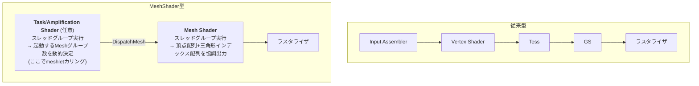

# Mesh Shader / Task Shader

## 概要

Mesh Shader は、従来の **IA→VS→(Tess)→(GS)** というジオメトリパイプライン前半を、**Compute Shader型の実行モデルで丸ごと置き換える**新しいステージです。前段の **Task Shader (DX12ではAmplification Shader)** と組み合わせ、「スレッドグループが協調して小さなメッシュ片 (**meshlet**) を生成し、ラスタライザへ直接送る」という構造を取ります。2018年のNVIDIA Turingで登場し、DX12 Ultimate / Vulkan拡張として標準化されました。

## なぜ必要なのか

従来パイプラインの限界:

- **固定の頂点フェッチ**: IAの仕組みは1頂点ずつの処理を前提とし、クラスタ単位のカリングができない
- **GSの失敗**: プリミティブ増幅・加工の柔軟性が必要なのに、GSは性能が出ない → [Geometry Shader](/graphics/pipeline/geometry-shader.html)
- **数億ポリゴン時代**: 映画品質アセットをそのまま流すには、GPU上で「見える部分だけを選ぶ」細粒度カリングが必須 → [GPU Driven Rendering](/graphics/optimization/gpu-driven.html)

Mesh Shaderは「ジオメトリ処理はComputeのように書きたい。ただしラスタライザへ直結したい」という要求への回答です。

## 歴史・誕生した背景

- 2015頃〜: GPU Drivenレンダリングの隆盛 (Assassin's Creed Unity, Frostbiteなど) — ComputeでカリングしてExecuteIndirectする設計が普及し、「そもそもパイプライン前半が邪魔」という認識が広がる
- 2016: AMD Vega の **Primitive Shader** (自動変換方式、ドライバ活用は頓挫)
- **2018: NVIDIA Turing が Task/Mesh Shader を発表** (`VK_NV_mesh_shader`)
- 2020: **DirectX 12 Ultimate** (Amplification/Mesh Shader)、RDNA2 (PS5/Xbox Series X世代) が対応
- 2022: **`VK_EXT_mesh_shader`** でVulkanのベンダー中立拡張が成立
- 現在: Alan Wake 2 (2023) など採用作が登場。UE5のNaniteはHWラスタライズ経路でMesh Shaderを利用

## それ以前の技術

- 従来型 VS/GS/Tessellation パイプライン
- Compute + ExecuteIndirect によるGPU Drivenカリング (Mesh Shader登場後も有力な代替)

## 解決した課題

1. **meshlet単位のカリング**: クラスタ (約64頂点/126三角形) ごとに視錐台・背面円錐・オクルージョンカリングをTask Shaderで実行し、見えないクラスタは**頂点処理すら走らない**
2. **GS的な増幅の正しい実装**: 出力上限をコンパイル時に固定し、グループで協調出力することでバッファリング問題を解消
3. **自由な頂点フェッチ**: IAの制約から解放され、圧縮頂点・手続き生成・可変フォーマットが自在
4. Tessellationの代替: Task→Meshの2段で適応分割も表現可能

## 現在の位置づけ

DX12 Ultimate世代 (Turing+/RDNA2+) の標準機能ですが、**採用はまだ限定的**です。理由は (1) 旧ハードのサポートが必要な期間はフォールバック実装 (Compute+ExecuteIndirect) との二重管理になる、(2) meshletビルドという前処理資産が必要、の2点。エンジンレベル (Nanite等) では既に中核技術であり、**方向性としてはジオメトリパイプラインの未来形**と見なされています。

## 内部動作

### パイプライン構造の比較



### meshlet

メッシュを事前に小クラスタへ分割したもの。典型的には**最大64頂点・126三角形**程度 (ハードウェアの出力上限とアロケーションに合わせる)。各meshletは:

- ローカルインデックス (8bitで足りる) + 頂点リスト
- バウンディング球 + **法線円錐 (normal cone)** — クラスタ全体が裏を向いているかを1判定でカリングするための錐

meshoptimizer等のライブラリでオフライン生成するのが定番です。

### 実行モデル

- Mesh Shaderは `[numthreads(128,1,1)]` のような**スレッドグループ**として起動
- グループで協調して `SetMeshOutputCounts(vertexCount, primCount)` を宣言し、`verts[]` / `tris[]` 配列に書き込む
- 出力はそのままラスタライザのプリミティブになる
- Task Shaderは `DispatchMesh(x,y,z, payload)` で子Meshグループ数を**動的に**決める — これが「正しく設計された増幅」

## 各環境での扱い

### Unity
現時点でエンジン標準のMesh Shaderサポートは限定的 (研究的な利用のみ)。GPU Resident Drawer等のGPU Driven機能はCompute+BatchRendererGroupベースです。

### Unreal Engine
**NaniteのHWラスタライズ経路**がMesh Shaderを使用 (対応環境)。一般開発者が直接Mesh Shaderを書くAPIは公開されていません — エンジンが内部で使う技術という位置づけです。

### DirectX 12
`D3D12_FEATURE_D3D12_OPTIONS7` の `MeshShaderTier` を確認。PSOは `D3DX12_MESH_SHADER_PIPELINE_STATE_DESC` (AS+MS+PS)。起動は `DispatchMesh(x, y, z)`。HLSLは `ms_6_5` / `as_6_5` 以降。

### Vulkan
`VK_EXT_mesh_shader` 拡張。GLSLでは `GL_EXT_mesh_shader`。起動は `vkCmdDrawMeshTasksEXT`。NV独自拡張 (`VK_NV_mesh_shader`) とはセマンティクスが微妙に異なるので注意。

## コード例

最小のMesh Shader (HLSL, DX12) — 1グループで1三角形:

```hlsl
struct VertexOut { float4 pos : SV_Position; float3 color : COLOR; };

[outputtopology("triangle")]
[numthreads(3, 1, 1)]
void MSMain(uint tid : SV_GroupThreadID,
            out vertices VertexOut verts[3],
            out indices  uint3     tris[1])
{
    // グループ全体で「頂点3・三角形1」を出力すると宣言
    SetMeshOutputCounts(3, 1);

    const float2 pos[3] = { {0, 0.5}, {0.5, -0.5}, {-0.5, -0.5} };
    const float3 col[3] = { {1,0,0}, {0,1,0}, {0,0,1} };

    verts[tid].pos   = float4(pos[tid], 0, 1);
    verts[tid].color = col[tid];
    if (tid == 0) tris[0] = uint3(0, 1, 2);
}
```

Task Shaderによるmeshletカリングの骨格:

```hlsl
struct Payload { uint meshletIndices[64]; };
groupshared Payload sPayload;

[numthreads(64, 1, 1)]
void ASMain(uint dtid : SV_DispatchThreadID) {
    bool visible = false;
    if (dtid < gMeshletCount) {
        Meshlet m = gMeshlets[dtid];
        visible = FrustumTest(m.boundingSphere)
               && NormalConeTest(m.coneApex, m.coneAxis, m.coneCutoff, gCameraPosWS);
    }
    // 可視meshletだけを詰めて子グループに渡す (Wave圧縮)
    if (visible) {
        uint slot = WavePrefixCountBits(visible);
        sPayload.meshletIndices[slot] = dtid;
    }
    uint visibleCount = WaveActiveCountBits(visible);
    DispatchMesh(visibleCount, 1, 1, sPayload);  // 可視数だけMeshグループ起動
}
```

## 前提知識

- [Compute Shader](/graphics/compute/compute-shader.html) — 実行モデルの土台
- [GPU並列実行モデル](/graphics/compute/execution-model.html) — Wave命令
- [Geometry Shader](/graphics/pipeline/geometry-shader.html) / [Tessellation](/graphics/pipeline/tessellation.html) — 置き換えられる側の理解

## 次に読むべきページ

- [GPU Driven Rendering](/graphics/optimization/gpu-driven.html) — Mesh Shaderが位置づく大きな文脈
- [ラスタライゼーション](/graphics/pipeline/rasterization.html) — 微小三角形問題とNanite
- [4大API横断比較](/graphics/api/comparison.html)

## 理解度チェック

1. **Mesh ShaderがGSの「出力バッファリング問題」をどう解決したか説明せよ。**
   ::: details 解答
   GSは1呼び出しが可変個の頂点を逐次Appendする構造で、最大出力分の予約と順序保証の直列化が必要だった。Mesh Shaderはスレッドグループ全体で「この回の出力は頂点N個・プリミティブM個」と最初に宣言し(SetMeshOutputCounts)、固定上限内の出力配列にグループ内スレッドが並列に書き込む。出力量がグループ単位で確定しているため、ハードウェアはComputeと同じ資源管理で効率的に実行できる。
   :::

2. **meshletの「法線円錐 (normal cone)」カリングとは何か。**
   ::: details 解答
   meshlet内の全三角形の法線を包含する円錐(軸+開き角)を事前計算しておき、視点位置に対して円錐全体が裏を向いていると判定できればmeshletごと棄却する手法。三角形単位の背面カリングをクラスタ単位に引き上げ、頂点処理前に大量のジオメトリを捨てられる。
   :::

3. **Task Shaderの役割を従来のTessellation Hull Shaderと対比して説明せよ。**
   ::: details 解答
   どちらも「後段の仕事量を動的に決める」役割を持つ。Hull ShaderはTessFactorという固定的な分割パターンのパラメータしか出せないのに対し、Task Shaderは起動するMeshグループ数そのものと任意のペイロードを出力でき、カリング・LOD選択・手続き生成など自由なロジックで後段の仕事を構成できる。
   :::

## 参考資料

- NVIDIA, *"Introduction to Turing Mesh Shaders"* (2018) — 原典解説
- Microsoft, *Mesh Shader* 仕様 (DirectX-Specs)
- meshoptimizer — meshletビルドの実装
- SIGGRAPH 2021, *"Nanite: A Deep Dive"* — 実戦での位置づけ
- Vulkan Blog, *"Mesh Shading for Vulkan"* (VK_EXT_mesh_shader解説)
