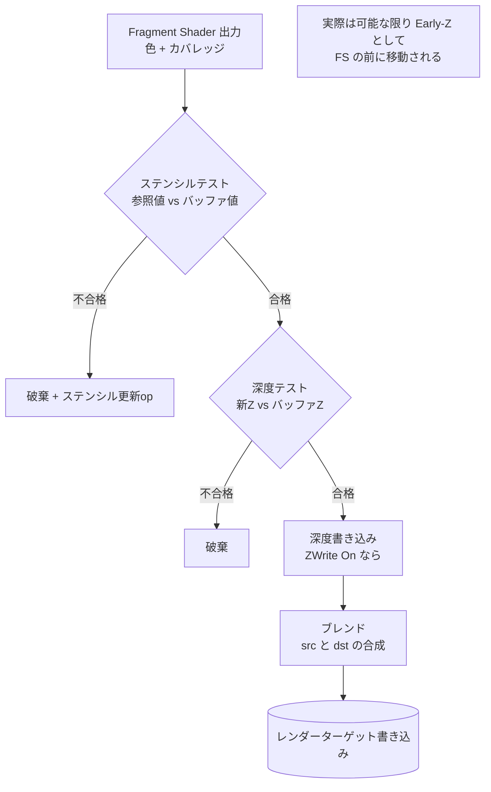

# 出力結合 (Depth / Stencil / Blend)

## 概要

出力結合 (Output Merger / ROP) は、Fragment Shaderが計算した色を**レンダーターゲットへ実際に書き込むかどうか・どう合成するかを決める**パイプライン最終段の固定機能ステージです。**深度テスト・ステンシルテスト・ブレンディング**の3つの機能からなり、隠面消去と半透明合成という2大問題をここで解決します。

## なぜ必要なのか

- **隠面消去**: 手前の物が奥の物を隠すという当たり前を、ソート不要で実現する (Zバッファ)
- **半透明**: ガラス・炎・UIなど、背後と混ざる表現はブレンドなしに描けない
- **ステンシル**: マスク処理 (ポータル、アウトライン、Deferredのライト範囲限定) の道具
- 順序保証: 並列に流れてくるフラグメントを**プリミティブ投入順**に合成する唯一の場所

## 歴史・誕生した背景

- 1974: **Catmull がZバッファを提案**。当時はフレームバッファ分のメモリが高価すぎて非現実的とされた
- 1980年代: メモリ価格の低下でワークステーションに搭載され始める
- 1990年代: 民生GPU (Voodoo以降) が深度テスト+アルファブレンドを回路化。**ROP (Raster Operations Pipeline)** という用語が定着
- 1999: DX7世代でステンシルバッファ一般化 — シャドウボリューム (Carmack's Reverse, DOOM 3) の全盛へ
- 2000年代: 深度バッファ圧縮・Hi-Z・Early-Zなどの最適化が成熟
- 現在: Reverse-Z が標準化。プログラマブルブレンド (ROV, フレームバッファフェッチ) が部分的に登場

## それ以前の技術

**ペインターズアルゴリズム** (奥から順に全ポリゴンをソートして描く) と **BSPツリー** (DOOM/Quake)。ソートはポリゴン交差を扱えず、シーンが動的だと破綻しました。Zバッファは「メモリで計算を買う」ことでこの問題を消し去りました。

## 解決した課題

1. ピクセル単位の正確な隠面消去 — ジオメトリのソートも交差の分割も不要
2. 半透明の合成則の標準化 (アルファブレンディング)
3. 並列実行下での決定論的な描画結果 (順序保証)

## 現在の位置づけ

深度テストは全ての不透明描画の前提。ブレンドは半透明・パーティクル・UIの前提。ステンシルはDeferredライティング・アウトライン等で現役です。一方で**半透明のソート問題は今も未解決** (OIT関連は研究と部分実用の段階) であり、レンダリングの残された難問の一つです。

## 内部動作

### パイプライン内の処理順



### 深度テスト

新フラグメントの深度と深度バッファの既存値を比較し、合格したものだけ書き込みます。

- 比較関数: `LESS` (通常Z) / `GREATER` ([Reverse-Z](/math/rendering/camera.html)) / `EQUAL` (Zプリパス後の本描画) など
- **ZWrite と ZTest は独立**: 半透明は「ZTestあり・ZWriteなし」が定石 (不透明に隠されるが、自分は深度を汚さない)
- **Z-fighting**: 同一深度の面同士のちらつき。深度精度 (Reverse-Z)、`DepthBias`、ジオメトリ側の工夫で対処

### ステンシルテスト

8bitの汎用マスクバッファ。「テスト関数 + 3つの更新オペレーション (stencil fail / depth fail / pass)」で構成されます。

| 用途 | 使い方 |
|---|---|
| Deferredのライト体積 | 光が届く範囲のピクセルだけマークして計算を限定 |
| アウトライン | 本体で1を書き、拡大モデルを「≠1」で描く |
| ポータル/鏡 | 鏡面領域をマークし、その中だけ反転シーンを描く |
| シャドウボリューム | depth-fail法 (Carmack's Reverse) でカウント |

### ブレンディング

$$C_{out} = C_{src} \cdot F_{src} \;\oplus\; C_{dst} \cdot F_{dst}$$

| 合成 | SrcFactor | DstFactor | 用途 |
|---|---|---|---|
| アルファブレンド | SrcAlpha | InvSrcAlpha | 通常の半透明 |
| 加算 | One | One | 炎・光・エフェクト |
| 乗算 | Zero (Dst=SrcColor) | SrcColor | 影・染色 |
| Premultiplied | One | InvSrcAlpha | 合成の正解とされる形式 |

**ブレンドは順序依存**です。アルファブレンドの半透明は奥→手前にソートして描く必要があり、交差する半透明は正しく描けません。これが**OIT (Order-Independent Transparency)** — per-pixel linked list、Weighted Blended OIT等 — が研究され続ける理由です。

### ハードウェア実装 (ROP)

- ROPユニットはメモリコントローラ近くに配置され、深度/カラーの**圧縮** (デルタ圧縮、クリア圧縮) を透過的に行い帯域を節約
- ブレンドは読み出し-修正-書き込みであり、**帯域を2倍以上消費** — パーティクルの重なりすぎ (オーバードロー) がモバイルで致命的な理由
- 順序保証のためのスコアボードを持ち、同一ピクセルへの書き込みを投入順に直列化

## 各環境での扱い

### Unity
ShaderLabで宣言的に記述: `ZTest LEqual`, `ZWrite Off`, `Blend SrcAlpha OneMinusSrcAlpha`, `Stencil { Ref 1 Comp Equal }`。URPの RenderObjects フィーチャーでステンシルを使ったレイヤ演出が定番。

### Unreal Engine
マテリアルの Blend Mode (Opaque/Masked/Translucent/Additive/Modulate) が内部でブレンドステートに変換。Custom Depth / Custom Stencil という専用バッファがアウトライン等の標準手段として用意されています。

### DirectX 12
`D3D12_DEPTH_STENCIL_DESC` と `D3D12_BLEND_DESC` をPSOに焼き込み。`OMSetStencilRef` / `OMSetBlendFactor` のみ動的。Dual-source blending、LogicOpも利用可能。

### Vulkan
`VkPipelineDepthStencilStateCreateInfo` / `VkPipelineColorBlendStateCreateInfo`。Dynamic Stateで比較関数等を動的化可能 (`VK_EXT_extended_dynamic_state`)。TBDRではブレンドがオンチップメモリ内で完結するため加算ブレンドが比較的安価です。

## コード例

Unity ShaderLab — 定番ステートの宣言:

```shaderlab
// 半透明パーティクル (加算)
Pass {
    Blend One One          // 加算合成
    ZWrite Off             // 深度を汚さない
    ZTest LEqual           // 不透明には隠される
    Cull Off
    ...
}

// ステンシルでマスクを書く
Pass {
    ColorMask 0            // 色は書かない
    Stencil { Ref 1  Comp Always  Pass Replace }
    ...
}
```

DX12 — Reverse-Z + アルファブレンドのPSO断片 (C++):

```cpp
D3D12_GRAPHICS_PIPELINE_STATE_DESC pso = {};
// Reverse-Z: 大きい方が手前
pso.DepthStencilState.DepthEnable    = TRUE;
pso.DepthStencilState.DepthFunc      = D3D12_COMPARISON_FUNC_GREATER;
pso.DepthStencilState.DepthWriteMask = D3D12_DEPTH_WRITE_MASK_ZERO; // 半透明

auto& rt = pso.BlendState.RenderTarget[0];
rt.BlendEnable = TRUE;
rt.SrcBlend  = D3D12_BLEND_SRC_ALPHA;
rt.DestBlend = D3D12_BLEND_INV_SRC_ALPHA;
rt.BlendOp   = D3D12_BLEND_OP_ADD;
```

## 前提知識

- [Fragment Shader](/graphics/pipeline/fragment-shader.html)
- [カメラと射影](/math/rendering/camera.html) — 深度値の性質とReverse-Z

## 次に読むべきページ

- [Forward Rendering](/graphics/path/forward.html) — 描画順とブレンドの設計
- [Deferred Rendering](/graphics/path/deferred.html) — ステンシルによるライト最適化
- [GPU最適化の基礎](/graphics/optimization/basics.html) — 帯域とオーバードロー

## 理解度チェック

1. **Zバッファ法がペインターズアルゴリズムを置き換えられた理由を、メモリとアルゴリズムの観点から説明せよ。**
   ::: details 解答
   ペインターズ法はポリゴン単位のソートが必要で、交差・循環遮蔽を扱えず、動的シーンでのソートコストも大きい。Zバッファはピクセル単位で最前面深度を記録するメモリを追加するだけで、任意順序の描画から正しい隠面消去を得られる。かつて障壁だったメモリコストがムーアの法則で無視できる水準に下がり、全面移行した。
   :::

2. **半透明オブジェクトを「ZWrite Off」で描くのはなぜか。Onにすると何が起きるか。**
   ::: details 解答
   半透明は背後が透けて見えるため、後から描かれる自分より奥の半透明/エフェクトも見えなければならない。ZWrite Onにすると半透明面が深度バッファを埋め、その奥に描かれるはずのものが深度テストで棄却されて消える。よってZTestで不透明との前後関係だけ守り、深度は書かない。
   :::

3. **アルファブレンドの半透明を正しく描くには何が必要か。それでも解決できないケースは。**
   ::: details 解答
   ブレンドは非可換なので、奥から手前へのソート描画が必要。しかし相互に貫通・交差するポリゴンや循環遮蔽はオブジェクト単位のソートでは正しくならない。厳密解にはピクセル単位で全フラグメントをソートするOIT(per-pixel linked list等)が必要だが、コストが高く部分的採用に留まる。
   :::

## 参考資料

- E. Catmull, *"A Subdivision Algorithm for Computer Display of Curved Surfaces"* (1974) — Zバッファの原典
- Morgan McGuire & Louis Bavoil, *"Weighted Blended Order-Independent Transparency"* (2013)
- Fabien Giesen, *"A trip through the Graphics Pipeline"* — Part 9 (ROP)
- Real-Time Rendering 4th ed., Chapter 5.5
