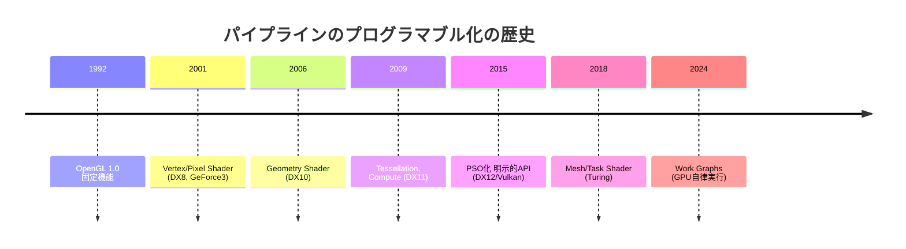
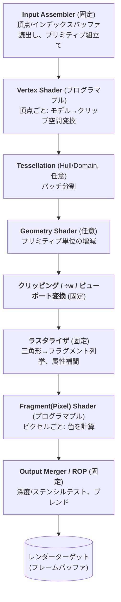

# レンダリングパイプライン全体像

## 概要

レンダリングパイプラインは、**頂点データが画面のピクセルになるまでの一連の工程**です。プログラム可能なステージ (Vertex/Fragment Shader等) と固定機能ステージ (ラスタライザ、出力結合等) が交互に並ぶ「工場の生産ライン」であり、このWikiの第3章はこのラインを1工程ずつ歩いていきます。

## なぜ必要なのか

- パイプラインの全体像は**グラフィックスプログラミングの地図**。どのシェーダがいつ動き、何を入出力するかを知らずにシェーダは書けない
- 「パイプラインステート (PSO)」「バリア」「パス」といったDX12/Vulkanの概念は、すべてこのラインの構造に由来する
- 性能問題は「ラインのどの工程が詰まっているか」の分析 → [GPU最適化の基礎](/graphics/optimization/basics.html)

## 歴史・誕生した背景

パイプラインという構造は1980年代のSGIワークステーション (Geometry Engine) で確立し、OpenGL 1.0 (1992) が「固定機能パイプライン」としてAPI化しました。2001年に頂点/ピクセル処理がプログラマブル化され、以降ステージが段階的に追加・置換されてきました:



## それ以前の技術

固定機能パイプライン。ライティング計算式 (Gouraud + Phong指数) もテクスチャ合成 (`glTexEnv`) も**設定できるパラメータの範囲内でしか変えられません**でした。表現が均質化し、「全部のゲームが同じ見た目」と言われた時代です。

## 解決した課題

プログラマブル化により、ライティングモデル・マテリアル表現・変形処理をゲームごとに自由に設計できるようになりました。さらにDX12/Vulkan世代では、パイプライン構成そのものを事前コンパイル (PSO) することで、実行時のドライバコストを排除しました。

## 現在の位置づけ

以下の「頂点パイプライン」が現在も主流ですが、ジオメトリ前半を Compute 的に置き換える [Mesh Shader](/graphics/pipeline/mesh-shader.html) パイプラインと、完全にComputeで描く [GPU Driven](/graphics/optimization/gpu-driven.html) / Nanite 型が台頭しています。

## 内部動作

### 論理パイプラインの全体図



各工程の入出力:

| ステージ | 入力 | 出力 | 実行回数 |
|---|---|---|---|
| Input Assembler | バッファ+頂点レイアウト | 頂点列 | — |
| [Vertex Shader](/graphics/pipeline/vertex-shader.html) | 1頂点 | クリップ空間座標+属性 | 頂点数 |
| [Tessellation](/graphics/pipeline/tessellation.html) | パッチ | 細分化された頂点群 | パッチ数 |
| [Geometry Shader](/graphics/pipeline/geometry-shader.html) | 1プリミティブ | 0〜N個のプリミティブ | プリミティブ数 |
| [ラスタライザ](/graphics/pipeline/rasterization.html) | 三角形 | フラグメント+補間属性 | — |
| [Fragment Shader](/graphics/pipeline/fragment-shader.html) | 1フラグメント | 色 (+深度) | カバーされたピクセル数 |
| [Output Merger](/graphics/pipeline/output-merger.html) | 色+深度 | 合成済みピクセル | — |

### 物理的な実行のされ方 — 重要な誤解の訂正

論理図は「直列のライン」ですが、物理的には:

- VS/FS等のプログラマブルステージは**すべて同じシェーダコア (SM/CU)** 上で動く → [GPUアーキテクチャ](/hardware/gpu/architecture.html)
- 複数のドローコール、複数のステージが**同時並行**で流れている (三角形AのFSと三角形BのVSは同時に走る)
- 順序保証は「同一ピクセルへの書き込みはプリミティブの投入順」というAPI規則 (ROPが担保) のみ

### 現代の3つのジオメトリパイプライン

```mermaid
flowchart LR
    subgraph 従来型
        A[IA→VS→(Tess)→(GS)] --> R1[Raster→FS→OM]
    end
    subgraph MeshShader型
        B[Task Shader→Mesh Shader] --> R2[Raster→FS→OM]
    end
    subgraph GPUDriven/SW型
        C[Compute: カリング・LOD選択] --> D[ExecuteIndirect/SWラスタライズ]
        D --> R3[Raster or Compute→OM相当]
    end
```

Nanite (UE5) は第3のパターンの代表で、小さい三角形はCompute Shaderによる**ソフトウェアラスタライズ**で描きます。

## 各環境での扱い

### Unity
シェーダは `.shader` (ShaderLab) 内にHLSLで記述。パイプライン構成 (Blend/ZTest等) はShaderLabのステートで宣言し、内部でPSO相当に変換されます。SRPではパスの並びを `ScriptableRenderPass` (URP) 等でC#から制御。

### Unreal Engine
マテリアルエディタのノードグラフがHLSLへ変換され、エンジン既定のVS/PSテンプレート (`BasePassVertexShader.usf` 等) に差し込まれます。パスの並びは `FDeferredShadingSceneRenderer::Render` がハードコード+RDGで構成。

### DirectX 12
パイプライン全体を `D3D12_GRAPHICS_PIPELINE_STATE_DESC` (シェーダ群+ラスタライザ/ブレンド/深度設定+フォーマット) として**事前に1個のPSOへコンパイル**します。描画時は `SetPipelineState` で切り替えるだけです。

### Vulkan
`VkGraphicsPipelineCreateInfo` で同様にPSO化。加えて `VkRenderPass` (現在はDynamic Rendering) でレンダーターゲットの使い方まで事前宣言する、最も明示的な設計です。

## コード例

「パイプライン1周」を最小のシェーダペアで (HLSL):

```hlsl
// ---- Vertex Shader: 頂点ごとに1回 ----
struct VSIn  { float3 pos : POSITION; float3 color : COLOR; };
struct VSOut { float4 pos : SV_Position; float3 color : COLOR; };

VSOut VSMain(VSIn i) {
    VSOut o;
    o.pos   = mul(gMVP, float4(i.pos, 1.0)); // クリップ空間へ
    o.color = i.color;                        // ラスタライザが補間する
    return o;
}

// ---- Fragment Shader: カバーされたピクセルごとに1回 ----
float4 PSMain(VSOut i) : SV_Target {
    return float4(i.color, 1.0);  // 補間済みの色が届く
}
```

この2つの間に、クリッピング・÷w・ビューポート変換・ラスタライズ・属性補間という固定機能の仕事が挟まっています。「書いていないのに起きること」を把握するのがパイプライン理解の核心です。

## 前提知識

- [GPUとは何か](/hardware/gpu/what-is-gpu.html), [GPUアーキテクチャ詳解](/hardware/gpu/architecture.html)
- [座標変換](/math/rendering/transform.html)

## 次に読むべきページ

第3章を順に:
1. [Vertex Shader](/graphics/pipeline/vertex-shader.html)
2. [ラスタライゼーション](/graphics/pipeline/rasterization.html)
3. [Fragment Shader](/graphics/pipeline/fragment-shader.html)
4. [出力結合](/graphics/pipeline/output-merger.html)
5. 拡張ステージ: [Geometry Shader](/graphics/pipeline/geometry-shader.html) → [Tessellation](/graphics/pipeline/tessellation.html) → [Mesh Shader](/graphics/pipeline/mesh-shader.html)

## 理解度チェック

1. **論理パイプラインの各ステージのうち、今日でも固定機能ハードウェアで実行されるものを3つ挙げ、なぜシェーダ化されないのか考察せよ。**
   ::: details 解答
   Input Assembler、ラスタライザ、Output Merger (ROP)。いずれも(1)全描画で必ず実行される頻出処理であり、(2)処理内容の自由度要求が低く、(3)専用回路の方が電力・面積効率が桁違いに良いため。特にラスタライザのエッジ判定とROPの順序保証付きブレンドは並列化との相性が特殊で、汎用コアで代替すると大幅に遅くなる。
   :::

2. **「Vertex ShaderとFragment Shaderは同じハードウェアで動く」— これはいつから、なぜ可能になったか。**
   ::: details 解答
   2006年の統合シェーダアーキテクチャ (NVIDIA G80、Xbox 360 Xenos) 以降。シェーダ処理を汎用のSIMTプロセッサ上のプログラムとして実行する設計になり、負荷に応じて頂点/ピクセルに同じ演算資源を動的配分できるようになった。
   :::

3. **PSO (Pipeline State Object) は、パイプラインのどの範囲を1つに固めたものか。**
   ::: details 解答
   全シェーダステージのバイトコード+固定機能の設定(ラスタライザステート、ブレンドステート、深度ステンシルステート、頂点レイアウト、プリミティブトポロジ、レンダーターゲットのフォーマット)まで、描画方法の宣言のほぼ全部。これによりドロー時のドライバによる状態検証・シェーダパッチを排除した。
   :::

## 参考資料

- Fabien Giesen, *"A trip through the Graphics Pipeline 2011"* — 本章全体の最良の副読本
- Real-Time Rendering 4th ed., Chapter 2 "The Graphics Rendering Pipeline"
- Microsoft Learn, *Direct3D 12 graphics pipeline*
- Vulkan Specification, Chapter 9 "Pipelines"
