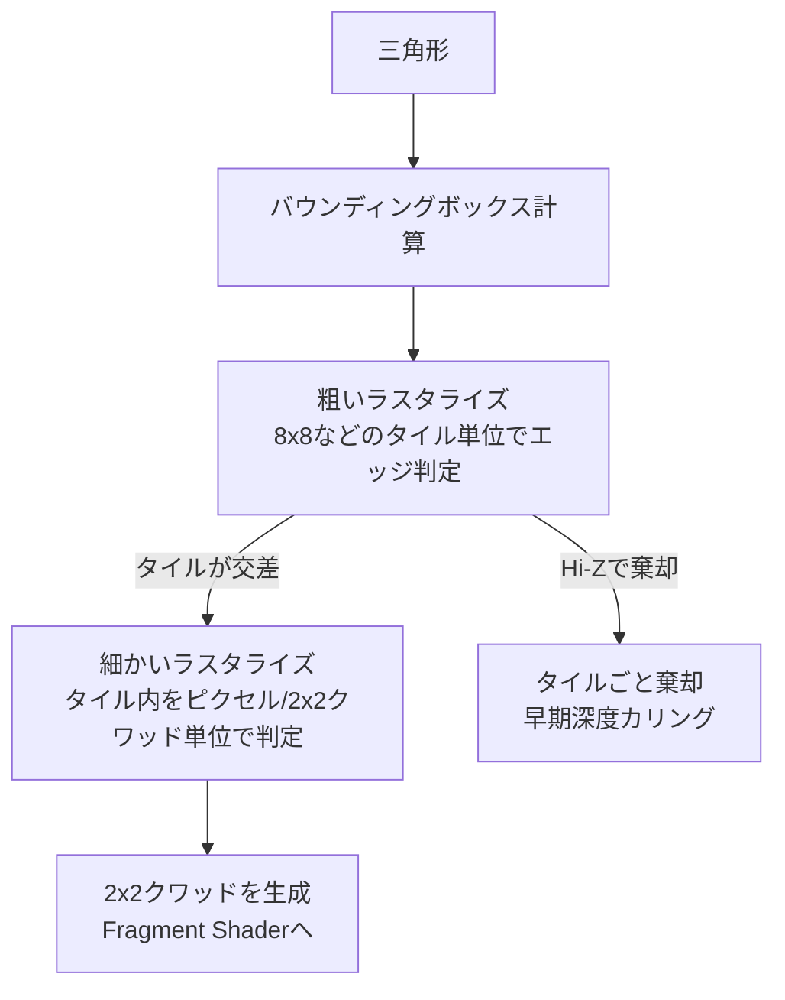

# ラスタライゼーション

## 概要

ラスタライゼーションは**三角形を「その三角形が覆うピクセル(フラグメント)の集合」へ変換する**固定機能ステージです。同時に、頂点属性 (UV・法線・色) を三角形内部の各ピクセル位置へ**透視補正付きで補間**します。リアルタイムグラフィックスが「速い」理由の中核であり、レイトレーシングと対をなすもう一つの可視性解決アルゴリズムです。

## なぜ必要なのか

- 「どのピクセルがどの三角形に属するか」の決定は、描画の最も内側のループ。ここが遅ければ全てが遅い
- 属性補間・パースペクティブ補正・微分 (ミップマップ選択) など、シェーディングの前提がすべてここで作られる
- 2x2クワッド実行、ヘルパーレーン、早期深度テストなど、**Fragment Shaderの性能特性はラスタライザの都合で決まっている**

## 歴史・誕生した背景

- 1967〜: Wylie らのスキャンライン法。1970年代はスキャンライン+アクティブエッジテーブルが主流
- 1974: **Catmull がZバッファ**を提案 — 「ピクセルごとに最前面を記録する」現在の方式の原点
- 1988: **Pineda が「エッジ関数」による並列ラスタライズ**を定式化 — 現代の全GPUの基礎
- 1990年代: ハードウェアラスタライザ (Voodoo等) がこの方式を回路化
- 2000年代: 階層的ラスタライズ・タイルベース化・Hi-Z (階層深度) が成熟
- 2021: UE5 Nanite が**微小三角形はComputeでソフトウェアラスタライズ**する方が速いことを示し、一周回った

## それ以前の技術

**スキャンライン法**: 走査線ごとにエッジとの交差を追跡する逐次アルゴリズム。メモリが貴重だった時代に適していましたが、本質的に逐次処理で並列化できませんでした。**ペインターズアルゴリズム** (奥から順に描く) は交差するポリゴンを扱えず、BSPツリー (DOOM) のような複雑な前処理を必要としました。

## 解決した課題

Pineda方式 + Zバッファは:
1. **完全並列**: 各ピクセルのエッジ判定は独立 → ハードウェアで一括判定できる
2. **順序自由な可視性解決**: Zバッファがピクセル単位で最前面を選ぶため、ポリゴンのソートが不要
3. ポリゴン同士の交差・貫通も自然に正しく描ける

## 現在の位置づけ

固定機能ラスタライザはすべてのGPUに搭載され、1クロックあたり複数三角形/多数ピクセルを処理します。ただし**1ピクセル未満の微小三角形では効率が崩壊**する (後述のクワッド問題) ため、Naniteのようなソフトウェアラスタライズとの使い分けが最先端の話題です。

## 内部動作

### エッジ関数方式

三角形の各辺について、点 $(x, y)$ がどちら側にあるかを判定する1次関数を定義します:

$$E_i(x, y) = (x - x_i)(y_{i+1} - y_i) - (y - y_i)(x_{i+1} - x_i)$$

3つすべてのエッジ関数が同符号なら、その点は三角形の内部です。この判定は:

- ピクセルごとに**完全に独立** → 並列評価可能
- 整数演算で厳密 (固定小数点スナップ) → 隣接三角形の間に隙間も二重描画もない (**タイブレーク規則**: top-left rule)
- エッジ関数の値がそのまま**重心座標 (barycentric)** になり、属性補間に直結

### 階層的ラスタライズ

実際のGPUは全ピクセルを総当たりしません:



- **Hi-Z (階層Zバッファ)**: タイルごとの最遠/最近深度を保持し、タイル単位で深度棄却。遮蔽された三角形はFSに到達すらしない
- **Early-Z**: FS実行前のピクセル単位深度テスト。FSで深度を書き換えたり `discard` すると無効化される → [出力結合](/graphics/pipeline/output-merger.html)

### 透視補正補間

属性をスクリーン空間で線形補間すると、奥行きのある面でテクスチャが歪みます (PS1の揺れるテクスチャの原因)。正しくは **1/w 空間で線形**になるため:

$$attr(x,y) = \frac{\sum b_i \cdot attr_i / w_i}{\sum b_i / w_i}$$

($b_i$ は重心座標)。ハードウェアはこれを自動で行います。VS出力の `noperspective` 修飾子で無効化も可能です。

### 2x2クワッドとヘルパーレーン — 最重要の性能特性

Fragment Shaderは常に **2x2ピクセルのクワッド単位**で起動されます。理由はテクスチャの**ミップマップ選択に必要な微分 (ddx/ddy) を、隣接ピクセルとの差分で求める**ためです。

- 三角形のエッジ上では、三角形に覆われていないピクセルも**ヘルパーレーン**として実行される (結果は捨てられる)
- **微小三角形の破滅**: 1ピクセルの三角形でも最低4スレッド起動 → 1ピクセル三角形だらけのメッシュはFSコストが最大4倍 + ラスタライザの三角形処理レートで頭打ち
- これがLOD・[Nanite/ソフトウェアラスタライズ](/graphics/optimization/gpu-driven.html)・[Mesh Shader](/graphics/pipeline/mesh-shader.html) が必要な根本理由

## 各環境での扱い

### Unity
ラスタライザステートはShaderLabの `Cull Back/Front/Off`、`ZTest`、`Offset` (深度バイアス) 等で宣言。`Conservative Rasterization` は対応APIでのみ。ワイヤーフレーム表示はSceneViewの機能。

### Unreal Engine
マテリアルの Two Sided がカルモード、Nanite有効メッシュはハードウェア/ソフトウェアラスタライズを三角形サイズで自動選択。`r.Nanite.MaxPixelsPerEdge` 等で制御。

### DirectX 12
`D3D12_RASTERIZER_DESC` (FillMode, CullMode, DepthBias, ConservativeRaster, MultisampleEnable)。可変レートシェーディング `RSSetShadingRate` はラスタライザとFS起動粒度の制御。

### Vulkan
`VkPipelineRasterizationStateCreateInfo`。`VK_EXT_conservative_rasterization`、`VK_KHR_fragment_shading_rate`。`frontFace` (CW/CCW) と `cullMode` の組が座標系規約 (Y反転) と絡む定番の罠。

## コード例

エッジ関数によるソフトウェアラスタライザの核心部 (C++):

```cpp
// 2Dスクリーン座標の三角形をラスタライズする最小実装
float Edge(float2 a, float2 b, float2 p) {
    return (p.x - a.x) * (b.y - a.y) - (p.y - a.y) * (b.x - a.x);
}

void RasterizeTriangle(float2 v0, float2 v1, float2 v2, /*属性*/...) {
    float area = Edge(v0, v1, v2);
    if (area <= 0) return;                       // バックフェースカリング

    int minX = (int)floor(min3(v0.x, v1.x, v2.x));
    int maxX = (int)ceil (max3(v0.x, v1.x, v2.x)); // 以下同様にY
    for (int y = minY; y < maxY; ++y)
    for (int x = minX; x < maxX; ++x) {
        float2 p = { x + 0.5f, y + 0.5f };       // ピクセル中心でサンプル
        float w0 = Edge(v1, v2, p);
        float w1 = Edge(v2, v0, p);
        float w2 = Edge(v0, v1, p);
        if (w0 >= 0 && w1 >= 0 && w2 >= 0) {     // 3辺すべて内側
            float3 bary = float3(w0, w1, w2) / area; // 重心座標
            ShadePixel(x, y, bary);              // 属性補間+深度テストへ
        }
    }
}
```

微分の挙動を確認するシェーダ (HLSL):

```hlsl
float4 PSMain(Varyings i) : SV_Target {
    // ddx/ddy は同一クワッド内の隣接ピクセルとの差分
    float2 dx = ddx(i.uv), dy = ddy(i.uv);
    // ミップレベルの手動計算 (ハードウェアがサンプル時に行うことと等価)
    float lod = 0.5 * log2(max(dot(dx, dx), dot(dy, dy)) * texSize * texSize);
    return float4(lod.xxx / 10.0, 1);
}
```

## 前提知識

- [パイプライン全体像](/graphics/pipeline/overview.html), [Vertex Shader](/graphics/pipeline/vertex-shader.html)
- [ベクトル](/math/rendering/vector.html) (外積と符号付き面積)

## 次に読むべきページ

- [Fragment Shader](/graphics/pipeline/fragment-shader.html) — クワッドの上で動くプログラム
- [出力結合](/graphics/pipeline/output-merger.html) — Early-Zとの関係
- [アンチエイリアシング](/graphics/postprocess/antialiasing.html) — ラスタライズの離散化誤差との戦い
- [GPU Driven Rendering](/graphics/optimization/gpu-driven.html) — ソフトウェアラスタライズ

## 理解度チェック

1. **エッジ関数方式がスキャンライン法を駆逐した理由を、ハードウェアの観点から説明せよ。**
   ::: details 解答
   スキャンライン法はエッジ追跡の状態を持つ逐次アルゴリズムで並列化できない。エッジ関数方式は各ピクセルの内外判定が3つの1次式の符号評価だけで完結し互いに独立なため、タイル内の多数ピクセルを1クロックで一括判定する並列回路にそのまま落とせる。
   :::

2. **透視補正補間はなぜ必要か。「スクリーン空間の線形補間」では何が起きるか。**
   ::: details 解答
   透視投影は非線形(1/z)なため、3D空間で等間隔のものはスクリーン上では等間隔でない。属性をスクリーン空間で線形補間すると、奥行きのある面でテクスチャ座標の進み方が実際と食い違い、テクスチャが手前に引き寄せられるような歪みが生じる(初代PSの症状)。1/wを掛けた属性を補間し最後にwを掛け直すことで、3D空間での線形性を回復する。
   :::

3. **「ピクセルサイズの三角形100万個」と「画面を覆う三角形100個」で、同じピクセル数を塗るのにFragment Shaderコストが違うのはなぜか。**
   ::: details 解答
   FSは2x2クワッド単位で起動され、微小三角形ではカバーされないヘルパーレーンの割合が支配的になる(1ピクセル三角形は4スレッド起動)。さらにラスタライザの三角形セットアップレートも三角形数に比例して消費される。このオーバーシェーディングが微小三角形の効率崩壊の正体で、Naniteがソフトウェアラスタライズを導入した動機。
   :::

## 参考資料

- Juan Pineda, *"A Parallel Algorithm for Polygon Rasterization"* (SIGGRAPH 1988) — 原典
- Fabien Giesen, *"A trip through the Graphics Pipeline"* — Part 5, 6, 8
- Kayvon Fatahalian, *CMU 15-869 講義資料* (ラスタライズと補間)
- Brian Karis, *"Nanite: A Deep Dive"* (SIGGRAPH 2021) — SWラスタライズの動機
