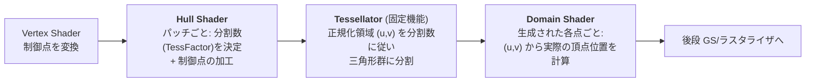

# Tessellation

## 概要

Tessellation (テッセレーション) は、**粗いパッチをGPU上で細かい三角形群に分割する**ためのステージ群です。DX11 (2009) で導入され、**Hull Shader (制御) → Tessellator (固定機能分割) → Domain Shader (頂点配置)** の3段で構成されます。地形・水面・ディスプレースメントマッピングで使われましたが、現在はMesh ShaderやNaniteに主役を譲りつつあります。

## なぜ必要なのか

- メッシュの詳細度をGPU上で**動的に**変えたい (カメラに近いほど細かく = 連続LOD)
- 細かいジオメトリをCPU→GPU転送するのは帯域の無駄 — 「粗いデータ+分割ルール」を送る方が軽い
- ハイトマップによる**ディスプレースメント** (実際に凹凸するジオメトリ) は、法線マップ (見た目だけの凹凸) の次の段階として求められた

## 歴史・誕生した背景

- 理論的源流: Catmull-Clark サブディビジョン曲面 (1978)、PN-Triangles (2001)
- 2001: ATI TruForm (N-Patches) — ハードウェアテッセレーションの最初の試み。普及せず
- 2005: Xbox 360 (Xenos) が独自テッセレータ搭載
- **2009: DirectX 11 / OpenGL 4.0** で標準化。GeForce 400 (Fermi) vs Radeon 5000 のテッセレーション性能競争が勃発
- 2010年代前半: Crysis 2、Batman等が採用するも「不必要に分割しすぎ」問題が議論に
- 2010年代後半: 適応分割の難しさ・小三角形の非効率 ([ラスタライゼーション](/graphics/pipeline/rasterization.html)のクワッド問題) が明確になり、利用は限定的に
- 2021: **Nanite (UE5) が「事前分割+クラスタLOD」で同じ問題をより上手く解決**。UE5.0はNaniteとテッセレーションが排他だったが、後にNanite Tessellationとして再統合 (5.4)

## それ以前の技術

CPUでのLODメッシュ切り替え (離散LOD) と、頂点シェーダでのモーフィング (geomorphing)。離散LODは切り替え時のポッピングが問題でした。

## 解決した課題

1. 連続的な詳細度制御 (ポッピングの軽減)
2. ディスプレースメントマッピングの実用化
3. 曲面 (サブディビジョン、ベジェパッチ) のGPU評価

## 現在の位置づけ

地形レンダリングと水面では現役です (UnityのHDRP水面、各種地形エンジン)。ただし汎用のキャラクタ/背景メッシュ詳細化としては、Naniteのような**クラスタベースの事前分割ジオメトリ**に敗れました。理由は (1) テッセレータの分割パターンが均質でシルエットに無駄が多い、(2) 微小三角形の効率問題、(3) アーティストの制御が難しい、の3点です。

## 内部動作

### 3段構成



| ステージ | 実行単位 | 主な仕事 |
|---|---|---|
| Hull Shader (VulkanではTess. Control) | パッチ (+制御点) | エッジ/内部の**TessFactor** (分割数、最大64) を出力 |
| Tessellator | 固定機能 | (u,v)パラメータ空間の分割点を機械的に生成 |
| Domain Shader (VulkanではTess. Evaluation) | 生成頂点ごと | (u,v)と制御点から頂点位置を評価 (ここでハイトマップを読む) |

### 適応分割の定石

TessFactorをどう決めるかが品質と性能を分けます:

- **距離ベース**: カメラ距離に反比例
- **スクリーンスペースエッジ長**: 「分割後のエッジが画面上で約Nピクセルになるように」— 最も原理的
- **視錐台/背面カリング**: 見えないパッチはFactor=0で棄却
- 隣接パッチとエッジのFactorを一致させないと**クラック (裂け目)** が生じる — エッジFactorはパッチ間で共有される値から計算するのが鉄則

### ディスプレースメント

Domain Shaderでハイトマップをサンプルし、法線方向に頂点を押し出します:

$$\mathbf{p} = \mathbf{p}_{patch}(u,v) + h(u,v) \cdot \mathbf{n}(u,v) \cdot scale$$

ミップ選択の微分が使えない (DSに隣接情報がない) ため `SampleLevel` で明示LODを指定します。

## 各環境での扱い

### Unity
Surface Shaderの `tessellate:` 関数、URP/HDRPではLit Shaderの Tessellation オプション (HDRP)。`UnityDistanceBasedTess` 等のヘルパーが提供されます。Metal (Apple) ではComputeベースのエミュレーションになるため挙動差に注意。

### Unreal Engine
UE4ではマテリアルのTessellation設定 (Flat/PN Triangles) がありましたが、**UE5でハードウェアテッセレーションは一旦廃止**され、Naniteへ誘導されました。UE5.4で **Nanite Tessellation** (Naniteクラスタ上のディスプレースメント) として復活しています。この変遷自体が技術の世代交代を物語ります。

### DirectX 12
`hs_6_x` / `ds_6_x`。PSOのトポロジは `D3D12_PRIMITIVE_TOPOLOGY_TYPE_PATCH`、IAには `D3D_PRIMITIVE_TOPOLOGY_4_CONTROL_POINT_PATCHLIST` 等を指定。

### Vulkan
`tessellationShader` フィーチャー必須。GLSLでは `layout(vertices=4) out` (TCS) / `layout(quads, equal_spacing, cw) in` (TES)。モバイルでは非対応・低速なことが多い点はGSと同様です。

## コード例

距離適応テッセレーションの骨格 (HLSL):

```hlsl
// ---- Hull Shader: パッチ定数関数で分割数を決める ----
struct PatchTess { float edge[3] : SV_TessFactor; float inside : SV_InsideTessFactor; };

PatchTess PatchConstant(InputPatch<VSOut, 3> patch) {
    PatchTess pt;
    [unroll]
    for (int i = 0; i < 3; ++i) {
        // エッジ中点のカメラ距離から分割数を決定 (隣接パッチと一致する計算)
        float3 mid = (patch[(i+1)%3].posWS + patch[(i+2)%3].posWS) * 0.5;
        float d = distance(mid, gCameraPosWS);
        pt.edge[i] = clamp(64.0 * saturate(1.0 - d / 100.0), 1.0, 64.0);
    }
    pt.inside = (pt.edge[0] + pt.edge[1] + pt.edge[2]) / 3.0;
    return pt;
}

[domain("tri")] [partitioning("fractional_odd")] [outputtopology("triangle_cw")]
[outputcontrolpoints(3)] [patchconstantfunc("PatchConstant")]
VSOut HSMain(InputPatch<VSOut, 3> p, uint i : SV_OutputControlPointID) {
    return p[i];   // 制御点はそのまま通す (Flat tessellation)
}

// ---- Domain Shader: 生成頂点の位置を評価 ----
[domain("tri")]
DSOut DSMain(PatchTess pt, float3 bary : SV_DomainLocation,
             const OutputPatch<VSOut, 3> patch) {
    DSOut o;
    float3 posWS = patch[0].posWS * bary.x
                 + patch[1].posWS * bary.y
                 + patch[2].posWS * bary.z;
    float2 uv = patch[0].uv * bary.x + patch[1].uv * bary.y + patch[2].uv * bary.z;

    float3 n = normalize(patch[0].normalWS * bary.x
                       + patch[1].normalWS * bary.y
                       + patch[2].normalWS * bary.z);
    float height = gHeightMap.SampleLevel(gLinear, uv, 0).r;
    posWS += n * height * gDisplaceScale;        // ディスプレースメント

    o.posCS = mul(gViewProj, float4(posWS, 1));
    o.uv = uv;
    return o;
}
```

## 前提知識

- [Vertex Shader](/graphics/pipeline/vertex-shader.html), [パイプライン全体像](/graphics/pipeline/overview.html)

## 次に読むべきページ

- [Mesh Shader](/graphics/pipeline/mesh-shader.html) — ジオメトリパイプラインの現在形
- [GPU Driven Rendering](/graphics/optimization/gpu-driven.html) — Naniteのアプローチ
- [ラスタライゼーション](/graphics/pipeline/rasterization.html) — 微小三角形問題の理解

## 理解度チェック

1. **隣接パッチ間で「クラック」が生じる原因と防止策を説明せよ。**
   ::: details 解答
   共有エッジの分割数(TessFactor)が両パッチで異なると、エッジ上の頂点位置が一致せず隙間が開く。防止策は、エッジのFactorを「そのエッジ自身の情報(両端点や中点)だけから決定的に計算」し、どちらのパッチから計算しても同値になるようにすること。
   :::

2. **テッセレーションが汎用ジオメトリ詳細化としてNanite型アプローチに敗れた理由を挙げよ。**
   ::: details 解答
   (1)テッセレータの分割は(u,v)空間の規則分割で、実際の形状の詳細分布と無関係に均質に細かくなり無駄が多い。(2)分割結果が微小三角形になりクワッド効率が崩壊する。(3)実行時分割ゆえ結果をキャッシュできず毎フレーム全評価。Naniteは事前分割済みクラスタ階層から必要な詳細度だけを選択し、微小三角形はSWラスタライズで処理することでこれらを回避した。
   :::

3. **Domain Shaderでのテクスチャ読みに `SampleLevel` が必要な理由は。**
   ::: details 解答
   暗黙のミップ選択に必要なUV微分は、Fragment Shaderの2x2クワッド実行によって得られる仕組みであり、Domain Shaderには存在しない。そのためLODを明示指定するSampleLevel(またはSampleGrad)を使う必要がある。
   :::

## 参考資料

- Vlachos et al., *"Curved PN Triangles"* (2001)
- Microsoft, *Direct3D 11 Tessellation* ドキュメント
- Matthijs De Smedt, *"GPU Tessellation: We still have a problem"* 系の検証記事
- Epic Games, *"Nanite Tessellation"* (UE 5.4 リリースノート/講演)
