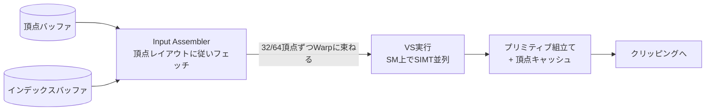

# Vertex Shader

## 概要

Vertex Shader (VS) は**頂点1つごとに1回実行されるプログラム**で、主な仕事は頂点座標をモデル空間からクリップ空間へ変換することです。加えて法線・UV・色などの属性を後段へ受け渡し、スキニングやモーフィング、頂点アニメーションもここで行います。**最初に登場したプログラマブルステージ**であり、シェーダプログラミングの原点です。

## なぜ必要なのか

- 全ての描画物は「頂点をどこに置くか」の決定なしには描けない — その決定ロジックのプログラム化がVS
- キャラクターの骨変形 (スキニング)、草木の揺れ、水面波、ビルボード — 「頂点を動かす」表現はすべてVSの仕事
- VSの出力設計 (何をFragment Shaderへ渡すか) がシェーディングの設計そのもの

## 歴史・誕生した背景

- 1999: GeForce 256 の固定機能T&Lユニット — 変換とライティングの回路化
- **2001: GeForce 3 + DirectX 8** — T&Lをプログラム可能にした「Vertex Shader 1.1」誕生。アセンブリ風言語で128命令まで
- 2003-04: HLSL/GLSLによる高級言語化。分岐・ループの追加 (SM2.0/3.0)
- 2006: 統合シェーダ化により、VS専用ユニットは消滅 (汎用コアで実行)
- 2008 (DX10.1/SM4): VSからテクスチャを読める (Vertex Texture Fetch) のが当たり前に — GPUパーティクル・地形変位が実用化

## それ以前の技術

固定機能T&L。変換は「ModelView/Projection行列の設定」のみ、ライティングは「Gouraudシェーディング+固定の光源式 (最大8光源)」に固定されていました。水面の波のような頂点アニメーションはCPUで頂点バッファを毎フレーム書き換えるしかありませんでした。

## 解決した課題

1. 頂点処理ロジックの完全な自由化 (独自の変形・独自の空間設計)
2. CPUによる頂点バッファ書き換えの排除 → バス転送の削減
3. ライティング計算の頂点/ピクセルへの自由な配分

## 現在の位置づけ

依然として標準パイプラインの入口ですが、役割は「変換と属性受け渡し」に純化しています(ライティングはFragmentへ移った)。ジオメトリ量が爆発する現代では、VS以前の頂点フェッチ構造ごと置き換える [Mesh Shader](/graphics/pipeline/mesh-shader.html) への移行が始まっています。

## 内部動作

### 実行モデル



- 頂点は**互いに独立**に処理される (他の頂点の結果は見えない)
- 同じインデックスの頂点は**ポストトランスフォームキャッシュ**で再利用される — インデックスバッファが重要な理由。キャッシュ効率を上げる頂点並び替え (Forsythアルゴリズム、meshoptimizer) は今も有効な最適化
- 入力: 頂点属性 + 定数バッファ + テクスチャ/構造化バッファ + システム値 (`SV_VertexID`, `SV_InstanceID`)
- 出力: `SV_Position` (クリップ空間座標、**必須**) + 任意の補間属性

### 頂点フェッチの2方式

| 方式 | 仕組み | 用途 |
|---|---|---|
| 固定機能IA | 頂点レイアウト宣言に従いハードウェアがフェッチ | 伝統的・最適化されている |
| **Programmable Vertex Pulling** | VSが `SV_VertexID` を使い `StructuredBuffer`/`ByteAddressBuffer` から自分で読む | GPU Driven、Nanite系、柔軟なフォーマット |

現代のGPUでは固定機能IAも内部的にはシェーダによるフェッチに近く、Vertex Pullingのペナルティはほぼありません。

### スキニング (Linear Blend Skinning)

$$\mathbf{p}' = \sum_{i=0}^{3} w_i \, M_{bone_i} \, \mathbf{p}$$

各頂点は最大4本(近年は8本も)のボーン行列の加重平均で変形します。行列パレットは定数/構造化バッファで供給。近年はVSでなく**Compute Shaderで事前スキニング**する設計 (変形結果を複数パスで再利用できる) が主流です → [Compute Shader](/graphics/compute/compute-shader.html)

## 各環境での扱い

### Unity
`#pragma vertex vert` で指定。URP/HDRPでは `Attributes` (入力) / `Varyings` (出力) 構造体の慣習。`GetVertexPositionInputs()` ヘルパーが各空間の座標を一括計算。GPUスキニングは既定でComputeに移行済み。

### Unreal Engine
マテリアルの「World Position Offset」がVSに挿入されるコード。エンジン側のVS本体は `LocalVertexFactory.ush` 等の**Vertex Factory**システムで、メッシュ種別 (静的/スキン/Nanite/草) ごとにフェッチ方法を差し替える設計です。

### DirectX 12
`D3D12_INPUT_ELEMENT_DESC` 配列で頂点レイアウトを宣言しPSOに焼き込み。シェーダは `vs_6_x` プロファイルでDXCコンパイル。`SV_VertexID`/`SV_InstanceID`/`SV_StartVertexLocation` 等のシステム値が利用可能。

### Vulkan
`VkPipelineVertexInputStateCreateInfo` でバインディング/属性を宣言。GLSLでは `layout(location=N) in`。`gl_VertexIndex` / `gl_InstanceIndex` (DX系と異なりベース頂点を含む値)。

## コード例

インスタンシング+風揺れ付きの実践的VS (HLSL):

```hlsl
struct Attributes {
    float3 positionOS : POSITION;
    float3 normalOS   : NORMAL;
    float2 uv         : TEXCOORD0;
    uint   instanceID : SV_InstanceID;
};
struct Varyings {
    float4 positionCS : SV_Position;
    float3 normalWS   : NORMAL;
    float2 uv         : TEXCOORD0;
    float3 positionWS : TEXCOORD1;
};

StructuredBuffer<float4x4> gInstanceMatrices : register(t0);

Varyings VSMain(Attributes IN) {
    Varyings OUT;
    float4x4 world = gInstanceMatrices[IN.instanceID];

    float3 posWS = mul(world, float4(IN.positionOS, 1)).xyz;
    // 頂点アニメーション: 高さに応じた風揺れ
    float sway = sin(gTime * 2.0 + posWS.x * 0.5) * 0.1 * IN.positionOS.y;
    posWS.xz += sway;

    OUT.positionWS = posWS;
    OUT.positionCS = mul(gViewProj, float4(posWS, 1));
    OUT.normalWS   = normalize(mul((float3x3)world, IN.normalOS));
    OUT.uv         = IN.uv;
    return OUT;
}
```

Vertex Pulling方式 (GLSL / Vulkan):

```glsl
layout(std430, set=0, binding=0) readonly buffer Positions { float pos[]; };

void main() {
    // 頂点レイアウト宣言なしで、IDから自分でフェッチする
    vec3 p = vec3(pos[gl_VertexIndex*3+0],
                  pos[gl_VertexIndex*3+1],
                  pos[gl_VertexIndex*3+2]);
    gl_Position = ubo.viewProj * ubo.model * vec4(p, 1.0);
}
```

## 前提知識

- [座標変換](/math/rendering/transform.html), [行列](/math/rendering/matrix.html)
- [パイプライン全体像](/graphics/pipeline/overview.html)

## 次に読むべきページ

- [ラスタライゼーション](/graphics/pipeline/rasterization.html) — VS出力がどう料理されるか
- [Fragment Shader](/graphics/pipeline/fragment-shader.html)
- [Mesh Shader](/graphics/pipeline/mesh-shader.html) — VSパイプラインの後継

## 理解度チェック

1. **インデックスバッファが性能に効く理由を、VSの実行モデルから説明せよ。**
   ::: details 解答
   同じ頂点が複数の三角形から参照されるとき、インデックスが同一ならポストトランスフォームキャッシュにヒットし、VSの再実行を省ける。平均的なメッシュでは1頂点が約6三角形に共有されるため、キャッシュが効けばVS実行回数を大幅に削減できる。頂点の並び順をキャッシュフレンドリーに最適化する意味もここにある。
   :::

2. **VSでライティングを計算する (頂点ライティング) 方式の欠点は何か。**
   ::: details 解答
   計算結果が三角形内部で線形補間されるため、スペキュラハイライトのような非線形に変化する成分がポリゴン密度依存で崩れる(ハイライトが欠けたり形が歪む)。ピクセル単位の法線マップも使えない。このためライティングはFragment Shaderへ移った。
   :::

3. **Programmable Vertex Pullingが GPU Driven Rendering で好まれる理由は。**
   ::: details 解答
   頂点レイアウトをPSOに焼き込む必要がなくなり、単一のシェーダで任意フォーマットのメッシュを描ける。また `SV_VertexID` ベースの自由なフェッチにより、Compute でカリング済みの可視頂点リストやmeshletを間接的に参照する設計が可能になる。
   :::

## 参考資料

- Fabien Giesen, *"A trip through the Graphics Pipeline"* — Part 3 (頂点処理)
- meshoptimizer (Arseny Kapoulkine) — 頂点キャッシュ最適化の実装
- GDC/GPU Gems の GPU Skinning 各種資料
- Microsoft Learn, *Vertex Shader Stage*
