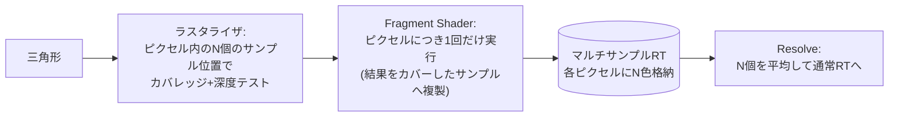

# アンチエイリアシング (MSAA / FXAA / SMAA)

## 概要

エイリアシングは、**連続的な画像信号を離散的なピクセルでサンプリングすることによる折り返し歪み**です。ジオメトリのエッジのギザギザ (ジャギー)、細部のちらつき (シマー) として現れます。このページではサンプリング理論の基礎と、空間的AA — **SSAA / MSAA** (ハードウェア系) と **FXAA / SMAA** (ポストプロセス系) — を扱います。時間的AA ([TAA](/graphics/postprocess/taa.html)) はページを分けています。

## なぜ必要なのか

- ラスタライザはピクセル中心の1点でカバレッジを判定する → エッジは必ず階段状になる
- 動くと悪化する: エッジの階段が毎フレームずれて「這う」「ちらつく」— 静止画より動画で目立つ
- シェーディングのエイリアシング (鏡面ハイライトのちらつき等) はジオメトリAAでは解決しない — 問題の分類が対策選択の鍵

## 歴史・誕生した背景

- 1977: Crow がCGにおけるエイリアシング問題を定式化 (サンプリング理論のCG応用)
- 1980-90年代: オフラインではスーパーサンプリングと確率的サンプリングが確立
- 2001頃: GPUで **MSAA** がハードウェア標準化 (GeForce 3世代〜) — Forward時代の王
- 2009: **MLAA** (Reshetov, Intel) — 「描いた後にエッジを推定して混ぜる」ポストAAの提案
- **2011: FXAA** (Lottes, NVIDIA) / **SMAA** (Jimenez) — Deferred時代 (MSAA困難) の穴を埋めるポストAA全盛期
- 2012-14: TAAの台頭により空間的AAは補助役へ → [TAA](/graphics/postprocess/taa.html)
- 現在: 「TAA/アップスケーラが主、MSAAはVR/Forward系で健在、FXAAは軽量フォールバック」という棲み分け

## それ以前の技術

AAなし (PS2期以前は解像度とテレビのにじみが実質のAAだった)、そして全画面を高解像度で描いて縮小する **SSAA** (品質最高・コスト最悪の原点)。

## 解決した課題 / 生んだ課題

各手法の本質は「**どこで・何を・何回サンプルするか**」のトレードオフです:

| 手法 | 原理 | コスト | 弱点 |
|---|---|---|---|
| SSAA | 全ピクセルをN倍サンプルで描画し縮小 | 極大 (シェーディングN倍) | コスト |
| **MSAA** | **カバレッジ/深度のみN倍、シェーディングは1回** | 中 (帯域N倍) | Deferredと相性最悪、シェーディングAAに無力 |
| **FXAA** | 輝度からエッジを推定し方向にぼかす | 極小 (1パス) | 細部が溶ける、ちらつきに無力 |
| **SMAA** | エッジ形状をパターン分類し高精度に再構成 | 小 | ちらつきに無力 (SMAA T2xで時間拡張) |
| TAA | 時間方向にサンプルを蓄積 | 小 | ゴースト・ぼけ → [TAA](/graphics/postprocess/taa.html) |

## 現在の位置づけ

- **VR / Forward+モバイル**: MSAAが第一選択 (TBDRではタイル内で解決でき帯域コストも小さい)
- **Deferred AAA**: TAA/アップスケーラが標準、FXAAは低負荷オプション
- SMAAは映像系・スタイライズド作品で「ぼけないAA」として根強い人気

## 内部動作

### エイリアシングの正体 (サンプリング理論)

ナイキスト周波数を超える成分を含む信号 (エッジ=無限周波数) を点サンプルすると、高周波が偽の低周波として折り返します。**根本解は「サンプル前に帯域制限 (プリフィルタ)」**ですが、ラスタライズは点サンプルしかできないため、全AA技術は「サンプルを増やす」か「後から推定して混ぜる」かのどちらかになります。

### MSAA詳解



- **鍵**: ジオメトリエッジ (カバレッジ) だけをN倍サンプルし、高価なシェーディングは1回 — 「エッジ問題に特化した賢いSSAA」
- 深度・ステンシルもサンプル数分必要 → 帯域とメモリはN倍相当 (圧縮で緩和)
- **Deferredで崩壊する理由**: G-Buffer全部をMSAA化し、ライティングもサンプル単位で行わないとエッジで破綻 → コストがSSAAに接近
- シェーディング起因のちらつき (法線マップのスペキュラ等) には無力 — そこはTAAやプリフィルタ (Toksvig/LEAN) の領分

### FXAA詳解

1. 輝度バッファからローカルコントラストでエッジ検出
2. エッジの方向 (水平/垂直) を判定
3. エッジ端点を探索し、エッジ上の位置に応じたブレンド係数でぼかす

「1パス・依存なし・激安」が存在価値。実装はシェーダ1本で、今も学ぶ価値のある美しいハックです。

### SMAA詳解

MLAAの発展形。エッジ検出→**形状パターン分類 (L/Z/U字等をLUTで判定)** →理論的なカバレッジ値でブレンド、の3パス。FXAAより輪郭の再構成が正確で、ぼけが少ないのが特徴です。

## 各環境での扱い

### Unity
URP: Camera単位で FXAA / SMAA / TAA を選択、MSAAはForward系でRenderTexture/PipelineAsset設定 (2x-8x)。HDRPも同様の選択+TAAが標準。VRテンプレートはMSAA 4x既定。

### Unreal Engine
`r.AntiAliasingMethod`: 0=なし, 1=FXAA, 2=TAA, 3=MSAA (Forwardのみ), 4=TSR。既定はTAA/TSR。MSAAはForward Shadingモード専用です。

### DirectX 12
MSAAは `DXGI_SAMPLE_DESC{Count, Quality}` をPSOとRTに指定し、`ResolveSubresource` で解決。`SV_SampleIndex` 使用でサンプル毎シェーディング (=SSAA化) も可能。

### Vulkan
`VkPipelineMultisampleStateCreateInfo::rasterizationSamples`、Resolveは `vkCmdResolveImage` またはレンダーパスのresolve attachment (TBDRではタイル内resolveが無料に近い — `VK_ATTACHMENT_STORE_OP_DONT_CARE` でMSAAバッファをVRAMに書かない定石)。

## コード例

FXAAの核心 (簡略版、考え方が分かる最小形):

```hlsl
float3 FXAA(Texture2D tex, float2 uv, float2 rcpRes) {
    // 近傍の輝度
    float lM = Luma(tex.Sample(gLinear, uv).rgb);
    float lN = Luma(tex.Sample(gLinear, uv + float2(0, -rcpRes.y)).rgb);
    float lS = Luma(tex.Sample(gLinear, uv + float2(0,  rcpRes.y)).rgb);
    float lE = Luma(tex.Sample(gLinear, uv + float2( rcpRes.x, 0)).rgb);
    float lW = Luma(tex.Sample(gLinear, uv + float2(-rcpRes.x, 0)).rgb);

    float lMin = min(lM, min(min(lN, lS), min(lE, lW)));
    float lMax = max(lM, max(max(lN, lS), max(lE, lW)));
    if (lMax - lMin < max(0.0312, lMax * 0.125))
        return tex.Sample(gLinear, uv).rgb;          // エッジなし: 早期棄却

    // エッジ方向を判定し、垂直方向に半ピクセルずらしてブレンド (概念)
    bool horizontal = abs(lN + lS - 2*lM) >= abs(lE + lW - 2*lM);
    float2 dir = horizontal ? float2(0, rcpRes.y) : float2(rcpRes.x, 0);
    float3 a = tex.Sample(gLinear, uv + dir * 0.5).rgb;
    float3 b = tex.Sample(gLinear, uv - dir * 0.5).rgb;
    return (a + b) * 0.5;
    // 実物のFXAA 3.11はエッジ端点探索とサブピクセル処理が加わる
}
```

Vulkan: メモリレスMSAA (モバイル定石) の設定断片:

```cpp
// MSAAカラーは LAZILY_ALLOCATED + STORE_OP_DONT_CARE でVRAMに書かない
colorAtt.samples = VK_SAMPLE_COUNT_4_BIT;
colorAtt.storeOp = VK_ATTACHMENT_STORE_OP_DONT_CARE;  // タイル内で捨てる
resolveAtt.samples = VK_SAMPLE_COUNT_1_BIT;           // resolve先だけ書く
```

## 前提知識

- [ラスタライゼーション](/graphics/pipeline/rasterization.html) — 点サンプルという原因
- [出力結合](/graphics/pipeline/output-merger.html), [Forward](/graphics/path/forward.html) / [Deferred](/graphics/path/deferred.html)

## 次に読むべきページ

- [TAA](/graphics/postprocess/taa.html) — 現代の主役
- [アップスケーリング](/graphics/postprocess/upscaling.html) — TAAの発展形

## 理解度チェック

1. **MSAAが「SSAAの賢い省略形」である点を、何を省き何を残したかで説明せよ。**
   ::: details 解答
   SSAAはカバレッジ・深度・シェーディングの全てをNサンプルで行う。MSAAはこのうちエイリアシングの主因であるジオメトリエッジのカバレッジ判定と深度テストだけをNサンプルに残し、コストの大半を占めるFragment Shader実行をピクセル1回に省略した(結果をカバーサンプルに複製)。エッジ品質はSSAA同等、内部のシェーディングエイリアシングは未解決、コストは帯域のみ増、という特性がここから全て導かれる。
   :::

2. **ポストプロセスAA (FXAA/SMAA) がDeferred時代に隆盛した理由は。**
   ::: details 解答
   DeferredではMSAAのコストが爆発する(G-Buffer全体のマルチサンプル化+サンプル毎ライティング)ため、ハードウェアAAが事実上使えなくなった。FXAA/SMAAは最終画像だけから輪郭を推定して補正するため、レンダリング方式と完全に独立で、Deferredでも1パスの追加で済んだ。
   :::

3. **FXAAをかけても「細いワイヤーのちらつき」が直らない理由は。**
   ::: details 解答
   サブピクセルサイズの形状は、フレームごとにサンプル点に「当たったり外れたり」して出現・消滅を繰り返す。FXAAは各フレームで完成した画像内のエッジを滑らかにするだけで、フレーム間の情報を持たないため、この時間的な明滅は補正できない。解決にはサンプル位置を毎フレームずらして蓄積するTAA系の時間的スーパーサンプリングが必要。
   :::

## 参考資料

- Franklin Crow, *"The Aliasing Problem in Computer-Generated Shaded Images"* (1977)
- Timothy Lottes, *"FXAA"* whitepaper (2011) / FXAA 3.11 ソース
- Jimenez et al., *"SMAA: Enhanced Subpixel Morphological Antialiasing"* (2012)
- Matt Pettineo, *"Applying Sampling Theory to Real-Time Graphics"*
