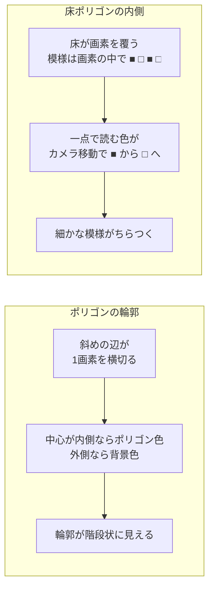
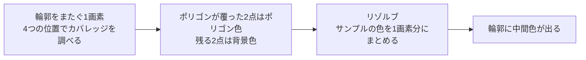

# アンチエイリアシング (MSAA / FXAA / SMAA)

## 概要

エイリアシングは、連続的な画像信号を離散的なピクセルでサンプリングしたときに生じる折り返し歪みです。ジオメトリのエッジのギザギザ (ジャギー) や細部のちらつき (シマー) として現れます。サンプリング理論の基礎と、空間的AAであるSSAA・MSAA (ハードウェア系)、FXAA・SMAA (ポストプロセス系) を扱います。時間的AAは[TAAの記事](/graphics/postprocess/taa.html)で説明します。

## 輪郭のギザギザと床模様のちらつき

斜めの辺が画素を横切ると、その画素の一部をポリゴンが覆います。この被覆を**カバレッジ**と呼びます。三角形を単一サンプルで描く場合、中心の点が三角形に入るかどうかで、画素全体に三角形の色が付くかが決まります。斜めの辺に沿って内側と外側が画素単位で切り替わり、輪郭が階段状に見えます。

床模様の場合は、床の内側にある画素でもちらつきます。遠くの床では、画面の1画素が白と黒の模様をいくつもまたぎます。ポイントサンプリングで1テクセルを読むと、カメラが少し動くだけで参照先が白から黒へ移ります。ここで変わるのは床が画素を覆う割合ではなく、テクスチャから読んだ色です。



輪郭に沿った階段も、物体やカメラが動くと明滅して見えることがあります。ちらつきが**輪郭に沿っているか、面の模様にも出ているか**を見ると、どちらを調べるべきか切り分けられます。輪郭は[ラスタライゼーション](/graphics/pipeline/rasterization.html)、床の模様は[テクスチャのフィルタリングとミップマップ](/graphics/texture/texture-filtering-and-mipmaps.html)で詳しく扱います。

## 歴史・誕生した背景

- 1977: Crow がCGにおけるエイリアシング問題を定式化 (サンプリング理論のCG応用)
- 1980-90年代: オフラインではスーパーサンプリングと確率的サンプリングが確立
- 2001頃: GPUで **MSAA** がハードウェア標準化 (GeForce 3世代〜) — Forward時代の王
- 2009: **MLAA** (Reshetov, Intel) — 「描いた後にエッジを推定して混ぜる」ポストAAの提案
- **2011: FXAA** (Lottes, NVIDIA) / **SMAA** (Jimenez) — Deferred時代 (MSAA困難) の穴を埋めるポストAA全盛期
- 2012-14: TAAの台頭により空間的AAは補助役へ → [TAA](/graphics/postprocess/taa.html)
- 現在: 「TAA/アップスケーラが主、MSAAはVR/Forward系で健在、FXAAは軽量フォールバック」という棲み分け

## それ以前の技術

AAなし (PS2期以前は解像度とテレビのにじみが実質のAAだった)、そして全画面を高解像度で描いて縮小する **SSAA** (品質最高・コスト最悪の原点)。

## 解決した課題 / 生んだ課題

各手法の本質は「**どこで・何を・何回サンプルするか**」のトレードオフです:

| 手法 | 原理 | コスト | 弱点 |
|---|---|---|---|
| SSAA | 全ピクセルをN倍サンプルで描画し縮小 | 極大 (シェーディングN倍) | コスト |
| **MSAA** | カバレッジや深度をサンプルごとに扱い、シェーディング結果は複数サンプルで共有できる | サンプル用の格納領域とリゾルブが必要 | 面の内側の細かな模様には別の対策が必要 |
| **FXAA** | 輝度からエッジを推定し方向にぼかす | 小 (1パス) | 細部もぼける場合がある。フレーム履歴は使わない |
| **SMAA** | エッジ形状をパターン分類し、輪郭の色を混ぜる | 小 | 空間版ではフレーム履歴を使わない (SMAA T2xで時間拡張) |
| TAA | 時間方向にサンプルを蓄積 | 小 | ゴースト・ぼけ → [TAA](/graphics/postprocess/taa.html) |

## 現在の位置づけ

- **VR / Forward+モバイル**: MSAAが第一選択 (TBDRではタイル内で解決でき帯域コストも小さい)
- **Deferred AAA**: TAA/アップスケーラが標準、FXAAは低負荷オプション
- SMAAは映像系・スタイライズド作品で「ぼけないAA」として根強い人気

## 内部動作

### エイリアシングの正体 (サンプリング理論)

画素の間隔に対して細かすぎる模様を点でサンプルすると、画面上では別の粗い模様として現れることがあります。これを**折り返し**と呼びます。テクスチャではミップマップでサンプル前に細かな模様をならせます。輪郭ではMSAAで画素内のカバレッジを複数点から推定します。FXAAなど、描画した画像から輪郭を推定して色を調整する方法もあります。

### MSAAは輪郭を画素内の複数位置で調べる



**MSAA**（Multisample Anti-Aliasing）は、1画素内の複数位置でポリゴンが覆う点を調べます。図は4点のうち2点をポリゴンが覆う例です。背景色とポリゴン色を含むサンプルを1画素にまとめる**リゾルブ**（resolve）により、輪郭に中間色が出ます。サンプルの配置やリゾルブの詳細は実装に依存します。[OpenGL ES 3.0.6仕様の §3.3・§3.6.3・§4.3.3](https://registry.khronos.org/OpenGL/specs/es/3.0/es_spec_3.0.pdf)

深度バッファを使う場合は、サンプルごとに深度を扱えます。フラグメントシェーダーで求めた色は複数のサンプルで共有できます。そのため、4× MSAAは画素ごとのカバレッジを4点で調べますが、各点で独立にテクスチャを読み直す設定ではありません。床の内側で全サンプルを同じポリゴンが覆い、ポイントサンプリングを使い続けると、細かな模様のちらつきが残ります。

MSAAではサンプルを保存する領域やリゾルブの処理が増えます。帯域や実行時間はGPUと描画パスの構成によります。Deferred Renderingで複数のGバッファをマルチサンプル化する場合は、シルエット付近で異なる面の情報をどう保持して照明を計算するかも考えます。[ForwardとDeferredの違い](/graphics/path/deferred.html)

### 同じシーンでMSAAを切り替える

[輪郭と床模様を見比べる実践](/practice/graphics/msaa-observation.html)では、カメラを止めて単色ポリゴンの斜めの辺を比べます。次にカメラを動かし、MSAAをオンにしたまま床の奥の模様を見ます。床はポイントサンプリングに固定しているので、輪郭の変化と床のちらつきを一つの画面で観察できます。

<a href="/study/samples/graphics/msaa-observation/index.html" target="_self">MSAAの比較デモを開く</a>

### FXAA詳解

1. 輝度バッファからローカルコントラストでエッジ検出
2. エッジの方向 (水平/垂直) を判定
3. エッジ端点を探索し、エッジ上の位置に応じたブレンド係数でぼかす

「1パス・依存なし・激安」が存在価値。実装はシェーダ1本で、今も学ぶ価値のある美しいハックです。

### SMAA詳解

MLAAの発展形。エッジ検出→**形状パターン分類 (L/Z/U字等をLUTで判定)** →理論的なカバレッジ値でブレンド、の3パス。FXAAより輪郭の再構成が正確で、ぼけが少ないのが特徴です。

## 各環境での扱い

### Unity
URP: Camera単位で FXAA / SMAA / TAA を選択、MSAAはForward系でRenderTexture/PipelineAsset設定 (2x-8x)。HDRPも同様の選択+TAAが標準。VRテンプレートはMSAA 4x既定。

### Unreal Engine
`r.AntiAliasingMethod`: 0=なし, 1=FXAA, 2=TAA, 3=MSAA (Forwardのみ), 4=TSR。既定はTAA/TSR。MSAAはForward Shadingモード専用です。

### DirectX 12
MSAAは `DXGI_SAMPLE_DESC{Count, Quality}` をPSOとレンダーターゲットに指定し、`ResolveSubresource` で単一サンプルの画像にまとめます。ピクセルシェーダーの入力に `SV_SampleIndex` を使うと、サンプル単位で実行できます。[MicrosoftのResolveSubresource](https://learn.microsoft.com/en-us/windows/win32/api/d3d12/nf-d3d12-id3d12graphicscommandlist-resolvesubresource) · [SV_SampleIndexの例](https://learn.microsoft.com/en-us/windows/win32/direct3dhlsl/dx-graphics-hlsl-to-get-sample-position)

### Vulkan
`VkPipelineMultisampleStateCreateInfo::rasterizationSamples`、Resolveは `vkCmdResolveImage` またはレンダーパスのresolve attachment (TBDRではタイル内resolveが無料に近い — `VK_ATTACHMENT_STORE_OP_DONT_CARE` でMSAAバッファをVRAMに書かない定石)。

## コード例

FXAAの核心 (簡略版、考え方が分かる最小形):

```hlsl
float3 FXAA(Texture2D tex, float2 uv, float2 rcpRes) {
    // 近傍の輝度
    float lM = Luma(tex.Sample(gLinear, uv).rgb);
    float lN = Luma(tex.Sample(gLinear, uv + float2(0, -rcpRes.y)).rgb);
    float lS = Luma(tex.Sample(gLinear, uv + float2(0,  rcpRes.y)).rgb);
    float lE = Luma(tex.Sample(gLinear, uv + float2( rcpRes.x, 0)).rgb);
    float lW = Luma(tex.Sample(gLinear, uv + float2(-rcpRes.x, 0)).rgb);

    float lMin = min(lM, min(min(lN, lS), min(lE, lW)));
    float lMax = max(lM, max(max(lN, lS), max(lE, lW)));
    if (lMax - lMin < max(0.0312, lMax * 0.125))
        return tex.Sample(gLinear, uv).rgb;          // エッジなし: 早期棄却

    // エッジ方向を判定し、垂直方向に半ピクセルずらしてブレンド (概念)
    bool horizontal = abs(lN + lS - 2*lM) >= abs(lE + lW - 2*lM);
    float2 dir = horizontal ? float2(0, rcpRes.y) : float2(rcpRes.x, 0);
    float3 a = tex.Sample(gLinear, uv + dir * 0.5).rgb;
    float3 b = tex.Sample(gLinear, uv - dir * 0.5).rgb;
    return (a + b) * 0.5;
    // 実物のFXAA 3.11はエッジ端点探索とサブピクセル処理が加わる
}
```

Vulkan: メモリレスMSAA (モバイル定石) の設定断片:

```cpp
// MSAAカラーは LAZILY_ALLOCATED + STORE_OP_DONT_CARE でVRAMに書かない
colorAtt.samples = VK_SAMPLE_COUNT_4_BIT;
colorAtt.storeOp = VK_ATTACHMENT_STORE_OP_DONT_CARE;  // タイル内で捨てる
resolveAtt.samples = VK_SAMPLE_COUNT_1_BIT;           // resolve先だけ書く
```

## 前提知識

- [ラスタライゼーション](/graphics/pipeline/rasterization.html) — 点サンプルという原因
- [出力結合](/graphics/pipeline/output-merger.html), [Forward](/graphics/path/forward.html) / [Deferred](/graphics/path/deferred.html)

## 次に読むべきページ

- [TAA](/graphics/postprocess/taa.html) — 現代の主役
- [アップスケーリング](/graphics/postprocess/upscaling.html) — TAAの発展形
- [3DCG・描画ロードマップの「ポストプロセスとAA」](/learn/roadmap.html?node=gfx-postprocess#graphics)

## 理解度チェック

1. **4× MSAAで、斜めの輪郭をまたぐ画素のうち2サンプルにポリゴンの色が入りました。リゾルブ後はどう見えますか。**
   ::: details 解答
   残り2サンプルが背景色なら、両方の色がリゾルブに反映され、輪郭に中間色が出ます。単一サンプルでは、この例の画素はポリゴン色か背景色のどちらかです。
   :::

2. **MSAAをオンにしても、実践の遠くの床がちらつくのはなぜですか。**
   ::: details 解答
   床の内側では、複数のサンプルを同じポリゴンが覆います。床の色は引き続き元画像のポイントサンプリングで決まります。広い範囲の模様を縮小して読むにはミップマップを使います。
   :::

3. **FXAAをかけても「細いワイヤーのちらつき」が直らない理由は。**
   ::: details 解答
   画素より細い形状は、フレームごとにサンプル点に当たったり外れたりします。FXAAは描画済みの画像を使うため、そのフレームで一度もサンプルされなかった形状の情報は拾えません。同じフレームでサンプルを増やす方法や、異なる位置でサンプルした複数フレームの情報を使うTAAが、明滅を抑える候補になります。
   :::

## 参考資料

- [Khronos — OpenGL ES 3.0.6 Specification](https://registry.khronos.org/OpenGL/specs/es/3.0/es_spec_3.0.pdf) · [WebGL 2.0 Specification](https://registry.khronos.org/webgl/specs/latest/2.0/)
- Franklin Crow, *"The Aliasing Problem in Computer-Generated Shaded Images"* (1977)
- [Timothy Lottes — FXAA](https://developer.download.nvidia.com/assets/gamedev/files/sdk/11/FXAA_WhitePaper.pdf)
- [Jorge Jimenez et al. — SMAA: Enhanced Subpixel Morphological Antialiasing (2012)](https://www.iryoku.com/smaa/)
- Matt Pettineo, *"Applying Sampling Theory to Real-Time Graphics"*
