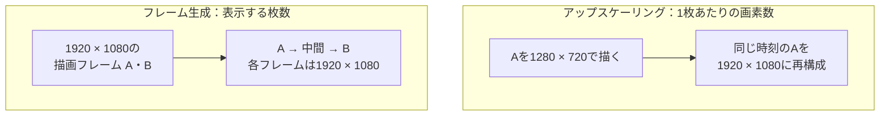
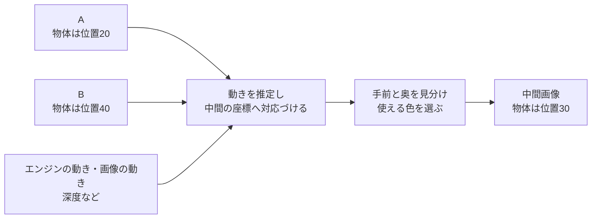
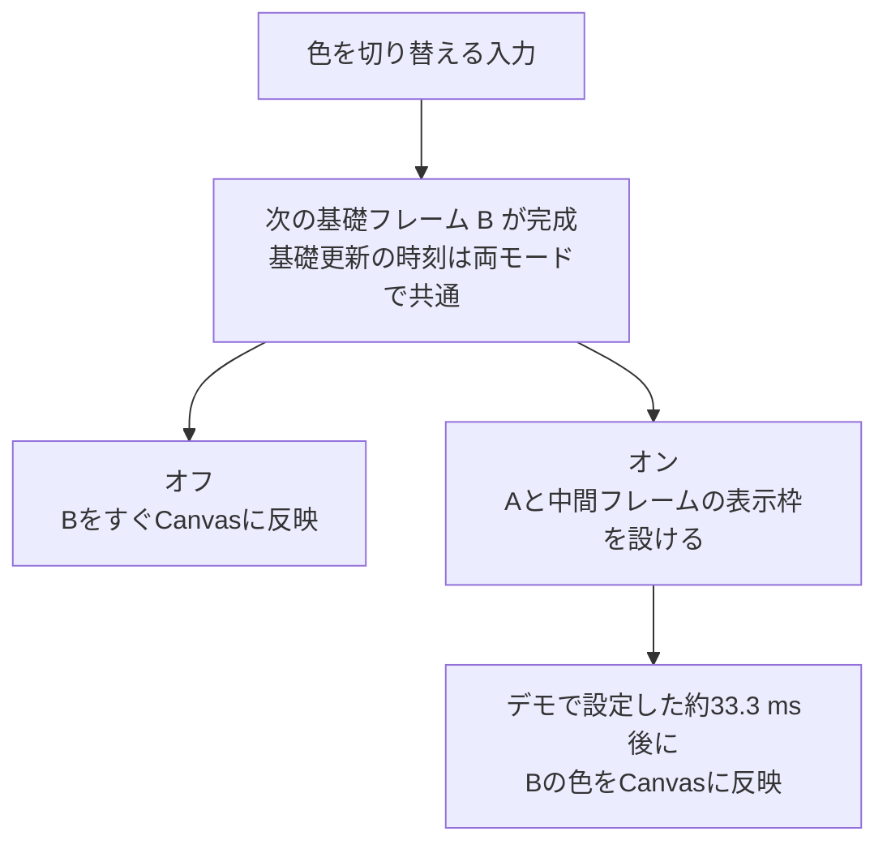

# フレーム生成 — 2枚の間を補い、表示を滑らかにする

走る物体を30 FPSで描くと、位置は約33 msごとに変わります。その間に物体が通りそうな位置を推定し、1枚挿入すると、動きを約17 ms間隔で見せられます。このように、**描画したフレームの間に表示用の画像を追加する**のが、補間を使うフレーム生成です。

[フレーム生成の比較実践](/practice/graphics/frame-generation-observation.html)では、同じシーンでオン・オフを切り替え、移動の滑らかさと、入力した色が画面に出るタイミングを比べられます。

<a href="/study/samples/graphics/frame-generation-observation/index.html" target="_self">フレーム生成の比較デモを開く</a>

## アップスケーリングは画素を、フレーム生成は表示枚数を増やす

[アップスケーリング](/graphics/postprocess/upscaling.html)では、例えば1280×720で描いた画像から、1920×1080の画像を作ります。TAAUのように過去フレームを使う方式でも、目的は一つの描画時刻の画像を細かい画素で出力することです。

フレーム生成では、例えば1920×1080の描画済みフレームAとBから、その間の時刻の1920×1080の画像を作ります。画面に出す順序はA、中間フレーム、Bです。両方を使う構成では、例えばアップスケーリング済みのAとBをフレーム生成に渡せます。 [AMDのFSR 3資料](https://gpuopen.com/manuals/fidelityfx_sdk/techniques/super-resolution-interpolation/) · [NVIDIAのDLSS機能一覧](https://developer.nvidia.com/rtx/dlss)

## 2枚から間の画像を作る

同じ物体がフレームAでは横位置20、フレームBでは横位置40にあるとします。一定の速さで動いたと仮定すれば、中間の位置は `(20 + 40) / 2 = 30` です。画素ごとの単純な色の平均では、位置20と40に物体が半透明で重なり得ます。動きを補間して位置30に物体を描くと、途中の位置を見せられます。

実際のゲームには同時に動く面がいくつもあります。エンジンの**モーションベクトル**は、描いた面の画面上の移動を表します。**オプティカルフロー**は、2枚の画像の模様の変化から画面上の動きを推定します。フレーム生成はこうした情報から中間時刻の各画素に対応するAとBの座標を探し、どちらの色を使うか決めます。深度や遮蔽の情報があると、手前と奥の色を区別しやすくなります。 [AMDのFidelityFX Frame Interpolation 1.1.3](https://gpuopen.com/manuals/fidelityfx_sdk/techniques/frame-interpolation/) · [AMDのFSR Frame Generation 4.0.2](https://gpuopen.com/manuals/fsr_sdk/techniques/frame-interpolation-ml/)

物体が動いて新しく見えた背景には、片方の画像にしか色がないことがあります。急なカメラ切り替えでは、2枚の対応を取れないこともあります。動きや遮蔽を取り違えると、輪郭のゆがみ、二重像、穴が出ます。文字や照準をシーンと一緒に補間すると文字もゆがむため、UIを別に合成できる実装があります。 [AMDの補間アルゴリズム](https://gpuopen.com/manuals/fidelityfx_sdk/techniques/frame-interpolation/) · [NVIDIA Streamlineのフレーム生成統合ガイド](https://github.com/NVIDIA-RTX/Streamline/blob/main/docs/ProgrammingGuideDLSS_G.md)

## 滑らかさと入力への反応は別々に見る

中間フレームを作るには、後ろ側の描画フレームBが必要です。AとBの間に中間フレームを表示するために、Bが完成してから、表示する順序と間隔を調整します。表示間隔が不均等なら、表示枚数が増えても動きがカクついて見えることがあります。 [AMDのFrame Generation Swapchain](https://gpuopen.com/manuals/fsr_sdk/techniques/frame-interpolation-swap-chain/) · [フレームペーシング](/graphics/optimization/frame-pacing.html)

この実践では、入力を反映する基礎フレームを約33.3 msごとに用意します。生成オン時の予定表示に、教材の設定として1基礎フレーム分の待ちを加えます。図は入力がBで色を変えた場合です。中間の位置は補間し、色の切り替えはBが表示される時点にそろえています。

補間によって表示する位置は増えます。入力を読み、新しいゲーム状態を計算する回数は、ゲーム側の更新ループで決まります。実際のゲームでは、補間画像にもBに反映された変化が一部見える場合があります。製品で生成をオンにしたときの遅延の差は、生成方式と処理時間、基礎FPS、提示キュー、ディスプレイの更新条件によって変わります。入力から表示までの時間は、これらを含む経路で測ります。 [AMDの補間・外挿の比較](https://gpuopen.com/download/GDC2024_High_Performance_Rendering_in_Snowdrop_Using_AMD_FidelityFX_Super_Resolution_3.pdf) · [AMDの提示タイミング資料](https://gpuopen.com/manuals/fsr_sdk/techniques/frame-interpolation-swap-chain/#frame-pacing-and-presentation) · [NVIDIAの提示キューと遅延の解説](https://github.com/NVIDIA-RTX/Streamline/blob/main/docs/ProgrammingGuideDLSS_G.md#227-high-latency-with-high-fg-multipliers) · [入力から画面に出るまでの遅延](/graphics/optimization/input-to-display-latency.html)

## DLSSとFSRで設定を読む

NVIDIAのDLSSでは、**Super Resolution**が1枚の解像度を上げ、**Frame Generation**や**Multi Frame Generation**が間の画像を増やします。AMDのFSR 3.1ではアップスケーリングとフレーム生成のAPIが分かれ、対応する別のアップスケーラーとフレーム生成を組み合わせられます。AMD FSR Frame Generation 4.0.2は、動き情報と前後の画像を使う学習モデルを採用しています。各機能の対応GPUや設定は、使用する版ごとに確認します。 [NVIDIAのDLSS機能一覧](https://developer.nvidia.com/rtx/dlss) · [AMDのFSR 3.1移行ガイド](https://gpuopen.com/manuals/fidelityfx_sdk/getting-started/migrating-to-fsr-3-1/) · [AMD FSR Frame Generation 4.0.2](https://gpuopen.com/manuals/fsr_sdk/techniques/frame-interpolation-ml/)

## 理解度チェック

1. 30 FPSで描いたフレームの間に1枚ずつ挿入すると、何の頻度が約60回毎秒になりますか。

   ::: details 解答
   画面へ出す画像の頻度です。ゲームが入力を読んで状態を更新する頻度は、ゲーム側の更新ループで決まります。
   :::

2. Aで位置20、Bで位置40にある物体を、単純な色の平均で補間すると何が起きますか。

   ::: details 解答
   Aの位置20とBの位置40にそれぞれ物体の色があり、平均を取ると両方の位置に薄く残り得ます。動きを使う補間なら、物体が通る中間の位置を推定できます。
   :::

3. デモで生成をオンにすると、色が変わるまで何の待ち時間が加わりますか。

   ::: details 解答
   入力を反映した基礎フレームの完成から、その画像を表示用Canvasに反映するまでの予定待ちが加わります。中間フレームのためにこの実践で設けた待ちです。
   :::

## 関連項目

- [アップスケーリング](/graphics/postprocess/upscaling.html)で、1枚あたりの画素を増やす方法を確認する。
- [入力から画面に出るまでの遅延](/graphics/optimization/input-to-display-latency.html)で、入力からディスプレイまでの待ちを分ける。
- [フレームペーシング](/graphics/optimization/frame-pacing.html)で、表示枚数と表示間隔の関係を整理する。
- [フレームペーシングの実践](/practice/graphics/frame-pacing-observation.html)で、同じ生成フレームを出しても提示間隔によって動きがどう変わるかを比べる。
- [3DCG・描画ロードマップの「ポストプロセスとAA」](/learn/roadmap.html?node=gfx-postprocess#graphics)

## 参考資料

- [AMD — FidelityFX Frame Interpolation 1.1.3](https://gpuopen.com/manuals/fidelityfx_sdk/techniques/frame-interpolation/)
- [AMD — FSR Frame Generation 4.0.2](https://gpuopen.com/manuals/fsr_sdk/techniques/frame-interpolation-ml/) · [Frame Generation Swapchain](https://gpuopen.com/manuals/fsr_sdk/techniques/frame-interpolation-swap-chain/)
- [NVIDIA — Streamline DLSS Frame Generation Integration Guide](https://github.com/NVIDIA-RTX/Streamline/blob/main/docs/ProgrammingGuideDLSS_G.md)
