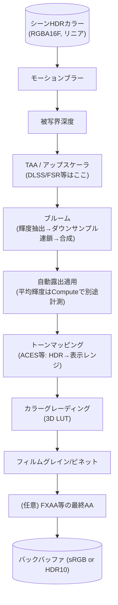

# ポストプロセスパイプライン

## 概要

ポストプロセスは、**シーンを描き終えたHDRカラーバッファに対して行う画像処理の総称**です。トーンマッピング・ブルーム・被写界深度・モーションブラー・色調補正などが連なる「現像工程」であり、ゲームの絵の「ルック」の大半はここで決まります。実装的にはフルスクリーンパス (またはCompute) の連鎖で、HDRレンダリングとリニア色空間の理解が土台になります。

## なぜ必要なのか

- **出力先の表示レンジへ合わせる** — HDRで計算したシーンをSDRへ出すならトーンマップする。HDRディスプレイへ出す場合も露出・表示可能な輝度/色域・出力形式へ合わせるが、必ずSDRへ圧縮するわけではない
- カメラの物理現象 (レンズのボケ・露出・グレア) の再現が実写感の核心
- アートディレクション (カラーグレーディング) を、アセットを触らず一括制御できる

## 歴史・誕生した背景

- 2004-05: **HDRレンダリングの普及期** (Half-Life 2: Lost Coast, FP16レンダーターゲット) — ブルームと露出が「次世代感」の象徴に
- 2000年代後半: トーンマップ演算子の試行錯誤 (Reinhard 2002 → **Uncharted 2 / Hable curve 2010**)
- 2010年代: 物理ベースカメラ (実際の絞り・ISO・シャッター速度での露出制御、Frostbite 2014) 、**ACES** による色管理の標準化
- 2013〜: Compute化・単一パス統合 (複数エフェクトを1つのUber-passに融合して帯域節約)
- 2016〜: HDRディスプレイ出力 (HDR10/scRGB) がパイプラインに追加
- 現在: [TAA](/graphics/postprocess/taa.html)/[アップスケーラ](/graphics/postprocess/upscaling.html) がパイプラインの中核位置を占め、「どこでアップスケールするか」がパイプライン設計の焦点に

## それ以前の技術

LDR (8bit) レンダリング直書き。白飛びは即クリップされ、露出という概念もなく、「見た目の調整=ライトとテクスチャの調整」でした。

## 解決した課題

1. 物理的に意味のあるライティング値 (太陽=数万lux) を扱える計算空間
2. 写真的な絵作りの言語 (露出・ボケ・グレイン) の導入
3. ルックの一元管理

## 現在の位置づけ

全エンジン標準装備。設計上の要点は**順序**と**色空間**に集約されます (下記)。モバイルでは帯域制約からエフェクトの取捨選択とタイルメモリ内融合が課題になります。

## 内部動作

### 標準的なパス順序

順序は品質に直結します (例: ブルームはトーンマップ前のHDR値で計算しないと「光の溢れ」にならない):



- **アップスケーラ以前=内部解像度、以後=出力解像度** — この分割が現代パイプラインの基本構造
- 中間bufferの精度は後続処理と出力で決める。SDRの最終出力は8bit、HDR10は10bit、scRGBはFP16等を使い分ける。グレーディング以降も常に8/10bitで十分とは限らない。トーンマップとLUTを同じパスにまとめる実装もある

### 色空間 — 最重要基礎

| 空間 | 用途 |
|---|---|
| リニア | **すべてのライティング計算**。光は線形に加算されるため |
| sRGB | 多くの色テクスチャ・SDR出力で使う色空間と非線形符号化。単純な2.2乗とは異なる |
| ACEScg 等 | 広色域の作業空間 (映画的ワークフロー) |

SDR/sRGB出力の基本は「**sRGBで保存された色をリニアへ復号 → リニアで計算 → 表示レンジへ写像 → sRGBへ一度だけ符号化**」です。sRGB対応のtexture format/viewでsamplingした場合はRGBの復号が自動で行われます。normal/roughness等のデータtextureやalphaにはその変換をかけません。最終color attachmentもsRGB対応のformat/view（OpenGLではFRAMEBUFFER_SRGB等の条件も確認）ならRGBを自動符号化するので、shaderで重ねてgamma変換しません。HDR10のPQやlinearなscRGB出力は別経路です。画像が暗い/明るいときは値・format/view・出力色空間・変換回数を確認します。

### 主要エフェクトの原理

| エフェクト | 原理 |
|---|---|
| ブルーム | 閾値抽出→ミップ連鎖のダウン/アップサンプル (Jimenez 2014の13-tap法が定番) |
| 自動露出 | 輝度ヒストグラム ([Compute](/graphics/compute/parallel-algorithms.html)) →目標EVへ時定数付きで追従 |
| トーンマップ | 表示先のレンジへの写像。以下のACES近似例はSDR向けに[0,1]へ圧縮 |
| DoF | CoC (錯乱円) 半径を深度から計算→散乱 or ギャザーでボケ生成 |
| モーションブラー | モーションベクタ方向にサンプル (TAAと同じ速度バッファを共用) |
| カラーグレーディング | 3D LUT (32³) 1回の参照に全補正を焼き込む |

## 各環境での扱い

### Unity
URP/HDRPとも **Volume システム** (グローバル/ローカルVolumeにプロファイルを載せてブレンド)。URPはUberポストシェーダに統合。カスタムは `ScriptableRenderPass` (URP) / Custom Pass (HDRP) で注入します。

### Unreal Engine
**Post Process Volume** が同発想の先行実装。Material Domain=Post Process のマテリアルで自作エフェクトを挿入位置 (Before Tonemapping等) 指定で追加。トーンマッパはACESベースのFilmic (置換も可能)。

### DirectX 12 / Vulkan
フルスクリーン三角形 ([Fragment Shader](/graphics/pipeline/fragment-shader.html) のコード例参照) またはComputeで実装。中間RTの使い回しとバリア管理が煩雑になるため、[RenderGraph](/graphics/optimization/render-graph.html) の導入動機の代表例です。

## コード例

SDR出力用のACES近似トーンマップ+自動露出適用の断片 (HLSL)。出力はsRGB形式のcolor attachment/viewへ書き、shader自身はsRGB符号化しない前提です:

```hlsl
// Narkowicz の ACES 近似 — 手軽さと品質のバランスで広く使われる
float3 ACESFitted(float3 x) {
    const float a = 2.51, b = 0.03, c = 2.43, d = 0.59, e = 0.14;
    return saturate((x * (a * x + b)) / (x * (c * x + d) + e));
}

float4 TonemapPS(Varyings i) : SV_Target {
    float3 hdr = gSceneColor.Sample(gLinear, i.uv).rgb;

    float exposure = gExposureBuffer[0];       // Computeで計測した露出
    float3 color = hdr * exposure;

    color = ACESFitted(color);                 // HDR→[0,1]
    color = ApplyLUT3D(gGradeLUT, color);      // グレーディング
    return float4(color, 1);                   // sRGB変換はRTフォーマットに任せる
}
```

ブルームのダウンサンプル核心 (13-tap, Jimenez):

```hlsl
// 4x4ボックスを重み付きで13点サンプル — ちらつき (firefly) に強い
float3 DownsampleBox13(Texture2D src, float2 uv, float2 texel) {
    float3 A = src.Sample(gLinear, uv + texel * float2(-1,-1)).rgb;
    float3 B = src.Sample(gLinear, uv + texel * float2( 1,-1)).rgb;
    float3 C = src.Sample(gLinear, uv + texel * float2(-1, 1)).rgb;
    float3 D = src.Sample(gLinear, uv + texel * float2( 1, 1)).rgb;
    float3 E = src.Sample(gLinear, uv).rgb;
    // ...(外周8点略)...
    return E * 0.125 + (A + B + C + D) * 0.125 /* + 外周の重み */;
}
```

## 前提知識

- [Fragment Shader](/graphics/pipeline/fragment-shader.html) — フルスクリーンパス
- [Compute Shader](/graphics/compute/compute-shader.html), [並列アルゴリズム](/graphics/compute/parallel-algorithms.html) — 露出計測

## 次に読むべきページ

- [アンチエイリアシング](/graphics/postprocess/antialiasing.html) → [TAA](/graphics/postprocess/taa.html)
- [アップスケーリング](/graphics/postprocess/upscaling.html)
- [RenderGraph](/graphics/optimization/render-graph.html) — パス管理の自動化

## 理解度チェック

1. **ブルームをトーンマップ後に計算すると何が起きるか。**
   ::: details 解答
   トーンマップ後は輝度が[0,1]に圧縮され、太陽と白い紙の区別が失われている。そこから閾値抽出しても「本当に眩しいもの」だけが溢れる物理的な挙動にならず、白いものすべてが一様に滲む嘘くさいグローになる。ブルームはHDRのリニア値に対して行い、光学現象として正しい強度比を保つ必要がある。
   :::

2. **sRGBテクスチャをリニア変換せずにライティングすると絵がどうなるか。**
   ::: details 解答
   ガンマ空間の値(実際より明るく符号化された値)を線形計算に使うため、ライティング結果の加算・減衰がすべて歪む。中間調が明るく飛びやすく、陰影の変化が不自然に急峻になり、複数ライトの加算やブレンドが過剰に明るくなる。最終出力時のガンマも二重適用になりがちで、いわゆる「ガンマが崩れた眠い/飛んだ絵」になる。
   :::

3. **アップスケーラの挿入位置が「モーションブラーの後・ブルームの前」あたりに置かれるのはなぜか。**
   ::: details 解答
   アップスケーラ(TAAU/DLSS/FSR2)はジッタとモーションベクタを使う時間的再構成で、シーンのジオメトリ的情報が保たれた段階で実行する必要がある。一方ブルームやグレイン、LUTなどの画作り系エフェクトは出力解像度で掛けた方が品質が良く(低解像度のブルームは粗が見える)、コスト増も軽微なため、再構成の後に置く。この境界で「内部解像度/出力解像度」が分かれる。
   :::

## 参考資料

- Jimenez, *"Next Generation Post Processing in Call of Duty: Advanced Warfare"* (SIGGRAPH 2014) — 定番中の定番
- Lagarde & de Rousiers, *"Moving Frostbite to PBR"* — 物理カメラ・露出
- ACES (Academy Color Encoding System) ドキュメント / Narkowicz blog
- John Hable, *"Uncharted 2: HDR Lighting"* (GDC 2010)
- [Microsoft: Converting data for the color space](https://learn.microsoft.com/en-us/windows/win32/direct3ddxgi/converting-data-color-space)
- [Microsoft: DirectX with Advanced Color](https://learn.microsoft.com/en-us/windows/win32/direct3darticles/high-dynamic-range)
- [Microsoft DXC: SPIR-V — Vulkan specific Image Formats](https://github.com/microsoft/DirectXShaderCompiler/blob/main/docs/SPIR-V.rst)
- [OpenGL 4.6 Core Specification: §8.24 / §17.3.7](https://registry.khronos.org/OpenGL/specs/gl/glspec46.core.pdf)
