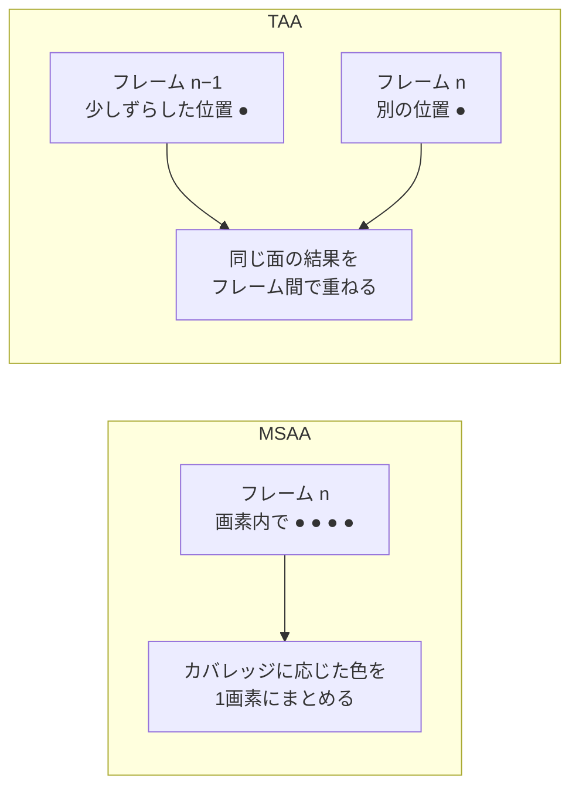
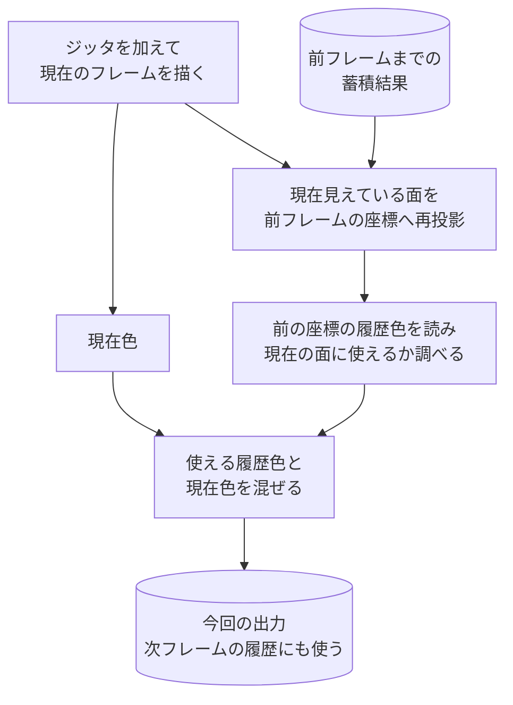
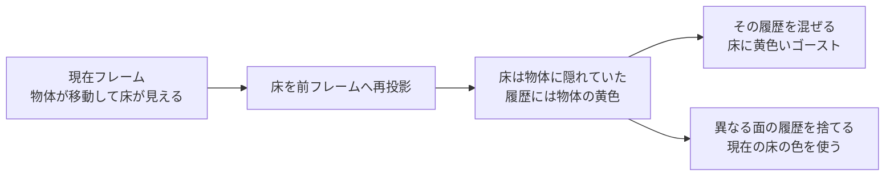

# TAA (Temporal Anti-Aliasing)

## 概要

遠くの市松模様の床をポイントサンプリングで描くと、カメラが少し動くだけで、同じ場所の模様が明るくなったり暗くなったりします。**TAA**（Temporal Anti-Aliasing）は、フレームごとに画素内のサンプル位置を少しずらし、同じ面に対応する過去の結果を現在のサンプルと混ぜます。異なる位置の色が蓄積されるため、細かな模様のちらつきを抑えられます。[Yang・Liu・Salviの論文 §3–4](https://behindthepixels.io/assets/files/TemporalAA.pdf)

## MSAAとTAAはいつサンプルを取るか

前回の[MSAAの実践](/practice/graphics/msaa-observation.html)では、1画素内の複数の点でポリゴンが覆う範囲を調べました。輪郭をまたぐ画素では、ポリゴンと背景の両方の色がリゾルブに反映されます。面の内部では複数の点で同じシェーディング結果を共有できるため、ポイントサンプリングの床のちらつきは残ります。[OpenGL ES 3.0.6仕様 §3.3](https://registry.khronos.org/OpenGL/specs/es/3.0/es_spec_3.0.pdf)



TAAは、輪郭に加え、面の内側の模様や細い反射のちらつきにも効く場合があります。遠くの床でどの範囲の色を読むかは、[テクスチャのフィルタリングとミップマップ](/graphics/texture/texture-filtering-and-mipmaps.html)でも扱います。

## 歴史・誕生した背景

- 原型: モーションブラーのための時間的再投影研究 (2000年代)、Reverse Reprojection Caching (2007)
- 2011-12: 時間方向のサンプルを使うSMAA T2xが登場。[SMAAの著者資料](https://www.iryoku.com/smaa/)
- **2014: Karis "High Quality Temporal Supersampling" (SIGGRAPH)** — Neighborhood clamping等、現代TAAの定式化
- 2010年代半ば以降: ゲームエンジンでTAAの採用が進み、フレーム履歴をアップスケーリングにも利用するようになった。[Yang・Liu・Salviの論文 §2・§5](https://behindthepixels.io/assets/files/TemporalAA.pdf)
- 2016-18: 「TAAのぼけ」批判と改良 (シャープニング、可変ブレンド)
- 2018〜: **TAAU→DLSS 2 (2020) / FSR 2 (2022) / TSR (UE5)** — 蓄積の枠組みをアップスケーリングへ拡張 → [アップスケーリング](/graphics/postprocess/upscaling.html)

## それ以前の技術

FXAAや空間版のSMAAは、描画済みの1フレームから輪郭を推定します。マルチサンプルの描画先を使うMSAAは、Forward Renderingで組み込みやすい手法です。Deferred Renderingで使う場合は、Gバッファの保存や輪郭でのシェーディングの扱いを設計します。[アンチエイリアシング](/graphics/postprocess/antialiasing.html) · [Yang・Liu・Salviの論文 §1](https://behindthepixels.io/assets/files/TemporalAA.pdf)

## 解決した課題

1. 時間的エイリアシング (ちらつき・シマー) の抑制
2. サブピクセル形状の再構成 (細いワイヤーが安定して描ける)
3. [SSAO](/graphics/lighting/ssao.html)や[SSR](/graphics/lighting/ssr.html)などで、時間方向にサンプルを蓄積してノイズを減らす

## 生んだ課題

過去の色が現在の面に合わなくても、その色を混ぜ続けると**ゴースト**（残像）が出ます。再投影で補間を繰り返すと、細部がぼける場合があります。遮蔽が解けた場所では、使える履歴が減って一時的にちらつきやノイズが目立ちます。[Yang・Liu・Salviの論文 §4・§6.2](https://behindthepixels.io/assets/files/TemporalAA.pdf)

## 内部動作

### ジッタ・再投影・蓄積



### 各要素の詳細

1. **ジッタ**でカメラの射影を1画素未満だけずらし、毎フレーム違う位置をサンプルします。ずらし方の例にHalton (2,3) 列があります。
2. **再投影**で、現在の画素に見えている面を前フレームの画面上で探します。カメラが動けば床の座標も変わります。物体自身が動く場合は、その物体の前の位置も必要です。多くの実装は、前後の画面座標の差を**モーションベクトル**として持ちます。
3. **履歴検証**で、前の画面座標が範囲内か、同じ面に対応するかなどを調べます。疑わしい履歴を捨てる方法や、現在フレームの近傍色に収まるように色を補正する方法があります。後者の例が**近傍クランプ**です。
4. **ブレンド**で、現在色と使える履歴色を混ぜます。例えば現在を10%、履歴を90%とします。履歴を使えない画素は現在色だけにします。混ぜた出力を次フレームに渡すので、直前までの複数フレームの結果が1枚の履歴画像に蓄積されます。

### 物体の後ろにゴーストが出る理由

黄色い物体が動いて、その後ろの床が新たに見える場面を考えます。前フレームで床があった画面座標を正しく計算しても、その座標に保存されている色は、当時手前にあった物体の黄色です。このように隠れていた面が見えることを**ディスオクルージョン**（遮蔽の解除）と呼びます。



履歴の色だけから面の違いを見分けるのは難しいので、実装によっては深度や法線なども判断に使います。履歴を強く残すと細部が安定する一方、誤った色が長く残りやすくなります。履歴を捨てた画素では、現在の少ないサンプルに戻ります。[Yang・Liu・Salviの論文 §4・§6.2](https://behindthepixels.io/assets/files/TemporalAA.pdf) · [Karisの講演資料](https://de45xmedrsdbp.cloudfront.net/Resources/files/TemporalAA_small-59732822.pdf)

### ブラウザーで床のちらつきとゴーストを比べる

[TAAの実践](/practice/graphics/taa-observation.html)では、カメラを動かして遠くの床を、物体を動かしてその後ろの床を観察します。TAAを切り替えたあと、履歴を捨てる設定も試すと、ちらつきの抑制と残像の違いが見えます。

<a href="/study/samples/graphics/taa-observation/index.html" target="_self">TAAの比較デモを開く</a>

### なぜ「ぼける」のか

- 再投影のバイリニア補間が毎フレーム情報を拡散する
- クランプによりサブピクセルディテールが破棄される
- 再投影時にどのフィルターで色を読み、どの程度履歴を残すかで、ぼけ方が変わります。[Yang・Liu・Salviの論文 §3.2・§6.2](https://behindthepixels.io/assets/files/TemporalAA.pdf)

## 各環境での扱い

### Unity
URP: Camera の Anti-aliasing で TAA 選択 (Unity 2022〜)。HDRPはTAA標準+品質プリセット。`TemporalAA.shader` が実装本体で、`MotionVector` パスをオブジェクトが出力します。

### Unreal Engine
`r.AntiAliasingMethod 2` (TAA) / 4 (**TSR** — UE5の後継、アップスケーリング統合型)。実装は `TAAStandalone.usf` / TSRの各シェーダ。`r.TemporalAASamples` 等の調整CVar多数。UEのTAAは業界の参照実装として最も研究されています。

### DirectX 12 / Vulkan
自前実装ではモーションベクタRT (RG16F) を描画パスに追加し、Computeで解決するのが普通。API的な特別機能は不要 — **TAAは純粋にアルゴリズムの問題**です。

## コード例

HLSLの解決パスの例です。モーションベクトルは `現在のUV - 前フレームのUV` と定義し、ジッタの扱いを含め、両方のUVを対応するバッファの座標系にそろえます。履歴のサンプラーには線形・クランプを設定します。入出力は同じサイズで、最初のフレームやカメラカット直後は別途、現在色から履歴を初期化します。

```hlsl
Texture2D<float4> gCurrent : register(t0);   // ジッタ付きで描いた現フレーム
Texture2D<float4> gHistory : register(t1);   // 前フレームの蓄積結果
Texture2D<float2> gMotion  : register(t2);   // モーションベクタ
SamplerState gHistorySampler : register(s0);
RWTexture2D<float4> gOut   : register(u0);

[numthreads(8, 8, 1)]
void TaaCS(uint3 id : SV_DispatchThreadID)
{
    uint width, height;
    gCurrent.GetDimensions(width, height);
    if (id.x >= width || id.y >= height) return;

    int2 pixel = int2(id.xy);
    int2 lastPixel = int2(width, height) - 1;
    float2 uv = (float2(pixel) + 0.5) / float2(width, height);
    float3 current = gCurrent[pixel].rgb;
    float2 prevUV = uv - gMotion[pixel];
    if (any(prevUV < 0.0) || any(prevUV >= 1.0)) {
        gOut[id.xy] = float4(current, 1.0);
        return;
    }

    // 画面端では、近傍の参照座標を画像内に収める
    float3 nMin = current;
    float3 nMax = current;
    [unroll] for (int y = -1; y <= 1; ++y)
    [unroll] for (int x = -1; x <= 1; ++x) {
        int2 neighbor = clamp(pixel + int2(x, y), int2(0, 0), lastPixel);
        float3 c = gCurrent[neighbor].rgb;
        nMin = min(nMin, c);
        nMax = max(nMax, c);
    }

    float3 history = gHistory.SampleLevel(gHistorySampler, prevUV, 0).rgb;
    // 現在の近傍色の範囲に履歴色を収める
    history = clamp(history, nMin, nMax);
    gOut[id.xy] = float4(lerp(history, current, 0.1), 1.0);
}
```

この例は近傍クランプまでを示しています。遮蔽の解除を直接判定するには、現在の面と再投影先の深度や面の情報も比較します。

射影のジッタは、画素単位のオフセットを正規化デバイス座標（NDC）の単位に変換して加えます。クリップ座標の `w` を掛けると、透視除算後に所定のNDCオフセットが加わります。Y方向の符号は画素座標とNDCの向きに合わせます。

```hlsl
// clipPosition は頂点を射影した直後のクリップ座標
float2 jitterNdc = 2.0 * jitterInPixels / renderSize;
clipPosition.xy += jitterNdc * clipPosition.w;
```

## 前提知識

- [アンチエイリアシング](/graphics/postprocess/antialiasing.html) — 空間的AAの限界
- [座標変換](/math/rendering/transform.html) — 再投影の数学
- [Compute Shader](/graphics/compute/compute-shader.html)

## 次に読むべきページ

- [アップスケーリング (DLSS/FSR/XeSS)](/graphics/postprocess/upscaling.html)で、TAAの履歴を高解像度の再構成に使う方法を確認する。
- [時間方向のアップスケーリングの実践](/practice/graphics/taau-observation.html)で、異なるフレームのサンプルが出力の2×2画素を埋める様子を見る。
- [SSAO](/graphics/lighting/ssao.html) / [SSR](/graphics/lighting/ssr.html) — TAAを再構成基盤として使う技法
- [3DCG・描画ロードマップの「ポストプロセスとAA」](/learn/roadmap.html?node=gfx-postprocess#graphics)

## 理解度チェック

1. **MSAAとTAAでは、1画素の色を決めるのにいつのサンプルを使いますか。**
   ::: details 解答
   MSAAは同じフレームの複数位置でカバレッジを調べます。TAAはフレームごとにサンプル位置をずらし、再投影して対応する過去の結果を現在の色と混ぜます。
   :::

2. **前フレームへの再投影が正しくても、物体の後ろの床にゴーストが出るのはなぜですか。**
   ::: details 解答
   その床は前フレームで物体に隠れていたため、前の座標の履歴色は手前の物体の色です。この履歴を現在の床の色と混ぜると、床に物体の色が残ります。
   :::

3. **モーションベクタが取れないもの(半透明、パーティクル、シェーダアニメーション)でTAAに何が起き、どう対処するか。**
   ::: details 解答
   過去の対応点がずれると、ゴーストやちらつきの原因になります。シェーダーで頂点を動かす場合は前フレームの頂点位置も計算します。半透明などで対応が取りにくい場合は、履歴の重みを下げる、TAAの後で描くといった選択肢があります。
   :::

## 参考資料

- [Brian Karis — High Quality Temporal Supersampling (SIGGRAPH 2014)](https://de45xmedrsdbp.cloudfront.net/Resources/files/TemporalAA_small-59732822.pdf)
- [Lei Yang, Shiqiu Liu, Marco Salvi — A Survey of Temporal Antialiasing Techniques (2020)](https://diglib.eg.org/items/cfa6a05c-53b3-4ee1-979d-48abc6225f6b)
- Alex Tardif, *"Temporal Antialiasing Starter Pack"* — 実装入門
- Epic, TSR 公式ドキュメント
