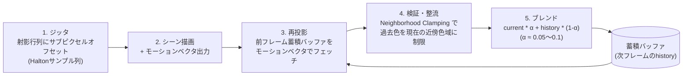

# TAA (Temporal Anti-Aliasing)

## 概要

TAAは、**サンプル位置を毎フレーム微小にずらし (ジッタ)、過去フレームの結果を再投影して蓄積する**ことで、時間方向にスーパーサンプリングを実現するAAです。2010年代半ばからAAA開発の標準AAとなり、さらに**あらゆる確率的手法 (SSAO/SSR/GI/影のノイズ) の共通の再構成基盤**として、現代レンダリングの中枢部品に成長しました。DLSS/FSR2等のアップスケーラはTAAの直系の発展形です。

## なぜ必要なのか

- Deferred時代にMSAAが使えなくなり、FXAAではちらつき (時間的エイリアシング) を解決できなかった → [アンチエイリアシング](/graphics/postprocess/antialiasing.html)
- ジオメトリだけでなく**シェーディングのエイリアシング** (スペキュラのちらつき) も均せる唯一の実用手段
- 「1sppの確率的レンダリング+時間的蓄積」という現代の設計パラダイム ([SSAO](/graphics/lighting/ssao.html)、[Lumen](/graphics/lighting/lumen.html)、[パストレーシング](/graphics/lighting/path-tracing.html)) の土台

## 歴史・誕生した背景

- 原型: モーションブラーのための時間的再投影研究 (2000年代)、Reverse Reprojection Caching (2007)
- 2011-12: Crytek SMAA T2x、UE4初期のTAA実装 (Karis)
- **2014: Karis "High Quality Temporal Supersampling" (SIGGRAPH)** — Neighborhood clamping等、現代TAAの定式化
- 2014-16: 全AAAエンジンが採用 (Frostbite, id Tech, Unity, Decima...)
- 2016-18: 「TAAのぼけ」批判と改良 (シャープニング、可変ブレンド)
- 2018〜: **TAAU→DLSS 2 (2020) / FSR 2 (2022) / TSR (UE5)** — 蓄積の枠組みをアップスケーリングへ拡張 → [アップスケーリング](/graphics/postprocess/upscaling.html)

## それ以前の技術

FXAA/SMAA (空間のみ)、MSAA (Forward限定)。時間方向の情報を使うAAは実用レベルでは存在しませんでした。

## 解決した課題

1. 時間的エイリアシング (ちらつき・シマー) の抑制
2. サブピクセル形状の再構成 (細いワイヤーが安定して描ける)
3. 確率的手法のノイズを「無料で」均す共通基盤の提供

## 生んだ課題

**ゴースティング** (動く物体の残像)、**ぼけ** (再投影の補間ロス)、ディスオクルージョン時のノイズ再露出 — 「TAA is blurry」問題。これらとの戦いが後続 (AIアップスケーラ) の開発動機です。

## 内部動作

### 基本ループ



### 各要素の詳細

1. **ジッタ**: 射影行列に±0.5ピクセル以内のオフセットを加える。Halton(2,3)列の8〜16点巡回が定番。**UIやシャドウマップにはジッタを掛けない**
2. **モーションベクタ**: 各ピクセルの「前フレームでの位置」。動的物体は前フレームのワールド行列も必要。**これを正しく出すことがTAA品質の8割**
3. **再投影**: historyをモーションベクタ先からバイリニア/Catmull-Romでサンプル (バイリニアの累積がぼけの一因 → Catmull-Rom 5tapが定番改善)
4. **Neighborhood Clamping**: 現在フレームの3x3近傍のmin/max (またはYCoCg空間のAABB) にhistory色をクランプ。**「過去の色が現在ありえない色ならば棄却する」** — ゴースト対策の核心で、TAAを成立させた発明
5. **適応ブレンド**: 速度・ディスオクルージョン・輝度差でαを調整

### なぜ「ぼける」のか

- 再投影のバイリニア補間が毎フレーム情報を拡散する
- クランプによりサブピクセルディテールが破棄される
- 対策: シャープニングパス、Catmull-Rom、分散クリッピング、そして**根本対策としてのAI再構成 (DLSS)** — 「手作りのヒューリスティックの限界」がニューラル化の直接の理由です

## 各環境での扱い

### Unity
URP: Camera の Anti-aliasing で TAA 選択 (Unity 2022〜)。HDRPはTAA標準+品質プリセット。`TemporalAA.shader` が実装本体で、`MotionVector` パスをオブジェクトが出力します。

### Unreal Engine
`r.AntiAliasingMethod 2` (TAA) / 4 (**TSR** — UE5の後継、アップスケーリング統合型)。実装は `TAAStandalone.usf` / TSRの各シェーダ。`r.TemporalAASamples` 等の調整CVar多数。UEのTAAは業界の参照実装として最も研究されています。

### DirectX 12 / Vulkan
自前実装ではモーションベクタRT (RG16F) を描画パスに追加し、Computeで解決するのが普通。API的な特別機能は不要 — **TAAは純粋にアルゴリズムの問題**です。

## コード例

TAA解決パスの核心 (HLSL Compute、簡略版):

```hlsl
Texture2D<float4> gCurrent : register(t0);   // ジッタ付きで描いた現フレーム
Texture2D<float4> gHistory : register(t1);   // 前フレームの蓄積結果
Texture2D<float2> gMotion  : register(t2);   // モーションベクタ
RWTexture2D<float4> gOut   : register(u0);

[numthreads(8, 8, 1)]
void TaaCS(uint3 id : SV_DispatchThreadID)
{
    float2 uv = (id.xy + 0.5) * gRcpResolution;

    // 1. 近傍3x3のAABB (YCoCg空間だとより堅牢)
    float3 nMin = 1e5, nMax = -1e5;
    float3 current = 0;
    [unroll] for (int y = -1; y <= 1; ++y)
    [unroll] for (int x = -1; x <= 1; ++x) {
        float3 c = gCurrent[id.xy + int2(x, y)].rgb;
        nMin = min(nMin, c); nMax = max(nMax, c);
        if (x == 0 && y == 0) current = c;
    }

    // 2. 再投影 (最長モーションベクタを3x3から選ぶとエッジが安定)
    float2 motion = gMotion[id.xy];
    float2 prevUV = uv - motion;
    float3 history = SampleCatmullRom(gHistory, prevUV).rgb;

    // 3. クランプ: 過去色を現在の色域に制限 (ゴースト対策の心臓)
    history = clamp(history, nMin, nMax);

    // 4. ブレンド (画面外・ディスオクルージョンではα=1に)
    float alpha = any(prevUV < 0 || prevUV > 1) ? 1.0 : 0.1;
    gOut[id.xy] = float4(lerp(history, current, alpha), 1);
}
```

ジッタの適用 (C++側):

```cpp
float2 Halton23(int i) {  // Halton(2,3) 列
    return float2(RadicalInverse(i, 2), RadicalInverse(i, 3));
}
// 射影行列にサブピクセルオフセットを注入
float2 jitter = (Halton23(frameIndex % 8) - 0.5f) * 2.0f / float2(width, height);
proj[2][0] += jitter.x;   // 列優先・クリップ空間XYへの平行移動項
proj[2][1] += jitter.y;
```

## 前提知識

- [アンチエイリアシング](/graphics/postprocess/antialiasing.html) — 空間的AAの限界
- [座標変換](/math/rendering/transform.html) — 再投影の数学
- [Compute Shader](/graphics/compute/compute-shader.html)

## 次に読むべきページ

- [アップスケーリング (DLSS/FSR/XeSS)](/graphics/postprocess/upscaling.html) — TAAの直系進化
- [SSAO](/graphics/lighting/ssao.html) / [SSR](/graphics/lighting/ssr.html) — TAAを再構成基盤として使う技法

## 理解度チェック

1. **Neighborhood Clampingがゴースティングを抑える原理と、その副作用を述べよ。**
   ::: details 解答
   動く物体の背後が露出した(ディスオクルージョン)ピクセルでは、モーションベクタで引いてきた過去色は既にそこにない物体の色である。この過去色を「現在フレームの3x3近傍色のAABB」にクランプすると、現在の風景にありえない色は近傍色域の境界へ押し込まれ、残像として残れなくなる。副作用は、正しい過去情報(蓄積されたサブピクセルディテールや確率的手法の収束結果)もクランプで破棄され、ぼけ・ノイズ再露出の原因になること。
   :::

2. **TAAが「確率的レンダリングの共通基盤」と呼ばれる理由を説明せよ。**
   ::: details 解答
   TAAの蓄積バッファは実質「時間方向の指数移動平均フィルタ」であり、毎フレーム異なるサンプル(ジッタ、ランダムレイ、確率的SSR方向等)を使う手法の分散を自動的に均してくれる。このためSSAO・SSR・ボリューメトリック・RT影などは1〜数sppのノイズだらけの結果を出力し、「あとはTAAが混ぜてくれる」前提で設計される。TAAを切ると現代ゲームの多くの効果がざらざらになるのはこのため。
   :::

3. **モーションベクタが取れないもの(半透明、パーティクル、シェーダアニメーション)でTAAに何が起き、どう対処するか。**
   ::: details 解答
   再投影先が間違うためゴーストやちらつきが出る。対処: シェーダアニメーションは頂点シェーダで前フレーム位置も計算してMVを出力する、半透明はMVを書かずresponsive AA(α大きめ)フラグで蓄積を弱める、パーティクルはTAA後に描く、など。「MVの正しさがTAA品質の大半を決める」ことの裏返し。
   :::

## 参考資料

- Brian Karis, *"High Quality Temporal Supersampling"* (SIGGRAPH 2014) — 決定版
- Lei Yang et al., *"A Survey of Temporal Antialiasing Techniques"* (2020) — サーベイ
- Alex Tardif, *"Temporal Antialiasing Starter Pack"* — 実装入門
- Epic, TSR 公式ドキュメント
