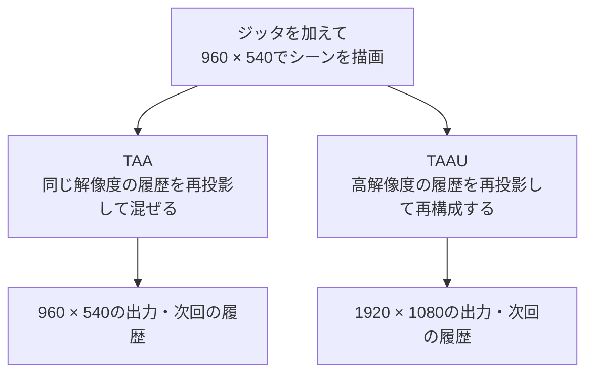
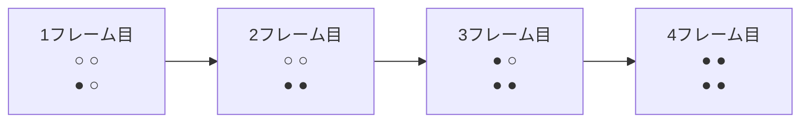
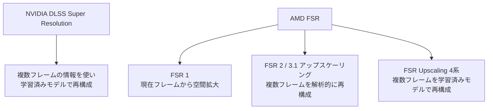

# アップスケーリング — DLSS / FSR / XeSS

## 概要

画面に1920×1080で表示するとき、シーン自体は1280×720で描くことができます。シーンを描く方を**内部解像度**、アップスケーラーが作る画像の方を**出力解像度**と呼びます。時間方向のアップスケーリングは、ジッタで毎フレーム少し違う位置を描き、そのサンプルと履歴を使って出力の細かな画素を組み立てます。

[ブラウザー実践](/practice/graphics/taau-observation.html)では、同じシーンを出力解像度で直接描く**ネイティブ描画**、低解像度の1枚を引き伸ばす**バイリニア拡大**、複数フレームで高解像度の格子を埋める**時間方向のアップスケーリング**を見比べられます。

<a href="/study/samples/graphics/taau-observation/index.html" target="_self">3方式の比較デモを開く</a>

## TAAからTAAUへ

[TAA](/graphics/postprocess/taa.html)は、描画と同じ解像度でジッタ付きの現在色と再投影した履歴を混ぜ、輪郭や細かな模様のちらつきを抑えます。**TAAU**（Temporal Anti-Aliasing Upsampling）は、その蓄積と拡大を同じ処理で行います。低解像度で描き、履歴を高解像度側の格子へ対応づけて再構成します。例えばTAAで960×540を描けば解決結果も960×540です。同じ入力からTAAUで1920×1080を作る場合は、出力1画素ごとに現在の入力と高解像度の履歴を組み合わせます。[Yang・Liu・Salviの論文 §5](https://behindthepixels.io/assets/files/TemporalAA.pdf) · [EpicのTAAU解説（Unreal Engine 5.8）](https://dev.epicgames.com/documentation/en-us/unreal-engine/screen-percentage-with-temporal-upscale-in-unreal-engine?application_version=5.8)



### 低解像度の1画素から出力の2×2画素を考える

縦横を2倍にする場合、低解像度の1画素の範囲に、高解像度の画素の中心が4点あります。バイリニア拡大は、現在の低解像度画像の周囲の色を、距離に応じて混ぜます。実践の時間方向モードでは、低解像度のサンプル位置を毎フレーム変えて、その4点を一つずつ直接描きます。取れた点は履歴に保持し、まだ取れていない点には一時的な補間色を入れます。



●は実際にサンプルした画素、○は取得前の画素です。静止シーンで4点を出力の中心に正確に合わせた実践では、4フレームでネイティブのサンプルがそろいます。一般のシーンでは、カメラや物体が動き、隠れていた面も見えるようになります。実用のアップスケーラーは再投影と履歴検証を行い、現在見える面と合う履歴を選びます。画面に現れたばかりの細い形状や、入力側で一度も取れなかった細部は、履歴があっても同じようには復元できません。[Yang・Liu・Salviの論文 §4–5](https://behindthepixels.io/assets/files/TemporalAA.pdf)

## 歴史・誕生した背景

- 2010年代: Unreal Engine 4のTAAUや、ゲーム機向けのチェッカーボードレンダリングが登場。[Epicの解説](https://dev.epicgames.com/documentation/en-us/unreal-engine/temporal-upscalers-in-unreal-engine?application_version=5.8) · [Yang・Liu・Salviの論文 §5](https://behindthepixels.io/assets/files/TemporalAA.pdf)
- **2018: DLSS 1.0** — ゲームごとにモデルを学習する方式。
- **2020: DLSS 2.0** — ゲームをまたいで使えるモデルと、時間方向の履歴を利用する方式に移行。[NVIDIAのDLSS 2.0発表](https://www.nvidia.com/en-us/geforce/news/nvidia-dlss-2-0-a-big-leap-in-ai-rendering/)
- 2021: **FSR 1.0** — 現在の画像でエッジを考慮して空間拡大し、シャープ化する。[AMDのFSR 1解説](https://gpuopen.com/fidelityfx-superresolution/)
- **2022: FSR 2.0** — 解析的な時間的再構成 (ML推論不要・幅広い対応GPU・オープンソース。APIとハードウェアの要件はある) / **XeSS** (Intel, DP4a版は他社GPUでも動作)
- 2022: UE5 **TSR** (エンジン内蔵の高品質アップスケーラ)
- **2022: DLSS 3 Frame Generation** — RTX 40シリーズ向けに提供開始
- **2023: DLSS 3.5 Ray Reconstruction** — RTデノイズのAI再構成
- **2024: FSR 3.1** — 時間方向のアップスケーリングとフレーム生成をAPIで分離。[AMDの移行ガイド](https://gpuopen.com/manuals/fidelityfx_sdk/getting-started/migrating-to-fsr-3-1/)
- 2024: PS5 Pro **PSSR**、Intel **XeSS 2** のフレーム生成
- **2025: DLSS 4** — TransformerモデルとRTX 50シリーズのMulti Frame Generation（最大4倍モード）。**FSR 4**はMLベースの再構成を導入（当初はRDNA 4向け）
- **2026: DLSS 4.5** — 第2世代TransformerのSuper Resolution。3月にRTX 50シリーズ向けの最大6倍・動的Multi Frame Generationを提供
- **2026: DLSS 5** — 3D-Guided Neural Renderingで、ゲームエンジンの情報をもとにライティングやマテリアルの見え方を処理する機能を追加。[NVIDIAのDLSS 5技術解説](https://developer.nvidia.com/blog/whats-new-for-game-developers-dlss-5-with-3d-guided-neural-rendering-nvidia-ace-updates-and-new-rtx-kit-capabilities/)
- **2026年6月: FSR SDK 2.3** — MLアップスケーリング4.1の対応を、従来のRX 9000シリーズからRX 7000シリーズにも拡大
- **2026年10月: FSR SDK 2.4** — MLアップスケーリング4.1.2をRX 6000シリーズと一部Ryzen APUにも拡大。アップスケーリングとフレーム生成はVulkanにも対応

## 描画負荷と再構成のコスト

内部解像度を縦横で半分にすると、内部画像の画素数は4分の1になります。画素単位のシェーディングなどは負荷を下げられる一方、ジオメトリ処理やCPUの仕事は解像度と同じ割合で減りません。再構成のパスと履歴の読み書きにもコストがあり、再構成後に走る処理は高い解像度で実行する場合があります。フレーム時間の効果は、シーンとGPUごとに計測します。[EpicのTAAUとポストプロセスの説明（Unreal Engine 5.8）](https://dev.epicgames.com/documentation/en-us/unreal-engine/screen-percentage-with-temporal-upscale-in-unreal-engine?application_version=5.8) · [GPU最適化の基礎](/graphics/optimization/basics.html)

## 内部動作

### 共通の入力と構造

時間方向の方式では、ジッタ付きの低解像度カラーと、過去の位置を推定する情報を渡します。実際に必要な入力、符号、単位、リソースの解像度はSDKごとに確認します。[NVIDIAのStreamlineガイド](https://github.com/NVIDIA-RTX/Streamline/blob/main/docs/ProgrammingGuideDLSS.md) · [AMDのFSR 2技術資料](https://gpuopen.com/manuals/fidelityfx_sdk/techniques/super-resolution-temporal/)

| 入力 | 用途 |
|---|---|
| 低解像度カラー (ジッタ付き) | 再構成のソース |
| モーションベクタ | 過去フレームの再投影 |
| 深度 | ディスオクルージョン検出 |
| ジッタ値 | サブピクセル位置の復元 |
| 露出 | フレーム間で色の明るさの扱いをそろえる。受け取り方は実装による |
| リアクティブマスクなど | 対応する方式では、半透明など履歴を強く使いにくい画素を知らせる |

### DLSSとFSRは世代と機能名を分けて見る

**DLSS Super Resolution**は、低解像度の色、動き、過去フレームの情報を使う学習済みモデルで、高解像度の画像を出力します。DLSS 4.5のSuper Resolutionでは第2世代Transformerモデルが導入されました。[NVIDIAのDLSS開発者向け資料](https://developer.nvidia.com/rtx/dlss) · [DLSS 4.5の技術解説](https://developer.nvidia.com/blog/nvidia-dlss-4-5-delivers-super-resolution-upgrades-and-new-dynamic-multi-frame-generation)

**FSR**は世代によって処理が異なります。FSR 1は現在の1枚を空間的に拡大します。FSR 2とFSR 3.1のアップスケーリングは、シェーダーでフレーム間のサンプルを再構成する解析的な手法です。旧称FSR 4の**AMD FSR Upscaling**は、時間方向の再構成に学習済みモデルを使います。[AMDのFSR 1解説](https://gpuopen.com/fidelityfx-superresolution/) · [FSR 3.1の公式資料](https://gpuopen.com/fidelityfx-super-resolution-3/) · [FSR Upscalingの公式資料](https://gpuopen.com/amd-fsr-upscaling/)



| | DLSS Super Resolution | FSR 2 / 3.1の再構成 | FSR Upscaling 4系 | XeSS Super Resolution |
|---|---|---|---|---|
| 方式 | ニューラルネット（新世代はTransformer） | MLを使わない解析的手法 | MLモデル | ニューラルネット |
| 対応GPU | GeForce RTX。FG/MFGの対応世代とは別に確認 | AMD以外も含む、各版の要件を満たすGPU | 4.1.2ではRX 6000/7000/9000と一部APU。SDK・ドライバ要件あり | XMX経路 / 他社GPU等のDP4a経路。版ごとの要件あり |
| 実装を調べる資料 | NVIDIAのSDKと統合ガイド | FSR 2と旧SDKの3.1に公開ソースあり | AMDのSDKと統合ガイド。SDK 2.4は署名済みバイナリを利用 | IntelのSDKと統合ガイド |
| 学習の観点 | 時間的入力と学習モデルの統合 | 再構成のソース実装を追える | ML再構成と対応ハードの関係 | 実行バックエンドの切り替え |

GPUの対応は、Super Resolution、フレーム生成、レイトレーシングの再構成で個別に確認します。AMD FSR SDK 2.4で配布されるFSR Upscaling 4.1.2は、対応するRadeon RX 6000・7000・9000シリーズや一部のRyzen APUが対象です。SDKには、対象外の環境向けの解析的なFSR 3.1.6も含まれます。[AMD FSR SDK 2.4の要件](https://gpuopen.com/amd-fsr-sdk/) · [Intel XeSS SDK](https://github.com/intel/xess)

DLSSの**Ray Reconstruction**は、レイトレーシングの少ないサンプルから反射や照明などを再構成する機能です。Super Resolutionの出力解像度の設定とあわせて、どの機能を有効にしたかを確認します。[NVIDIAのDLSS機能一覧](https://developer.nvidia.com/rtx/dlss)

### Frame Generation (フレーム生成)

描画したフレームやモーションベクタなどから中間画像を**生成**し、表示の滑らかさを高める機能です。DLSS 3やFSR 3の1枚生成は2倍モード、RTX 50シリーズのDLSS 4のMFGは最大3枚生成する4倍モード、DLSS 4.5は最大5枚生成する6倍モードと動的な倍率選択を提供します。この倍率が数えるのは表示枚数です。基礎フレームレート、生成・提示のコスト、入力から表示までの時間は実測します。[NVIDIAの6X提供開始時の資料](https://www.nvidia.com/en-us/geforce/news/dlss-4-5-dynamic-multi-frame-generation-6x-mode-released/) · [AMDのFSR 3資料](https://gpuopen.com/fidelityfx-super-resolution-3/)

[フレーム生成の記事](/graphics/postprocess/frame-generation.html)で、2枚から中間画像を作る処理を図解しています。[オン・オフの比較実践](/practice/graphics/frame-generation-observation.html)では、表示する位置と入力が反映されるタイミングを比べられます。

## 各環境での扱い

### Unity
Unity 6.3の標準機能ではDLSS 4 Super ResolutionとFSR 2はHDRPで使えます。STP (Spatial-Temporal Post-processing) はURPとHDRPの両方にあります。プラットフォームや動的解像度の制限は各機能の要件を確認します。[Unity 6.3の方式一覧](https://docs.unity.com/en-us/engine/6000.3/manual/cameras/resolution-scale/introduction)

### Unreal Engine
Unreal Engine 5.8にはTSRがあり、DLSS Super Resolution・FSR・XeSSなどは対応するプラグインで追加できます。Epicは時間方向のアップスケーラーを被写界深度とモーションブラーの間に置き、画面比率で内部解像度を制御すると説明しています。[Epicの時間方向アップスケーラー解説（Unreal Engine 5.8）](https://dev.epicgames.com/documentation/en-us/unreal-engine/temporal-upscalers-in-unreal-engine?application_version=5.8)

### DirectX 12
各SDKから、描画した色や深度、モーションベクトルなどのリソースを渡します。Microsoftの**DirectSR**の2024年プレビューでは、FSR 2.2の組み込み実装と、ドライバー経由のDLSS Super Resolution・XeSSが同じAPIで利用できました。[MicrosoftのDirectSRプレビュー資料](https://devblogs.microsoft.com/directx/directsr-preview/)

### Vulkan
APIの対応は機能とSDKの版ごとに確認します。例えばAMD FSR SDK 2.4は、Vulkan向けのアップスケーリングとフレーム生成を提供します。[AMD FSR SDK 2.4の要件](https://gpuopen.com/amd-fsr-sdk/)

## コード例

旧スタンドアロンFSR 2のC++統合の抜粋です。初期化済みのコンテキスト、レンダラーのリソース、バックエンドのコマンドリストを使います。コンテキストの作成・破棄、リソースの状態遷移、エラー処理を含む全体は、[AMDの公式サンプル](https://github.com/GPUOpen-Effects/FidelityFX-FSR2/blob/master/src/DX12/UpscaleContext_FSR2_API.cpp)を参照してください。

```cpp
// コンテキスト作成時に maxRenderSize と displaySize を設定済み
float jx, jy;
ffxFsr2GetJitterOffset(&jx, &jy, frameIndex,
    ffxFsr2GetJitterPhaseCount(renderWidth, displayWidth));
// jx, jy は入力画素単位。レンダラーの座標系に合わせて射影に適用

// レンダリング後: ディスパッチ
FfxFsr2DispatchDescription d = {};
d.commandList  = fsrCommandList;
d.color        = GetResource(sceneColorLowRes);
d.depth        = GetResource(depthBuffer);
d.motionVectors = GetResource(motionVectors);
d.motionVectorScale = { motionScaleX, motionScaleY };
d.output       = GetResource(upscaledColor);
d.jitterOffset = { jx, jy };
d.renderSize   = { renderWidth, renderHeight };
d.preExposure  = scenePreExposure;  // 事前露出を使わない場合は1
d.frameTimeDelta = deltaMs;
d.reset = cameraCut;
d.cameraNear = zNear;
d.cameraFar = zFar;
d.cameraFovAngleVertical = fovY;    // ラジアン
ffxFsr2ContextDispatch(&context, &d);
```

## 前提知識

- [TAA](/graphics/postprocess/taa.html)で、ジッタ、再投影、履歴検証の流れを確認する。
- [ポストプロセスパイプライン](/graphics/postprocess/overview.html) — 挿入位置

## 次に読むべきページ

- [パストレーシング](/graphics/lighting/path-tracing.html) — アップスケーラが可能にした世界
- [GPU最適化の基礎](/graphics/optimization/basics.html)
- [3DCG・描画ロードマップの「ポストプロセスとAA」](/learn/roadmap.html?node=gfx-postprocess#graphics)

## 関連項目

- [ニューラルレンダリング](/graphics/path/neural-rendering.html)

## 理解度チェック

1. **低解像度の同じシーンを4フレーム描くとき、サンプル位置を固定する場合とずらす場合で何が変わりますか。**
   ::: details 解答
   位置を固定すると同じ点を繰り返し読みます。少しずつずらすと、1フレームでは描かなかった位置の色を、別のフレームのサンプルから得られます。実践では4フレームで静止シーンの2×2の出力画素がそろいます。
   :::

2. **DLSS Super Resolution、FSR 1、FSR 3.1、FSR Upscaling 4系のうち、時間方向に学習済みモデルを使うのはどれですか。**
   ::: details 解答
   DLSS Super ResolutionとFSR Upscaling 4系です。FSR 3.1のアップスケーリングはフレーム間の情報を解析的に処理し、FSR 1は現在の1枚から拡大します。
   :::

3. **アップスケーリングとフレーム生成では、何を増やしますか。**
   ::: details 解答
   アップスケーリングは1枚の画像の画素数を増やします。フレーム生成は描画したフレームの間に表示用の画像を作り、表示枚数を増やします。入力から表示までの時間は別に計測します。
   :::

## 参考資料

- [Lei Yang, Shiqiu Liu, Marco Salvi — A Survey of Temporal Antialiasing Techniques](https://diglib.eg.org/items/cfa6a05c-53b3-4ee1-979d-48abc6225f6b)
- [Epic — Screen Percentage with Temporal Upscale（Unreal Engine 5.8）](https://dev.epicgames.com/documentation/en-us/unreal-engine/screen-percentage-with-temporal-upscale-in-unreal-engine?application_version=5.8)
- [NVIDIA — DLSS Programming Guide](https://github.com/NVIDIA-RTX/Streamline/blob/main/docs/ProgrammingGuideDLSS.md)
- [AMD — FidelityFX FSR 2のサンプル実装](https://github.com/GPUOpen-Effects/FidelityFX-FSR2)
- [Intel — XeSS SDK](https://github.com/intel/xess)
- [NVIDIA: DLSS 3発表（2022年）](https://www.nvidia.com/en-us/geforce/news/dlss3-ai-powered-neural-graphics-innovations/)
- [NVIDIA: DLSS 4.5の6X・動的MFG提供開始](https://www.nvidia.com/en-us/geforce/news/dlss-4-5-dynamic-multi-frame-generation-6x-mode-released/)
- [AMD: FSR SDK 2.3でのRDNA 3対応](https://gpuopen.com/learn/amd-fsr-sdk-2-3-blog/)
- [AMD: FSR SDK 2.4の対応GPU拡大とVulkan対応](https://gpuopen.com/learn/amd-fsr-sdk-2-4-rx-6000-ryzen-apus/)
- [AMD: FSR Upscaling 4の要件](https://gpuopen.com/manuals/fsr_sdk/techniques/super-resolution-ml/)
