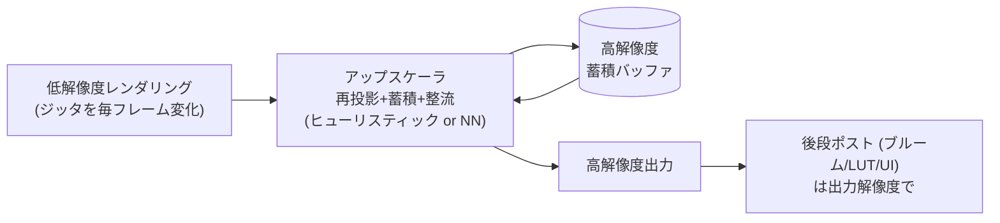

# アップスケーリング — DLSS / FSR / XeSS

## 概要

時間的アップスケーラは、**低解像度でレンダリングしたフレームを、ジッタ+モーションベクタ+過去フレームの蓄積から高解像度に再構成する**技術です。[TAA](/graphics/postprocess/taa.html) の直系進化であり、**「4Kをネイティブで描くのではなく、1080p〜1440pで描いて賢く拡大する」**ことでレイトレーシング世代のGPUコストを賄う、現代リアルタイムグラフィックスの中心的インフラです。三大実装が **DLSS** (NVIDIA, AI)、**FSR** (AMD, オープン)、**XeSS** (Intel, AI) です。

## なぜ必要なのか

- 4K・120fps・レイトレーシングという要求の掛け算はネイティブ描画では物理的に不可能
- シェーディングコストは解像度に比例 — 内部解像度を半分 (面積1/4) にすればGPU時間は劇的に下がる
- TAAで既に「時間的に情報を蓄積する」基盤があった → 「ならば出力解像度を入力より上げられるはず」という自然な発展

## 歴史・誕生した背景

- 2014-18: TAAU (TAA Upsampling)、チェッカーボードレンダリング (PS4 Pro世代) — 手作り再構成の時代
- **2018: DLSS 1.0** — ゲームごとの学習が必要で品質も不評 (失敗からのスタート)
- **2020: DLSS 2.0** — 汎用の時間的AI再構成に転換して大成功。Tensorコアで汎用モデルを実行
- 2021: **FSR 1.0** (空間的のみ、Lanczos+シャープ) — 過渡期の産物
- **2022: FSR 2.0** — ハンドチューニングの時間的再構成 (AI不要・全GPU対応・オープンソース) / **XeSS** (Intel, DP4a版は他社GPUでも動作)
- 2022: UE5 **TSR** (エンジン内蔵の高品質アップスケーラ)
- 2023: **DLSS 3 Frame Generation** (フレーム補間) / **3.5 Ray Reconstruction** (RTデノイズ統合)
- 2024-25: FSR 4がAIモデル化 (RDNA4)、PS5 Pro **PSSR** — 全社AI路線へ収斂

## それ以前の技術

バイリニア/バイキュービック拡大 (ぼけるだけ)、動的解像度スケーリング+単純拡大、チェッカーボード。いずれも「失われた情報を推定する」能力を欠いていました。

## 解決した課題

1. 品質をほぼ保ったまま (場合によりTAAより改善して) GPU時間を30〜50%削減
2. レイトレーシング・パストレーシングの実用化 (性能予算の捻出)
3. TAAのぼけ・ゴースト問題のAIによる改善 (DLSS系)

## 現在の位置づけ

AAA PCタイトルでは事実上の標準装備 (3種+ネイティブTAAの選択肢を提供するのが普通)。エンジンはUnity/UEともプラグインとして統合済み。「アップスケーラを前提にフレーム予算を組む」のが現代の設計です。

## 内部動作

### 共通の入力と構造

3実装とも要求する入力はほぼ同じです — つまり**TAAと同じ統合作業**です:

| 入力 | 用途 |
|---|---|
| 低解像度カラー (ジッタ付き) | 再構成のソース |
| モーションベクタ | 過去フレームの再投影 |
| 深度 | ディスオクルージョン検出 |
| ジッタ値 | サブピクセル位置の復元 |
| (露出、リアクティブマスク等) | 半透明・パーティクルの特別扱い |



原理: ジッタにより**毎フレーム異なるサブピクセル位置のサンプル**が得られるため、静止領域ではNフレームで実質N倍のサンプル密度=真のスーパーサンプリングに収束します。動く領域では再投影の妥当性判定 (深度・色域・信頼度) が品質の分かれ目で、ここが各社の腕の見せ所です。

### 三者の比較

| | DLSS 2+ | FSR 2/3 | XeSS |
|---|---|---|---|
| 方式 | ニューラルネット (Tensorコア) | ハンドチューニングのヒューリスティック | ニューラルネット (XMX / DP4a) |
| 対応GPU | RTX専用 | **全GPU** (コンソール含む) | Arc最良 / 他GPUはDP4a版 |
| ソース | 非公開 | **オープンソース (MIT)** | 部分公開 |
| 傾向 | 再構成品質・安定性で最良評価 | 実装が読める教材価値・可搬性 | 中間 |
| 発展 | FG (フレーム生成) / Ray Reconstruction | FSR3 FG / FSR4でAI化 | XeSS 2 FG |

**FSR2のソースコードは「production品質の時間的再構成の完全な教科書」**であり、本Wikiの読者には精読を勧めます。

### Frame Generation (フレーム生成)

DLSS 3 / FSR 3の追加機能。2フレーム間の中間フレームをオプティカルフロー+ゲーム側MVから**補間生成**し、表示フレームレートを倍増します。入力遅延は改善しない (むしろ増える) ため、Reflex等の遅延削減とセットで使う点が重要です。

## 各環境での扱い

### Unity
DLSS (HDRP標準統合、URPはUnity 6で対応拡大)、FSR2はパッケージ/アセット統合。`UpscalingFilter` としてSTP (Spatial-Temporal Post-processing、Unity内製アップスケーラ) もUnity 6で追加されました。

### Unreal Engine
**TSR** (内蔵、コンソール含む全対応) が既定。DLSS/FSR/XeSSは各社公式プラグインで追加し、`r.ScreenPercentage` と連動します。

### DirectX 12
各SDK (DLSS: NGX、FSR: FidelityFX SDK、XeSS SDK) をリンクし、リソースを渡してディスパッチ。**DirectSR** (2024) がこれらを統一APIで抽象化するMicrosoftの試みです。

### Vulkan
3実装ともVulkan対応。FSR2はシェーダソースがそのまま読めるため、Vulkan学習者の題材としても優れています。

## コード例

FSR2統合の骨格 (C++、FidelityFX SDK):

```cpp
// 初期化: 内部解像度と出力解像度を宣言
FfxFsr2ContextDescription desc = {};
desc.maxRenderSize = { renderWidth, renderHeight };   // 例: 1280x720
desc.displaySize   = { 3840, 2160 };                  // 4K出力
desc.flags = FFX_FSR2_ENABLE_HIGH_DYNAMIC_RANGE;
ffxFsr2ContextCreate(&context, &desc);

// 毎フレーム: ジッタをカメラに適用
float jx, jy;
ffxFsr2GetJitterOffset(&jx, &jy, frameIndex,
    ffxFsr2GetJitterPhaseCount(renderWidth, displayWidth));
camera.SetJitter(2.0f * jx / renderWidth, -2.0f * jy / renderHeight);

// レンダリング後: ディスパッチ
FfxFsr2DispatchDescription d = {};
d.color        = GetResource(sceneColorLowRes);
d.depth        = GetResource(depthBuffer);
d.motionVectors= GetResource(motionVectors);
d.output       = GetResource(upscaledColor);
d.jitterOffset = { jx, jy };
d.renderSize   = { renderWidth, renderHeight };
d.frameTimeDelta = deltaMs;
d.cameraNear = zNear; d.cameraFar = zFar; d.cameraFovAngleVertical = fovY;
ffxFsr2ContextDispatch(&context, &d);
// 以後のポスト(ブルーム/トーンマップ/UI)は4K側で実行
```

## 前提知識

- [TAA](/graphics/postprocess/taa.html) — 全ての土台。TAA統合ができればアップスケーラ統合は同じ作業
- [ポストプロセスパイプライン](/graphics/postprocess/overview.html) — 挿入位置

## 次に読むべきページ

- [パストレーシング](/graphics/lighting/path-tracing.html) — アップスケーラが可能にした世界
- [GPU最適化の基礎](/graphics/optimization/basics.html)

## 理解度チェック

1. **時間的アップスケーラが「無から情報を作っている」わけではない理由を説明せよ。**
   ::: details 解答
   ジッタにより毎フレーム異なるサブピクセル位置が実際にサンプリングされており、静止領域ではNフレーム分の蓄積が出力解像度以上の実サンプル密度に達する。アップスケーラの仕事は「存在する時間方向の実サンプルを、動きを補正しながら空間的に正しく再配置する」ことであり、原理的には超解像というよりも分散されたスーパーサンプリングの再構成である(動的領域では推定の比重が上がる)。
   :::

2. **DLSS 2がDLSS 1の失敗から学んだ転換は何か。**
   ::: details 解答
   DLSS 1は「低解像度画像から高解像度画像への空間的超解像」をゲームごとに学習する方式で、学習コストが高く時間的安定性も欠いた。DLSS 2は問題を「TAA同様の時間的サンプル蓄積の整流」に再定義し、ジッタ・モーションベクタ・履歴という物理的に正しい入力を与えた汎用モデル1つに転換した。ドメイン知識(TAAの枠組み)とNNの分担を正しく引き直したことが成功の本質。
   :::

3. **Frame Generationがもたらす体験改善と、もたらさないものを区別せよ。**
   ::: details 解答
   改善: 表示フレームレート(滑らかさ・モーション明瞭度)。もたらさない: 入力への応答性 — 生成フレームは入力を反映しない補間であり、むしろ1フレーム分の遅延バッファが必要で遅延は増える。ゆえに低フレームレート(<60fps)を底上げする用途では操作感の悪さが露呈しやすく、Reflex等の遅延対策と高い基礎fpsが前提となる。
   :::

## 参考資料

- AMD, *FidelityFX Super Resolution 2* — GPUOpenのソースと解説 (必読)
- NVIDIA, *DLSS Programming Guide* / GTC講演各年
- Intel, *XeSS* SDK ドキュメント
- Epic, *Temporal Super Resolution* ドキュメント
- Alex Battaglia (Digital Foundry) の各種アップスケーラ比較検証
