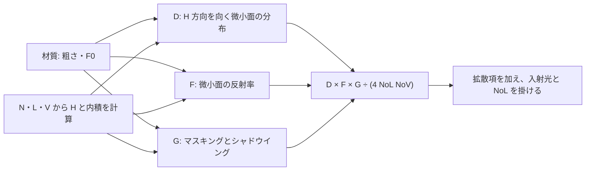

# BRDF の中身 — Lambert・Blinn–Phong・GGX

BRDF は、ある方向から届いた光が、別の方向へどれだけ反射されるかを表す関数。照明計算では光と視線の方向をそろえ、BRDF に入射角の余弦と入射光の重みを掛ける。ここでは一つの方向光を考え、材質の入力と光の当て方は [PBR の解説](/graphics/lighting/pbr.html) につなぐ。

## Lambert と Blinn–Phong

法線を `N`、面から光へ向かう単位ベクトルを `L`、面から視点へ向かう単位ベクトルを `V` とする。`NoL = max(dot(N,L), 0)`。`NoV`、`NoH` も同様に定義し、`H = normalize(L+V)` は光と視線の中間方向。

| モデル | 式の例 | 見え方 |
| --- | --- | --- |
| Lambert | `fDiffuse = rho / π` | BRDF 自体は方向によらない。光への傾きによる明暗は、後で掛ける `NoL` で決まる。 |
| Blinn–Phong の鏡面ローブ | `pow(NoH, shininess)` | `shininess` が大きいほどハイライトが狭くなる。ここに示す単純なローブは正規化を含まず、PBR の粗さとも直接対応しない。 |

Lambert の `1 / π` は、半球上で入射方向に関する余弦の積分が π になることから求まる。たとえば反射率 `rho=0.5` なら、方向に配分される反射を余弦付きで積分した結果も 0.5 になる。

### Blinn–Phong ローブの正規化

鏡面ローブを BRDF として扱う場合、実時間レンダラーで用いられる近似に $f_s=\rho_s\,(n+8)/(8\pi)\,(N\cdot H)^n$ がある。$n$ は指数、$\rho_s$ は鏡面の係数。方向を固定せずハーフベクトルを使うため、係数の意味を確認するには余弦付きの半球積分が必要になる。例えば法線方向から観察する場合、光の天頂角を $\theta$ とすると $N\cdot H=\cos(\theta/2)$。$t=\cos(\theta/2)$ と置くと、係数を掛ける前の積分は

$$
2\pi\int_0^{\pi/2}\cos^n(\theta/2)\cos\theta\sin\theta\,d\theta
=8\pi\int_{1/\sqrt{2}}^1 t^{n+1}(2t^2-1)\,dt
=\frac{8\pi(n+2^{-n/2})}{(n+2)(n+4)}
$$

となる。この向きで厳密に正規化する係数はこの逆数。例えば $n=16$ では約 0.895、近似係数は約 0.955 なので、近似のローブを積分すると $\rho_s$ の約 1.067 倍になる。$(n+8)/(8\pi)$ は近似であり、拡散との和も含めて任意の角度でエネルギー保存を保証する係数ではない。マイクロファセットの法線分布 $D$ に使う Blinn の正規化係数 $(n+2)/(2\pi)$ は、微小面の投影面積を積分する別の式。 [OgreNext — PbsBrdf](https://ogrecave.github.io/ogre-next/api/2.2/namespace_ogre_1_1_pbs_brdf.html)・[Hoffman — Physics and Math of Shading, §7](https://blog.selfshadow.com/publications/s2012-shading-course/hoffman/s2012_pbs_physics_math_notes.pdf)

## GGX の鏡面項

単一散乱のマイクロファセットモデルでは、面をさまざまな向きの微小面の集まりとして扱う。`H` を向く微小面の分布 `D`、微小面での反射率 `F`、光や視線が他の微小面に遮られる割合を補正する幾何項 `G` を使う。



以下の式は等方性 GGX。入力の知覚的粗さを `r`、`alpha = r*r` とする。実装ではゼロ粗さの特異点を避けるために下限を設ける。

- `D = alpha² / (π * (NoH² * (alpha² - 1) + 1)²)`。`D` は単位立体角あたりの分布で、点で評価した値が 1 を超えることもある。
- `F = F0 + (1 - F0) * (1 - VoH)^5`。`VoH = max(dot(V,H), 0)`。Schlick 近似を使う。空気から屈折率 1.5 の誘電体へ垂直に入射すると、`F0 = ((1.5-1)/(1.5+1))² = 0.04`。
- `G = G1(NoL) * G1(NoV)`。この例では分離形の Smith 項を使う。`G1(x) = 2x / (x + sqrt(alpha² + (1-alpha²)x²))`。
- `fSpecular = D * F * G / (4 * NoL * NoV)`。`NoL` または `NoV` が 0 以下ならこの式を評価しない。

glTF 2.0 Appendix B も GGX、Schlick 近似、分離形の Smith 項を示している。`G / (4 * NoL * NoV)` をまとめた量は可視性項とも呼ばれる。

### 分離形 Smith と高さ相関 Smith

$G_1(x)=1/(1+\Lambda(x))$ と書き直すと、等方性 GGX では $\Lambda(x)=(\sqrt{1+\alpha^2(1-x^2)/x^2}-1)/2$（$x>0$）。分離形は $(1+\Lambda_L)(1+\Lambda_V)$ の逆数。高さ相関形は、微小面が高い位置にあるほど光側・視線側の両方で遮られにくいことを考慮し、$1/(1+\Lambda_L+\Lambda_V)$ となる。前者の分母にある積 $\Lambda_L\Lambda_V$ がなくなるので、ほかの項を固定すると高さ相関形の $G$ は分離形以上になる。 [Eric Heitz — Understanding the Masking-Shadowing Function in Microfacet-Based BRDFs, 式 (98)–(99)](https://jcgt.org/published/0003/02/03/)

例えば $\alpha=0.5$、$N\cdot L=0.2$、$N\cdot V=0.3$ なら、$\Lambda_L\approx0.823$、$\Lambda_V\approx0.439$。$G$ は分離形で約 0.381、高さ相関形で約 0.442 になる。法線方向の光と視線では両者とも $G=1$。glTF 2.0 の Appendix B.3.2 は分離形の実装例、B.3.6.1 は高さ相関形を精度の改善案として挙げている。[PBR の方向光サンプル](/graphics/lighting/pbr.html)の `V_SmithGGXCorrelated` は後者で、$G$ を $4(N\cdot L)(N\cdot V)$ で割った可視性を直接求める。

### 反射エネルギーの扱い

サンプルでは誘電体の拡散色に `(1-Fdielectric) * (1-metallic)` を掛ける。`Fdielectric` は `F0=0.04` のフレネル反射率。金属度 1 ではこのモデルの拡散項が 0 になる。この配分は、表面で反射した光を拡散側でも数えないようにする近似。単一散乱 GGX は微小面同士の多重散乱を計算しないため、粗い鏡面ではその分の反射が失われる。

`N=L=V`、`r=0.5`、金属度 0、ベース色 0.5 の無彩色で検算する。`alpha=0.25`、`D=16/π`、`F=0.04`、`G=1`。鏡面項は `0.16/π ≈ 0.05093`、拡散項は `0.48/π ≈ 0.15279` で、単位入射の結果は `0.64/π ≈ 0.20372`。

### 多重散乱の補償

フレネル反射率を全角度で 1 として白い環境で試すと、吸収のない鏡面は、反射の回数に関係なく入射エネルギーを返すはず。Kulla と Conty は、単一散乱の方向半球反射率を $E(\mu_o)$、余弦で重み付けした全方向の平均を $E_{\mathrm{avg}}=2\int_0^1 E(\mu)\mu\,d\mu$ と置き、足りない反射を次のローブで補う。$\mu_i=N\cdot L$、$\mu_o=N\cdot V$。

$$
f_{\mathrm{ms}}(\mu_o,\mu_i)
=\frac{(1-E(\mu_o))(1-E(\mu_i))}{\pi(1-E_{\mathrm{avg}})}
$$

入射半球で余弦を掛けて積分すると、$\mu_i$ に依存する部分が $\pi(1-E_{\mathrm{avg}})$ になり、単一散乱で不足した $1-E(\mu_o)$ を補う。$E$ は余弦と粗さで引く LUT にできる。例えばある方向で $E=0.72$ なら、このローブを積分した反射率は $0.28$。この式は反射率 1 の場合で、実際の材質では多重反射中のフレネルによる損失も含めて調整する。$E_{\mathrm{avg}}=1$ なら補う量はゼロなので除算を行わない。 [Kulla・Conty — Revisiting Physically Based Shading at Imageworks（2017）](https://blog.selfshadow.com/publications/s2017-shading-course/imageworks/s2017_pbs_imageworks_slides_v2.pdf)

## コード例 — 方向光を一つ評価する

HLSL の `ps_6_0`。`model=0` は Lambert、`1` は Lambert に Blinn–Phong の鏡面ローブを足した比較用のモデル、`2` は分離形 Smith GGX、`3` は高さ相関 Smith GGX、`4` は近似正規化した Blinn–Phong の鏡面ローブを足した比較用のモデル。`lightDirection`、`viewDirection`、入力法線は同じ座標空間で有効な長さを持つ。`baseColor` と `incidentLight` は線形値。返り値はシーンの線形光量なので、必要に応じて後段で [露出とトーンマッピング](/graphics/shader/color-space-and-hdr.html) を行う。

```hlsl
static const float PI = 3.14159265358979323846;

cbuffer Material : register(b0)
{
    float3 baseColor;
    float metallic;
    float3 incidentLight;
    float roughness;
    float3 lightDirection;
    uint model;
    float3 viewDirection;
    float shininess;
};

float smithG1(float cosine, float alphaSquared)
{
    float root = sqrt(alphaSquared + (1.0 - alphaSquared) * cosine * cosine);
    return (2.0 * cosine) / (cosine + root);
}

float smithHeightCorrelatedVisibility(float noL, float noV, float alphaSquared)
{
    float rootL = sqrt(alphaSquared + (1.0 - alphaSquared) * noL * noL);
    float rootV = sqrt(alphaSquared + (1.0 - alphaSquared) * noV * noV);
    return 0.5 / (noV * rootL + noL * rootV);
}

float4 main(float3 normalWorld : TEXCOORD0) : SV_Target
{
    float3 n = normalize(normalWorld);
    float3 l = normalize(lightDirection);
    float3 v = normalize(viewDirection);
    float noL = saturate(dot(n, l));
    float noV = saturate(dot(n, v));
    if (noL <= 1e-5 || noV <= 1e-5)
    {
        return float4(0.0, 0.0, 0.0, 1.0);
    }

    float3 lambert = baseColor / PI;
    if (model == 0)
    {
        return float4(lambert * incidentLight * noL, 1.0);
    }

    float3 h = normalize(l + v);
    float noH = saturate(dot(n, h));
    if (model == 1 || model == 4)
    {
        float power = max(1.0, shininess);
        float scale = model == 4 ? (power + 8.0) / (8.0 * PI) : 1.0;
        float blinnPhong = 0.25 * scale * pow(noH, power);
        return float4((lambert + blinnPhong) * incidentLight * noL, 1.0);
    }

    float voH = saturate(dot(v, h));
    float r = clamp(roughness, 0.045, 1.0);
    float alpha = r * r;
    float alphaSquared = alpha * alpha;

    float distributionTerm = (1.0 - noH * noH) + alphaSquared * noH * noH;
    float distribution = alphaSquared / (PI * distributionTerm * distributionTerm);
    float metal = saturate(metallic);
    float3 f0 = lerp(float3(0.04, 0.04, 0.04), baseColor, metal);
    float schlickWeight = pow(1.0 - voH, 5.0);
    float3 fresnel = f0 + (1.0 - f0) * schlickWeight;
    float dielectricFresnel = 0.04 + 0.96 * schlickWeight;
    float visibility = model == 3
        ? smithHeightCorrelatedVisibility(noL, noV, alphaSquared)
        : smithG1(noL, alphaSquared) * smithG1(noV, alphaSquared) / (4.0 * noL * noV);
    float3 specular = distribution * fresnel * visibility;
    float3 diffuse = (1.0 - dielectricFresnel) * (1.0 - metal) * lambert;

    return float4((diffuse + specular) * incidentLight * noL, 1.0);
}
```

## 理解度チェック

<details><summary>Lambert の BRDF が方向によらないのに、斜めから照らすと暗くなるのはなぜ？</summary>

反射光を求めるとき、BRDF に `NoL` を掛ける。同じ方向光でも、斜めの面が単位面積あたりに受ける光は減る。

</details>

<details><summary>GGX の D が 1 を超えた。反射率が 100% を超えたと言える？</summary>

`D` は微小面法線の分布で、その方向の反射率は `F`。エネルギーは `D` 一点の値で判断せず、幾何項と余弦を含む反射を方向について積分して調べる。

</details>

<details><summary>F0 が 0.04 の材質で、微小面をかすめる方向から見ると Schlick 近似はどう変わる？</summary>

`VoH` が 0 に近づくほど `(1-VoH)^5` が 1 に近づき、反射率は 1 に近づく。

</details>

<details><summary>分離形 Smith と高さ相関 Smith の結果が法線方向から見る場合に近づくのはなぜ？</summary>

視線が法線方向なら `NoV = 1` で $\Lambda_V=0$ になる。二つの分母の違いに当たる $\Lambda_L\Lambda_V$ が消えるので、このときは一致する。

</details>

## 関連項目

- [WebGPU実践でパラメーターを変える](/practice/graphics/shader-lab.html#brdf)
- [PBR — 物理ベースレンダリング](/graphics/lighting/pbr.html)
- [法線マップと接空間 — TBN・MikkTSpace・チャンネル規約](/graphics/shader/normal-mapping.html)
- [色空間と HDR — リニア光量からディスプレイ出力まで](/graphics/shader/color-space-and-hdr.html)

## 参考資料

- [James F. Blinn — Models of Light Reflection for Computer Synthesized Pictures（SIGGRAPH 1977）](https://www.microsoft.com/en-us/research/publication/models-of-light-reflection-for-computer-synthesized-pictures/)
- [Bruce Walter ほか — Microfacet Models for Refraction through Rough Surfaces（EGSR 2007）](https://www.cs.cornell.edu/~srm/publications/EGSR07-btdf.pdf)
- [Khronos glTF 2.0 Specification — Appendix B. BRDF Implementation](https://registry.khronos.org/glTF/specs/2.0/glTF-2.0.html#appendix-b-brdf-implementation)

- [OgreNext — PbsBrdf と近似正規化 Blinn–Phong](https://ogrecave.github.io/ogre-next/api/2.2/namespace_ogre_1_1_pbs_brdf.html)
- [Naty Hoffman — Physics and Math of Shading（2012）](https://blog.selfshadow.com/publications/s2012-shading-course/hoffman/s2012_pbs_physics_math_notes.pdf)
- [Eric Heitz — Understanding the Masking-Shadowing Function in Microfacet-Based BRDFs（2014）](https://jcgt.org/published/0003/02/03/)
- [Christopher Kulla・Alejandro Conty — Revisiting Physically Based Shading at Imageworks（2017）](https://blog.selfshadow.com/publications/s2017-shading-course/imageworks/s2017_pbs_imageworks_slides_v2.pdf)
