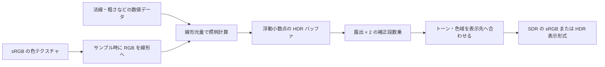

# 色空間と HDR — リニア光量からディスプレイ出力まで

0 と 1 の中間値でも、その数字が光の量か、sRGB に符号化した色かで意味が変わる。照明の加算や色の平均には光の量に比例する値を使い、画面へ出す段階で表示先に合わせた変換を行う。

## リニアと sRGB

sRGB の色を `s`、同じ RGB 原色での線形値を `l` とすると、`[0,1]` の各チャンネルには次の変換を使う。sRGB の変換は区分的な関数で、全域を一つの指数で表す近似とは暗部で差が出る。

| 変換 | 下側の範囲 | 上側の範囲 |
| --- | --- | --- |
| sRGB → リニア | `s <= 0.04045` なら `s / 12.92` | `pow((s + 0.055) / 1.055, 2.4)` |
| リニア → sRGB | `l <= 0.0031308` なら `12.92 * l` | `1.055 * pow(l, 1 / 2.4) - 0.055` |

sRGB の 0.5 は線形で約 0.214041。黒と白を等分した線形値 0.5 を sRGB に戻すと約 0.735357 になる。黒白のテクセルからミップを作る処理でも、この差が現れる。粗さや法線マップのように各チャンネルが数値を持つテクスチャは、その規約に従い線形のデータとして読む。glTF 2.0 のベースカラーでは RGB は sRGB、アルファは線形で扱う。



## HDR バッファ、露出、トーンマッピング

シーンの線形 HDR バッファには、1 を超える光量も保持する。たとえば `R16G16B16A16_FLOAT` の作業用レンダーターゲットに 4 の値が入っても、照明や後処理の段階で 1 へ丸める必要はない。露出補正を `e` 段と定義して `exp2(e)` を掛けると、`+1` 段で 2 倍、`-1` 段で半分になる。ここでの `e` はシェーダーへの補正量。

| 処理 | 役割 |
| --- | --- |
| 露出補正 | トーンカーブに入る前に、シーン全体の光量を同じ倍率で変える。 |
| トーンマッピング | 表示先の明るさの範囲に向けて、暗部からハイライトまでを写す。 |
| 色域の変換・圧縮 | 原色の違いを扱い、表示できる範囲に色を収める。 |
| 出力の符号化 | SDR の sRGB や HDR10 の PQ など、受け手が解釈する形式に合わせる。 |

ACES 2.0 の Output Transform は、トーンと色域を扱うレンダリング変換と、表示機器向けの符号化を組み合わせる。エンジン内の短い「ACES 風」カーブだけを使った結果は、ACES 2.0 の Output Transform 全体を通した結果と異なる。Blender 4.5 LTS の AgX は別のビュー変換で、露出の高い色の彩度を下げながらハイライトを扱う。比較するときは、同じ入力・露出・表示先を使い、明るい色の彩度と色相も観察する。

シーン内部の HDR と、モニターへ HDR 信号を渡す設定は別々に選べる。Windows の DXGI Advanced Color では、FP16 の線形 scRGB のほか、条件を満たすアプリで RGB10 に HDR10/BT.2100 の色空間を明示して渡す方法がある。FP16 の中間バッファだけを使い、最後は SDR に変換する構成も一般的に使える。

## コード例 — 線形 HDR 画像を SDR に写す

HLSL の `ps_6_0`。入力は線形 sRGB 原色で、非負のシーン光量を想定する。カーブは確認用の `Y / (1 + Y)`。RGB 全体を `1 / (1 + Y)` 倍して相対的な色の比を保ち、範囲外の成分は最後にクリップする。この例は ACES や AgX の色域処理を実装していない。ニュートラルグレーの入力が 4、補正が −1 段なら、露出後に 2、線形 SDR は `2/3`、符号化後は約 0.8360。

```hlsl
Texture2D<float4> sceneHdr : register(t0);
SamplerState sceneSampler : register(s0);

cbuffer Display : register(b0)
{
    float exposureStops;
    uint encodeForUnorm; // 0 for an sRGB RTV, 1 for a plain UNORM RTV
};

float linearToSrgb(float value)
{
    return value <= 0.0031308
         ? 12.92 * value
         : 1.055 * pow(value, 1.0 / 2.4) - 0.055;
}

float4 main(float2 uv : TEXCOORD0) : SV_Target
{
    float3 sceneLinear = max(sceneHdr.Sample(sceneSampler, uv).rgb, 0.0);
    float3 exposed = sceneLinear * exp2(exposureStops);
    float luminance = dot(exposed, float3(0.2126, 0.7152, 0.0722));
    float3 displayLinear = saturate(exposed / (1.0 + luminance));
    if (encodeForUnorm != 0)
    {
        return float4(linearToSrgb(displayLinear.r),
                      linearToSrgb(displayLinear.g),
                      linearToSrgb(displayLinear.b), 1.0);
    }

    return float4(displayLinear, 1.0);
}
```

Direct3D 11/12 の sRGB ビューで出力を符号化する場合は、シェーダーから線形値を返す。通常の UNORM ビューを選んでシェーダーで符号化する場合は、以降の表示経路が sRGB として受け取ることを確認する。符号化を重ねると、中間調が意図した値より明るくなる。

## 理解度チェック

<details><summary>線形の灰色 0.5 と sRGB テクセルの値 0.5 では、どちらの光量が多い？</summary>

線形の 0.5。sRGB の 0.5 は同じ原色の線形値へ復号すると約 0.214041 になる。

</details>

<details><summary>HDR バッファの値を保持したまま SDR 画面へ出すには何をする？</summary>

シーンの線形 HDR のまま照明や必要な後処理を行い、露出とトーンマッピングを経て SDR の表示範囲へ写す。その後、表示先が受け取る色空間と転送関数に合わせる。

</details>

<details><summary>シェーダーが sRGB へ符号化した値を、sRGB の RTV へ書き込むと？</summary>

書き込み時にも sRGB へ変換されるため、二重に符号化されて中間調が明るくなる。

</details>

## 関連項目

- [WebGPU実践でパラメーターを変える](/practice/graphics/shader-lab.html#hdr)
- [テクスチャのフィルタリングとミップマップ](/graphics/texture/texture-filtering-and-mipmaps.html)
- [法線マップと接空間 — TBN・MikkTSpace・チャンネル規約](/graphics/shader/normal-mapping.html)
- [BRDF の中身 — Lambert・Blinn–Phong・GGX](/graphics/shader/brdf-internals.html)

## 参考資料

- [W3C CSS Color Module Level 4 — Sample code for color conversions](https://www.w3.org/TR/css-color-4/#color-conversion-code)
- [Khronos glTF 2.0 Specification — Materials](https://registry.khronos.org/glTF/specs/2.0/glTF-2.0.html#materials)
- [Microsoft — Converting data for the color space](https://learn.microsoft.com/en-us/windows/win32/direct3ddxgi/converting-data-color-space)
- [Microsoft — Using DirectX with Advanced Color](https://learn.microsoft.com/en-us/windows/win32/direct3darticles/high-dynamic-range)
- [ACES Documentation — ACES 2 Output Transform](https://docs.acescentral.com/system-components/output-transforms/technical-details/rendering-overview/)
- [Blender 4.5 LTS Manual — Color Management](https://docs.blender.org/manual/en/4.5/render/color_management.html)
