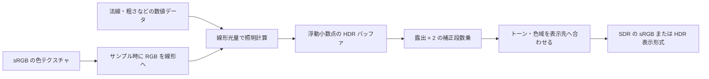
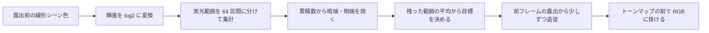

# 色空間と HDR — リニア光量からディスプレイ出力まで

0 と 1 の中間値でも、その数字が光の量か、sRGB に符号化した色かで意味が変わる。照明の加算や色の平均には光の量に比例する値を使い、画面へ出す段階で表示先に合わせた変換を行う。

## リニアと sRGB

sRGB の色を `s`、同じ RGB 原色での線形値を `l` とすると、`[0,1]` の各チャンネルには次の変換を使う。sRGB の変換は区分的な関数で、全域を一つの指数で表す近似とは暗部で差が出る。

| 変換 | 下側の範囲 | 上側の範囲 |
| --- | --- | --- |
| sRGB → リニア | `s <= 0.04045` なら `s / 12.92` | `pow((s + 0.055) / 1.055, 2.4)` |
| リニア → sRGB | `l <= 0.0031308` なら `12.92 * l` | `1.055 * pow(l, 1 / 2.4) - 0.055` |

sRGB の 0.5 は線形で約 0.214041。黒と白を等分した線形値 0.5 を sRGB に戻すと約 0.735357 になる。黒白のテクセルからミップを作る処理でも、この差が現れる。粗さや法線マップのように各チャンネルが数値を持つテクスチャは、その規約に従い線形のデータとして読む。glTF 2.0 のベースカラーでは RGB は sRGB、アルファは線形で扱う。



## HDR バッファ、露出、トーンマッピング

シーンの線形 HDR バッファには、1 を超える光量も保持する。たとえば `R16G16B16A16_FLOAT` の作業用レンダーターゲットに 4 の値が入っても、照明や後処理の段階で 1 へ丸める必要はない。露出補正を `e` 段と定義して `exp2(e)` を掛けると、`+1` 段で 2 倍、`-1` 段で半分になる。ここでの `e` はシェーダーへの補正量。

| 処理 | 役割 |
| --- | --- |
| 露出補正 | トーンカーブに入る前に、シーン全体の光量を同じ倍率で変える。 |
| トーンマッピング | 表示先の明るさの範囲に向けて、暗部からハイライトまでを写す。 |
| 色域の変換・圧縮 | 原色の違いを扱い、表示できる範囲に色を収める。 |
| 出力の符号化 | SDR の sRGB や HDR10 の PQ など、受け手が解釈する形式に合わせる。 |

ACES 2.0 の Output Transform は、トーンと色域を扱うレンダリング変換と、表示機器向けの符号化を組み合わせる。エンジン内の短い「ACES 風」カーブだけを使った結果は、ACES 2.0 の Output Transform 全体を通した結果と異なる。Blender 4.5 LTS の AgX は別のビュー変換で、露出の高い色の彩度を下げながらハイライトを扱う。比較するときは、同じ入力・露出・表示先を使い、明るい色の彩度と色相も観察する。

シーン内部の HDR と、モニターへ HDR 信号を渡す設定は別々に選べる。Windows の DXGI Advanced Color では、FP16 の線形 scRGB のほか、条件を満たすアプリで RGB10 に HDR10/BT.2100 の色空間を明示して渡す方法がある。FP16 の中間バッファだけを使い、最後は SDR に変換する構成も一般的に使える。

### ACES 2.0 のトーンスケール

ACES 2.0 の Rendering Transform は入力 RGB を JMh に変換する。J は明るさ、M は色みの強さ、h は色相を表す。このうち J から無彩色相当の線形値を取り出してトーンスケールに通し、変換後の輝度を J に戻す。その J と元の色み・色相を基にクロマ圧縮と色域圧縮を行う。最後に表示先の原色と符号化に合わせる。RGB の各成分に同じカーブを掛ける方式と比べ、カーブが効く場所と色の圧縮を決める場所が分かれている。 [ACES 2 Rendering Transform](https://docs.acescentral.com/system-components/output-transforms/technical-details/rendering-overview/)

非負の無彩色入力を `x`、出力輝度を `L`（cd/m²）とすると、CTL のトーンスケールは次の形になる。

```text
f = m × (x / (x + s))^g
L = 100 × f² / (f + t)
g = 1.15, t = 0.04
```

`m` と `s` は目標ピーク輝度に応じて決まる。100 cd/m² 向けなら約 `m = 1.047104`、`s = 0.919858`、1000 cd/m² 向けなら約 `m = 10.172911`、`s = 5.895927`。上式の前半は Michaelis–Menten 型で、入力が大きいほど `x / (x+s)` の増加が鈍る。後半は `f` が小さいとき約 `f²/t` に近づき、暗部に緩い立ち上がりを作る。入力を 0.18 と 2 に変えると、100 cd/m² の設定で約 10.000 と 63.988 cd/m²、1000 cd/m² の設定では約 14.512 と 205.783 cd/m² になる。ピークを変えるとハイライトと中間調への割り当ても変わる。 [ACES 2 Tone Mapping](https://docs.acescentral.com/system-components/output-transforms/technical-details/tone-mapping/)、[ACES 2.0 CTL — Tonescale](https://github.com/aces-aswf/aces-core/blob/main/lib/Lib.Academy.Tonescale.ctl)

### Blender 4.5 LTS の AgX

ここでは数値例とシェーダーで同じカーブを再現できるように、同じリリースに入っている OCIO 設定と LUT を組にし、Blender 4.5.0 に固定する。別の版で比較するときも、その版の設定と LUT を一緒に使う。

Blender 4.5.0 で Look を掛けず、sRGB 向けの AgX を使うと、線形の色は FilmLight E-Gamut に変換され、成分ごとに対数で 0〜1 の LUT 座標に写る。`AgX_Base_sRGB.cube` は一辺 57 点の 3D LUT。3 成分を一緒に参照し、格子セル内を四面体補間する。LUT の出力は 2.4 乗で線形 Rec.709 に戻し、最後に sRGB へ符号化する。途中の 2.4 乗は LUT の出力側の復号で、sRGB の区分的な伝達関数とは別の段階にある。 [Blender 4.5.0 — config.ocio](https://github.com/blender/blender/blob/v4.5.0/release/datafiles/colormanagement/config.ocio)、[AgX_Base_sRGB.cube](https://github.com/blender/blender/blob/v4.5.0/release/datafiles/colormanagement/luts/AgX_Base_sRGB.cube)

```text
e = 線形 FilmLight E-Gamut の RGB
u = saturate((log2(max(e, 2^-12.47393)) + 12.47393) / 25)
v = AgX_Base_sRGB.cube(u)             四面体補間
線形の表示 RGB = v^2.4
```

無彩色なら `u.r = u.g = u.b` なので、格子の対角線上にある 2 点の線形補間に帰着する。たとえば `e = (0.18, 0.18, 0.18)` は LUT の各軸で約 22.4 番目。赤成分は 22 番の約 0.46363 と 23 番の約 0.52807 を 0.4 の割合で補間して約 0.48941 となり、2.4 乗で約 0.1800、sRGB へ符号化すると約 0.4613 になる。色が付くと 3 軸の小数部が異なるため、セル内で小数部が大きい軸から頂点を足していく。

| 無彩色のシーン値 | ACES 2.0 の 100 cd/m² トーンスケール | AgX Base sRGB の LUT を 100 cd/m² 基準で換算 |
| ---: | ---: | ---: |
| 0.01 | 0.071 cd/m² | 0.627 cd/m² |
| 0.18 | 10.000 cd/m² | 17.998 cd/m² |
| 1 | 45.757 cd/m² | 55.578 cd/m² |
| 2 | 63.988 cd/m² | 69.533 cd/m² |
| 8 | 88.557 cd/m² | 91.479 cd/m² |
| 16 | 94.348 cd/m² | 99.668 cd/m² |

この比較は、対応する入力色空間で同じ無彩色値を入れ、露出補正を加えず、白を 100 cd/m² としたもの。AgX は LUT の赤成分を代表値にした。0.18 のパッチは AgX の方が明るく、8 と 16 のパッチでは AgX が先に表示白へ近づく。露出を補正して中間調の明るさを合わせると、カーブを読む基準点も動く。

有彩色では、ACES 2.0 は JMh で h を保ちながら色域に収め、AgX Base sRGB は 3D LUT に含まれる色ごとの処理で明るい色を白へ寄せる。比較画像には無彩色の階調に加えて、赤・黄・青の発光面を同じ露出で段階的に明るくしたパッチを入れるとよい。無彩色の表で見える差は明暗の配分で、有彩色のパッチからは白へ近づく速さと色相の動きを読める。

### コード例 — ACES の無彩色と AgX の LUT を確認する

HLSL の `ps_6_0`。`mode=0` は画面横方向に −8〜+6 段の無彩色ランプを作り、上半分を ACES 2.0 のトーンスケール、下半分を AgX で表示する。どちらも 100 cd/m² の白を 1 とした線形 RGB を返す。ACES 2.0 のトーンスケール単体は高い入力で目標ピークを超える値も返す。この例は SDR 表示用に、100 cd/m² で正規化した ACES 側の値を `saturate` で 0〜1 に制限する。`mode=1` は `sceneHdr` に入れた線形 Rec.709 のシーン色を AgX に通す。`b0` の行列は使用する OCIO 設定の「線形 Rec.709 → 線形 FilmLight E-Gamut」に合わせて渡す。公式の .cube の RGB データを浮動小数点の 3D テクスチャとして用意し、X 軸を R、Y 軸を G、Z 軸を B に対応させる。`Load` で格子点を取得し、四面体補間をシェーダーで行う。出力先には sRGB の RTV を使う。

```hlsl
Texture3D<float4> agxLut : register(t0);
Texture2D<float4> sceneHdr : register(t1);
SamplerState sceneSampler : register(s0);

cbuffer CurveSettings : register(b0)
{
    row_major float3x3 rec709ToEGamut;
    float exposureStops;
    uint mode;
};

float aces100(float x)
{
    float f = 1.04710376 * pow(x / (x + 0.91985825), 1.15);
    return saturate(f * f / (f + 0.04));
}

float3 loadAgx(int3 p)
{
    return agxLut.Load(int4(min(p, int3(56, 56, 56)), 0)).rgb;
}

void orderAxes(inout float x, inout float y, inout int3 a, inout int3 b)
{
    if (x < y)
    {
        float savedValue = x;
        x = y;
        y = savedValue;
        int3 savedAxis = a;
        a = b;
        b = savedAxis;
    }
}

float3 agxBaseSrgbLinear(float3 eGamut)
{
    const float low = -12.47393;
    float3 grid = 56.0 * saturate((log2(max(eGamut, exp2(low))) - low) / 25.0);
    int3 p = int3(floor(grid));
    float3 f = frac(grid);
    int3 a = int3(1, 0, 0);
    int3 b = int3(0, 1, 0);
    int3 c = int3(0, 0, 1);
    orderAxes(f.x, f.y, a, b);
    orderAxes(f.y, f.z, b, c);
    orderAxes(f.x, f.y, a, b);
    float3 encoded = (1.0 - f.x) * loadAgx(p)
                   + (f.x - f.y) * loadAgx(p + a)
                   + (f.y - f.z) * loadAgx(p + a + b)
                   + f.z * loadAgx(p + a + b + c);
    return pow(max(encoded, 0.0), 2.4);
}

float4 main(float2 uv : TEXCOORD0) : SV_Target
{
    float exposure = exp2(exposureStops);
    if (mode == 0)
    {
        float x = exposure * exp2(lerp(-8.0, 6.0, saturate(uv.x)));
        float3 displayColor = uv.y < 0.5 ? aces100(x).xxx : agxBaseSrgbLinear(x.xxx);
        return float4(displayColor, 1.0);
    }

    float3 sceneColor = exposure * sceneHdr.Sample(sceneSampler, uv).rgb;
    return float4(agxBaseSrgbLinear(mul(rec709ToEGamut, sceneColor)), 1.0);
}
```

四面体補間は、小数部を降順に並べた結果を `f.x >= f.y >= f.z` として重みを決める。4 つの重みは非負で、足すと 1 になる。`f.x=f.y=f.z` なら中間 2 頂点の重みが 0 になり、無彩色ランプでは対角線の両端だけが効く。`mode=0` の ACES 側は無彩色専用。有彩色の比較を行う ACES 側は、同じ入力を対応する色空間に変換し、公式の Output Transform まで通す。

### 自動露出 — 輝度ヒストグラムと EV100

自動露出の入力にはトーンマッピング前のシーン輝度を使う。線形 Rec.709 の RGB なら、輝度 `Y` は `dot(RGB, float3(0.2126, 0.7152, 0.0722))`。ピクセルごとに `log2(max(Y, epsilon))` を取り、一定範囲のヒストグラムへ加算する。対数で測ると、輝度 1→2 と 100→200 がどちらも 1 段になる。HDR バッファが前フレームの露出を含む場合、露出前の値へ戻してから集計する。戻さずに測ると、自分で掛けた倍率までシーンの明暗の変化として拾う。



たとえば暗い方から 10% と明るい方から 5% を除き、残りのビン中心を件数で加重平均する。端がビンの途中にあれば、そのビンの重みを一部だけ使う。これで明るい窓や暗い画面枠に全体の明るさが引っ張られにくくなる。`log2(Y)` の平均を `ell` とすると、`2^ell` は幾何平均の近似。中間調を線形値 0.18 に置く設計なら目標倍率は `0.18 / 2^ell`、その倍率を段で表すと `log2(0.18) - ell` になる。

100 ピクセルのうち、ビン中心 −4 段に 20 個、−1 段に 70 個、+5 段に 10 個あるとする。上下を除くと、各ビンに 10、70、5 個が残る。`ell = (−4×10 − 1×70 + 5×5)/85 = −1` なので測光値は `2^-1 = 0.5`、目標倍率は `0.18/0.5 = 0.36`（約 −1.474 段）。除外せずに平均を取った場合の `ell` は −1 で、この分布ではたまたま同じになる。たとえば最も明るい 10 個が +8 段に移ると、除外ありでは `ell ≈ −0.824`、除外なしでは −0.7 となる。明るい側のピクセルを除く割合を決めると、極端な値に対する応答も決まる。

EV100 は ISO 100 を基準にした露出値。絞り値 `N`、シャッター時間 `t`（秒）、ISO 感度 `S` を使う場合、`EV100 = log2((N²/t) × (100/S))`。F4、1/125 秒、ISO 100 なら `log2(2000) ≈ 10.966`。同じ絞りと感度でシャッター時間を半分にすると 1 EV 増え、取り込む光が半分になる。ここで使う露出補正の `+1` 段は、露出倍率を 2 倍にする定義。 [Unreal Engine 5.8 — Auto Exposure](https://dev.epicgames.com/documentation/unreal-engine/auto-exposure-in-unreal-engine?lang=ja)

反射光式の露出計では、測光したシーン輝度を `L`（cd/m²）、校正定数を `K` とすると、感度 `S` での読みは `EV = log2(L × S / K)`。ISO 100 なら `EV100 = log2(L × 100 / K)` で、逆に `L = (K / 100) × 2^EV100` となる。Filament v1.80.0 が採る `K = 12.5` では、先ほどの EV100 に対応する測光値は `L = 0.125 × 2000 = 250 cd/m²`。ヒストグラムからこの式を使う場合は、露出前のバッファ値を cd/m² に校正する。 [ISO 2720:1974 — 写真用露出計](https://www.iso.org/standard/7690.html)・[Filament v1.80.0 — Exposure.cpp](https://raw.githubusercontent.com/google/filament/v1.80.0/filament/src/Exposure.cpp)

Filament は、レンズの減衰係数を `q = 0.65` とする飽和基準のカメラモデルで、飽和に対応するシーン輝度を `Lmax = (0.78 / q) × 2^EV100 = 1.2 × 2^EV100` とする。線形 RGB に掛ける露出倍率は `1 / Lmax`。F4、1/125 秒、ISO 100 の例では `1 / (1.2 × 2000) ≈ 0.0004167` で、250 cd/m² の画素はトーンマップ前に約 0.1042 となる。係数 1.2 はこのレンズの仮定から決まる。上のヒストグラム例と下のコードは、中間調を 0.18 に置く `0.18 / 2^ell` の方式を使う。 [Filament — Exposure](https://google.github.io/filament/main/filament.html#imagingpipeline/physicallybasedcamera/exposure)・[Epic Games — Unreal Engine 4.25 における露出の変更](https://www.unrealengine.com/tech-blog/how-epic-games-is-handling-auto-exposure-in-4-25)

現在の倍率を段数 `e`、目標を `target` とし、時間差を `dt` 秒として追従させる。`τ` を時定数（秒）とすると、目標が固定の区間に対して微分方程式 `de/dt = (target-e)/τ` を解いた更新式は `e += (target-e) × (1-exp(-dt/τ))`。たとえば目標まで 4 段、`τ=0.5` 秒なら、0.5 秒後に約 2.528 段進み、残差は約 1.472 段。`dt` が半分でも 2 回更新した総時間が同じなら残差は同じになる。明所に出たときの減光を速くし、暗所での増光を遅くするには、この 2 方向で時定数を分ける。UE 5.8 の Histogram モードも 64 ビンを使うが、目標との差が大きい区間では線形、小さい区間では指数的に追従し、速度設定は段/秒で与える。 [Unreal Engine 5.8 — Exposure Change Speed and Movement](https://dev.epicgames.com/documentation/unreal-engine/auto-exposure-in-unreal-engine?lang=ja)

### コード例 — 64 ビンの集計と目標への追従

HLSL の `cs_6_0`。同じファイルを `BuildHistogram` と `ReduceHistogram` の二つのエントリーポイントでコンパイルする。`t0` に露出前の線形 Rec.709 の HDR バッファを渡す。`u0` は 64 要素の `uint` バッファで、測光するたびに先にゼロで初期化する。`u1` は次の露出段数を書き出す 1 要素の `float` バッファ。D3D12 では `u0` のクリア後と集計後に必要な UAV 同期を入れ、`BuildHistogram` を `ceil(width/8) × ceil(height/8)` グループ、`ReduceHistogram` を 1 グループだけ実行する。`logRange` は昇順に設定する。範囲外の輝度は端のビンに含める。 [Microsoft — ClearUnorderedAccessViewUint と同期](https://learn.microsoft.com/en-us/windows/win32/api/d3d12/nf-d3d12-id3d12graphicscommandlist-clearunorderedaccessviewuint)

```hlsl
Texture2D<float4> hdr : register(t0);
RWStructuredBuffer<uint> histogram : register(u0);
RWStructuredBuffer<float> nextStops : register(u1);

cbuffer ExposureSettings : register(b0)
{
    uint2 imageSize;
    float2 logRange;
    float previousStops;
    float deltaSeconds;
    float brightenSeconds;
    float darkenSeconds;
};

groupshared uint localHistogram[64];

[numthreads(8, 8, 1)]
void BuildHistogram(uint3 pixel : SV_DispatchThreadID, uint index : SV_GroupIndex)
{
    localHistogram[index] = 0;
    GroupMemoryBarrierWithGroupSync();

    if (all(pixel.xy < imageSize))
    {
        float3 color = hdr.Load(int3(pixel.xy, 0)).rgb;
        float y = max(dot(color, float3(0.2126, 0.7152, 0.0722)), 1e-8);
        float u = saturate((log2(y) - logRange.x) / (logRange.y - logRange.x));
        uint bin = min(uint(u * 64.0), 63u);
        InterlockedAdd(localHistogram[bin], 1u);
    }

    GroupMemoryBarrierWithGroupSync();
    uint count = localHistogram[index];
    if (count != 0u)
        InterlockedAdd(histogram[index], count);
}

[numthreads(1, 1, 1)]
void ReduceHistogram()
{
    uint total = 0u;
    for (uint i = 0u; i < 64u; ++i)
        total += histogram[i];

    if (total == 0u)
    {
        nextStops[0] = previousStops;
        return;
    }

    float low = 0.10 * float(total);
    float high = 0.95 * float(total);
    uint cumulative = 0u;
    float weightedLog = 0.0;
    for (uint bin = 0u; bin < 64u; ++bin)
    {
        uint end = cumulative + histogram[bin];
        float count = max(0.0, min(float(end), high) - max(float(cumulative), low));
        float center = lerp(logRange.x, logRange.y, (float(bin) + 0.5) / 64.0);
        weightedLog += count * center;
        cumulative = end;
    }

    float target = log2(0.18) - weightedLog / (high - low);
    float tau = target > previousStops ? brightenSeconds : darkenSeconds;
    float weight = 1.0 - exp(-max(deltaSeconds, 0.0) / max(tau, 1e-4));
    nextStops[0] = lerp(previousStops, target, weight);
}
```

64 ビンに 16 段を割り当てると、幅は 0.25 段。ビン中心で近似する誤差は、範囲内の一点について最大 0.125 段になる。端のビンに件数が溜まる場合は測光範囲を調べる。画面の小さな光源が通るたびに露出が振れるなら、上下の除外率や、HUD を合成する前の測光になっているかを確認する。カット直後に前カットの露出が残る場合は、シーン切り替えで履歴を初期化するかを決める。集計とトーンマップが GPU に残るので、露出の値を CPU に読み戻さずフレームを進められる。

### HDR 出力 — PQ（ST 2084）の符号化

ITU-R BT.2100-3 の PQ は、信号値を表示側の絶対輝度に結び付ける。ここで `L` は表示側の線形成分を cd/m² で表した値。各 RGB 成分に逆 EOTF を使う。無彩色であれば、各成分の `L` がそのパッチの輝度になる。

```text
m1 = 2610/16384, m2 = 2523/32
c1 = 3424/4096, c2 = 2413/128, c3 = 2392/128

y = (L / 10000)^m1
E = ((c1 + c2 × y) / (1 + c3 × y))^m2

z = E^(1/m2)
L = 10000 × (max(z - c1, 0) / (c2 - c3 × z))^(1/m1)
```

後半は表示側の EOTF。前半は後半の分数を `y` について解いて得られる。`L=0` で逆変換の式をそのまま評価すると微小な正値になり、10 ビット量子化では黒のコードへ丸められる。PQ の 10,000 cd/m² は関数の上端で、個々のモニターのピーク輝度はそのモニターの特性から別に決まる。信号化の前に、作品としての基準白とハイライトの目標輝度、表示側のピークに収める変換を決めておく。 [ITU-R BT.2100-3 — 表 4 の PQ EOTF](https://www.itu.int/rec/R-REC-BT.2100-3-202502-I/en)

| 無彩色の目標輝度 | PQ 信号値 | 10 ビットフルレンジのコード |
| ---: | ---: | ---: |
| 1 cd/m² | 0.149946 | 153 |
| 80 cd/m² | 0.485857 | 497 |
| 100 cd/m² | 0.508078 | 520 |
| 203 cd/m² | 0.580689 | 594 |
| 1000 cd/m² | 0.751827 | 769 |
| 10,000 cd/m² | 1.000000 | 1023 |

SDR の sRGB 値 1 は表示の基準白に対応し、Windows ではその見かけの輝度をユーザー設定で変えられる。Windows の HDR モードで線形 scRGB を渡す場合、D65 の `(1,1,1)` は公称 80 cd/m²。HDR10 の BT.2100 PQ では、同じ D65 の 80 cd/m² を 10 ビットフルレンジの `(497,497,497)` として渡す。線形 scRGB の原色は Rec.709 系で、HDR10 の PQ 経路は BT.2020 原色を使う。シーン中間色の値 1、SDR の信号値 1、PQ の信号値 1 は、それぞれどの処理段階に置いた数値かを確かめる。 [Microsoft — Using DirectX with Advanced Color](https://learn.microsoft.com/en-us/windows/win32/direct3darticles/high-dynamic-range)

### コード例 — HDR10 用に表示 RGB を PQ で出力する

HLSL の `ps_6_0`。`displayNits` は色域変換とトーンマッピングを終えた線形 BT.2020 RGB で、各成分を cd/m² で保持する。たとえば目標 1000 cd/m² の白は `float3(1000, 1000, 1000)`。D3D12 の HDR10 出力では、`CheckColorSpaceSupport` で対応を確認したスワップチェーンで `DXGI_FORMAT_R10G10B10A2_UNORM` を使い、`SetColorSpace1` で `DXGI_COLOR_SPACE_RGB_FULL_G2084_NONE_P2020` を指定する。PQ はここで 1 回掛け、出力は通常の UNORM ビューに書く。UI を線形の段階で合成する場合、UI 白は選んだ基準白の輝度に換算してから混ぜる。 [Microsoft — Using DirectX with Advanced Color](https://learn.microsoft.com/en-us/windows/win32/direct3darticles/high-dynamic-range)

```hlsl
Texture2D<float4> displayNits : register(t0);
SamplerState displaySampler : register(s0);

float3 toPq(float3 luminance)
{
    const float m1 = 2610.0 / 16384.0;
    const float m2 = 2523.0 / 32.0;
    const float c1 = 3424.0 / 4096.0;
    const float c2 = 2413.0 / 128.0;
    const float c3 = 2392.0 / 128.0;
    float3 y = pow(saturate(luminance / 10000.0), m1);
    return pow((c1 + c2 * y) / (1.0 + c3 * y), m2);
}

float4 main(float2 uv : TEXCOORD0) : SV_Target
{
    float3 luminance = displayNits.Sample(displaySampler, uv).rgb;
    return float4(toPq(luminance), 1.0);
}
```

## コード例 — 線形 HDR 画像を SDR に写す

HLSL の `ps_6_0`。入力は線形 sRGB 原色で、非負のシーン光量を想定する。カーブは確認用の `Y / (1 + Y)`。RGB 全体を `1 / (1 + Y)` 倍して相対的な色の比を保ち、範囲外の成分は最後にクリップする。この例は ACES や AgX の色域処理を実装していない。ニュートラルグレーの入力が 4、補正が −1 段なら、露出後に 2、線形 SDR は `2/3`、符号化後は約 0.8360。

```hlsl
Texture2D<float4> sceneHdr : register(t0);
SamplerState sceneSampler : register(s0);

cbuffer Display : register(b0)
{
    float exposureStops;
    uint encodeForUnorm; // 0 for an sRGB RTV, 1 for a plain UNORM RTV
};

float linearToSrgb(float value)
{
    return value <= 0.0031308
         ? 12.92 * value
         : 1.055 * pow(value, 1.0 / 2.4) - 0.055;
}

float4 main(float2 uv : TEXCOORD0) : SV_Target
{
    float3 sceneLinear = max(sceneHdr.Sample(sceneSampler, uv).rgb, 0.0);
    float3 exposed = sceneLinear * exp2(exposureStops);
    float luminance = dot(exposed, float3(0.2126, 0.7152, 0.0722));
    float3 displayLinear = saturate(exposed / (1.0 + luminance));
    if (encodeForUnorm != 0)
    {
        return float4(linearToSrgb(displayLinear.r),
                      linearToSrgb(displayLinear.g),
                      linearToSrgb(displayLinear.b), 1.0);
    }

    return float4(displayLinear, 1.0);
}
```

Direct3D 11/12 の sRGB ビューで出力を符号化する場合は、シェーダーから線形値を返す。通常の UNORM ビューを選んでシェーダーで符号化する場合は、以降の表示経路が sRGB として受け取ることを確認する。符号化を重ねると、中間調が意図した値より明るくなる。

## 理解度チェック

<details><summary>線形の灰色 0.5 と sRGB テクセルの値 0.5 では、どちらの光量が多い？</summary>

線形の 0.5。sRGB の 0.5 は同じ原色の線形値へ復号すると約 0.214041 になる。

</details>

<details><summary>HDR バッファの値を保持したまま SDR 画面へ出すには何をする？</summary>

シーンの線形 HDR のまま照明や必要な後処理を行い、露出とトーンマッピングを経て SDR の表示範囲へ写す。その後、表示先が受け取る色空間と転送関数に合わせる。

</details>

<details><summary>シェーダーが sRGB へ符号化した値を、sRGB の RTV へ書き込むと？</summary>

書き込み時にも sRGB へ変換されるため、二重に符号化されて中間調が明るくなる。

</details>

<details><summary>線形のシーン輝度が全ピクセルで 2 倍になった。中間調を同じ明るさに保つには目標露出をどう変える？</summary>

輝度の対数が 1 増えるため、目標露出を 1 段下げて倍率を半分にする。実際の更新量は順応時間で決まる。

</details>

<details><summary>1000 cd/m² の白を PQ にした値が約 0.752 になるのはなぜ？</summary>

PQ の上端は 10,000 cd/m² で、絶対輝度を非線形に符号化するから。1000 cd/m² を機器のピークとする場合でも、PQ の信号値 1 に割り当て直す必要はない。

</details>

## 関連項目

- [WebGPU実践でパラメーターを変える](/practice/graphics/shader-lab.html#hdr)
- [テクスチャのフィルタリングとミップマップ](/graphics/texture/texture-filtering-and-mipmaps.html)
- [法線マップと接空間 — TBN・MikkTSpace・チャンネル規約](/graphics/shader/normal-mapping.html)
- [BRDF の中身 — Lambert・Blinn–Phong・GGX](/graphics/shader/brdf-internals.html)

## 参考資料

- [W3C CSS Color Module Level 4 — Sample code for color conversions](https://www.w3.org/TR/css-color-4/#color-conversion-code)
- [Khronos glTF 2.0 Specification — Materials](https://registry.khronos.org/glTF/specs/2.0/glTF-2.0.html#materials)
- [Microsoft — Converting data for the color space](https://learn.microsoft.com/en-us/windows/win32/direct3ddxgi/converting-data-color-space)
- [Microsoft — Using DirectX with Advanced Color](https://learn.microsoft.com/en-us/windows/win32/direct3darticles/high-dynamic-range)
- [ACES Documentation — ACES 2 Output Transform](https://docs.acescentral.com/system-components/output-transforms/technical-details/rendering-overview/)
- [Blender 4.5 LTS Manual — Color Management](https://docs.blender.org/manual/en/4.5/render/color_management.html)
- [ACES 2 Tone Mapping — 数値表](https://docs.acescentral.com/system-components/output-transforms/technical-details/tone-mapping/)
- [ACES 2.0 CTL — トーンスケールの係数と順変換](https://github.com/aces-aswf/aces-core/blob/main/lib/Lib.Academy.Tonescale.ctl)
- [Blender 4.5.0 — OpenColorIO の設定](https://github.com/blender/blender/blob/v4.5.0/release/datafiles/colormanagement/config.ocio)
- [Blender 4.5.0 — AgX Base sRGB の 3D LUT](https://github.com/blender/blender/blob/v4.5.0/release/datafiles/colormanagement/luts/AgX_Base_sRGB.cube)
- [Epic Games — Unreal Engine 5.8 Auto Exposure](https://dev.epicgames.com/documentation/unreal-engine/auto-exposure-in-unreal-engine?lang=ja)
- [ISO 2720:1974 — 写真用露出計の校正と試験](https://www.iso.org/standard/7690.html)
- [ISO 12232:2019 — デジタルカメラの ISO 感度などの決定方法](https://www.iso.org/standard/73758.html)
- [Filament v1.80.0 — Exposure.cpp、反射光の測光と飽和基準の露出倍率](https://raw.githubusercontent.com/google/filament/v1.80.0/filament/src/Exposure.cpp)
- [Epic Games — Unreal Engine 4.25 の露出とレンズの減衰係数](https://www.unrealengine.com/tech-blog/how-epic-games-is-handling-auto-exposure-in-4-25)
- [ITU-R BT.2100-3（2025 年版） — HDR の画像パラメーター](https://www.itu.int/rec/R-REC-BT.2100-3-202502-I/en)
